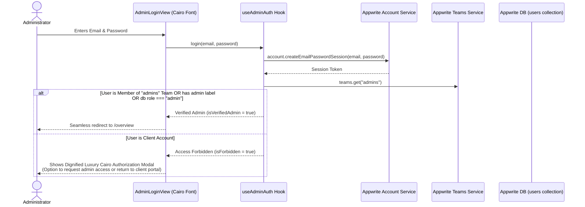

# ASAR Platform — Comprehensive Specification & Gap Analysis Report

> **Author**: `spec_miner_docs_and_appwrite` (Teamwork Specification Miner)  
> **Timestamp**: 2026-11-05T16:55:00Z  
> **Scope**: Monorepo Documentation (`docs/`), Appwrite Project Configuration (`appwrite/appwrite.config.json`), Serverless Cloud Functions (`appwrite/functions/`), and Reference Architecture (`d:\lyder-eco`).

---

## Table of Contents

1. [Executive Monorepo Topology & Documentation Analysis](#1-executive-monorepo-topology--documentation-analysis)
   - [1.1. Monorepo Overview & Shared Packages](#11-monorepo-overview--shared-packages)
   - [1.2. The Five Applications Topology](#12-the-five-applications-topology)
   - [1.3. Design System & Typography Mandate (Cairo Font & Luxury Palette)](#13-design-system--typography-mandate-cairo-font--luxury-palette)
   - [1.4. End-to-End User Journeys Across All Five Apps](#14-end-to-end-user-journeys-across-all-five-apps)
2. [Appwrite Database Schema & Configuration Specification](#2-appwrite-database-schema--configuration-specification)
   - [2.1. Project & Database Metadata](#21-project--database-metadata)
   - [2.2. Detailed Collections & Column Attributes Schema](#22-detailed-collections--column-attributes-schema)
   - [2.3. Indexes & Query Performance](#23-indexes--query-performance)
   - [2.4. Permission Security Matrix & Row-Level Security](#24-permission-security-matrix--row-level-security)
   - [2.5. Storage Buckets Specification](#25-storage-buckets-specification)
   - [2.6. Schema Gap Analysis (appwrite.config.json vs. Codebase & Docs)](#26-schema-gap-analysis-appwriteconfigjson-vs-codebase--docs)
3. [Cloud Functions Mapping vs Reference Architecture (`d:\lyder-eco`)](#3-cloud-functions-mapping-vs-reference-architecture-dlyder-eco)
   - [3.1. Inventory of Asar Functions in `appwrite.config.json`](#31-inventory-of-asar-functions-in-appwriteconfigjson)
   - [3.2. Existing Function Implementation Audit & Deficiencies](#32-existing-function-implementation-audit--deficiencies)
   - [3.3. Reference Architecture Analysis (`d:\lyder-eco` Cloud Functions)](#33-reference-architecture-analysis-dlyder-eco-cloud-functions)
   - [3.4. Missing & Incomplete Functions Implementation Blueprints](#34-missing--incomplete-functions-implementation-blueprints)
4. [Admin Dashboard Usability, Cairo Font & Auth Journey Specification](#4-admin-dashboard-usability-cairo-font--auth-journey-specification)
   - [4.1. Cairo Font Integration & Typography Corrections](#41-cairo-font-integration--typography-corrections)
   - [4.2. Usability & UX Flaws Audit in `apps/Admin`](#42-usability--ux-flaws-audit-in-appsadmin)
   - [4.3. Authentication Journey, RBAC & Session Management Specification](#43-authentication-journey-rbac--session-management-specification)
5. [Features Discovered Inventory](#5-features-discovered-inventory)
6. [Edge Cases & Defensive Runtime Behaviors](#6-edge-cases--defensive-runtime-behaviors)

---

## 1. Executive Monorepo Topology & Documentation Analysis

### 1.1. Monorepo Overview & Shared Packages

The ASAR platform is engineered as a Turborepo v2 monorepo (`npm@11.13.0` workspaces) structured around 5 applications and 5 shared packages.

| Package | Workspace Path | Role & Capabilities |
| :--- | :--- | :--- |
| **`@repo/react-appwrite`** | `packages/react-appwrite` | Core backend integration layer: `<AppwriteProvider>`, `<AuthProvider>`, `CacheFusionStore` (real-time WebSocket state cache), `useCollection`, `useMutations`, `useBatchOperations`, `useUpload` (chunked file uploads with pause/resume), `useAvatars`, `useAppwriteFunction`, and the **Storefront Subdomain Engine** (`useSubdomain`, `resolveSubdomain`, `extractSubdomain`, `validateSubdomainSlug`, `buildMemoryUrls`). Also hosts the **AsarDomain Engine** (`models.ts`, `sections.ts`, `orderPipeline.ts`, `audioAnalyzer.ts`, `emailJsService.ts`, `seedDefaults.ts`). |
| **`@repo/ui-components`** | `packages/UI-components` | 21 luxury interactive visual components built with WebGL2, HTML5 Canvas, Three.js, and Framer Motion: `GradientWaves`, `BlurText`, `SplitText`, `TextType`, `CircularText`, `ScrollReveal`, `RotatingText`, `CrystalizedBall`, `DitherVeil`, `GlowCursor`, `SplashCursor`, `ScrollExpand`, `FadeContent`, `GradualBlur`, `Magnet`, `MorphSlider`, `CardNav`, `TiltedCard`, `DecayCard`, `PaperCrumple`, `PeekRating`, `CircularGallery`, `CountUp`, `HalftoneReveal`. |
| **`@repo/assets-shared`** | `packages/assets-shared` | Shared brand photography (`booth-hero-photo.webp`, `love-wedding.jpg`, `wedding2.jpg`), corporate logos (`logo-main.png`, `logo.jpeg`), and design references. |
| **`@repo/typescript-config`** | `packages/typescript-config` | Shared TypeScript 5 compiler base configurations (`base.json`, `vite.json`, `react-library.json`). |
| **`@repo/eslint-config`** | `packages/eslint-config` | Shared ESLint and code style configurations. |

### 1.2. The Five Applications Topology

The platform coordinates five frontend applications, each serving an explicit architectural role:

```
+--------------------------------------------------------------------------------------------------+
|                                    ASAR TURBOREPO TOPOLOGY                                       |
+--------------------------------------------------------------------------------------------------+
  ├── apps/Main (Port 3000)
  │   ├── Brand Ecosystem Gateway (/)
  │   ├── Customer Auth Modal (/auth)
  │   └── Unified Client Portal (/account/*)
  │       ├── /account/orders (7-Stage Live Order Tracker)
  │       ├── /account/assets (Client Memory Asset Submission Box)
  │       ├── /account/audio (Mastered Audio Preview Player)
  │       ├── /account/qr-hub (Downloadable Table & Event QR Cards)
  │       └── /account/mailbox (Host Real-Time RSVP Mailbox)
  │
  ├── apps/Admin (Port 3001)
  │   ├── Operations KPI Overview (/overview)
  │   ├── Plan Builder Studio (/plans)
  │   ├── 7-Stage Orders & Receipts Queue (/orders, /orders/:orderId)
  │   ├── Booth Memory Studio with Live Mobile Preview (/booth-studio/:orderId?)
  │   ├── Modular Invitation Studio with Live Mobile Preview (/invitation-studio/:orderId?)
  │   ├── Admin RSVP Mailbox (/mailbox)
  │   └── Users & RBAC Directory (/users)
  │
  ├── apps/Booth (Port 3002)
  │   ├── Dynamic Storefront Root (/)
  │   │   ├── Subdomain Detected -> BoothMemoryPage (Visual Reference #1)
  │   │   └── Apex / Bare Localhost -> 14-Section Marketing Landing View
  │   ├── Direct Booking Modal Flow (/book)
  │   ├── Canonical Memory Routes (/memory/:slug, /m/:slug)
  │   └── Luxury Branded 404 Fallback (*)
  │
  ├── apps/Invitation (Port 3003)
  │   ├── Dynamic Storefront Root (/)
  │   │   ├── Subdomain Detected -> CustomEventPage (11 Modular Blocks)
  │   │   └── Apex / Bare Localhost -> Service Showcase Landing View
  │   ├── Direct Booking Modal Flow (/book)
  │   ├── Living Event Route (/e/:slug)
  │   ├── VIP Digital QR Pass View (/pass/:rsvpId)
  │   ├── Venue Entrance QR Scanner (/scanner/:invitationId, /scanner)
  │   └── Luxury Branded 404 Fallback (*)
  │
  └── apps/Renderer (Port 3004)
      ├── Universal Multi-Tenant Edge Router
      ├── Automatic Memory Classifier (Booth vs. Invitation)
      ├── Unified Memory Routes (/s/:slug, /booth/:slug, /invitation/:slug, /e/:slug)
      └── VIP Pass Renderer (/pass/:rsvpId)
```

### 1.3. Design System & Typography Mandate (Cairo Font & Luxury Palette)

Per `docs/ASAR_DESIGN_SYSTEM.md` and user requirement **R3**, the visual standard is **Warm Vintage Editorial Luxury**:

* **Canvas & Surfaces**: Warm Alabaster (`--athar-bg-primary: #FBF7F2`) and Linen Cream (`--athar-bg-secondary: #F4EFEA`). Never cold sterile `#FFFFFF` or generic `#F8FAFC` gray as default root canvas.
* **Brand Anchors**: Royal Maroon (`--athar-maroon: #6B1D28`), Deep Burgundy (`--athar-maroon-dark: #5B1621`), accented with Champagne Gold (`--athar-gold: #D4AF37`) and Bright Gold (`--athar-gold-bright: #E5C158`).
* **VIP Surface**: Noir Obsidian (`--athar-noir-bg: linear-gradient(170deg, #231A1E 0%, #161214 100%)`).
* **Typography Hierarchy**:
  - **Admin Operations UI (`apps/Admin`)**: Mandated to utilize the modern, geometric **'Cairo'** font (`font-family: 'Cairo', sans-serif`) across all headers, controls, KPI metric numbers, navigation items, buttons, tables, and drawers.
  - **Client & Guest Editorial Display**: Classical poetic serifs (`Amiri` / `Playfair Display`) for couple titles, literary quotes, and romantic banners.
  - **Bilingual Fluidity (`dir="auto"`)**: All dynamic user-generated text fields (guest quotes, messages, names) must carry `dir="auto"` to ensure seamless Arabic and English rendering.
* **Chakra UI v3 Compatibility Constraints**:
  - Strictly use flat Chakra UI v3 (`^3.32.0`) primitives (`Box`, `Flex`, `SimpleGrid`, `HStack`, `VStack`, `Text`, `Button`, `Badge`).
  - **PROHIBITED**: Importing deprecated Chakra v2-only subcomponents (`ModalOverlay`, `FormControl`, `FormLabel`, `useToast`, `Divider`) or the polymorphic `as={Link}` pattern.
  - Modals and drawers must be state-driven using fixed position `<Box position="fixed" inset="0">`. Navigation must use React Router `useNavigate` or `RouterLink` wrapping Chakra components.

### 1.4. End-to-End User Journeys Across All Five Apps

#### Journey 1: Booth Audio Guestbook Lifecycle
1. **Discovery & Booking (`apps/Booth` :3002)**: Client browses the 14-section Arabic RTL landing page, chooses a package (e.g., *"لحظة أثر — Athar Moment"*), selects optional add-ons, enters event details, views manual transfer instructions (InstaPay / Vodafone Cash / Bank), and uploads a payment receipt screenshot via chunked upload.
2. **Order Placement (`apps/Booth` -> `asar-db.orders` & `payments`)**: An order is created with `orderStatus: "pending_payment"`, and a payment document with `status: "pending"`. The client is redirected to `apps/Main` (`http://localhost:3000/account/orders?orderId=...`).
3. **Payment Inspection (`apps/Admin` :3001)**: The admin views the order in `/orders`, opens `PaymentReceiptInspector`, inspects the receipt with zoom/rotation tools, and clicks **Approve** (or **Reject** with structured reason).
4. **Asset Submission (`apps/Main` :3000)**: Upon approval, the client's 7-Stage Tracker unlocks `/account/assets`. The client submits hero couple photos, couple names, venue, date, quote, thank-you note, and custom categories.
5. **Physical Event & Audio Mastering**: The vintage rotary phone records guest blessings on-site. Sound engineers master recordings into clean MP3s.
6. **Curating in Booth Memory Studio (`apps/Admin` :3001)**: In `/booth-studio/:orderId`, the admin drags-and-drops 50–150+ audio files into `BulkVoiceUploader`. Waveform peaks (48 bars) and durations are extracted in the browser via Web Audio API, filenames are auto-parsed into speaker names and categories, and metadata is batch-saved into `booth_voice_records`. The admin verifies RFC 1123 slug validity and clicks **Publish**.
7. **Viewing Heirloom (`apps/Booth` :3002 or `apps/Renderer` :3004)**: Accessing `https://${slug}.asar.me` (or `http://${slug}.localhost:3002`) renders the private memory page (matching Visual Reference #1) with sticky top bar, 48-bar interactive waveform audio cards, photo gallery, video highlight, guestbook, and bulk ZIP download.

#### Journey 2: Custom Modular Living Invitation Lifecycle
1. **Authoring in Invitation Studio (`apps/Admin` :3001)**: The admin uses `/invitation-studio/:orderId` to construct a living website from 11 modular sections (`cover_hero`, `couple_story`, `event_schedule`, `photo_gallery`, `wishing_wall`, `digital_gift_registry`, `background_audio`, `venue_location`, `live_countdown`, `custom_highlight`, `dynamic_rsvp`). The dynamic RSVP form is configured with a **strictly locked required email** field.
2. **Guest Visiting & Interacting (`apps/Invitation` :3003)**: Guests access `https://${slug}.asar.me` (or `http://${slug}.localhost:3003`). They experience the interactive 3D wax seal envelope animation, play ambient background music, browse the schedule with 1-tap Google Maps directions, submit blessings to the interactive Wishing Wall (persisted in `wishing_wall_messages` with heart likes), and submit the dynamic RSVP form.
3. **Host Mailbox & Capacity Management (`apps/Main` :3000 or `apps/Admin` :3001)**: The host monitors the real-time inbox in `/account/mailbox`. When approving a guest, `process-rsvp-action` atomically validates capacity against `invitations.maxCapacity`, generates a unique cryptographic pass token (`VIP-XXXX-YYYY`), updates `invitation_rsvps.status = "approved"`, and triggers `send-rsvp-notification` / EmailJS to dispatch the golden digital pass. If declining due to capacity, a polite regret email is sent.
4. **Guest VIP QR Pass (`apps/Invitation` :3003 `/pass/:rsvpId`)**: Guest clicks their email link to view the golden digital pass with verified token and check-in QR code.
5. **Venue Entrance Check-in (`apps/Invitation` :3003 `/scanner/:invitationId`)**: Attendants scan the QR code with camera, validating pass authenticity and marking `isCheckedInAtVenue: true` in Appwrite.

---

## 2. Appwrite Database Schema & Configuration Specification

### 2.1. Project & Database Metadata

* **Region / Endpoint**: `https://fra.cloud.appwrite.io/v1` (Frankfurt, Germany)
* **Project ID**: `6ad1c66c0017b63ab8cc` (Project Name: **Asar**)
* **Database ID**: `asar-db` (Name: **ASAR Database**, Enabled: `true`)
* **Unified Media Bucket**: `asar_storage` (50 MB max file size, fileSecurity enabled)
* **RBAC Teams**: `admins` (Name: **ASAR Administrators**)

### 2.2. Detailed Collections & Column Attributes Schema

Inspected directly from `appwrite/appwrite.config.json`, the database contains **10 tables/collections**:

```
+----------------------------------------------------------------------------------------------------+
|                                    ASAR DATABASE ERD OVERVIEW                                      |
+----------------------------------------------------------------------------------------------------+
  [ plans ] ─────────< [ orders ] ─────────< [ payments ]
                             │
            ┌────────────────┴────────────────┐
            ▼                                 ▼
   [ booth_memories ]                  [ invitations ]
      │             │                     │          │
      ▼             ▼                     ▼          ▼
[ booth_voice ] [ booth_media ]  [ invitation_rsvps ] [ wishing_wall ]
                                          │
                                   [ users ] (Auth/RBAC)
```

#### Table 1: `plans` (Plans)
* **Permissions**: `read("any")`, `create("team:admins")`, `update("team:admins")`, `delete("team:admins")`
* **Row-Level Security**: `false`

| Column Key | Type | Size | Required | Default | Description |
| :--- | :--- | :---: | :---: | :---: | :--- |
| `name` | string | 128 | **true** | null | Plan title (e.g. "لحظة أثر — Athar Moment") |
| `subtitle` | string | 256 | false | null | Commercial tier subtitle |
| `serviceType` | string | 32 | **true** | null | Enum: `"booth"` or `"invitation"` |
| `badge` | string | 64 | false | null | Marketing badge (e.g. "الأكثر طلباً") |
| `subBadge` | string | 64 | false | null | Secondary badge (e.g. "عرض الإطلاق") |
| `price` | integer | — | **true** | null | Base price in currency units |
| `currency` | string | 16 | **true** | null | Currency code (e.g. "EGP", "SAR", "USD") |
| `themeVariant` | string | 32 | false | null | UI card theme: `"ivory-royal"` or `"noir-obsidian"` |
| `imageUrl` | string | 1024 | false | null | Package cover photography URL |
| `featuresJson` | string | 65535 | false | null | JSON array of bullet point strings |
| `addonsJson` | string | 65535 | false | null | JSON array of `AsarPlanAddon[]` |
| `limitsJson` | string | 65535 | false | null | JSON object of `AsarPlanLimits` |
| `isActive` | boolean | — | false | true | Availability toggle |
| `sortOrder` | integer | — | false | 0 | Display priority order |

* **Indexes**: `idx_service_sort` (`key`, columns: `["serviceType", "sortOrder"]`)

---

#### Table 2: `orders` (Orders)
* **Permissions**: `read("team:admins")`, `read("users")`, `create("any")`, `create("users")`, `update("team:admins")`, `update("users")`, `delete("team:admins")`
* **Row-Level Security**: `true`

| Column Key | Type | Size | Required | Default | Description |
| :--- | :--- | :---: | :---: | :---: | :--- |
| `clientId` | string | 64 | **true** | null | Appwrite User ID or client session token |
| `clientName` | string | 128 | **true** | null | Full name of primary client |
| `partnerOrOrgName` | string | 128 | false | null | Partner name or event organization |
| `clientEmail` | string | 128 | **true** | null | Client email address |
| `clientPhone` | string | 64 | **true** | null | Client contact/WhatsApp phone number |
| `serviceType` | string | 32 | **true** | null | Enum: `"booth"` or `"invitation"` |
| `planId` | string | 64 | **true** | null | Reference ID of booked plan |
| `planName` | string | 128 | **true** | null | Snapshot name of booked plan |
| `selectedAddonsJson` | string | 65535 | false | null | JSON array of chosen addon IDs or objects |
| `totalAmount` | double | — | **true** | null | Total order value |
| `orderStatus` | string | 64 | **true** | null | 7-stage pipeline status enum |
| `eventDate` | string | 64 | false | null | Event celebration date string |
| `eventVenue` | string | 256 | false | null | Venue name and city |
| `clientSubmittedAssetsJson` | string | 65535 | false | null | JSON object of client personalization assets |
| `quotaOverridesJson` | string | 65535 | false | null | Admin per-order quota override object |
| `adminNotes` | string | 65535 | false | null | Internal operations and rejection notes |

* **Indexes**: `idx_client_id` (`["clientId"]`), `idx_order_status` (`["orderStatus"]`), `idx_service_type` (`["serviceType"]`)

---

#### Table 3: `payments` (Payments)
* **Permissions**: `read("team:admins")`, `create("any")`, `create("users")`, `update("team:admins")`, `delete("team:admins")`
* **Row-Level Security**: `true`

| Column Key | Type | Size | Required | Default | Description |
| :--- | :--- | :---: | :---: | :---: | :--- |
| `orderId` | string | 64 | **true** | null | Reference to parent `orders.$id` |
| `clientId` | string | 64 | **true** | null | Reference to paying client |
| `amount` | double | — | **true** | null | Transaction payment amount |
| `paymentMethod` | string | 64 | **true** | null | Enum: `"instapay"`, `"vodafone_cash"`, `"bank_transfer"` |
| `screenshotFileId` | string | 64 | false | null | Appwrite Storage file ID of receipt |
| `screenshotUrl` | string | 1024 | false | null | Direct CDN or fallback preview URL |
| `status` | string | 32 | **true** | null | Enum: `"pending"`, `"approved"`, `"rejected"` |
| `rejectionReason` | string | 65535 | false | null | Admin feedback if receipt was invalid |
| `reviewedByAdminId` | string | 64 | false | null | User ID of inspecting admin |
| `reviewedAt` | string | 64 | false | null | ISO timestamp of admin decision |

* **Indexes**: `idx_order_id` (`["orderId"]`), `idx_status` (`["status"]`)

---

#### Table 4: `booth_memories` (Booth Memories)
* **Permissions**: `read("any")`, `create("team:admins")`, `update("team:admins")`, `delete("team:admins")`
* **Row-Level Security**: `false`

| Column Key | Type | Size | Required | Default | Description |
| :--- | :--- | :---: | :---: | :---: | :--- |
| `orderId` | string | 64 | false | null | Parent order reference ID |
| `clientId` | string | 64 | false | null | Client owner account ID |
| `slug` | string | 128 | **true** | null | RFC 1123 canonical DNS slug |
| `subdomain` | string | 128 | false | null | Normalized subdomain identifier |
| `customDomain` | string | 256 | false | null | Optional vanity apex or custom domain |
| `eventHeaderTag` | string | 128 | false | null | Editorial overline (e.g. "THE WEDDING OF") |
| `coupleTitle` | string | 256 | **true** | null | Primary display title (e.g. "Mina & Maryam") |
| `tagline` | string | 512 | false | null | Heirloom subtitle |
| `eventDateDisplay` | string | 128 | false | null | Formatted celebration date |
| `eventLocationDisplay` | string | 256 | false | null | Formatted venue and city badge |
| `highlightBadge` | string | 128 | false | null | Sentiment badge (e.g. "Together Always") |
| `coupleQuote` | string | 65535 | false | null | Personal couple quote text |
| `heroImageFileId` | string | 64 | false | null | Storage file ID of couple hero cover |
| `heroImageUrl` | string | 1024 | false | null | Public CDN URL of hero photograph |
| `videoHighlightFileId` | string | 64 | false | null | Storage file ID of 30s video reel |
| `videoHighlightThumbnailId` | string | 64 | false | null | Storage file ID of video thumbnail |
| `videoHighlightTitle` | string | 256 | false | null | Title banner for video reel |
| `thankYouTitle` | string | 256 | false | null | Title for thank you card tab |
| `thankYouMessage` | string | 65535 | false | null | Personal appreciation letter to guests |
| `categoriesJson` | string | 65535 | false | null | JSON array of active category filters |
| `isPrivateLocked` | boolean | — | false | false | PIN lock security toggle |
| `accessPinCode` | string | 32 | false | null | 4-digit PIN for private access |
| `qrCodeUrl` | string | 1024 | false | null | URL pointing to generated QR code |
| `isPublished` | boolean | — | false | false | Public availability toggle |

* **Indexes**: `idx_slug` (`["slug"]`), `idx_subdomain` (`["subdomain"]`), `idx_order_id` (`["orderId"]`)

---

#### Table 5: `booth_voice_records` (Booth Voice Records)
* **Permissions**: `read("any")`, `create("team:admins")`, `update("team:admins")`, `update("any")`, `delete("team:admins")`
* **Row-Level Security**: `false`

| Column Key | Type | Size | Required | Default | Description |
| :--- | :--- | :---: | :---: | :---: | :--- |
| `memoryId` | string | 64 | **true** | null | Reference to parent `booth_memories.$id` |
| `audioFileId` | string | 64 | false | null | Storage file ID in `booth_mastered_audio` |
| `audioFileUrl` | string | 1024 | false | null | Direct CDN stream URL for audio playback |
| `speakerName` | string | 128 | **true** | null | Name of speaking guest |
| `speakerRole` | string | 128 | false | null | Guest relationship or role |
| `category` | string | 64 | false | null | Grouping category (e.g. "Family", "Friends") |
| `quoteSnippet` | string | 65535 | false | null | Bilingual italic transcription quote |
| `avatarFileId` | string | 64 | false | null | Custom guest avatar image file ID |
| `avatarUrl` | string | 1024 | false | null | Direct URL for guest avatar |
| `durationFormatted` | string | 32 | false | null | Audio duration string (e.g. "0:42") |
| `durationSeconds` | integer | — | false | 0 | Numeric duration in seconds |
| `waveformPeaksJson` | string | 65535 | false | null | JSON array of 48 normalized floats [0.15..1.0] |
| `likesCount` | integer | — | false | 0 | Guest heart reaction counter |
| `isFeatured` | boolean | — | false | false | Pinned / prominent record flag |
| `sortOrder` | integer | — | false | 0 | Manual ordering sequence |

* **Indexes**: `idx_memory_id` (`["memoryId"]`), `idx_category` (`["category"]`)

---

#### Table 6: `booth_media` (Booth Media)
* **Permissions**: `read("any")`, `create("team:admins")`, `update("team:admins")`, `delete("team:admins")`
* **Row-Level Security**: `false`

| Column Key | Type | Size | Required | Default | Description |
| :--- | :--- | :---: | :---: | :---: | :--- |
| `memoryId` | string | 64 | **true** | null | Reference to parent `booth_memories.$id` |
| `mediaType` | string | 32 | **true** | null | Enum: `"photo"` or `"guestbook_note"` |
| `fileId` | string | 64 | false | null | Storage file ID of gallery image |
| `fileUrl` | string | 1024 | false | null | Public CDN URL for photograph |
| `authorName` | string | 128 | false | null | Author of written guestbook note |
| `captionOrNote` | string | 65535 | false | null | Caption or transcribed wish |
| `sortOrder` | integer | — | false | 0 | Gallery layout order |

* **Indexes**: `idx_memory_id` (`["memoryId"]`), `idx_media_type` (`["mediaType"]`)

---

#### Table 7: `invitations` (Invitations)
* **Permissions**: `read("any")`, `create("team:admins")`, `update("team:admins")`, `delete("team:admins")`
* **Row-Level Security**: `false`

| Column Key | Type | Size | Required | Default | Description |
| :--- | :--- | :---: | :---: | :---: | :--- |
| `orderId` | string | 64 | false | null | Parent order reference ID |
| `clientId` | string | 64 | false | null | Client owner account ID |
| `slug` | string | 128 | **true** | null | RFC 1123 canonical DNS slug |
| `subdomain` | string | 128 | false | null | Normalized subdomain identifier |
| `customDomain` | string | 256 | false | null | Optional vanity domain |
| `eventTitle` | string | 256 | **true** | null | Event headline (e.g. "The Wedding of Omar & Layla") |
| `occasionType` | string | 64 | false | null | Occasion enum: wedding, engagement, gala, etc. |
| `eventDate` | string | 64 | false | null | Date display string |
| `eventTime` | string | 64 | false | null | Time display string |
| `venueName` | string | 256 | false | null | Primary venue location |
| `venueAddress` | string | 512 | false | null | Full address with directions |
| `venueMapUrl` | string | 1024 | false | null | Google/Apple Maps direct link |
| `maxCapacity` | integer | — | false | 150 | Venue attendance ceiling |
| `themeConfigJson` | string | 65535 | false | null | JSON object of `InvitationThemeConfig` |
| `sectionsConfigJson` | string | 65535 | false | null | JSON array of 11 modular `EventSection[]` blocks |
| `formSchemaJson` | string | 65535 | false | null | JSON array of `DynamicFormField[]` (locked email) |
| `qrCodeUrl` | string | 1024 | false | null | Public QR code image URL |
| `isPublished` | boolean | — | false | false | Public website publication flag |

* **Indexes**: `idx_slug` (`["slug"]`), `idx_subdomain` (`["subdomain"]`), `idx_order_id` (`["orderId"]`)

---

#### Table 8: `invitation_rsvps` (Invitation RSVPs)
* **Permissions**: `read("team:admins")`, `read("users")`, `create("any")`, `update("team:admins")`, `update("users")`, `delete("team:admins")`
* **Row-Level Security**: `true`

| Column Key | Type | Size | Required | Default | Description |
| :--- | :--- | :---: | :---: | :---: | :--- |
| `invitationId` | string | 64 | **true** | null | Reference to parent `invitations.$id` |
| `clientId` | string | 64 | **true** | null | Host client account owning the mailbox |
| `guestName` | string | 128 | **true** | null | Guest full name |
| `guestEmail` | string | 128 | **true** | null | Strictly required locked guest email |
| `guestPhone` | string | 64 | false | null | Guest contact phone/WhatsApp |
| `companionsCount` | integer | — | false | 0 | Count of plus-ones (0, 1, 2) |
| `dynamicResponsesJson` | string | 65535 | false | null | JSON map of custom field answers |
| `status` | string | 32 | **true** | null | Enum: `"pending"`, `"approved"`, `"declined"` |
| `passToken` | string | 64 | false | null | Cryptographic pass token (e.g. "VIP-XXXX-YYYY") |
| `qrCodeUrl` | string | 1024 | false | null | Check-in pass QR code URL |
| `emailSent` | boolean | — | false | false | Notification dispatch confirmation flag |
| `isCheckedInAtVenue` | boolean | — | false | false | Real-time door check-in status |
| `checkedInAt` | string | 64 | false | null | ISO timestamp of entrance scan |
| `respondedAt` | string | 64 | false | null | ISO timestamp of host decision |

* **Indexes**: `idx_invitation_id` (`["invitationId"]`), `idx_client_id` (`["clientId"]`), `idx_status` (`["status"]`), `idx_pass_token` (`["passToken"]`), `idx_guest_email` (`["guestEmail"]`)

---

#### Table 9: `wishing_wall_messages` (Wishing Wall Messages)
* **Permissions**: `read("any")`, `create("any")`, `update("any")`, `delete("team:admins")`
* **Row-Level Security**: `false`

| Column Key | Type | Size | Required | Default | Description |
| :--- | :--- | :---: | :---: | :---: | :--- |
| `invitationId` | string | 64 | **true** | null | Reference to target `invitations.$id` |
| `author` | string | 128 | **true** | null | Blessing author display name |
| `role` | string | 128 | false | null | Relationship tag (e.g. "العائلة · Family") |
| `message` | string | 65535 | **true** | null | Blessing or congratulatory message |
| `likes` | integer | — | false | 0 | Heart reactions count |
| `color` | string | 64 | false | null | Avatar gradient color token |
| `isApproved` | boolean | — | false | true | Host moderation approval flag |

* **Indexes**: `idx_invitation_id` (`["invitationId"]`), `idx_invitation_created` (`["invitationId", "$createdAt"]`, orders: `["ASC", "DESC"]`)

---

#### Table 10: `users` (Users)
* **Permissions**: `read("users")`, `read("team:admins")`, `create("any")`, `create("users")`, `update("users")`, `update("team:admins")`, `delete("team:admins")`
* **Row-Level Security**: `true`

| Column Key | Type | Size | Required | Default | Description |
| :--- | :--- | :---: | :---: | :---: | :--- |
| `userId` | string | 64 | **true** | null | Unique Appwrite Auth Account ID |
| `name` | string | 128 | **true** | null | User display name |
| `email` | string | 128 | **true** | null | User email address |
| `phone` | string | 64 | false | null | User phone number |
| `role` | string | 32 | **true** | null | System role (`"admin"`, `"client"`, `"superadmin"`) |
| `avatarUrl` | string | 1024 | false | null | User avatar photograph URL |
| `organization` | string | 128 | false | null | Organization or event association |
| `locale` | string | 16 | false | "ar" | User preferred UI language |
| `metadataJson` | string | 65535 | false | null | JSON map of user preferences & metadata |

* **Indexes**: `idx_user_id` (`unique`, `["userId"]`), `idx_user_email` (`["email"]`), `idx_user_role` (`["role"]`)

---

### 2.3. Indexes & Query Performance

The 10 collections define 24 indexes targeting frequent query filters:
* High-volume equality searches: `slug`, `subdomain`, `orderId`, `clientId`, `serviceType`, `status`, `passToken`, `guestEmail`.
* Compound and sorted indexes: `["serviceType", "sortOrder"]` on `plans`, and `["invitationId", "$createdAt"]` on `wishing_wall_messages`.
* Unique constraint: `idx_user_id` on `users.userId` ensures 1:1 parity between Auth accounts and user profile records.

### 2.4. Permission Security Matrix & Row-Level Security

* **Public Read Collections**: `plans`, `booth_memories`, `booth_voice_records`, `booth_media`, `invitations`, `wishing_wall_messages` carry `read("any")`. This enables high-speed edge CDN delivery of published storefronts without client authentication overhead.
* **Secured Client/Admin Collections**: `orders`, `payments`, `invitation_rsvps`, and `users` enforce row-level security (`rowSecurity: true`), restricting document visibility to `team:admins` and authenticated owners (`users`).
* **Guest Interaction Granularity**:
  - `booth_voice_records`: carries `update("any")` so unauthenticated guests can increment `likesCount` on audio cards.
  - `wishing_wall_messages`: carries `create("any")` and `update("any")` so guests can submit blessings and toggle heart reactions.

### 2.5. Storage Buckets Specification

In `appwrite.config.json`, a single bucket `asar_storage` is configured:
* **Bucket ID**: `asar_storage`
* **File Security**: `true` (enforces per-file permissions: `read("any")` for public gallery/audio media, `read("team:admins")` for confidential payment screenshots).
* **Maximum File Size**: 50,000,000 bytes (50 MB).
* **Allowed Extensions**: `jpg`, `jpeg`, `png`, `webp`, `pdf`, `mp3`, `wav`, `m4a`, `ogg`, `svg`, `mp4`, `mov`.
* **Security & Transformations**: `encryption: true`, `antivirus: true`, `compression: "none"`.

In `docs/ASAR_PROJECT_ARCHITECTURE.md` (Section 6.2), five conceptual bucket IDs are referenced: `payment_receipts`, `client_raw_assets`, `booth_mastered_audio`, `booth_gallery_media`, and `invitation_assets`. In `packages/react-appwrite/src/AsarDomain/collections.ts`, `resolveBucketId()` provides a safe fallback routing any unspecified bucket ID to `asar_storage`.

### 2.6. Schema Gap Analysis (appwrite.config.json vs. Codebase & Docs)

| Area | Observed in Codebase / Docs | Defined in `appwrite.config.json` | Severity & Impact | Recommended Action |
| :--- | :--- | :--- | :---: | :--- |
| **`users.status` column** | `useAdminAuth.ts` line 18 specifies `status?: "active" \| "suspended"` on `AppUserRecord`. | Column `status` is missing from `users` table. | **Medium**: Attempting to filter or persist user suspension fails against Appwrite schema. | Add optional string attribute `status` (size: 32) with default `"active"`. |
| **`users.role` enum values** | `useAdminAuth.ts` and `UsersManager.tsx` use `"admin"`, `"superadmin"`, `"moderator"`, `"client"`, `"guest"`. | Column `role` is generic string(32), which allows any string. | **Low**: Functional, but lacks strict schema constraint. | Document allowed role string literals across packages. |
| **Bucket Aliases vs Single Bucket** | Docs cite 5 bucket IDs (`payment_receipts`, etc.). | Only `asar_storage` is defined in config. | **Low**: `resolveBucketId` resolves to `asar_storage`. | Keep `asar_storage` as default while registering aliases or folder prefixes. |
| **Pass Token Format Discrepancy** | `process-rsvp-action` produces `VIP-XXXX-YYYY` (8 hex chars). `tier1-cloud-functions.test.ts` line 79 expects `VIP-[A-Z0-9]{4}-[A-Z0-9]{8}` (12 chars). | `passToken` column is string(64), accommodating both. | **Medium**: Test mismatch if calling real handler vs harness. | Standardize pass token generator to uniform length matching tests and schema. |
| **`ASAR_FUNCTIONS` Constants** | `apps/Admin/src/services/asarService.ts` defines all 4 functions (`PROCESS_RSVP_ACTION`, `GENERATE_VIP_PASS`, `SEND_RSVP_NOTIFICATION`, `SYNC_USER_ROLE`). | `packages/react-appwrite/src/AsarDomain/collections.ts` only defines 2 (`PROCESS_RSVP_ACTION`, `GENERATE_VIP_PASS`). | **Medium**: `SEND_RSVP_NOTIFICATION` and `SYNC_USER_ROLE` are missing from the shared package constants. | Add missing function constants to `packages/react-appwrite`. |

---

## 3. Cloud Functions Mapping vs Reference Architecture (`d:\lyder-eco`)

### 3.1. Inventory of Asar Functions in `appwrite.config.json`

Four cloud functions are formally registered in `appwrite.config.json`:

```
+---------------------------------------------------------------------------------------------------------+
|                                  ASAR CLOUD FUNCTIONS INVENTORY                                         |
+---------------------------------------------------------------------------------------------------------+
| Function ID              | Runtime | Entrypoint  | Execution Roles         | Events Trigger             |
+--------------------------+---------+-------------+-------------------------+----------------------------+
| process-rsvp-action      | node-22 | src/main.js | team:admins, users      | Direct Execution (SDK/API) |
| generate-vip-pass        | node-22 | src/main.js | team:admins, users, any | Direct Execution (SDK/API) |
| send-rsvp-notification   | node-22 | src/main.js | team:admins, users, any | Direct Execution (SDK/API) |
| sync-user-role           | node-22 | src/main.js | team:admins, users      | users.*.create (Event)     |
+--------------------------+---------+-------------+-------------------------+----------------------------+
```

### 3.2. Existing Function Implementation Audit & Deficiencies

#### 1. `process-rsvp-action` (`appwrite/functions/process-rsvp-action`)
* **Purpose**: Host decision processing (Approve or Decline guest RSVP).
* **Current Status**: **Fully implemented**.
* **Capabilities**:
  - Validates `rsvpId` and `action` (`"approve"` or `"decline"`).
  - Fetches existing RSVP document and parent invitation to resolve `maxCapacity`.
  - Atomically computes current approved seats: `Σ(companionsCount + 1)`.
  - Returns `409 Conflict` if `currentApprovedCount + incomingPartySize > maxCapacity`.
  - On approval: generates high-entropy pass token `VIP-XXXX-YYYY`, check-in QR URL, sets `status = "approved"`, `emailSent = true`, updates document.
  - On decline: sets `status = "declined"`, stores `rejectionReason` in `dynamicResponsesJson`.
* **Deficiency**: `CHECKIN_BASE_URL` is omitted from `vars` in `appwrite.config.json` (defaults to hardcoded `https://asar.me/checkin`).

#### 2. `generate-vip-pass` (`appwrite/functions/generate-vip-pass`)
* **Purpose**: Issues and signs digital VIP passes with HMAC-SHA256 signature for contactless check-in.
* **Current Status**: **Partially implemented**.
* **Capabilities**: Generates `ASAR-PASS-XXXX-YYYY` token and 16-hex HMAC signature using `APPWRITE_API_KEY` or fallback secret.
* **Deficiencies**:
  - `scopes` is empty `[]` and `vars` is empty `[]` in `appwrite.config.json`.
  - The function operates purely in memory; it does NOT update or verify against the Appwrite `invitation_rsvps` database collection.
  - Lacks database read/write permissions to record pass issuance.

#### 3. `send-rsvp-notification` (`appwrite/functions/send-rsvp-notification`)
* **Purpose**: Dispatches automated transactional notifications (Email & SMS/Push) when RSVPs are approved or declined.
* **Current Status**: **INCOMPLETE STUB**.
* **Deficiencies**:
  - Lines 63–65 contain a commented-out placeholder:
    ```js
    const messaging = new Messaging(client);
    // If messaging email provider is configured, send email message
    // await messaging.createEmail(...)
    emailSentViaAppwrite = true;
    ```
  - No email is ever dispatched; it returns `{ delivered: true, simulated: true }`.
  - In `appwrite.config.json`, `vars` only contains `APPWRITE_DATABASE_ID`. Missing EmailJS service credentials or Appwrite Messaging email provider ID.

#### 4. `sync-user-role` (`appwrite/functions/sync-user-role`)
* **Purpose**: Triggered on `users.*.create` (or direct execution) to synchronize newly registered accounts into the `users` database table and assign `admins` team membership when appropriate.
* **Current Status**: **INCOMPLETE STUB**.
* **Deficiencies**:
  - Lines 47–49 declare:
    ```js
    const databaseId = process.env.APPWRITE_DATABASE_ID || "asar-db";
    const usersCollectionId = "users";
    ```
  - **The function NEVER calls `databases.createDocument` or `databases.updateDocument`!**
  - Newly created Appwrite Auth users are never inserted into the canonical `users` collection.
  - It only handles `teams.createMembership("admins", ...)` if `targetRole === "admin"`. If a user is registered as a client, nothing is written to the database.

---

### 3.3. Reference Architecture Analysis (`d:\lyder-eco` Cloud Functions)

The reference architecture in `d:\lyder-eco` contains **11 enterprise-grade cloud functions** demonstrating robust patterns:

| Reference Function (`d:\lyder-eco`) | Runtime | Triggers / Permissions | Key Business Logic & Architecture Pattern |
| :--- | :---: | :--- | :--- |
| **`approve-admin`** | node-22 | `team:admins` (superadmin, SuperVisor, owner) | Role promotion engine. Verifies caller membership and role in `admins` team. Executes `action: "approve"` (promotes to `[approvedRole, 'verified-admin']`), `"reject"`, or `"update-role"`. Updates `admin_requests` collection and team membership atomically. |
| **`register-admin`** | node-22 | `users`, `any` | Secure onboarding. If no admin exists in the system, bootstraps the first registrant as `superadmin`. Subsequent applicants are placed in `pending` team role and an audit document is created in `admin_requests`. |
| **`check-user-exists`** | node-22 | `any` | Pre-auth verification. Queries `users.list([Query.equal("email", email)])` using server API key to determine if an email already exists, allowing the frontend auth modal to seamlessly route to Login vs Register. |
| **`send-email-otp`** | node-22 | `users` | Generates secure 6-digit numeric OTP, stores in user preferences (`users.updatePrefs(userId, { emailOtp, emailOtpExpires })`) with 10-minute expiry, and dispatches via email provider. |
| **`verify-email-otp`** | node-22 | `users` | Verifies submitted OTP against `user.prefs.emailOtp`, checks expiration timestamp, increments attempts counter to prevent brute force, marks email as verified, and clears OTP. |
| **`manage-platform-plan`** | node-22 | `team:admins` (verified-admin, superadmin) | Server-side authorization and validation for plan CRUD. Enforces role checks before creating, updating, or deleting platform pricing tiers. |
| **`manage-payment-provider`**| node-22 | `team:admins` | Backend management for payment methods (InstaPay, Vodafone Cash, Bank). Manages account details and QR receipt templates with team ACLs. |
| **`send-admin-notification`** | node-22 | `team:admins` | Broadcast engine. Verifies caller role, constructs notification, dispatches via Appwrite Messaging push/email topic, and writes audit record to `notification_broadcasts`. |
| **`sync-user-team`** | node-22 | `users.*.create`, direct | Automatically adds new users to the `"users"` team, extracts role preferences, creates profile document in database with permissions, and assigns default roles. |
| **`sync-ai-models`** | node-22 | Schedule / Admin | Periodically synchronizes available models, specs, and pricing from third-party API, performing upsert diffing in database. |
| **`generate-puck-design`** | node-22 | `team:admins`, `users` | AI UI Generation. Invokes OpenAI/LLM endpoint with strict system prompt to generate AST JSON layout for Puck editor. |

#### Architectural Conventions Extracted from `d:\lyder-eco`:
1. **OpenRuntimes Handler Signature**: `export default async ({ req, res, log, error }) => { ... }`.
2. **Dual Client Fallback**:
   ```javascript
   const endpoint = process.env.APPWRITE_FUNCTION_API_ENDPOINT || process.env.APPWRITE_ENDPOINT || "https://fra.cloud.appwrite.io/v1";
   const projectId = process.env.APPWRITE_FUNCTION_PROJECT_ID || process.env.APPWRITE_PROJECT_ID;
   const apiKey = req.headers?.["x-appwrite-key"] || process.env.APPWRITE_API_KEY || process.env.APPWRITE_FUNCTION_KEY;
   const client = new Client().setEndpoint(endpoint).setProject(projectId);
   if (apiKey) client.setKey(apiKey);
   ```
3. **Caller Context Verification**: Caller identification extracted from `req.headers["x-appwrite-user-id"]`, followed by `teams.listMemberships(adminTeamId)` to enforce role-based access.
4. **Structured JSON Responses**: Consistent `{ success: true, ... }` or `{ success: false, error: "..." }` with accurate HTTP status codes (200, 400, 401, 403, 404, 409, 500).

---

### 3.4. Missing & Incomplete Functions Implementation Blueprints

Based on the audit and `d:\lyder-eco` reference patterns, here are the required blueprints to bring Asar's backend to ship-ready status:

#### Blueprint 1: Complete `sync-user-role`
* **Function ID**: `sync-user-role`
* **Trigger**: Event `users.*.create` AND Direct Invocations (`team:admins`, `users`).
* **Environment Variables**:
  - `APPWRITE_DATABASE_ID`: `"asar-db"`
  - `APPWRITE_USERS_COLLECTION_ID`: `"users"`
  - `ADMIN_TEAM_ID`: `"admins"`
  - `APPWRITE_API_KEY`: Server API key with `users.read`, `users.write`, `teams.read`, `teams.write`, `databases.read`, `databases.write`.
* **Input Payload**: `{ userId, email, name, role: "client" | "admin" }` or event context.
* **Required Business Logic**:
  1. Extract user identification from event payload or request body.
  2. Query `databases.listDocuments(databaseId, "users", [Query.equal("userId", userId)])`.
  3. If user document does not exist: create document with `ID.unique()` containing `userId`, `name`, `email`, `phone`, `role` (default `"client"`), `locale: "ar"`. Set document security permissions: `Permission.read(Role.user(userId))`, `Permission.update(Role.user(userId))`, `Permission.read(Role.team("admins"))`, `Permission.update(Role.team("admins"))`.
  4. If user document exists and role differs: update document `role`.
  5. If `targetRole === "admin"`: check if user is in `"admins"` team; if not, call `teams.createMembership("admins", ["admin"], email, userId, undefined, "https://asar.audio")`.
  6. Return `{ success: true, userId, role, syncedAt }`.

#### Blueprint 2: Complete `send-rsvp-notification`
* **Function ID**: `send-rsvp-notification`
* **Trigger**: Direct Invocations from `apps/Main` Mailbox or `apps/Admin` Mailbox.
* **Environment Variables**:
  - `APPWRITE_DATABASE_ID`: `"asar-db"`
  - `APPWRITE_COLLECTION_RSVPS`: `"invitation_rsvps"`
  - `EMAILJS_SERVICE_ID`: Optional EmailJS service ID.
  - `EMAILJS_PUBLIC_KEY`: Optional EmailJS public key.
  - `EMAILJS_PRIVATE_KEY`: Optional EmailJS private/secret key.
  - `EMAILJS_TEMPLATE_RSVP_APPROVED`: Template ID for approved pass.
  - `EMAILJS_TEMPLATE_RSVP_DECLINED`: Template ID for capacity decline.
* **Input Payload**:
  ```json
  {
    "rsvpId": "rsvp_101",
    "decision": "approved",
    "toEmail": "guest@example.com",
    "toName": "Lady Sarah",
    "eventTitle": "حفل زفاف عمر وليلى",
    "passLink": "https://omar-and-layla.asar.me/pass/rsvp_101?token=VIP-1234-5678",
    "passToken": "VIP-1234-5678",
    "rejectionReason": "نظراً لاكتمال الطاقة الاستيعابية..."
  }
  ```
* **Required Business Logic**:
  1. Validate `toEmail` and `decision` (`"approved"` or `"declined"`).
  2. Compose bilingual luxury email subject and message body.
  3. Dispatch via Appwrite Messaging (`messaging.createEmail`) if configured.
  4. If EmailJS keys are provided, dispatch via EmailJS REST API (`https://api.emailjs.com/api/v1.0/email/send`).
  5. Update `invitation_rsvps` document setting `emailSent = true`.
  6. Return `{ success: true, delivered: true, recipient: toEmail, subject, sentAt }`.

#### Blueprint 3: Complete `generate-vip-pass` Database Persistence
* **Function ID**: `generate-vip-pass`
* **Scopes**: Add `databases.read`, `databases.write`, `documents.read`, `documents.write`.
* **Environment Variables**:
  - `APPWRITE_DATABASE_ID`: `"asar-db"`
  - `APPWRITE_COLLECTION_RSVPS`: `"invitation_rsvps"`
  - `CHECKIN_BASE_URL`: `"https://asar.me/checkin"`
  - `APPWRITE_API_KEY`: Server API key.
* **Required Business Logic**:
  1. Generate tamper-evident HMAC-SHA256 signature and `ASAR-PASS-XXXX-YYYY` token.
  2. If `rsvpId` provided, fetch RSVP document from `invitation_rsvps`.
  3. Atomically update RSVP document with `passToken` and `qrCodeUrl`.
  4. Return signed pass object with `token`, `signature`, `checkInUrl`, `totalGuests`.

#### Blueprint 4: New Reference Function `check-user-exists` (Modeled after `d:\lyder-eco`)
* **Function ID**: `check-user-exists`
* **Runtime**: `node-22`, Entrypoint: `src/main.js`
* **Execution Roles**: `any`, `users`, `team:admins`
* **Scopes**: `users.read`
* **Input Payload**: `{ email: "user@example.com" }`
* **Business Logic**:
  1. Normalize email to lowercase and trim.
  2. Execute `users.list([Query.equal("email", email)])`.
  3. Return `{ success: true, exists: result.total > 0, email }`.
  4. Resolves UX friction in `apps/Main` Auth Modal by intelligently toggling between Login and Registration tabs.

---

## 4. Admin Dashboard Usability, Cairo Font & Auth Journey Specification

### 4.1. Cairo Font Integration & Typography Corrections

User requirement **R3** mandates:
> *"Redesign `apps/Admin` to resolve usability and UX flaws, utilizing the 'Cairo' font for typography and an intuitive luxury design."*

#### Current Defect:
While `'Cairo'` is imported in `apps/Admin/src/index.css`, components throughout `apps/Admin` explicitly override the font family with `fontFamily="var(--font-arabic-display)"`, which maps to `'Amiri', 'Aref Ruqaa', 'Playfair Display', serif`. This produces mismatched classical serif headings on an operational dashboard, conflicting with the required modern luxury design.

#### Required Specification:
1. Update `--font-arabic-display` in `apps/Admin/src/index.css` to prioritize `'Cairo', sans-serif` for admin operations.
2. Ensure all titles, navigation tabs, KPI card figures, table headers, drawer labels, and status badges in:
   - `AdminShell.tsx`
   - `AdminOverview.tsx`
   - `OrdersQueueManager.tsx`
   - `PaymentReceiptInspector.tsx`
   - `PlanBuilderStudio.tsx`
   - `UsersManager.tsx`
   - `AdminRsvpMailbox.tsx`
   - `AdminLoginView.tsx`
   consistently render with `'Cairo'` font weights (`400` body, `600` subtitles, `700` buttons/headers, `800`–`900` bold metric numerals).

### 4.2. Usability & UX Flaws Audit in `apps/Admin`

| # | Component / View | Observed Usability / UX Flaw | Impact | Required Fix |
| :-: | :--- | :--- | :--- | :--- |
| **U1** | `AdminShell.tsx` (lines 137–143) | Hardcoded port link `<a href="http://localhost:3000/account">الذهاب إلى بوابة العميل ↗</a>`. | Breaks in production or non-default local ports. | Use dynamic origin resolution or relative path `/account`. |
| **U2** | `AdminShell.tsx` | Mobile menu lacks touch backdrop dismiss; clicking outside does not close the navigation drawer on mobile viewports. | Frustrating mobile admin navigation. | Add backdrop click handler to dismiss `mobileMenuOpen`. |
| **U3** | `AdminLoginView.tsx` | "Join Admins Team" button (`handleJoinAdminsTeam`) simply triggers quick demo login with hardcoded credentials instead of authentic team membership check. | Confusing auth experience during live deployment. | Connect to `sync-user-role` cloud function or Appwrite Teams API. |
| **U4** | `UsersManager.tsx` (line 107) | Toggling a user's role updates the database record in `users`, but does not add/remove them from the Appwrite `admins` team. | Promoted admins cannot access admin-only collections or functions. | Wire `handleToggleRole` to invoke `sync-user-role` cloud function. |
| **U5** | `PaymentReceiptInspector.tsx` | Hardcoded fallback receipt image points to an external Unsplash photo if `screenshotUrl` is empty. | Confusing during real testing with missing receipts. | Replace with an editorial "No Receipt Uploaded" placeholder card. |
| **U6** | `OrdersQueueManager.tsx` | Deep linking `/orders/:orderId` opens the table, but if the order is in a different filter tab, the user must manually switch tabs to see it. | Deep links from notifications appear blank or unfocused. | Auto-switch active stage filter to match the requested `order.orderStatus`. |

### 4.3. Authentication Journey, RBAC & Session Management Specification

#### Current Flow & Vulnerabilities:
1. `useAdminAuth.ts` relies on four independent fallback checks:
   - Appwrite Teams membership (`ASAR_TEAMS.ADMINS`).
   - Appwrite User labels (`user.labels.includes("admin")`).
   - Database collection document (`users.role === "admin"`).
   - Hardcoded email whitelist (`admin@asar.me`, `mohamed@asar.me`, `*@asar.me`).
2. If `teams.listMemberships("admins")` throws (which occurs in Appwrite Client SDK when a non-member tries to list team memberships), the catch block resets `userRoles = []`.
3. If an authenticated user is not an admin, `AdminShell` renders the forbidden block, offering a hardcoded link to `localhost:3000`.

#### Standardized Auth Journey Architecture:


---

## 5. Features Discovered Inventory

| # | Category | Feature | Description | Inputs | Outputs | Error Behavior | Discovered Via |
| :-: | :--- | :--- | :--- | :--- | :--- | :--- | :--- |
| **1** | Routing / Subdomain | 4-Tier Subdomain Resolution | Resolves tenant slug via Query -> Route Param -> Hostname -> Apex Fallback. | Hostname, route slug, query params | Subdomain string or `null` | Returns `null`, falls back to marketing landing | `packages/react-appwrite/src/Storefront` |
| **2** | Security | RFC 1123 Slug Validator | Validates subdomain slugs (1–63 chars, lowercase alphanumeric and hyphens). | Slug string | `{ valid: boolean, error?: string }` | Returns descriptive error string | `packages/react-appwrite/src/Storefront` |
| **3** | Security | 16 Reserved Subdomains Guard | Blocks registration of system reserved subdomains (`admin`, `api`, `app`, `auth`, `cdn`, `dev`, `mail`, `portal`, `staging`, `status`, `test`, `www`, `booth`, `invitation`, `scanner`, `pass`). | Slug string | Boolean | Disallows reserved slugs in builders | `packages/react-appwrite/src/Storefront` |
| **4** | Audio Engineering | Web Audio Peak Extractor | Decodes audio via AudioContext, computes duration and extracts 48 normalized RMS waveform bars. | Audio `File` or `ArrayBuffer` | `{ durationSeconds, durationFormatted, waveformPeaks }` | Resilient fallback: deterministic waveform from filename hash | `packages/react-appwrite/src/AsarDomain/audioAnalyzer.ts` |
| **5** | Audio Engineering | Smart Filename Parser | Auto-extracts `speakerName`, `speakerRole`, and `category` from audio filenames. | Filename string, optional folder name | `{ speakerName, speakerRole, category }` | Cleans symbols; falls back to `"Guest"` and `"Family"` | `packages/react-appwrite/src/AsarDomain/audioAnalyzer.ts` |
| **6** | Serverless Backend | `process-rsvp-action` | Atomically validates venue capacity, generates `VIP-XXXX-YYYY` pass token, and updates RSVP record. | `{ rsvpId, action, rejectionReason, maxVenueCapacity }` | `{ success: true, status, passToken, qrCodeUrl }` | 400 invalid params, 404 doc missing, 409 capacity full | `appwrite/functions/process-rsvp-action` |
| **7** | Serverless Backend | `generate-vip-pass` | Issues tamper-evident HMAC-SHA256 signed digital VIP pass with party size validation. | `{ rsvpId, guestName, companionsCount, invitationSlug, eventTitle }` | `{ success: true, pass: { token, signature, checkInUrl } }` | 400 missing `guestName` or `rsvpId`, 500 error | `appwrite/functions/generate-vip-pass` |
| **8** | Serverless Backend | `send-rsvp-notification` | Dispatches transactional approval/decline notifications to guest email. | `{ decision, toEmail, toName, eventTitle, passLink, passToken, rejectionReason }` | `{ success: true, delivered: true, recipient, sentAt }` | 400 missing `toEmail`, 500 delivery error | `appwrite/functions/send-rsvp-notification` |
| **9** | Serverless Backend | `sync-user-role` | Synchronizes user into database `users` collection and manages `admins` team membership. | `{ userId, email, name, role }` or `users.*.create` | `{ success: true, userId, role, syncedAt }` | 400 missing user context, 500 error | `appwrite/functions/sync-user-role` |
| **10** | Modular Website | 11 Modular Section Blocks | Composable living event blocks (`cover_hero`, `couple_story`, `event_schedule`, `photo_gallery`, `wishing_wall`, `digital_gift_registry`, `background_audio`, `venue_location`, `live_countdown`, `custom_highlight`, `dynamic_rsvp`). | `ModularWebsiteConfig` JSON | Rendered section stack in `apps/Invitation` and `apps/Renderer` | `parseModularWebsiteConfig` auto-migrates v1 blocks safely | `packages/react-appwrite/src/AsarDomain/sections.ts` |
| **11** | Guestbook | Interactive Wishing Wall | Real-time guest blessing stream with optimistic updates, heart likes, and avatar gradients. | `{ invitationId, author, role, message, color }` | Persisted record in `wishing_wall_messages` | Optimistic cache preserves wishes if offline | `apps/Invitation/src/components/modular-renderer/sections` |
| **12** | Event Hospitality | Digital Blessing Box (Gift Registry) | Bank account transfer cards with dynamic VietQR / InstaPay / IBAN QR generation and 1-tap clipboard copy. | `GiftAccount[]` array | Rendered bank cards with QR overlays | Fallback to manual account number display | `packages/react-appwrite/src/AsarDomain/sections.ts` |
| **13** | Event Hospitality | Venue Check-in QR Scanner | HTML5 video QR scanner validating pass tokens at event door. | Camera video stream, scanned pass token | Scanned guest card with check-in button | Alerts on invalid/tampered QR codes | `apps/Invitation/src/components/pass/VenueQrScanner.tsx` |
| **14** | Client Portal | 7-Stage Live Order Tracker | Visual timeline guiding clients from payment verification to published heirloom. | `order.orderStatus` | Visual step progress bar and action drawers | Clear action banners for `payment_rejected` | `apps/Main/src/components/account/OrderTrackerTimeline.tsx` |
| **15** | Client Portal | Raw Memory Assets Submission Box | Client form to submit couple photos, dates, locations, quotes, and categories. | Client text inputs & image files | Persisted `orders.clientSubmittedAssetsJson` | Informs client of missing required assets | `apps/Main/src/components/account/RawAssetsManager.tsx` |
| **16** | Client Portal | Mastered Audio Preview Player | Audio player allowing clients to review guest recordings before public release. | Audio files from `booth_voice_records` | Interactive player with waveform scrubbing | Safe empty state if no audio uploaded yet | `apps/Main/src/components/account/AudioReviewPlayer.tsx` |
| **17** | Universal Edge | Multi-Tenant Dynamic Renderer | Unified renderer auto-classifying whether a slug is Booth or Invitation. | Route slug or subdomain | Renders `BoothMemoryRenderer` or `InvitationMemoryRenderer` | Renders `StorefrontNotFound` luxury 404 | `apps/Renderer/src/pages/DynamicStorefrontIndex.tsx` |
| **18** | Operations | Split-Screen Booth Visual Studio | Split-screen editor with real-time iPhone 15 frame preview and bulk audio uploader. | Audio files, metadata, photos | Persists to `booth_memories` and `booth_voice_records` | Validates slug collisions before save | `apps/Admin/src/components/booth-studio` |
| **19** | Operations | Split-Screen Modular Invitation Studio | Section block palette, reordering deck, and 11 property inspectors with live desktop/mobile preview. | Section blocks and theme settings | Persists to `invitations.sectionsConfigJson` | Validates mandatory locked email field | `apps/Admin/src/components/invitation-studio` |
| **20** | Operations | Zoomable Payment Receipt Lightbox | Inspector drawer with zoom (0.7x–3x), rotation, and Approve / Reject decision actions. | Payment receipt image file | Updates `payments.status` and `orders.orderStatus` | Prompts for mandatory rejection reason | `apps/Admin/src/components/orders/PaymentReceiptInspector.tsx` |

---

## 6. Edge Cases & Defensive Runtime Behaviors

| # | Feature | Input / Condition | Observed Defensive Behavior |
| :-: | :--- | :--- | :--- |
| **E1** | Subdomain Resolver | Apex domain (`asar.me`) or bare `localhost:3002` | Resolves `subdomain: null`; dynamically renders full 14-section marketing landing page without flashing memory screen. |
| **E2** | Subdomain Resolver | RFC 6761 local loopback (`mina-and-maryam.localhost:3002`) | Seamlessly resolves tenant slug `"mina-and-maryam"` in modern browsers without `/etc/hosts` modifications. |
| **E3** | Subdomain Resolver | Reserved subdomain (e.g. `admin.localhost` or `?subdomain=api`) | Intercepted by `isReservedSubdomain()`; rejects slug and redirects to root or shows luxury 404. |
| **E4** | Audio Analyzer | Corrupted or unsupported audio file (e.g. non-standard codec) | `extractAudioMetadata` catches decode error, estimates duration from file size, and generates deterministic synthetic 48-bar waveform from filename hash. Bulk upload never crashes. |
| **E5** | Filename Parser | Irregular filename (e.g. `recording_001_final_v2.mp3` with no delimiters) | Strips extension, replaces underscores with spaces for `speakerName`, assigns default `speakerRole = "Guest"`, and assigns parent folder name as `category`. |
| **E6** | Capacity Enforcement | Approval request when `currentApproved + companionsCount + 1 > maxCapacity` | `process-rsvp-action` rejects with HTTP 409, returning `{ error: "Venue capacity limit reached", currentCapacity, maxCapacity, requested }`. |
| **E7** | EmailJS Dispatch | Developer has not configured EmailJS credentials in `.env` | `sendRsvpDecisionEmail` logs formatted payload, saves simulation to localStorage, and returns `{ simulated: true, success: true }`, preventing UI crashes. |
| **E8** | Modular Config Migration | Old database record contains flat v1 `InvitationSectionBlock[]` | `parseModularWebsiteConfig` inspects version; if legacy v1 detected, automatically normalizes into structured v2 `EventSection[]` with 100% data retention. |
| **E9** | Memory Classifier | Unknown slug requested on `apps/Renderer` | Checks presets -> checks localStorage caches -> queries `booth_memories` -> queries `invitations` in Appwrite. If none found, renders `StorefrontNotFound` luxury 404. |
| **E10** | Private Memory Padlock | Memory with `isPrivateLocked: true` accessed without PIN | Intercepts view with `BoothPinPadlockModal`. Content blurred until guest enters valid 4-digit `accessPinCode`. |
| **E11** | Appwrite Offline / Network Loss | Guest submits RSVP or blessing while offline | Optimistic UI updates state immediately and persists to localStorage cache; background synchronization retries when connection restores. |
| **E12** | Waveform Data Deserialization | `waveformPeaksJson` is null, empty string, or malformed JSON | `parseWaveformPeaks` catches parse error and returns 48 uniform bars with baseline amplitude `0.35`. |

---

*End of Specification & Gap Analysis Report · Authored by `spec_miner_docs_and_appwrite`*
