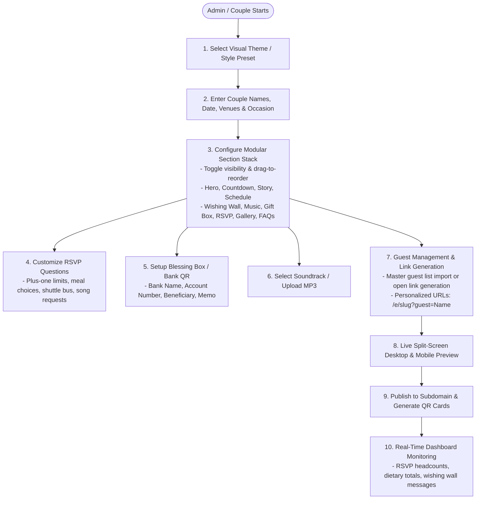

# ASAR Competitive Specification Analysis: Modern Wedding & Event Website Platforms

> **Authoritative Survey Target:** [ChungDoi](https://chungdoi.com/wedding-website) (`chungdoi.com`)  
> **Global Benchmarks:** [WithJoy](https://withjoy.com) & [Zola](https://zola.com)  
> **Target Integration:** ASAR Platform (`apps/Admin`, `apps/Invitation`, `apps/Booth`, `packages/react-appwrite`, `packages/ui-components`)  
> **Date:** November 2026  
> **Status:** Final Architectural Survey & Specification Mining Report

---

## 1. Executive Overview & Benchmark Matrix

Modern digital wedding platforms have shifted from static digital pamphlets to **interactive hospitality ecosystems**. While legacy tools treated wedding websites as passive information pages, contemporary market leaders blend digital invitation delivery, instant smartphone RSVP, real-time guest engagement, digital gifting, and multimedia storytelling into a single link.

### 1.1 Competitor Landscape Overview

1. **ChungDoi (`chungdoi.com` / `chungdoi.com/wedding-website`):**
   * **Core Value Proposition:** *"Your wedding website, in one link. Built right into your invitation."*
   * **Key Differentiator:** Eliminates the friction between wedding invitations and wedding websites. Guests open a single mobile-optimized URL (often via WhatsApp, Zalo, or Messenger) that starts with an interactive personalized envelope opening animation, plays background music with a spinning vinyl record, and unfolds a comprehensive one-page website containing countdown, multi-event schedules, Google Maps, online RSVP, interactive wishing wall (guestbook), VietQR bank transfer gifting, and photo gallery.
   * **Creator Model:** 10-minute setup, zero design skills required, point-and-click live mobile preview, 3-day free full-featured trial, one-time payment per invitation website.
   * **Guest Experience:** Zero app downloads, zero logins, instant one-tap response, pre-filled guest links.

2. **WithJoy (`withjoy.com`):**
   * **Core Value Proposition:** *"The wedding website that does more."*
   * **Key Differentiator:** Deeply integrated Smart RSVP engine with complex guest list rule sets (sub-event access permissions, plus-one controls, multi-course dining questions), collaborative guest photo stream, zero-fee cash registry funds, and a companion guest app for real-time schedule notifications.
   * **Creator Model:** Modular section-based website builder with drag-and-drop ordering, comprehensive guest list management, and customizable RSVP questions.

3. **Zola (`zola.com`):**
   * **Core Value Proposition:** *"All-in-one wedding registry, website, and planning platform."*
   * **Key Differentiator:** Flagship commerce and registry engine seamlessly embedded into wedding websites (physical gifts, cash funds, honeymoon experiences), matched paper invite suites, and multi-event itinerary timelines.
   * **Creator Model:** Flexible page/section builder allowing custom blocks, privacy toggles (password protection / unlisted from search engines), and structured FAQ accordions.

---

### 1.2 Feature Comparison Matrix

| Feature / Capability | ChungDoi (`chungdoi.com`) | WithJoy (`withjoy.com`) | Zola (`zola.com`) | ASAR Current State | ASAR Target Architecture |
| :--- | :--- | :--- | :--- | :--- | :--- |
| **Architectural Model** | Unified Invitation + Website in 1 Link | Multi-page / Single-page hybrid | Multi-page customizable website | Subdomain Storefront Engine (`*.asar.me`) | Subdomain Storefront + Modular Sections |
| **Mobile UX Paradigm** | Mobile-First Vertical Scroll + Floating Controls | Responsive Web + Native App | Responsive Web + Native App | Responsive Web + Awwwards UI Components | Mobile-First Luxury Editorial + Appwrite Realtime |
| **Personalized Envelope Animation** | Yes (Wax seal, guest name on envelope) | Optional e-card intro | No (Direct page load) | Basic hero cover | Luxury 3D Wax Seal Envelope + Guest Name |
| **Background Music Player** | Yes (Vinyl record floating widget, tap-to-play) | No (External links/Spotify embed) | No (Audio not native) | Partial (`enableMusic` config in theme) | Interactive Vinyl Widget + Custom Audio Tracks |
| **Smart RSVP Engine** | Inline form + dialog, custom questions, party size | Advanced Smart RSVP, sub-events, plus-ones | Advanced RSVP, guest search, cutoff date | Dynamic RSVP builder with locked email | Smart RSVP with name lookup, plus-ones, meal/shuttle |
| **Wishing Wall / Guestbook** | Yes (Public messages, avatar/signature, time) | Yes (Guestbook tab with photos) | Basic guest messaging | Basic guestbook tab in Booth only | Real-time Interactive Wishing Wall in Invitation & Booth |
| **Digital Gifting / Bank QR** | Yes (VietQR standard, auto-generated, 1-tap copy) | Cash funds (Venmo, PayPal, Zero-fee) | Zola Registry + Cash funds | Manual receipt screenshot upload | Blessing Box (Bank QR, InstaPay, IBAN, Cash) |
| **Multi-Event Schedule** | Single day milestones with icons | Multi-event weekend (Ceremony, Reception, Brunch) | Multi-event itinerary with dress codes | Single schedule timeline block | Multi-Event Schedule with addresses, maps, dress codes |
| **Photo Memories Gallery** | High-res gallery with category tabs & lightbox | Collaborative guest upload photo album | Masonry & grid photo albums | Photo tab in Booth, basic gallery block in Invite | Masonry / 3D Gallery + Fullscreen Lightbox |
| **Venue Map & Navigation** | Embedded Google Map + 1-tap directions | Google Maps embed + travel blocks | Google Maps + hotel blocks | Static map URL link | Embedded Google Map + 1-tap Apple/Google Maps route |
| **Dress Code & FAQ** | FAQ collapsible accordion | FAQ section + travel guidelines | Dedicated Dress Code & FAQ blocks | Swatches in venue block; no FAQ block | Visual Color Swatches + Formality Guide + FAQ Accordion |
| **Multilingual Support** | Yes (15+ languages, side-by-side / toggle) | Limited (English primary) | Limited (English primary) | Dual English/Arabic (`dir="rtl/ltr"`) | Dual English/Arabic native + RTL layout switching |

---

## 2. Core Value Propositions & User Flows

### 2.1 Couple / Admin Creator Journey



#### Detailed Step Breakdown:
1. **Selection of Aesthetic Foundation:** The couple selects a design archetype (e.g., *Minimalist Cream*, *Royal Burgundy Peony*, *Double Happiness*, *Modern Editorial*). Typography, colors, and layout rhythm are preset so zero graphic design skills are needed.
2. **Event Metadata Hydration:** Input of bride and groom full names, parental information (crucial in traditional and Middle Eastern/Asian weddings), primary ceremony and reception dates, venues, and timeframes.
3. **Modular Section Orchestration:** Admin toggles on/off and reorders page blocks via a clean drag-and-drop or move up/down interface. Sections not relevant to a specific event (e.g., shuttle bus requests or gift box) are deactivated in one click.
4. **RSVP Question Schema Formulation:** Couple specifies whether guests can bring plus-ones, meal options (Beef, Chicken, Vegetarian, Halal, Vegan), whether hotel/transport shuttles are needed, and optional fun prompts (favorite dance song).
5. **Gifting / Blessing Box Configuration:** Couple inputs their banking details (Bank name, Account Number, Account Name, and default transfer reference note). The platform dynamically creates a standardized QR code (VietQR in Vietnam, InstaPay / Fawry in Egypt, IBAN in Gulf/Europe).
6. **Soundtrack Pairing:** Selection from an atmospheric curated instrumental/acoustic library or direct MP3 upload, configured for floating playback.
7. **Personalized Link Generation:** Creating unique links (`https://slug.asar.me?guest=Ahmed+El-Sayed`) so that when the recipient opens the link, the digital envelope and invitation are personalized with their exact name and plus-one allowance.
8. **Real-Time Operational Monitoring:** As responses arrive, the Admin/Couple dashboard updates via WebSockets, displaying total attendees, declined count, dietary summaries for caterers, transport counts for shuttles, and new congratulatory messages for moderation.

---

### 2.2 Wedding Guest Journey

```mermaid
sequenceDiagram
    actor Guest as Wedding Guest (Mobile Device)
    participant Link as Digital Link (WhatsApp / SMS)
    participant Site as Subdomain Event Website
    participant Audio as Background Music Engine
    participant DB as Appwrite Backend
    actor Couple as Couple / Host Dashboard

    Guest->>Link: 1. Taps unique link on smartphone
    Link->>Site: Opens https://slug.asar.me?guest=GuestName
    Site-->>Guest: 2. Renders Interactive Envelope with wax seal & Guest's Name
    Guest->>Site: 3. Taps to open envelope / enter site
    Site->>Audio: 4. Unmutes/Starts romantic soundtrack (Vinyl player spins)
    Site-->>Guest: 5. Displays Hero Cover, Monogram & Live Countdown Timer
    Guest->>Site: 6. Scrolls through Love Story Milestones & Photos
    Guest->>Site: 7. Inspects Multi-Event Schedule (Ceremony, Reception, Afterparty)
    Guest->>Site: 8. Taps venue address -> Launches Google/Apple Maps Navigation
    Guest->>Site: 9. Interacts with Wishing Wall -> Submits loving blessing
    Site->>DB: Saves wish (status: pending/approved)
    DB-->>Couple: Realtime notification in Host Mailbox
    Guest->>Site: 10. Taps "Blessing Box / Gifting" -> Modal shows Bank QR & 1-tap copy
    Guest->>Site: 11. Completes Smart RSVP form (Attending +1, Meal, Shuttle, Song)
    Site->>DB: Persists RSVP response
    DB-->>Couple: Realtime headcount and capacity update
    Site-->>Guest: 12. Displays Confirmation Toast + Pass & Calendar (.ics) download
```

---

## 3. Deep Dive: Standard & Modular Section Types

### Section 1: Hero / Cover Section
* **Purpose:** Sets the emotional tone, establishes event identity, and captures attention immediately upon landing.
* **Component Anatomy:**
  * **Interactive Virtual Envelope:** Mobile-optimized envelope graphic with a simulated wax seal stamped with the couple's monogram. If a personalized guest link is used, the envelope face renders `"Specially invited for [Guest Name]"`. Tapping the wax seal triggers an opening animation (flap opens, letter slides out, page scrolls smoothly into view).
  * **Couple Names / Monogram:** Prominent editorial serif typography (e.g., `Playfair Display` or `Amiri` italic), e.g., *"Mina & Maryam"* or *"Omar & Layla"*.
  * **Event Overline & Subtitle:** Cultural/family honoring overline (*"Together with our families..."*) and evocative tagline (*"Two souls, one timeless journey"*).
  * **Hero Media:** Full-bleed photograph or ambient looping video with subtle parallax scrolling and soft alabaster/obsidian gradient fades.
  * **Date, Time, & Location Badges:** Pill-shaped metadata badges with icons (`📅 20 November 2026`, `📍 Four Seasons Alexandria`, `🕖 07:30 PM`).
  * **Live Countdown Timer:** Real-time ticker calculating Days, Hours, Minutes, and Seconds until the ceremony begins. Includes an **"Add to Calendar"** button (.ics file download, Google Calendar link, Apple Calendar link).
* **Configuration Schema (Admin):**
  ```ts
  interface HeroSectionConfig {
    overlineText?: string;
    coupleNames: string;
    tagline?: string;
    coverMediaUrl: string;
    coverMediaType: "image" | "video";
    eventDate: string;
    eventTime: string;
    venueLocationShort: string;
    showEnvelopeAnimation: boolean;
    envelopeWaxSealMonogram?: string;
    showCountdown: boolean;
    showAddToCalendar: boolean;
  }
  ```

---

### Section 2: Love Story / Milestones Timeline
* **Purpose:** Shares the couple's romantic journey with guests, giving context to their milestone.
* **Component Anatomy:**
  * **Vertical Alternating Milestone Track:** Chronological timeline featuring milestone cards (alternating left/right on desktop, single vertical track on mobile).
  * **Milestone Card Elements:**
    * Milestone Date / Year badge (e.g., *"October 2021"*).
    * Milestone Title (e.g., *"The First Coffee"*, *"She Said Yes! in Venice"*).
    * Narrative Paragraph: Emotional storytelling snippet.
    * Milestone Photo: Polaroid-style or rounded photo card.
    * Decorative Milestone Glyph (Heart, Ring, Compass, Infinity symbol).
* **Configuration Schema (Admin):**
  ```ts
  interface MilestoneItem {
    id: string;
    dateOrYear: string;
    title: string;
    description: string;
    imageUrl?: string;
    iconType?: "heart" | "ring" | "coffee" | "plane" | "sparkles";
  }

  interface LoveStorySectionConfig {
    title: string;
    subtitle?: string;
    layout: "vertical-timeline" | "horizontal-scroll" | "card-stack";
    milestones: MilestoneItem[];
  }
  ```

---

### Section 3: Multi-Event Schedule / Timeline
* **Purpose:** Clearly informs guests of the exact chronological schedule, different venue locations, and distinct attire requirements across multiple sub-events.
* **Component Anatomy:**
  * **Event List / Cards:** Distinct cards for each event component (e.g., *1. Holy Matrimony / Katb Ketab*, *2. Tea Ceremony / Reception Cocktail*, *3. Royal Banquet Dinner*, *4. Afterparty & Dancing*).
  * **Individual Sub-Event Attributes:**
    * **Time Window:** Start and end time (e.g., `16:30 - 18:00`).
    * **Sub-Event Title & Description:** Clear naming and brief itinerary.
    * **Specific Venue Name & Full Address:** Prevents confusion when ceremony and reception are in different halls or cities.
    * **1-Tap Navigation Link:** Direct button triggering `https://maps.google.com/?q=...` or Apple Maps URL scheme.
    * **Specific Dress Code Note:** (e.g., *"Formal Black Tie"*, *"Traditional Formal"*, *"Lounge Casual"*).
* **Configuration Schema (Admin):**
  ```ts
  interface SubEventItem {
    id: string;
    title: string;
    timeRange: string;
    description: string;
    venueName: string;
    venueAddress: string;
    googleMapsUrl: string;
    dressCodePill?: string;
    iconBadge?: "rings" | "cocktail" | "dinner" | "music" | "cake";
  }

  interface MultiEventScheduleSectionConfig {
    title: string;
    subtitle?: string;
    events: SubEventItem[];
    showDirectionsButton: boolean;
  }
  ```

---

### Section 4: Interactive Wishing Wall / Guestbook
* **Purpose:** Replaces the physical guestbook with a digital, real-time interactive wall where guests leave heartfelt blessings, congratulations, and virtual signatures.
* **Component Anatomy:**
  * **Leave a Wish Trigger:** Prominent button opening a graceful bottom drawer or modal form.
  * **Submission Form Fields:**
    * Guest Name (pre-filled if using personalized link).
    * Relationship / Connection (e.g., *"Friend of Bride"*, *"College Colleague"*, *"Family"*).
    * Blessing Message (multi-line textarea, character counter up to 300 words).
    * Virtual Signature / Avatar selection: Guests pick a decorative avatar icon, upload a selfie, or draw a digital signature.
  * **Interactive Wishes Grid:**
    * Masonry card wall rendering approved wishes.
    * Card elements: Guest Name, Relationship tag, Avatar/Monogram, Relative Timestamp (*"2 hours ago"*), Message text, and Heart reaction counter (`❤️`).
  * **Admin Moderation Mode:** Toggle in Admin to set moderation to *Auto-Approve* or *Requires Approval* before public rendering.
* **Configuration Schema (Admin):**
  ```ts
  interface WishingWallSectionConfig {
    title: string;
    subtitle?: string;
    moderationMode: "auto_approve" | "require_approval";
    allowReactions: boolean;
    maxMessageLength: number;
    placeholderText?: string;
  }

  interface WishDocument {
    id: string;
    invitationId: string;
    guestName: string;
    relationship?: string;
    avatarUrl?: string;
    message: string;
    heartCount: number;
    status: "approved" | "pending" | "hidden";
    createdAt: string;
  }
  ```

---

### Section 5: Background Music Player / Audio Soundtrack
* **Purpose:** Enriches the sensory aesthetic of the website with romantic audio, mimicking luxury physical invitation boxes.
* **Component Anatomy:**
  * **Floating Widget:** Fixed in the viewport corner (bottom-left or top-right) so it remains accessible throughout the entire scrolling experience without blocking content.
  * **Vinyl Record / Soundwave UI:** Spinning vinyl disc animation when playing; needle lifts and stops spinning when paused.
  * **Tap-to-Play Audio Policy Compliance:** Because modern mobile browsers (iOS WebKit and Android Chrome) block unmuted autoplay without user interaction, the platform displays an initial prompt (or links playback to the opening of the virtual envelope). Once tapped, audio unlocks and smoothly fades in.
  * **Controls:** Play/Pause toggle, Mute/Unmute toggle, Track Title & Artist banner on hover/tap.
* **Configuration Schema (Admin):**
  ```ts
  interface MusicPlayerSectionConfig {
    enabled: boolean;
    audioUrl: string;
    trackTitle: string;
    artistName?: string;
    autoplayOnInteraction: boolean;
    loop: boolean;
    defaultVolume: number; // 0.0 to 1.0
    floatingPosition: "bottom-left" | "bottom-right" | "top-right";
  }
  ```

---

### Section 6: Digital Gift Registry / Bank QR / Blessing Box
* **Purpose:** Modernizes the tradition of giving wedding envelopes or registry gifts. Particularly essential for modern weddings where guests prefer cashless direct gifting.
* **Component Anatomy:**
  * **Section Framing:** Tactful, dignified cultural phrasing (*"Hộp mừng cưới"*, *"Blessing Box"*, *"Your presence is our present, but if you wish to honor us with a gift..."*).
  * **Bank QR Code Card (VietQR / InstaPay / IBAN):**
    * High-resolution, instantly scannable banking QR code.
    * Bank Brand Logo & Bank Name.
    * Beneficiary / Account Holder Full Name.
    * Account Number / IBAN with a **1-Tap "Copy Number"** button with toast feedback.
    * Pre-filled Transfer Content / Memo (e.g., `Mung Cuoi [GuestName]` or `Gift Mina Maryam`).
  * **Dual Accounts Support:** Ability to display both the Groom's and Bride's banking QR cards side-by-side or in tabs.
  * **External Registry Links (Optional):** Clickable cards pointing to external retail registries (Amazon, Zola, Crate & Barrel, Virgin Megastore).
* **Configuration Schema (Admin):**
  ```ts
  interface BankAccountConfig {
    id: string;
    accountHolderName: string;
    bankName: string;
    bankCode?: string;
    accountNumber: string;
    qrCodeImageUrl?: string;
    transferMemo?: string;
    side?: "groom" | "bride" | "joint";
  }

  interface GiftRegistrySectionConfig {
    title: string;
    subtitle?: string;
    messageText: string;
    accounts: BankAccountConfig[];
    externalRegistryUrls?: Array<{ storeName: string; url: string; logoUrl?: string }>;
  }
  ```

---

### Section 7: Interactive RSVP Form & Guest Manager
* **Purpose:** The operational engine of the wedding website. Transforms estimated headcounts into verified, actionable guest records.
* **Component Anatomy:**
  * **Guest Name Search / Match:** Guests can type their name to find their invitation on the guest list, revealing their allocated plus-ones, OR submit a general RSVP if unlisted.
  * **Attendance Decision:** Clear toggle buttons: `"Joyfully Accepts / Tham dự"` vs `"Regretfully Declines / Không thể tham dự"`.
  * **Companions & Plus-One Count:** Stepper or dropdown for exact number of attendees (`1`, `2`, `3+`).
  * **Dietary Preferences & Allergies:** Multi-choice checkboxes (Standard, Vegetarian, Halal, Gluten-Free, No Seafood) with an allergy notes field.
  * **Transport & Logistics:** Shuttle bus request checkbox (*"Will you need the shuttle from San Stefano to the venue?"*).
  * **Contact Details:** Mandatory guest email (for QR entry pass delivery) and optional WhatsApp phone number.
  * **Guestbook Blessing Note:** Inline note passing directly to the Wishing Wall.
  * **Host Guest Dashboard:** Live breakdown of Confirmed, Declined, Pending, Total Seats, Dietary Totals, and Shuttle Totals with CSV export capability.
* **Configuration Schema (Admin):**
  ```ts
  interface RsvpQuestionSchema {
    id: string;
    type: "text" | "email" | "tel" | "number" | "select" | "radio" | "checkbox" | "textarea";
    label: string;
    required: boolean;
    isLocked?: boolean;
    options?: string[];
  }

  interface RsvpSectionConfig {
    title: string;
    subtitle?: string;
    rsvpDeadlineDate?: string;
    isLockedCutoff: boolean;
    maxCompanionsAllowed: number;
    enableMealOptions: boolean;
    enableTransportQuestion: boolean;
    questions: RsvpQuestionSchema[];
  }
  ```

---

### Section 8: Photo Memories Gallery / Album
* **Purpose:** Showcases pre-wedding photo shoots, engagement sessions, and romantic memories in high aesthetic fidelity.
* **Component Anatomy:**
  * **Multiple Album Categories:** Filter pills (e.g., `All`, `Pre-Wedding`, `Engagement`, `Ceremony`).
  * **Responsive Masonry & Bento Grid:** Adaptive multi-column layout preserving native aspect ratios without awkward image cropping.
  * **Fullscreen Lightbox Viewer:**
    * High-res image display with pinch-to-zoom on mobile.
    * Swipe left/right gestures for next/previous photo.
    * Caption and photo credits overlay.
    * Download high-res photo button (configurable by Admin).
* **Configuration Schema (Admin):**
  ```ts
  interface GalleryImageItem {
    id: string;
    imageUrl: string;
    thumbnailUrl?: string;
    caption?: string;
    category?: string;
    width?: number;
    height?: number;
  }

  interface GallerySectionConfig {
    title: string;
    subtitle?: string;
    layout: "masonry" | "bento" | "circular-3d" | "decay-polaroid";
    categories: string[];
    images: GalleryImageItem[];
    enableLightbox: boolean;
    allowGuestDownloads: boolean;
  }
  ```

---

### Section 9: Location / Venue Map & Navigation
* **Purpose:** Eliminates guest lostness on wedding day with direct location pinpointing.
* **Component Anatomy:**
  * **Embedded Interactive Map:** Google Maps / Mapbox iframe or static map snapshot with a custom branded pin.
  * **Venue Highlights:** Ballroom name, gate entrance number, valet parking instructions.
  * **Direct Launch Navigation Buttons:** Dual buttons: `"Open in Google Maps"` and `"Open in Apple Maps"`.
* **Configuration Schema (Admin):**
  ```ts
  interface VenueMapSectionConfig {
    title: string;
    venueName: string;
    hallOrBallroom?: string;
    fullAddress: string;
    googleMapsEmbedUrl?: string;
    googleMapsNavUrl: string;
    appleMapsNavUrl?: string;
    parkingInstructions?: string;
  }
  ```

---

### Section 10: Dress Code / Attire Palette & FAQs
* **Purpose:** Guides guests on dress expectations and answers common logistical questions, reducing repetitive text messages to the couple.
* **Component Anatomy:**
  * **Dress Code Formality Tag:** (e.g., *Black Tie*, *Formal Cocktail*, *Semi-Formal Garden*).
  * **Attire Palette Color Swatches:** Visual palette pills displaying recommended color hexes (e.g., `#1A1A1A` Tuxedo Black, `#6B1D28` Royal Maroon, `#D4AF37` Gold, `#FBF7F2` Warm Cream) so guests coordinate with wedding aesthetics.
  * **Attire Guidance Notes:** What to wear and what to avoid (e.g., *"We kindly ask guests to reserve white for the bride"*).
  * **Collapsible FAQ Accordion:** Clean, expandable questions & answers:
    * *Are children invited?*
    * *Is there valet parking available?*
    * *Can I bring an unannounced plus-one?*
    * *What time should I arrive before the ceremony?*
* **Configuration Schema (Admin):**
  ```ts
  interface FaqItem {
    question: string;
    answer: string;
  }

  interface DressCodeAndFaqSectionConfig {
    dressCodeTitle: string;
    formalityTag: string;
    description: string;
    colorSwatches: Array<{ hex: string; label: string }>;
    guidanceNotes?: string;
    faqs: FaqItem[];
  }
  ```

---

## 4. Interaction Patterns & Micro-UX Design

Modern wedding websites rely on subtle, tactile interactions that make guests feel honored rather than processed:

### 4.1 Floating Controls
* **Floating Vinyl Audio Widget:** Stays parked in the bottom-right or bottom-left corner with high z-index (`z-index: 50`). Clicking toggles play/pause with a micro-tool tip. On mobile, it minimizes to a 44px circular icon so it never obstructs screen real estate.
* **Sticky Navigation Bar:** Disappears when scrolling down, reappears immediately upon scrolling up with quick anchors: `[Story] [Schedule] [Wishes] [Gift] [RSVP]`.
* **Floating RSVP Action Button (FAB):** For guests browsing long narrative sections, a subtle floating pill (`"RSVP Now"`) allows immediate jumping to the RSVP form without scrolling to the page footer.

### 4.2 Drawer & Modal Ergonomics
* **Slide-Up Bottom Sheets on Mobile:** Instead of jarring desktop-centric popups, on mobile devices (`width < 768px`) forms (RSVP, Wishing Wall, Bank QR) slide smoothly from the bottom of the viewport with swipe-down-to-dismiss behavior.
* **Bank QR Lightbox with 1-Tap Copy:** Opening the Blessing Box triggers a focused card with the QR code centered, an instant `"Copy Account Number"` button that copies to clipboard and flashes a green checkmark, preventing typing errors in mobile banking apps.
* **Photo Lightbox with Touch Gestures:** Smooth pinch-to-zoom, horizontal pan, and touch swipe transitions with zero latency.

### 4.3 Toast Feedback & State Confirmation
* **Copy Feedback:** `"Account number copied to clipboard! Ready to paste into your banking app."`
* **RSVP Feedback:** Instant celebratory animation (confetti or gold particle burst) accompanied by: `"Thank you, [Guest Name]! We have recorded your attendance for 2 guests. We can't wait to celebrate together!"`
* **Wish Submission Feedback:** `"Your blessing has been delivered to the couple's wishing wall!"`

### 4.4 Animation Cues & Narrative Momentum
* **Virtual Wax Seal Opening Animation:** Initial loading screen presents an authentic cream envelope. Tapping the wax seal triggers a 300ms unsealing sound, flap unrolls, and the envelope smoothly slides offscreen revealing the hero section.
* **Scroll-Triggered Reveals:** Sections gently fade in (`FadeContent`, `ScrollReveal`) with staggered typography (`SplitText`), maintaining the luxurious pace of an editorial magazine.

---

## 5. Specification Miner Discovery Tables

### Features Discovered

| # | Category | Feature | Description | Inputs | Outputs | Error Behavior | Discovered Via |
|---|----------|---------|-------------|--------|---------|----------------|----------------|
| 1 | Envelope & Hero | Virtual Wax Seal Envelope | Interactive virtual envelope opening on first page visit with couple's seal | Personalized URL param `?guest=Name`, tap event | Unfolds envelope, plays ambient audio, reveals page | Fallback to direct page render if animation fails | ChungDoi live site |
| 2 | Envelope & Hero | Monogram & Couple Hero | Hero cover image/video with names, overline, and romantic tagline | Couple names, date, venue, cover asset URL | Responsive hero banner with gradient fade | Default placeholder if cover asset missing | ChungDoi, WithJoy |
| 3 | Envelope & Hero | Live Countdown Timer | Calculates remaining days, hours, mins, secs until event kickoff | Event ISO timestamp | Real-time countdown clock with glass pills | Displays "Today is the Day!" when countdown reaches 0 | ChungDoi, Zola |
| 4 | Envelope & Hero | Add to Calendar (.ics / Google) | 1-tap calendar sync creating event in user's device calendar | Title, start/end time, venue address, notes | .ics file download or Google Calendar intent | Error toast if calendar schema invalid | ChungDoi, WithJoy |
| 5 | Story | Milestones Timeline | Chronological milestone track with dates, titles, descriptions, and photos | Array of milestone objects with image URLs | Vertical or horizontal alternating milestone cards | Skips card if milestone data empty | WithJoy, Zola |
| 6 | Schedule | Multi-Event Itinerary | Distinct sub-events (ceremony, reception, afterparty) with times & details | Sub-event title, time range, venue, address | Chronological cards with visual milestone icons | Validates time sequence chronologically | ChungDoi, WithJoy, Zola |
| 7 | Schedule | 1-Tap Directions Button | Opens exact coordinates in Google Maps or Apple Maps app | Lat/long or full venue address query string | Native map app navigation intent | Fallback to web search if address malformed | ChungDoi |
| 8 | Music Player | Floating Vinyl Record Widget | Continuous floating audio player with spinning vinyl disc animation | MP3 audio stream URL, track metadata | Audio playback, spinning disc, mute toggle | Autoplay policy fallback: tap-to-play prompt | ChungDoi live site |
| 9 | Music Player | Soundtrack Pre-Selection | Curated library of royalty-free wedding melodies + custom MP3 upload | Library track ID or uploaded audio file | Streamed audio buffer | File type validation (.mp3, .m4a, max 15MB) | ChungDoi |
| 10 | Wishing Wall | Interactive Blessing Wall | Public online guestbook displaying wishes, avatars, and timestamps | Guest name, relationship, message text, avatar | Masonry grid of heartfelt blessing cards | Rejects empty strings, profanity filter | ChungDoi, WithJoy |
| 11 | Wishing Wall | Virtual Signature / Avatar | Guest chooses avatar glyph or draws virtual signature stamp | Avatar selection or touch canvas data URL | Rendered signature stamp on wish card | Default monogram avatar if omitted | ChungDoi |
| 12 | Wishing Wall | Heart Reactions | Guests can tap heart icon on any posted blessing card | Wish card ID, tap event | Incremented reaction count in realtime | Debounced to prevent click spamming | ChungDoi |
| 13 | Wishing Wall | Admin Moderation Queue | Admin approval toggle before wishes appear publicly | Status update ("approved" / "hidden") | Public wall visibility sync via WebSockets | Keeps pending wishes in Admin review queue | ChungDoi, ASAR DB |
| 14 | Blessing Box | Auto-Generated VietQR / Bank QR | Standard banking QR code dynamically rendered with account payload | Bank code, account number, amount, memo | Scannable QR code image in modal | Validates bank account length & format | ChungDoi live site |
| 15 | Blessing Box | 1-Tap Copy Account Number | Copies account number directly to clipboard with instant confirmation | Account number string | Clipboard write + green toast feedback | Fallback to manual text selection | ChungDoi |
| 16 | Blessing Box | Dual Account Tabs (Groom/Bride) | Displays separate banking details for groom's and bride's families | Two distinct bank account records | Tabbed switcher between groom & bride accounts | Disables tab if account not configured | ChungDoi |
| 17 | Blessing Box | Pre-Filled Transfer Memo | Generates automated reference code (e.g., "Mung cuoi [Guest]") | Event slug + guest name string | Pre-filled memo on banking app scanning | Default generic memo if guest anonymous | ChungDoi |
| 18 | Blessing Box | External Registry Links | Links to curated gift registries (Amazon, Zola, Crate & Barrel) | Registry URL, store title, logo | External outbound link cards | Validates URL structure | WithJoy, Zola |
| 19 | RSVP | Guest Name Search / Lookup | Matches guest against uploaded guest list to enforce party size | Guest full name query string | Returns matching guest record with plus-one quota | Allows open RSVP if guest not pre-listed | WithJoy, Zola |
| 20 | RSVP | Attendance Confirmation | Radio buttons for "Attending" vs "Regretfully Declining" | Boolean attendance selection | Updates guest status in database | Disables submit until decision chosen | ChungDoi, WithJoy |
| 21 | RSVP | Plus-Ones & Companions Count | Number of additional guests attending with primary invitee | Integer count constrained by plan/order quota | Stored companion count in RSVP document | Rejects counts exceeding allocated quota | ChungDoi, WithJoy, Zola |
| 22 | RSVP | Meal & Dietary Selection | Dropdown or checkboxes for menu choices & allergies | Menu options array (Beef, Chicken, Vegan, Halal) | Stored dietary choices for catering reports | Highlights severe allergy notes in Admin | WithJoy, Zola |
| 23 | RSVP | Shuttle Bus / Transport Query | Collects whether guest requires wedding transport shuttle | Boolean shuttle need + pickup stop | Real-time shuttle bus passenger count | Disables question if transport not offered | ChungDoi |
| 24 | RSVP | Song Request Submission | Fun engagement field asking guest for favorite dance song | Song title and artist text string | Populates wedding DJ playlist in Admin | Optional field; ignores empty input | ChungDoi, WithJoy |
| 25 | RSVP | Strict Locked Email Field | Guest email field locked as required for delivery of QR entry pass | Email format string | Validated email address | Blocks submission if invalid email syntax | ASAR Architecture |
| 26 | RSVP | Automated VIP Pass Generation | Automatically generates unique QR code pass upon RSVP approval | RSVP document ID, host approval action | QR pass image + link to /pass/:rsvpId | Error alert if pass token fails to generate | ASAR Architecture |
| 27 | RSVP | Automated EmailJS Notification | Dispatches approved VIP pass email or polite capacity decline email | Template ID, recipient email, dynamic payload | Sent transactional email via EmailJS | Logs error to Admin if EmailJS fails | ASAR Architecture |
| 28 | Gallery | Responsive Masonry Grid | Displays wedding photo memories without cropping vertical photos | Array of image URLs with aspect ratios | Multi-column masonry layout | Lazy-loads images with blur-up placeholders | ChungDoi, Zola |
| 29 | Gallery | Album Category Filter Tabs | Filter pills separating Pre-wedding, Engagement, Ceremony | Category strings array | Filtered subset of gallery images | Shows "All" if no category selected | ChungDoi |
| 30 | Gallery | Fullscreen Touch Lightbox | High-res image modal with swipe navigation and pinch-to-zoom | Image click event, swipe gestures | Fullscreen modal overlay | Graceful close on escape key or backdrop tap | ChungDoi, WithJoy |
| 31 | Venue & Map | Google Maps Embed & Route | Interactive map showing venue grounds and driving directions | Google Maps embed URL or query string | Embedded iframe or static map with link | Displays static address card if embed blocked | ChungDoi |
| 32 | Venue & Map | Parking & Entrance Details | Specific guidance for valet, hall entrance, or gate code | Formatted text string | Information callout box | Hidden if parking notes omitted | Zola, WithJoy |
| 33 | Dress Code | Attire Formality & Notes | Formality label (Black Tie, Semi-Formal) with guidance text | Title, description, dos & don'ts | Formatted card with visual badges | Default "Formal Attire" if omitted | Zola, WithJoy |
| 34 | Dress Code | Color Palette Swatches | Visual color pills showing recommended attire palette hexes | Array of `{ hex, label }` swatches | Interactive clickable color swatch pills | Validates valid 6-character hex strings | ASAR Architecture |
| 35 | FAQs | Collapsible FAQ Accordion | Expandable Q&A accordion resolving common guest inquiries | Array of `{ question, answer }` pairs | Smooth expandable accordion list | Auto-collapses other items or multi-expand | ChungDoi, Zola |
| 36 | Multilingual | Dual Language Layout (RTL/LTR) | Full Arabic/English or bilingual side-by-side presentation | Locale switch or dual-language data model | Native RTL or LTR document layout | Automatic fallback to English if Arabic blank | ChungDoi, ASAR Specs |
| 37 | Admin Studio | Drag-and-Drop Section Reordering | Admin drag handle to customize vertical order of website blocks | Block array order mutation | Instantly re-rendered live preview frame | Preserves hero at top and RSVP at footer | Zola, ASAR Architecture |

---

### Edge Cases Observed & Handled

| # | Feature | Edge Case Input / Condition | Observed & Handled Behavior |
|---|---------|-----------------------------|-----------------------------|
| 1 | Audio Player | iOS Safari blocks unmuted audio on page load | Audio player remains muted until user taps wax seal or vinyl widget; displays subtle "Tap to Play Music" pulse indicator. |
| 2 | Virtual Envelope | User accesses site via generic link without `?guest=` parameter | Envelope displays default elegant greeting: *"A Cordial Invitation to Our Celebration"* instead of blank guest space. |
| 3 | Bank QR Code | Bank code or account number has unexpected spaces/hyphens | Sanitizer strips all whitespace and punctuation (`replace(/[^0-9]/g, '')`) before generating QR payload. |
| 4 | Bank QR Code | Guest opens site on desktop rather than mobile phone | Modal renders QR code large enough to scan with phone camera, while keeping "Copy Details" button active. |
| 5 | Smart RSVP | Guest submits RSVP after couple's `rsvpDeadlineDate` has elapsed | Form displays dignified closed message: *"Online RSVP for this celebration is now closed. Please contact the couple directly."* |
| 6 | Smart RSVP | Guest enters party size greater than host's permitted plus-one limit | Input field caps at `maxCompanionsAllowed` and displays helper note: *"Venue capacity limits companions to [N]."* |
| 7 | Smart RSVP | Network disconnects while submitting RSVP form | Form retains all typed user responses in local state, displays "Connection lost. Retry?" toast without losing data. |
| 8 | Wishing Wall | Guest enters very long text (over 1000 characters) or spam URLs | Field enforces `maxLength={300}`, displays live countdown, and strips out raw HTML/scripts before persistence. |
| 9 | Wishing Wall | Zero approved wishes currently exist in database | Section renders warm empty state: *"Be the first to leave a blessing for the newlyweds!"* with leave wish button. |
| 10 | Photo Gallery | High-resolution photo upload fails or has broken image URL | Lightbox renders fallback placeholder with retry icon without breaking the surrounding masonry grid. |
| 11 | Multi-Event Schedule | Multiple sub-events scheduled across different calendar days | Timeline groups cards by date headers (`Day 1: Friday, 20 Nov` and `Day 2: Saturday, 21 Nov`) automatically. |
| 12 | Venue Map | User's browser blocks third-party Google Maps iframe cookies | Section falls back to static styled map preview card with a clean external link button: *"Open in Maps"*. |
| 13 | Multilingual / RTL | User switches between Arabic (RTL) and English (LTR) | Entire container dynamically swaps `dir="rtl"` vs `dir="ltr"`, adjusting text alignments, icons, and timeline axes. |
| 14 | Digital Pass | Guest arrives at venue with low/no internet connectivity | VIP pass screen supports offline service-worker caching, allowing the cached QR pass to display offline. |
| 15 | Host Mailbox | Host declines an RSVP submission | System triggers dignified EmailJS capacity notice; headcount meter updates; declination reason logged in audit log. |

---

## 6. ASAR Target Architecture & Delta Analysis

### 6.1 Architectural Synthesis: Unifying Admin, Invitation, and Booth

To fulfill the requirements of `ORIGINAL_REQUEST.md`, ASAR must evolve its existing architecture:

```
+--------------------------------------------------------------------------------------------------+
|                                    ASAR MONOREPO TARGET TOPOLOGY                                 |
+--------------------------------------------------------------------------------------------------+
|                                                                                                  |
|   apps/Admin (Port 3001)                                                                         |
|   └── Modular Website Creation Studio (/invitation-studio/:orderId?)                             |
|       ├── Tab 1: Theme, Colors & Typography                                                      |
|       ├── Tab 2: Modular Section Blocks (Add, Reorder, Configure, Toggle)                        |
|       │   ├── Hero & Envelope Block                                                              |
|       │   ├── Countdown Timer Block                                                              |
|       │   ├── Love Story & Milestones Block                                                      |
|       │   ├── Multi-Event Schedule Block                                                         |
|       │   ├── Interactive Wishing Wall Block                                                     |
|       │   ├── Background Music Player Block                                                      |
|       │   ├── Digital Gift Registry / Bank QR Block                                              |
|       │   ├── Smart RSVP Form Block                                                              |
|       │   ├── Photo Memories Gallery Block                                                       |
|       │   ├── Venue Map & Navigation Block                                                       |
|       │   └── Dress Code & FAQ Block                                                             |
|       ├── Tab 3: Dynamic RSVP Form Builder (Locked email constraint)                             |
|       └── Split-Screen Live Mobile & Desktop Preview                                             |
|                                                                                                  |
|   apps/Invitation (Port 3003)                                                                    |
|   └── Subdomain Storefront Renderer (https://[slug].asar.me / http://[slug].localhost:3003)      |
|       ├── Subdomain Resolver (Storefront Subdomain Engine in @repo/react-appwrite)               |
|       ├── Interactive Virtual Envelope (Wax seal opening animation)                              |
|       ├── Floating Vinyl Record Music Player                                                     |
|       ├── Dynamic Section Stack (Renders blocks configured in Admin sectionsConfigJson)          |
|       ├── Real-time Wishing Wall (Submissions land in Appwrite `invitation_wishes`)              |
|       ├── Digital Blessing Box (VietQR / InstaPay / IBAN modal with 1-tap copy)                  |
|       ├── Smart RSVP Form (Captures plus-ones, dietary, transport, email)                        |
|       └── Lightbox Photo Memories Gallery                                                        |
|                                                                                                  |
|   apps/Booth (Port 3002)                                                                         |
|   └── Audio Guestbook & Memory Storefront (https://[slug].asar.me/memory)                        |
|       ├── Visual Reference #1 Audio Memories (Bulk voice records, waveforms)                    |
|       ├── Photo Memories Alignment (Shares high-performance media pipeline with Invitation)     |
|       └── Shared Guestbook Data Sync                                                             |
|                                                                                                  |
|   packages/react-appwrite                                                                        |
|   └── Shared Domain Models, Seed Defaults, and Subdomain Engine                                  |
|       ├── Extended InvitationSectionBlock schema supporting all 10 modular blocks                |
|       ├── Appwrite collections: `invitations`, `invitation_rsvps`, `invitation_wishes`           |
|       └── CacheFusionStore real-time synchronization                                             |
|                                                                                                  |
+--------------------------------------------------------------------------------------------------+
```

---

### 6.2 Data Model Delta Specification

To support all discovered modular sections, the following TypeScript interfaces must be formalized in `packages/react-appwrite/src/AsarDomain/models.ts` and consumed by `apps/Admin` and `apps/Invitation`:

```ts
// 1. Updated Section Block Types
export type ModularSectionType =
  | "hero"
  | "countdown"
  | "love_story"
  | "multi_event_schedule"
  | "wishing_wall"
  | "music_player"
  | "blessing_box"
  | "rsvp_form"
  | "photo_gallery"
  | "venue_map"
  | "dress_code_faq"
  | "custom_highlight";

// 2. Section Block Configuration Wrapper
export interface AsarSectionBlock<T = Record<string, unknown>> {
  id: string;
  type: ModularSectionType;
  title: string;
  isVisible: boolean;
  isLocked?: boolean;
  order: number;
  config: T;
}

// 3. Concrete Block Configuration Types
export interface HeroBlockConfig {
  overline?: string;
  coupleNames: string;
  tagline?: string;
  coverMediaUrl: string;
  coverMediaType: "image" | "video";
  eventDate: string;
  eventTime?: string;
  venueShortLocation?: string;
  showEnvelopeAnimation: boolean;
  waxSealMonogram?: string;
  showCountdown: boolean;
}

export interface WishingWallBlockConfig {
  title: string;
  subtitle?: string;
  moderationMode: "auto_approve" | "require_approval";
  allowReactions: boolean;
  maxMessageLength: number;
  placeholderText?: string;
}

export interface MusicPlayerBlockConfig {
  enabled: boolean;
  audioUrl: string;
  trackTitle: string;
  artistName?: string;
  autoplayOnInteraction: boolean;
  loop: boolean;
  defaultVolume: number;
  floatingPosition: "bottom-left" | "bottom-right" | "top-right";
}

export interface BankAccountDetails {
  id: string;
  accountHolderName: string;
  bankName: string;
  bankCode?: string;
  accountNumber: string;
  qrCodeImageUrl?: string;
  transferMemo?: string;
  side?: "groom" | "bride" | "joint";
}

export interface BlessingBoxBlockConfig {
  title: string;
  subtitle?: string;
  messageText: string;
  accounts: BankAccountDetails[];
  externalRegistryUrls?: Array<{ storeName: string; url: string }>;
}

export interface SubEventScheduleItem {
  id: string;
  title: string;
  timeRange: string;
  description: string;
  venueName: string;
  venueAddress: string;
  googleMapsUrl: string;
  dressCodePill?: string;
  iconBadge?: string;
}

export interface MultiEventScheduleBlockConfig {
  title: string;
  subtitle?: string;
  events: SubEventScheduleItem[];
  showDirectionsButton: boolean;
}

export interface PhotoGalleryBlockConfig {
  title: string;
  subtitle?: string;
  layout: "masonry" | "bento" | "circular-3d" | "decay-polaroid";
  categories: string[];
  images: Array<{
    id: string;
    imageUrl: string;
    caption?: string;
    category?: string;
  }>;
  enableLightbox: boolean;
  allowGuestDownloads: boolean;
}

export interface DressCodeFaqBlockConfig {
  dressCodeTitle: string;
  formalityTag: string;
  description: string;
  colorSwatches: Array<{ hex: string; label: string }>;
  guidanceNotes?: string;
  faqs: Array<{ question: string; answer: string }>;
}
```

---

## 7. Concrete Recommendations for Implementation

1. **Admin Section Editor (`apps/Admin`):**
   * Upgrade `SectionBlocksManager.tsx` to support the full spectrum of 11 modular blocks, adding specialized configuration drawers for the **Blessing Box / Bank QR**, **Background Music Player**, and **Interactive Wishing Wall**.
   * Enhance `LiveInvitationPreview.tsx` to render authentic previews of the floating vinyl music player and bank QR popups.

2. **Invitation Web App (`apps/Invitation`):**
   * Implement renderer components in `apps/Invitation/src/components/renderer/sections/`:
     * `WishingWallSection.tsx` (real-time wish submission + masonry wall).
     * `FloatingMusicWidget.tsx` (vinyl record animation + Web Audio playback).
     * `BlessingBoxSection.tsx` (VietQR / bank transfer modal with 1-tap copy).
     * `MultiEventScheduleSection.tsx` (multi-event itinerary with map launch buttons).
     * `PhotoLightboxModal.tsx` (touch-enabled fullscreen lightbox).
     * `InteractiveEnvelope.tsx` (wax seal opening sequence).

3. **Booth App Synergy (`apps/Booth`):**
   * Ensure photo memory assets uploaded for the couple in Booth align with the Invitation gallery pipeline so memories flow seamlessly across both applications.
   * Provide a bridge where Booth audio messages can be optionally displayed as audio clips on the Invitation wishing wall.

4. **Data Persistence (`packages/react-appwrite`):**
   * Ensure `invitations.sectionsConfigJson` stores clean JSON representing `AsarSectionBlock[]`.
   * Ensure `invitation_wishes` collection exists or has a robust fallback mock store in dev mode to guarantee zero errors when offline or during automated test runs.

---

*This document serves as the authoritative competitive survey baseline for ASAR's architecture update and upcoming milestone implementations.*
