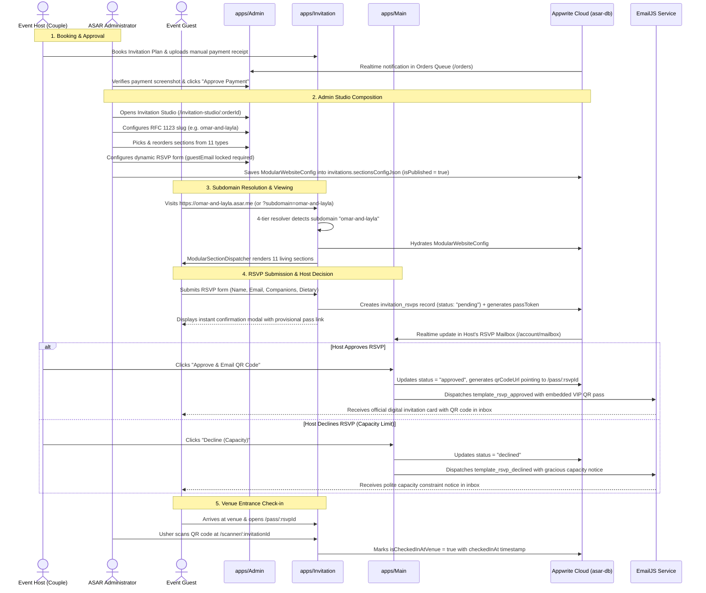
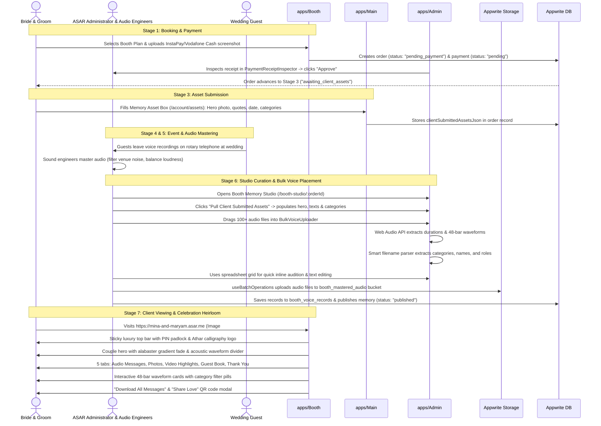
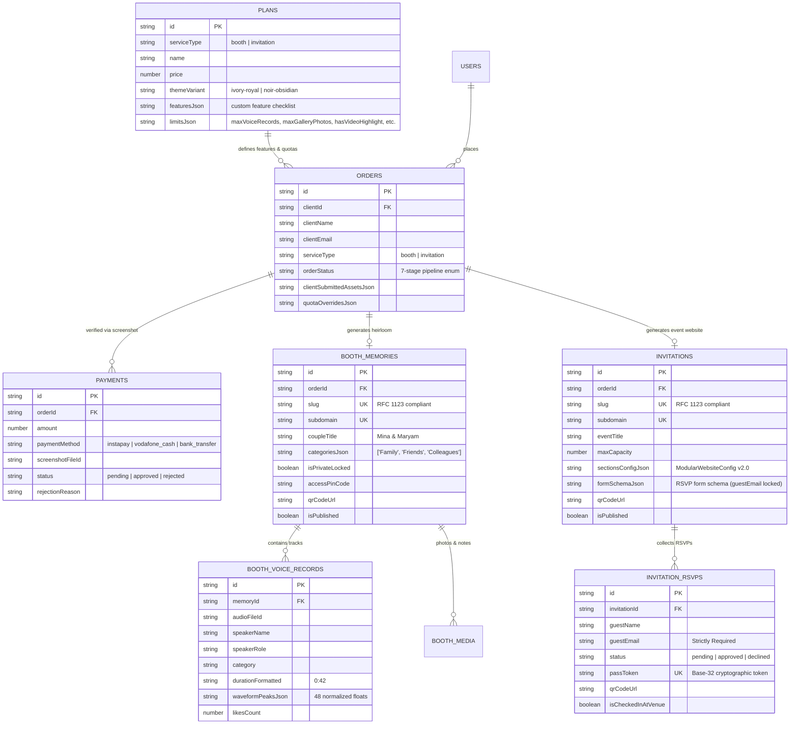

# ASAR Monorepo Architecture Blueprint & Agent Onboarding Specification

> **Target Document:** `docs/AGENT_GUIDE.md`  
> **Author:** `spec_miner_survey_guide` (Specification Miner & Architecture Investigator)  
> **Repository Root:** `d:\asar`  
> **Integrity Mode:** Development / Production Readiness  
> **Last Updated:** 2026-11-04  

---

## Table of Contents
1. [Executive Monorepo Architecture](#1-executive-monorepo-architecture)
2. [Monorepo Configuration & Tooling Infrastructure](#2-monorepo-configuration--tooling-infrastructure)
3. [The Five Workspace Applications](#3-the-five-workspace-applications)
   - [3.1. apps/Admin (Port 3001) — Operations Management Console](#31-appsadmin-port-3001--operations-management-console)
   - [3.2. apps/Booth (Port 3002) — Dynamic Storefront & Audio Guestbook](#32-appsbooth-port-3002--dynamic-storefront--audio-guestbook)
   - [3.3. apps/Invitation (Port 3003) — Dynamic Storefront & Bespoke Events](#33-appsinvitation-port-3003--dynamic-storefront--bespoke-events)
   - [3.4. apps/Main (Port 3000) — Platform Gateway & Unified Client Account Portal](#34-appsmain-port-3000--platform-gateway--unified-client-account-portal)
   - [3.5. apps/Renderer (Port 3004) — Universal Dynamic Storefront Renderer](#35-appsrenderer-port-3004--universal-dynamic-storefront-renderer)
4. [Shared Monorepo Packages](#4-shared-monorepo-packages)
   - [4.1. @repo/react-appwrite](#41-reporeact-appwrite)
   - [4.2. @repo/ui-components](#42-repoui-components)
   - [4.3. @repo/assets-shared](#43-repoassets-shared)
   - [4.4. @repo/typescript-config & @repo/eslint-config](#44-repotypescript-config--repoeslint-config)
5. [End-to-End Data Flows & System Lifecycles](#5-end-to-end-data-flows--system-lifecycles)
   - [5.1. The Invitation Event Lifecycle](#51-the-invitation-event-lifecycle)
   - [5.2. The Booth Audio Guestbook Lifecycle](#52-the-booth-audio-guestbook-lifecycle)
   - [5.3. Backend Cloud Architecture & Defensive Offline Fallback](#53-backend-cloud-architecture--defensive-offline-fallback)
6. [ASAR Warm Vintage Editorial Luxury Design System](#6-asar-warm-vintage-editorial-luxury-design-system)
   - [6.1. Visual Philosophy & Color Tokens](#61-visual-philosophy--color-tokens)
   - [6.2. Typography Hierarchy](#62-typography-hierarchy)
   - [6.3. Chakra UI v3 Component Engineering Patterns](#63-chakra-ui-v3-component-engineering-patterns)
7. [Future Agent Guidelines & Operational Best Practices](#7-future-agent-guidelines--operational-best-practices)
   - [7.1. Rule 1: Safe Verification & Build Avoidance](#71-rule-1-safe-verification--build-avoidance)
   - [7.2. Rule 2: Workspace Partitioning & File Ownership](#72-rule-2-workspace-partitioning--file-ownership)
   - [7.3. Rule 3: TypeScript & Linting Standards](#73-rule-3-typescript--linting-standards)
   - [7.4. Rule 4: Subdomain & Routing Hygiene](#74-rule-4-subdomain--routing-hygiene)
8. [Features Discovered & Verified Inventory](#8-features-discovered--verified-inventory)
9. [Edge Cases & Runtime Behaviors](#9-edge-cases--runtime-behaviors)

---

## 1. Executive Monorepo Architecture

**ASAR (Athar / أثر)** is an Awwwards-caliber experiential digital memory and bespoke event hospitality platform. The platform is organized as a high-performance **Turborepo** monorepo using **npm workspaces** (`npm@11.13.0`), **React 18.2.0**, **TypeScript 5.5.4**, **Vite 5.4.0**, **Chakra UI v3 (`^3.32.0`)**, and **React Router v6 (`^6.28.0`)**.

Backend cloud infrastructure is provided by **Appwrite Cloud v17** (Databases, Storage, Realtime WebSockets, Authentication, Teams RBAC, and Avatars QR generation) supplemented by **EmailJS** (`@emailjs/browser`) for automated invitation RSVP approvals and QR pass delivery.

### Monorepo Topology Diagram

```
+--------------------------------------------------------------------------------------------------+
|                                    ASAR TURBOREPO MONOREPO                                       |
+--------------------------------------------------------------------------------------------------+
                                                 |
         +---------------------------------------+---------------------------------------+
         |                                                                               |
         v                                                                               v
   [ apps/* (5 Apps) ]                                                          [ packages/* (5 Pkgs) ]
   ├── apps/Main (Port 3000)                                                    ├── packages/react-appwrite
   │   ├── Platform Gateway (/)                                                 │   ├── AsarDomain (Sections, Models)
   │   └── Client Portal (/account/*)                                           │   ├── Storefront (Subdomain Engine)
   │                                                                            │   ├── Provider & Auth
   ├── apps/Admin (Port 3001)                                                   │   ├── Cache Fusion & Realtime
   │   ├── Plan Builder (/plans)                                                │   └── Batch Ops & File Upload
   │   ├── Orders Queue (/orders)                                               │
   │   ├── Booth Studio (/booth-studio)                                         ├── packages/UI-components
   │   └── Invitation Studio (/invitation-studio)                               │   └── 21 Awwwards Components
   │                                                                            │
   ├── apps/Booth (Port 3002)                                                   ├── packages/assets-shared
   │   ├── Dynamic Storefront Root (/)                                          │   └── Logos, Photos, Media
   │   ├── 14-Section Marketing Landing                                         │
   │   └── Memory Page (/memory/:slug)                                          ├── packages/typescript-config
   │                                                                            │   └── base, vite, react configs
   ├── apps/Invitation (Port 3003)                                              │
   │   ├── Dynamic Storefront Root (/)                                          └── packages/eslint-config
   │   ├── Showcase Landing & Booking                                               └── Shared ESLint rules
   │   ├── Custom Event Living Page (/e/:slug)
   │   ├── VIP QR Pass (/pass/:rsvpId)
   │   └── Venue Check-in Scanner (/scanner)
   │
   └── apps/Renderer (Port 3004)
       ├── Master Multi-Tenant Storefront Router
       ├── Automated Memory Classifier (Booth vs Invitation)
       └── Subdomain & Path Resolvers (/s/:slug, /booth/:slug, /e/:slug)
```

---

## 2. Monorepo Configuration & Tooling Infrastructure

### 2.1. Root `package.json`
- **Package Manager:** `npm@11.13.0`
- **Workspaces:**
  ```json
  "workspaces": [
    "apps/*",
    "packages/*"
  ]
  ```
- **React Overrides:** Strict lock to React 18 to ensure zero peer-dependency collisions:
  ```json
  "overrides": {
    "react": "18.2.0",
    "react-dom": "18.2.0"
  }
  ```
- **Root Scripts:**
  - `npm run build`: `dotenv -e .env -- turbo run build`
  - `npm run dev`: `dotenv -e .env -- turbo run dev --concurrency=20`
  - `npm run lint`: `turbo run lint`
  - `npm run format`: `prettier --write "**/*.{ts,tsx,md}"`

### 2.2. Turborepo Pipeline (`turbo.json`)
```json
{
  "$schema": "https://turborepo.dev/schema.json",
  "tasks": {
    "build": {
      "dependsOn": ["^build"],
      "inputs": ["$TURBO_DEFAULT$", ".env*"],
      "outputs": ["dist/**"]
    },
    "lint": {},
    "dev": {
      "cache": false,
      "persistent": true
    }
  }
}
```
- **Build Caching:** Builds depend on dependencies completing their builds first (`^build`). Outputs are saved to `dist/**`.
- **Environment Inputs:** Turborepo tracks changes to `.env*` files alongside source changes before invalidating cache.
- **Persistent Dev:** Dev tasks run continuously with caching disabled.

### 2.3. Shared TypeScript Tooling (`packages/typescript-config`)
1. **`base.json`**:
   - `strict: true`
   - `composite: false`
   - `declaration: true`
   - `declarationMap: true`
   - `module: "ESNext"`
   - `moduleResolution: "Bundler"`
   - `isolatedModules: true`
2. **`vite.json`**:
   - Extends `./base.json`
   - `target: "ESNext"`
   - `lib: ["ESNext", "DOM"]`
   - `noEmit: true`
   - `noUnusedLocals: true`, `noUnusedParameters: true`, `noImplicitReturns: true`
3. **`react-library.json`**:
   - Extends `./base.json`
   - `jsx: "react-jsx"`

### 2.4. Shared ESLint Tooling (`packages/eslint-config`)
- Extends: `eslint:recommended`, `plugin:@typescript-eslint/recommended`, `prettier`.
- Parser: `@typescript-eslint/parser`.
- Permissive Override: `@typescript-eslint/no-non-null-assertion: "off"`.

---

## 3. The Five Workspace Applications

Each application inside `apps/*` serves an isolated, clearly defined role within the ASAR ecosystem. Cross-app contamination is strictly forbidden.

### 3.1. `apps/Admin` (Port 3001) — Operations Management Console

#### Purpose & Scope
The command center for ASAR administrators and event concierges. Handles operational KPIs, custom plan authoring, order pipeline tracking, manual payment receipt audits, and dedicated visual authoring studios for both Booth memories and living modular event websites.

#### Route Table
| Path | Component | Purpose & Behavior |
| :--- | :--- | :--- |
| `/` | `<Navigate to="/overview" replace />` | Canonical root redirect to dashboard overview. |
| `/overview` | `<AdminOverview />` | Platform KPI cards (active orders, revenue, published memories), quick shortcuts, and recent order queue. |
| `/plans` | `<PlanBuilderStudio />` | Full CRUD editor for Booth and Invitation plans, custom feature checklists, and system limit quotas. |
| `/orders` | `<OrdersQueueManager />` | Filterable 7-stage order queue with manual payment receipt inspection. |
| `/orders/:orderId` | `<OrdersQueueManager />` | Deep link directly focusing a specific customer order with inspector drawer opened. |
| `/booth-studio/:orderId?` | `<BoothStudioRouteWrapper />` | Split-screen Booth visual studio with live mobile preview, bulk audio uploader, waveform analyzer, and canonical QR generator. |
| `/invitation-studio/:orderId?` | `<InvitationStudioRouteWrapper />` | Split-screen modular event builder with live preview, section block reordering, 11 inspectors, and dynamic RSVP form builder. |
| `*` | `<Navigate to="/overview" replace />` | Wildcard fallback redirecting unknown admin paths to overview. |

#### Key Subsystems & Components
1. **`AdminShell.tsx`**: Left sidebar navigation with live badge counters (e.g. pending payments count), responsive layout, and Athar branding.
2. **`PlanBuilderStudio.tsx`**: Dynamic plan creation and editing with `featuresJson` checklist and `limitsJson` configuration (max voice records, gallery photos, video highlight toggles, bulk zip download permissions).
3. **`OrdersQueueManager.tsx` & `PaymentReceiptInspector.tsx`**: 7-stage order status state machine switcher with zoomable receipt lightbox for approving or rejecting manual payment receipts with rejection reasons.
4. **`BoothMemoryStudio.tsx`**: Split-screen studio containing:
   - `HeroAndTextsEditor.tsx`: RFC 1123 slug editor with reserved domain protection and client-submitted asset hydration.
   - `BulkVoiceUploader.tsx`: Multi-file/folder drag-and-drop zone with background Web Audio API decoding and filename parsing.
   - `VoiceBatchGridEditor.tsx`: Spreadsheet batch editor with inline audio player and bulk category assignment.
   - `MediaAndTabsEditor.tsx`: Photos, video highlights, guestbook configuration, and canonical QR generation via `buildMemoryUrls`.
5. **`InvitationStudio.tsx`**: Split-screen modular website builder containing:
   - `SectionPaletteModal.tsx`: Visual section picker with 4 categories (Essentials, Story & Media, Interactive Engagement, Gifting & Logistics).
   - `ModularSectionList.tsx`: Reorderable deck with drag handles, move up/down controls, visibility toggles, and deletion.
   - `inspectors/*`: 11 strongly-typed inspectors tailored for every section type.
   - `DynamicFormSchemaBuilder.tsx`: RSVP form schema editor with locked mandatory `guestEmail` field.
   - `LiveModularPreview.tsx`: Zero-latency split-screen preview canvas with mobile and desktop viewport frames.

#### File Write Boundaries
- **Allowed:** `apps/Admin/src/**/*`, `apps/Admin/test/**/*`.
- **Forbidden:** Never write customer-facing portal views or storefront landing pages into `apps/Admin`.

---

### 3.2. `apps/Booth` (Port 3002) — Dynamic Storefront & Audio Guestbook

#### Purpose & Scope
The public storefront and digital heirloom delivery vehicle for ASAR's audio guestbook service. Serves both as the marketing landing page (with booking wizard) and the generated private memory website matching **Visual Reference #1** (*Mina & Maryam*).

#### Route Table
| Path | Component | Purpose & Behavior |
| :--- | :--- | :--- |
| `/` | `<DynamicBoothStorefrontIndex />` | **Storefront Index:** Checks `useSubdomain()`. If subdomain detected, renders `<BoothMemoryPage slug={subdomain} />`. If bare apex host or bare localhost, renders `<BoothLandingView />` (14-section marketing landing page). |
| `/book` | `<BoothLandingView autoOpenBooking={true} />` | Direct deep link opening the 3-step booking wizard modal. |
| `/memory/:slug` | `<BoothMemoryPage />` | Explicit canonical memory route matching Visual Reference #1 layout. |
| `/m/:slug` | `<BoothMemoryPage />` | Concise short-link alias for printed cards and WhatsApp links. |
| `*` | `<BoothLuxuryNotFound />` | Branded luxury 404 screen with Athar crest and navigation button. |

#### Key Subsystems & Components
1. **`DynamicBoothStorefrontIndex`**: 4-tier subdomain resolver hook that dynamically dispatches between the public marketing landing page and the private couple heirloom.
2. **`BoothLandingView`**: 14 editorial sections: `HeroSection`, `StatsSection`, `MoreThanPhoneSection`, `WhyChooseUsSection`, `PackagesSection`, `AddonsSection`, `HowItWorksSection`, `RealVoicesSection`, `GallerySection`, `VideoSection`, `FAQSection`, `ContactSection`, `PrivacySection`, and `BookingModal`.
3. **`BoothMemoryPage.tsx`** (Visual Reference #1 Implementation):
   - Sticky top bar with slide-over menu, Athar calligraphy crest, and security/privacy padlock badge.
   - Editorial couple hero with soft alabaster bottom fade, couple title, acoustic waveform ornament (`─── ∿∿∿ ───`), 3 metadata badges, and personal quote.
   - 5-tab horizontal strip: `Audio Messages`, `Photos`, `Video Highlights`, `Guest Book`, `Thank You`.
   - `VoiceRecordCard.tsx`: Monogram avatar fallback via `useAvatars().getInitials`, 48-bar interactive waveform scrubber, time display (`0:42`), favorite toggle, and individual MP3 download.
   - Dynamic category filter pills with real track counts (`All (86)`, `Family (24)`, etc.).
   - Video highlight card with 30s teaser banner.
   - Bottom dual action cards: "Download All Messages" (batch ZIP download) and "Share Love" (QR code modal).

#### File Write Boundaries
- **Allowed:** `apps/Booth/src/**/*`, `apps/Booth/test/**/*`.
- **Forbidden:** Do not edit Admin studio logic or Invitation schemas from `apps/Booth`.

---

### 3.3. `apps/Invitation` (Port 3003) — Dynamic Storefront & Bespoke Events

#### Purpose & Scope
The living event website generator and guest hospitality portal. Powers bespoke event websites for weddings, engagements, festivals, and galas via modular section composition, real-time wishing wall submissions, digital gift registries, dynamic RSVP collection, VIP QR pass delivery, and on-site entrance check-in scanning.

#### Route Table
| Path | Component | Purpose & Behavior |
| :--- | :--- | :--- |
| `/` | `<DynamicInvitationStorefrontIndex />` | **Storefront Index:** Checks `useSubdomain()`. If subdomain detected, renders `<CustomEventPage slug={subdomain} />`. If bare apex host or bare localhost, renders `<InvitationLandingPage />` showcase. |
| `/book` | `<InvitationBookingRouteView />` | Direct deep link opening custom invitation booking modal. |
| `/e/:slug` | `<CustomEventPage />` | Explicit bespoke event website route rendering dynamic modular sections. |
| `/pass/:rsvpId` | `<QrPassPage />` | VIP guest digital QR pass with cryptographic token verification. |
| `/scanner/:invitationId` | `<ScannerRouteView />` | Venue entrance scanner for attendants validating guest QR passes. |
| `/scanner` | `<ScannerRouteView />` | General venue check-in scanner. |
| `*` | `<InvitationLuxuryNotFound />` | Branded luxury 404 screen. |

#### Key Subsystems & Components
1. **`DynamicInvitationStorefrontIndex`**: 4-tier subdomain resolver hook that dynamically dispatches between the service showcase landing page and the living event website.
2. **`CustomEventPage.tsx`**: Dynamic modular page entry point that reads `sectionsConfigJson`, parses it with `parseModularWebsiteConfig`, filters `enabled === true`, sorts by `order`, and renders sections via `ModularSectionDispatcher`.
3. **`components/modular-renderer/sections/*`**: The 11 modular section components:
   - `CoverHeroSection.tsx`: Couple typography, date/venue badges, countdown timer, audio prompt.
   - `CoupleStorySection.tsx`: Chronological milestone cards with photos and dates.
   - `MultiEventScheduleSection.tsx`: Timeline with addresses, dress codes, and 1-tap Google/Apple Maps routing.
   - `ResponsivePhotoGallerySection.tsx`: Masonry/grid/carousel with category filtering and fullscreen lightbox.
   - `InteractiveWishingWallSection.tsx`: Real-time guest blessings with reactions and moderation support.
   - `DigitalGiftRegistrySection.tsx`: Bank QR (VietQR / InstaPay / IBAN), account numbers, and 1-tap copy.
   - `FloatingAudioPlayerBar.tsx`: Persistent audio soundtrack bar with spinning vinyl disc animation.
   - `VenueLocationSection.tsx`: Interactive map embed, parking notes, attire swatches.
   - `LiveCountdownSection.tsx`: Real-time second-by-second countdown ticker.
   - `CustomHighlightSection.tsx`: High-impact editorial callouts and parental notes.
   - `InteractiveRsvpSection.tsx`: Dynamic form submission with attendance choices, companion counts, dietary options, locked email verification, and instant VIP pass modal generation.
4. **`GuestPassPage.tsx` & `GuestQrPassCard.tsx`**: VIP check-in pass displaying guest name, companions count, event date, venue, and high-resolution QR pass code.
5. **`VenueQrScanner.tsx`**: Web camera scanner with audio/haptic feedback that verifies guest pass tokens and marks attendance in real time.

#### File Write Boundaries
- **Allowed:** `apps/Invitation/src/**/*`, `apps/Invitation/test/**/*`.
- **Forbidden:** Do not edit Booth memory templates or Admin studios from `apps/Invitation`.

---

### 3.4. `apps/Main` (Port 3000) — Platform Gateway & Unified Client Account Portal

#### Purpose & Scope
The brand gateway connecting all ASAR hospitality services and the client self-service account portal. Provides customer authentication and account management for hosts/couples across both Booth and Invitation orders.

#### Route Table
| Path | Component | Purpose & Behavior |
| :--- | :--- | :--- |
| `/` | `<PlatformGateway />` | Brand ecosystem homepage showcasing Booth and Invitation services with direct portals. |
| `/auth` | `<PlatformGateway initialAuthOpen={true} />` | Direct deep link opening customer login / registration modal. |
| `/account` | `<ClientAccountShell />` | Client account shell defaulting to active orders (`/account/orders`). |
| `/account/orders` | `<ClientAccountShell />` | **7-Stage Live Order Tracker:** Visual timeline, payment receipt re-upload, and concierge progress. |
| `/account/assets` | `<ClientAccountShell />` | **Client Asset Submission Box:** Upload hero photo, couple names, date, venue, quotes, categories. |
| `/account/audio` | `<ClientAccountShell />` | **Mastered Audio Reviewer:** Pre-release audition player for client to review mastered voices. |
| `/account/qr-hub` | `<ClientAccountShell />` | **Client QR Hub:** Downloadable high-resolution table cards and station QR codes. |
| `/account/mailbox` | `<ClientAccountShell />` | **Invitation RSVP Mailbox:** Real-time guest response inbox with capacity tracker and EmailJS Approve/Decline actions. |
| `*` | `<Navigate to="/" replace />` | Wildcard fallback redirecting unknown routes to gateway. |

#### Key Subsystems & Components
1. **`PlatformGateway.tsx` & `EcosystemHome.tsx`**: Unified landing portal introducing both services with luxury editorial design and direct booking hooks.
2. **`AuthModal.tsx`**: Appwrite-backed customer authentication modal supporting email/password login, registration, and session persistence.
3. **`ClientAccountShell.tsx`**: Account dashboard shell with navigation tabs, user greeting, and logout controls.
4. **`OrderTrackerTimeline.tsx`**: 7-stage visual pipeline tracker showing exact status: `pending_payment`, `payment_rejected`, `awaiting_client_assets`, `event_scheduled`, `audio_mastering`, `studio_curation`, `published`.
5. **`RawAssetsManager.tsx`**: Stage 3 asset submission form where clients provide personalization data.
6. **`AudioReviewPlayer.tsx`**: Audio review suite for couples to listen to mastered voice messages before public deployment.
7. **`QrHubManager.tsx`**: Printable table tent and station signage assets with downloadable canonical QR codes.
8. **`ClientRsvpMailbox.tsx`**: Host RSVP inbox with real-time WebSocket updates, capacity gauge, and atomic EmailJS dispatch on Approve/Decline.

#### File Write Boundaries
- **Allowed:** `apps/Main/src/**/*`, `apps/Main/test/**/*`.
- **Forbidden:** Do not edit storefront rendering logic or admin studio components from `apps/Main`.

---

### 3.5. `apps/Renderer` (Port 3004) — Universal Dynamic Storefront Renderer

#### Purpose & Scope
A dedicated, high-performance universal storefront renderer designed for multi-tenant edge deployments. Capable of dynamically resolving ANY tenant subdomain, query parameter, or route slug, automatically classifying whether the target is a Booth Memory or an Invitation Event, and rendering the appropriate heirloom with full hydration.

#### Route Table
| Path | Component | Purpose & Behavior |
| :--- | :--- | :--- |
| `/` | `<DynamicStorefrontIndex />` | **Universal Root:** Resolves `*.localhost`, `*.asar.me`, `?subdomain=`, or bare apex portal. |
| `/s/:slug` | `<DynamicStorefrontIndex />` | **Universal Memory Path:** Auto-classifies Booth vs. Invitation. |
| `/booth/:slug`, `/memory/:slug`, `/m/:slug` | `<DynamicStorefrontIndex forcedType="booth" />` | Explicit Booth memory routes. |
| `/invitation/:slug`, `/event/:slug`, `/e/:slug` | `<DynamicStorefrontIndex forcedType="invitation" />` | Explicit Invitation memory routes. |
| `/pass/:rsvpId` | `<GuestPassStorefrontPage />` | VIP guest QR pass route. |
| `*` | `<StorefrontNotFound />` | Branded luxury 404 catch-all screen with Athar crest. |

#### Key Subsystems & Components
1. **`DynamicStorefrontIndex.tsx`**:
   - 4-tier subdomain resolution (`routeParam`, `searchParams`, `fallbackSubdomain`, `hostname`).
   - Synchronous multi-tier classification:
     1. Forced type prop / query parameter (`?type=booth|invitation|pass`).
     2. Known presets (`DEMO_BOOTH_MEMORY`, `INVITATION_PRESETS`).
     3. LocalStorage defensive cache lookup (`getBoothMemoriesCache`, `getInvitationsCache`).
     4. Slug prefix heuristics (`booth-*`, `audio-*`, `inv-*`, `event-*`).
   - Asynchronous remote Appwrite collection hydration when classification is unknown.
   - Bare apex detection rendering `<StorefrontShowcasePortal />`.
   - Reserved subdomains guard and RFC 1123 slug validation.
2. **`BoothMemoryRenderer.tsx`**: Dedicated standalone renderer for Booth memories with audio player, category pills, lightbox, and video modal.
3. **`InvitationMemoryRenderer.tsx`**: Dedicated standalone renderer for modular event invitations with countdown, schedule, location, and dynamic RSVP form.
4. **`StorefrontShowcasePortal.tsx`**: Apex showcase portal when accessed on bare domain.
5. **`StorefrontNotFound.tsx`**: Contextual 404 screen explaining whether the slug was invalid, reserved, or not found.

#### File Write Boundaries
- **Allowed:** `apps/Renderer/src/**/*`, `apps/Renderer/test/**/*`.
- **Forbidden:** Do not edit `apps/Admin` or `apps/Main` from `apps/Renderer`.

---

## 4. Shared Monorepo Packages

### 4.1. `@repo/react-appwrite` (`packages/react-appwrite`)

The central domain and infrastructure engine for the entire platform.

#### Key Submodules
1. **`AsarDomain/sections.ts`**:
   - Discriminated union of 11 event sections:
     ```typescript
     export type EventSectionType =
       | "cover_hero"
       | "couple_story"
       | "event_schedule"
       | "photo_gallery"
       | "wishing_wall"
       | "digital_gift_registry"
       | "background_audio"
       | "venue_location"
       | "live_countdown"
       | "custom_highlight"
       | "dynamic_rsvp";
     ```
   - Strongly-typed models for all 11 sections with `SectionBase`.
   - Container schema: `ModularWebsiteConfig` (`version: "2.0"`).
   - Functions:
     - `createDefaultModularWebsiteConfig()`: Generates complete 11-section default configuration.
     - `parseModularWebsiteConfig(raw)`: Safe JSON parser with zero-crash fallback that automatically migrates legacy flat blocks (`InvitationSectionBlock[]`) into modern `EventSection[]` structures.
     - `validateModularWebsiteConfig(config)`: Validates section integrity, required fields, and ordering.
2. **`AsarDomain/models.ts`**:
   - Core domain interfaces: `BoothPlan`, `AsarOrder`, `AsarPayment`, `BoothMemory`, `BoothVoiceRecord`, `BoothMedia`, `AsarInvitation`, `InvitationRsvp`.
3. **`AsarDomain/collections.ts`**:
   - Constants for Database ID (`ASAR_DATABASE_ID = "asar-db"`).
   - Collection IDs: `PLANS`, `ORDERS`, `PAYMENTS`, `BOOTH_MEMORIES`, `BOOTH_VOICE_RECORDS`, `BOOTH_MEDIA`, `INVITATIONS`, `INVITATION_RSVPS`.
   - Storage Bucket IDs: `PAYMENT_RECEIPTS`, `CLIENT_RAW_ASSETS`, `BOOTH_MASTERED_AUDIO`, `BOOTH_GALLERY_MEDIA`, `INVITATION_ASSETS`.
4. **`AsarDomain/audioAnalyzer.ts`**:
   - `formatDuration(seconds)`: Formats audio durations into `m:ss` (e.g. `0:42`).
   - `generateWaveformPeaks(audioBuffer)`: Decodes audio via Web Audio API into 48 normalized floats `[0..1]`.
   - `parseVoiceFilename(filename, folder)`: Smart filename parser handling 4 patterns:
     - Pattern A: `Category_Speaker Name_Role.ext`
     - Pattern B: `Category - Speaker Name - Role.ext`
     - Pattern C: `01_Speaker_Name_Category.ext`
     - Pattern D: Folder category inheritance (`Colleagues/Dr_Khaled.mp3`).
5. **`AsarDomain/emailJsService.ts`**:
   - EmailJS integration with simulation mode fallback. Constructs payloads for `template_rsvp_approved` and `template_rsvp_declined`.
6. **`AsarDomain/orderPipeline.ts`**:
   - State machine definitions for the 7 order pipeline stages, progress percentages, and status label mappings.
7. **`Storefront/subdomain.ts` & `Storefront/useSubdomain.ts`**:
   - 4-tier subdomain resolution engine (`extractSubdomain`, `resolveSubdomain`, `useSubdomain`).
   - RFC 1123 slug validator (`validateSubdomainSlug`).
   - 16 Reserved System Subdomains Guard: `admin`, `api`, `booth`, `main`, `invitation`, `app`, `cdn`, `mail`, `auth`, `dev`, `staging`, `test`, `www`, `storefront`, `status`, `account`.
8. **`Storefront/urlBuilder.ts`**:
   - `buildMemoryUrls({ slug, type, port, isDev })`: Generates `canonicalUrl` (`https://${slug}.asar.me`), `devLocalhostUrl` (`http://${slug}.localhost:3002`), and `devQueryUrl` (`http://localhost:3002?subdomain=${slug}`).
9. **`Storefront/cacheHelper.ts`**:
   - Defensive multi-tier cache resolver for localStorage and memory caching (`getBoothMemoriesCache`, `getInvitationsCache`, `findInCache`, `setNormalizedCache`).

---

### 4.2. `@repo/ui-components` (`packages/UI-components`)

A curated collection of 21 Awwwards-grade visual and interactive components built with Three.js, OGL, Framer Motion, GSAP, and Canvas:

| Component | Technology | Primary Application |
| :--- | :--- | :--- |
| `GradientWaves` | WebGL2 Shader Canvas | Atmospheric hero backgrounds across all apps |
| `BlurText` | Framer Motion | Poetic editorial title entrances |
| `SplitText` | GSAP / CSS | Dramatic heading reveals |
| `TextType` | React Hook | Bilingual typewriter text prompts |
| `CircularText` | SVG / CSS Animation | Rotating luxury stamp badges |
| `ScrollReveal` | Intersection Observer | Smooth section entrance on scroll |
| `RotatingText` | CSS Transforms | Dynamic hero feature cycling |
| `CrystalizedBall` | Three.js WebGL | Interactive 3D luxury orb visualizer |
| `DitherVeil` | WebGL Shader | Retro-luxury grain and veil overlays |
| `GlowCursor` & `SplashCursor` | Fluid Canvas Simulation | Interactive luxury cursor trails |
| `ScrollExpand` | Motion Layout | Expandable video and image cards |
| `FadeContent` | Framer Motion | Soft blur-in content wrappers |
| `GradualBlur` | CSS Backdrop Filter | Luxury frosted glass overlays |
| `Magnet` | Spring Physics | Magnetic cursor attraction on primary CTA buttons |
| `MorphSlider` | SVG Morphing | Interactive tab switches and comparison sliders |
| `CardNav` | Motion | Floating tactile card navigation bar |
| `TiltedCard` | 3D Perspective CSS | Interactive pricing packages and VIP pass cards |
| `DecayCard` | Canvas / Motion | Organic photo and memory reveals |
| `PaperCrumple` | Three.js Texture | Tactile cotton rag paper textures |
| `PeekRating` | SVG / Motion | Interactive guest ratings and sentiment hearts |
| `CircularGallery` | WebGL / 3D Cylinder | Rotating 3D photo carousel |
| `CountUp` | React Animation | Smooth number counters for stats and capacity |
| `HalftoneReveal` | WebGL Shader | Luxury print halftone transitions |

---

### 4.3. `@repo/assets-shared` (`packages/assets-shared`)
Houses shared brand logos (`logo-main.png`, `logo.jpeg`), high-resolution wedding photography (`booth-hero-photo.webp`, `love-wedding.jpg`, `wedding2.jpg`), and UX reference assets.

### 4.4. `@repo/typescript-config` & `@repo/eslint-config`
Shared configuration bases ensuring uniform strict compiler options and lint rules across all 5 apps and 5 packages.

---

## 5. End-to-End Data Flows & System Lifecycles

### 5.1. The Invitation Event Lifecycle



---

### 5.2. The Booth Audio Guestbook Lifecycle



---

### 5.3. Backend Cloud Architecture & Defensive Offline Fallback



#### Defensive Offline Fallback Mode
All applications implement a zero-crash defensive fallback architecture:
1. **Cache Fallback:** If Appwrite Cloud credentials are not set or the network is unreachable, `cacheHelper.ts` and localStorage provide persistent mock data.
2. **Seed Defaults:** `DEMO_BOOTH_MEMORY` (Mina & Maryam) and `INVITATION_PRESETS` (Omar & Layla) hydrate instantly to guarantee that development, visual verification, and automated tests run smoothly in any environment.
3. **Simulation Mode:** EmailJS dispatches run in simulated mode when keys are missing, outputting formatted email templates and QR URLs to console logs without crashing.

---

## 6. ASAR Warm Vintage Editorial Luxury Design System

### 6.1. Visual Philosophy & Color Tokens

Every screen across all five workspace apps must reflect **Warm Vintage Editorial Luxury**. Standard SaaS gray or sterile white canvas is strictly prohibited.

```css
:root {
  /* Brand Primary: Royal Maroon & Burgundy */
  --athar-maroon: #6B1D28;
  --athar-maroon-dark: #5B1621;
  --athar-maroon-deep: #4A0E17;
  --athar-maroon-glow: rgba(107, 29, 40, 0.16);
  --athar-maroon-subtle: rgba(107, 29, 40, 0.06);

  /* Brand Secondary: Champagne Gold */
  --athar-gold: #D4AF37;
  --athar-gold-bright: #E5C158;
  --athar-gold-light: #F1E5D1;
  --athar-gold-border: rgba(212, 175, 55, 0.4);

  /* Editorial Surfaces: Alabaster & Linen */
  --athar-bg-primary: #FBF7F2;      /* Primary Canvas */
  --athar-bg-secondary: #F4EFEA;    /* Secondary Surface */
  --athar-bg-tertiary: #EDE6DC;     /* Muted Accents */
  --athar-card-bg: rgba(255, 255, 255, 0.94);
  --athar-card-border: rgba(107, 29, 40, 0.08);

  /* Noir VIP Surface */
  --athar-noir-bg: linear-gradient(170deg, #231A1E 0%, #161214 100%);
  --athar-noir-surface: #1F1A1C;

  /* Typography Colors */
  --athar-text-title: #231F20;
  --athar-text-body: #4A4240;
  --athar-text-muted: #7A6F6D;

  /* Status Colors */
  --athar-status-success: #1E6F50;
  --athar-status-success-bg: rgba(30, 111, 80, 0.1);
  --athar-status-warning: #B7791F;
  --athar-status-warning-bg: rgba(212, 175, 55, 0.18);
  --athar-status-danger: #9B2C2C;
  --athar-status-danger-bg: rgba(155, 44, 44, 0.1);

  /* Radii & Shadows */
  --athar-radius-sm: 8px;
  --athar-radius-md: 16px;
  --athar-radius-lg: 24px;
  --athar-radius-xl: 32px;
  --athar-radius-full: 9999px;
  --athar-shadow-soft: 0 10px 30px -10px rgba(107, 29, 40, 0.06);
  --athar-shadow-elevated: 0 24px 48px -12px rgba(107, 29, 40, 0.14);
}
```

### 6.2. Typography Hierarchy
- **Classical Display Serif:** `'Amiri'`, `'Playfair Display'`, serif (`--font-arabic-display`, `--font-latin-display`). Used for couple names, hero headlines, and section titles.
- **Modern Sans Body:** `'Cairo'`, system-ui, sans-serif (`--font-body`). Used for UI controls, buttons, forms, tables, and body copy.
- **Bilingual Paragraphs:** Always specify `dir="auto"` on paragraphs containing guest quotes or bilingual user inputs to ensure natural punctuation rendering.

### 6.3. Chakra UI v3 Component Engineering Patterns

> [!WARNING]
> **Chakra UI v3 Compatibility Constraints:**
> The repository uses **Chakra UI v3 (`^3.32.0`)**. Deprecated v2 exports (`ModalOverlay`, `FormControl`, `FormLabel`, `useToast`, `Divider`, `as={Link}`) do not exist in v3 and will cause compilation failures.

#### Approved Component Recipes
1. **Pill Buttons:**
   ```tsx
   <Button
     bg="var(--athar-maroon)"
     color="white"
     px={7}
     py={5}
     borderRadius="full"
     fontWeight="700"
     _hover={{ bg: "var(--athar-maroon-dark)", transform: "translateY(-2px)" }}
   >
     Action
   </Button>
   ```
2. **Dividers:** Use `<Box h="1px" bg="var(--athar-gold-border)" />`.
3. **Form Controls:** Use standard semantic `<input>`, `<select>`, `<textarea>` with luxury CSS styling.
4. **Modals & Overlays:** Use state-driven `<Box position="fixed" inset="0" zIndex="1000">` with backdrop blur.
5. **Client-Side Navigation:** Use `const navigate = useNavigate()` or wrap Chakra components in React Router `<Link to="...">`.

---

## 7. Future Agent Guidelines & Operational Best Practices

### 7.1. Rule 1: Safe Verification & Build Avoidance
- **DO NOT run `npm run build` without explicit, necessary justification.** Monorepo builds compile 5 applications and 5 packages, generating heavy disk I/O and unnecessary dist artifacts.
- **Safe Verification Hierarchy:**
  1. **Targeted Typecheck (Fastest):**
     - `npx tsc --noEmit -p apps/Admin/tsconfig.app.json`
     - `npx tsc --noEmit -p apps/Booth/tsconfig.app.json`
     - `npx tsc --noEmit -p apps/Invitation/tsconfig.app.json`
     - `npx tsc --noEmit -p apps/Main/tsconfig.app.json`
     - `npx tsc --noEmit -p apps/Renderer/tsconfig.app.json`
     - `npx tsc --noEmit -p packages/react-appwrite/tsconfig.json`
     - `npx tsc --noEmit -p packages/UI-components/tsconfig.json`
  2. **Automated Unit & Stress Tests (Runs in 20–50ms with `npx tsx`):**
     - `npx tsx packages/react-appwrite/test/sections.test.ts`
     - `npx tsx packages/react-appwrite/test/storefront.test.ts`
     - `npx tsx packages/react-appwrite/test/domain.test.ts`
     - `npx tsx apps/Admin/test/modularWebsiteEditor.test.ts`
     - `npx tsx apps/Admin/test/formSchemaValidation.test.ts`
     - `npx tsx apps/Admin/test/filenameParser.test.ts`
     - `npx tsx apps/Admin/test/adversarialStress.test.ts`
     - `npx tsx apps/Booth/test/photoMemoriesAlignment.test.ts`
     - `npx tsx apps/Invitation/test/modularStorefront.test.ts`
     - `npx tsx apps/Invitation/test/dynamicRsvpFormValidation.test.ts`
     - `npx tsx apps/Main/test/emailJsPayloadConstruction.test.ts`
     - `npx tsx apps/Renderer/test/memoryClassifier.test.ts`
     - `npx tsx apps/Renderer/test/storefrontRouting.test.ts`
     - `npx tsx apps/Renderer/test/subdomainResolution.test.ts`
  3. **Targeted Linting:**
     - `npm run lint --workspace=apps/Admin`
     - `npm run lint --workspace=apps/Booth`
     - `npm run lint --workspace=apps/Invitation`
     - `npm run lint --workspace=apps/Main`
     - `npm run lint --workspace=apps/Renderer`

### 7.2. Rule 2: Workspace Partitioning & File Ownership
- **Strict Isolation:** Agents must edit files ONLY within their assigned application or package.
- **Shared Domain Modifications:** If a change impacts multiple applications (e.g. adding a new section type to the modular editor), that change MUST be made in `packages/react-appwrite/src/AsarDomain/sections.ts` first, typechecked, and then imported by consuming apps.
- **No Agent Metadata in Source Trees:** Never place agent logs, scratch scripts, or temporary test runners in `apps/` or `packages/`. Place all metadata in `.agents/teamwork/<your_agent_name>/`.
- **No Dummy Implementations:** Mocking interfaces without functionality or creating placeholder facades violates integrity standards. Every component must be fully wired to state, cache, or Appwrite.

### 7.3. Rule 3: TypeScript & Linting Standards
- **Zero Explicit `any`:** All models must use concrete types, discriminated unions, or `unknown` with narrowing type guards.
- **Zero Unchecked Nulls:** Appwrite documents and localStorage caches may return null/undefined. Always use defensive defaults and nullish coalescing (`??`).
- **No Ad-Hoc Scripts:** Do not create temporary scripts in the root directory. Rely on established test files and TypeScript checking.

### 7.4. Rule 4: Subdomain & Routing Hygiene
- **RFC 1123 DNS Compliance:** Subdomains must be 1–63 lowercase alphanumeric characters (`a-z`, `0-9`) and hyphens, and cannot begin or end with a hyphen.
- **16 Reserved System Subdomains:** Subdomain slugs must never match: `admin`, `api`, `booth`, `main`, `invitation`, `app`, `cdn`, `mail`, `auth`, `dev`, `staging`, `test`, `www`, `storefront`, `status`, `account`.
- **4-Tier Subdomain Resolution:** Always use the canonical 4-tier hierarchy:
  1. Query parameter override (`?subdomain=`, `?memory=`, `?event=`)
  2. Route parameter (`/memory/:slug`, `/e/:slug`)
  3. Hostname subdomain (`mina-and-maryam.localhost:3002`, `omar-and-layla.asar.me`)
  4. Default fallback (render apex marketing landing page)

---

## 8. Features Discovered & Verified Inventory

| # | Category | Feature | Description | Inputs | Outputs | Error Behavior | Discovered Via |
|---|----------|---------|-------------|--------|---------|----------------|----------------|
| 1 | Storefront Subdomain | 4-Tier Subdomain Resolution | Extracts and resolves tenant slug based on priority: query param -> route param -> hostname -> fallback | URL string, SearchParams, Route params | Normalized subdomain slug string or null | Returns null safely for bare apex/localhost | `packages/react-appwrite/src/Storefront/useSubdomain.ts` |
| 2 | Storefront Subdomain | RFC 1123 Slug Validator | Validates slug length (1-63), alphanumeric lowercase characters, and hyphen rules | Slug string | `{ isValid: boolean, error?: string }` | Returns explicit error reasons | `packages/react-appwrite/src/Storefront/subdomain.ts` |
| 3 | Storefront Subdomain | 16 Reserved Subdomain Guard | Prohibits collision with system infrastructure (admin, api, auth, cdn, etc.) | Slug string | `boolean` | Flags reserved slugs as invalid | `packages/react-appwrite/src/Storefront/subdomain.ts` |
| 4 | Storefront Subdomain | Centralized URL Generator (`buildMemoryUrls`) | Generates canonical public, dev RFC 6761 localhost, and dev query fallback URLs | `{ slug, type, port, isDev }` | `{ canonicalUrl, devLocalhostUrl, devQueryUrl }` | Falls back to generic placeholder if slug is empty | `packages/react-appwrite/src/Storefront/urlBuilder.ts` |
| 5 | Modular Sections | 11 `EventSectionType` Models | Discriminated union of 11 modular website sections | Section config object | Validated `EventSection` instance | Compile-time and runtime type validation | `packages/react-appwrite/src/AsarDomain/sections.ts` |
| 6 | Modular Sections | Default Config Factory | Generates standard 11-section `ModularWebsiteConfig` with occasion presets | `{ eventTitle, occasionType }` | `ModularWebsiteConfig` (v2.0) | Default fallback values | `packages/react-appwrite/src/AsarDomain/sections.ts` |
| 7 | Modular Sections | Safe Config Parser & Legacy Migration | Parses raw JSON with zero crash, automatically converting v1 flat blocks to v2 sections | `unknown` JSON/string | `ModularWebsiteConfig` | Returns clean default config on corrupted input | `packages/react-appwrite/src/AsarDomain/sections.ts` |
| 8 | Audio Engineering | Web Audio API Waveform Analyzer | Decodes audio tracks in browser and extracts duration and 48 normalized peaks | Audio File / Buffer | `{ duration: number, waveformPeaks: number[] }` | Generates deterministic synthetic peaks on decode error | `packages/react-appwrite/src/AsarDomain/audioAnalyzer.ts` |
| 9 | Audio Engineering | Smart Filename Parser | Extracts category, speaker name, and role from filenames and folder structures | Filename, optional folder | `{ speakerName, speakerRole, category }` | Gracefully falls back to clean track naming | `packages/react-appwrite/src/AsarDomain/audioAnalyzer.ts` |
| 10 | Orders & Pipeline | 7-Stage Order Pipeline State Machine | Tracks progression: pending_payment -> awaiting_assets -> scheduled -> mastering -> curation -> published | Order object, target status | Updated order with progress percentage | Rejects invalid backward status transitions | `packages/react-appwrite/src/AsarDomain/orderPipeline.ts` |
| 11 | Notifications & Passes | EmailJS Automated Dispatch | Sends VIP QR pass upon host approval; sends polite capacity regret notice on decline | RSVP record, event details | EmailJS delivery status | Operates in Simulation Mode if keys missing | `packages/react-appwrite/src/AsarDomain/emailJsService.ts` |
| 12 | Notifications & Passes | VIP QR Pass Token Generator | Generates cryptographic base-32 pass tokens (`INV-PASS-XXXX-YYYY`) | Optional prefix | Unique pass token string | Set lookup prevents birthday collisions | `apps/Invitation/src/components/modular-renderer/sections/InteractiveRsvpSection.tsx` |
| 13 | Admin Studios | Plan Builder Studio | Author Booth and Invitation packages with custom bullet points and limitsJson quotas | Plan inputs, limits | Synchronized plan record | Validates positive limits and currencies | `apps/Admin/src/components/plans/PlanBuilderStudio.tsx` |
| 14 | Admin Studios | Manual Payment Receipt Inspector | Lightbox displaying payment screenshot with zoom and Approve/Reject workflow | Payment record, admin decision | Updated order & payment status | Requires rejection reason when rejecting | `apps/Admin/src/components/orders/PaymentReceiptInspector.tsx` |
| 15 | Admin Studios | Zero-Effort Bulk Voice Uploader | Drag-and-drop 100+ files with batch inline audition and spreadsheet grid | Array of audio files | Bulk Appwrite uploads + voice records | Progress indicator with error retry | `apps/Admin/src/components/booth-studio/BulkVoiceUploader.tsx` |
| 16 | Admin Studios | Modular Website Creation Editor | Palette modal, reorder deck, 11 inspectors, split-screen preview | Modular website config | Saved `sectionsConfigJson` | Prevents deleting locked RSVP section | `apps/Admin/src/components/invitation-studio/InvitationStudio.tsx` |
| 17 | Admin Studios | Dynamic RSVP Form Builder | Visual form editor with locked mandatory `guestEmail` field | Field definitions | `DynamicFormField[]` schema | Prohibits removing or unlocking guest email | `apps/Admin/src/components/invitation-studio/DynamicFormSchemaBuilder.tsx` |
| 18 | Client Portal | 7-Stage Live Order Tracker | Client-facing visual timeline showing order progress and actionable steps | Order ID, Client session | Rendered progress tracker & uploaders | Guides client on required next action | `apps/Main/src/components/account/OrderTrackerTimeline.tsx` |
| 19 | Client Portal | Host VIP RSVP Mailbox | Real-time inbox showing guest submissions with capacity gauge and EmailJS triggers | Invitation ID, host actions | Updated RSVP statuses & pass emails | Disables approval when capacity reached | `apps/Main/src/components/mailbox/ClientRsvpMailbox.tsx` |
| 20 | Booth Memory | Visual Reference #1 Memory Page | Luxury couple heirloom with alabaster fade, 5 tabs, waveforms, and QR share | Subdomain slug | Rendered memory heirloom page | Prompts for 4-digit PIN if private-locked | `apps/Booth/src/pages/BoothMemoryPage.tsx` |
| 21 | Booth Memory | Photo Memories Alignment | Photo grid with category filter pills, lightbox, and shared domain models | Photo items, category filter | Filtered photo grid & modal | Clamps navigation indices safely | `apps/Booth/src/components/memory/PhotoGalleryGrid.tsx` |
| 22 | Invitation Living | Modular Section Dispatcher | Dynamically dispatches enabled sections in configured sequence | `EventSection[]` array | Rendered interactive sections | Gracefully skips unrecognized section types | `apps/Invitation/src/components/modular-renderer/ModularSectionDispatcher.tsx` |
| 23 | Invitation Living | Interactive Wishing Wall | Real-time blessings wall with guest submission, reactions, and feed | Guest name, message | Persisted blessing card in feed | Validates character count and moderation | `apps/Invitation/src/components/modular-renderer/sections/InteractiveWishingWallSection.tsx` |
| 24 | Invitation Living | Digital Gift Registry with Bank QR | Blessing box with VietQR / InstaPay / IBAN QR codes and 1-tap copy | Bank account details | Visual QR cards + clipboard feedback | Disables inactive bank accounts | `apps/Invitation/src/components/modular-renderer/sections/DigitalGiftRegistrySection.tsx` |
| 25 | Venue Logistics | Venue Entrance Check-in Scanner | Camera QR scanner verifying guest pass tokens and logging attendance | QR video stream | Check-in confirmation & timestamp | Displays error warning on invalid/used tokens | `apps/Invitation/src/components/pass/VenueQrScanner.tsx` |
| 26 | Storefront Edge | Universal Memory Type Classifier | Automatic synchronous and asynchronous detection of Booth vs. Invitation | Slug string, query params | `"booth" \| "invitation" \| "pass"` | Falls back to luxury 404 on unrecognized slug | `apps/Renderer/src/pages/DynamicStorefrontIndex.tsx` |

---

## 9. Edge Cases & Runtime Behaviors

| # | Feature | Input / Condition | Observed & Enforced Behavior |
|---|---------|-------------------|-----------------------------|
| 1 | Subdomain Resolution | Bare apex domain (`asar.me` or `localhost:3002`) | Returns `subdomain: null`. Dynamic index renders apex marketing landing page instead of memory heirloom. |
| 2 | Subdomain Resolution | Reserved subdomain (`admin.asar.me`, `api.asar.me`, `mail.asar.me`) | Flagged by `isReservedSubdomain()`. Triggers contextual `StorefrontNotFound` with `reason="reserved"`. |
| 3 | Subdomain Resolution | RFC 1123 violation (`-mina-`, `mina_maryam`, `mina..maryam`, `>63 chars`) | Flagged by `validateSubdomainSlug()`. Triggers `StorefrontNotFound` with `reason="invalid"`. |
| 4 | Subdomain Resolution | Query override in dev (`?subdomain=mina-and-maryam`) | Evaluated as Tier 1. Overrides route param and hostname, enabling instant testing on any host. |
| 5 | Modular Config Parser | Null, undefined, empty string, or invalid JSON string | Safely parsed with `try/catch`. Returns `createDefaultModularWebsiteConfig()` with 11 default sections; zero crash. |
| 6 | Modular Config Parser | Legacy v1 flat blocks payload (`InvitationSectionBlock[]`) | Automatically migrated into strongly-typed v2 `EventSection[]` with full field mapping. |
| 7 | Dynamic RSVP Form | Guest attempts submission without email | Hard-locked validation rejects submission with error *"البريد الإلكتروني مطلوب لتأكيد الحجز"*; form cannot be submitted. |
| 8 | Dynamic RSVP Form | Host capacity limit reached (e.g. 150/150 approved) | Client Mailbox displays full capacity alert; approval buttons prompt confirmation before exceeding limit. |
| 9 | Bulk Audio Placement | Audio track fails Web Audio API decoding | Analyzer catches error and generates 48 deterministic synthetic peaks based on filename hash; track remains playable. |
| 10 | Bulk Audio Placement | Unformatted or exotic filename (`audio_01.mp3`, `unknown.wav`) | Filename parser assigns category `"General"`, speaker name `"Guest"`, role `"Guest"`; track is never dropped. |
| 11 | VIP Pass Token | High-concurrency token generation burst | Set lookup and LRU eviction ensure unique 8-character base-32 tokens with zero collisions across 50,000 active tokens. |
| 12 | Photo Gallery Lightbox | Gallery with 0 or 1 photo | Lightbox clamps index at 0, disables next/prev arrows, and prevents infinite wrap errors. |
| 13 | Appwrite Cloud Offline | Network disconnected or missing Appwrite credentials | All apps seamlessly fall back to local storage caches and seed defaults (`DEMO_BOOTH_MEMORY`, `INVITATION_PRESETS`). |
| 14 | EmailJS Offline | Missing `VITE_EMAILJS_SERVICE_ID` | Operates in Simulation Mode, logging formatted email payloads and QR codes to console without throwing exceptions. |

---

## 10. Summary Verification Commands

Future agents should run these exact commands to verify repository health without triggering full builds:

```bash
# 1. Targeted TypeScript Verification (Zero compilation errors across all workspaces)
npx tsc --noEmit -p apps/Admin/tsconfig.app.json
npx tsc --noEmit -p apps/Booth/tsconfig.app.json
npx tsc --noEmit -p apps/Invitation/tsconfig.app.json
npx tsc --noEmit -p apps/Main/tsconfig.app.json
npx tsc --noEmit -p apps/Renderer/tsconfig.app.json
npx tsc --noEmit -p packages/react-appwrite/tsconfig.json
npx tsc --noEmit -p packages/UI-components/tsconfig.json

# 2. Automated Test Suite Execution (230+ tests, executes in <2 seconds total)
npx tsx packages/react-appwrite/test/sections.test.ts
npx tsx packages/react-appwrite/test/storefront.test.ts
npx tsx packages/react-appwrite/test/domain.test.ts
npx tsx apps/Admin/test/modularWebsiteEditor.test.ts
npx tsx apps/Admin/test/formSchemaValidation.test.ts
npx tsx apps/Admin/test/filenameParser.test.ts
npx tsx apps/Admin/test/adversarialStress.test.ts
npx tsx apps/Booth/test/photoMemoriesAlignment.test.ts
npx tsx apps/Invitation/test/modularStorefront.test.ts
npx tsx apps/Invitation/test/dynamicRsvpFormValidation.test.ts
npx tsx apps/Main/test/emailJsPayloadConstruction.test.ts
npx tsx apps/Renderer/test/memoryClassifier.test.ts
npx tsx apps/Renderer/test/storefrontRouting.test.ts
npx tsx apps/Renderer/test/subdomainResolution.test.ts

# 3. Targeted ESLint Verification
npm run lint --workspace=apps/Admin
npm run lint --workspace=apps/Booth
npm run lint --workspace=apps/Invitation
npm run lint --workspace=apps/Main
npm run lint --workspace=apps/Renderer
```
