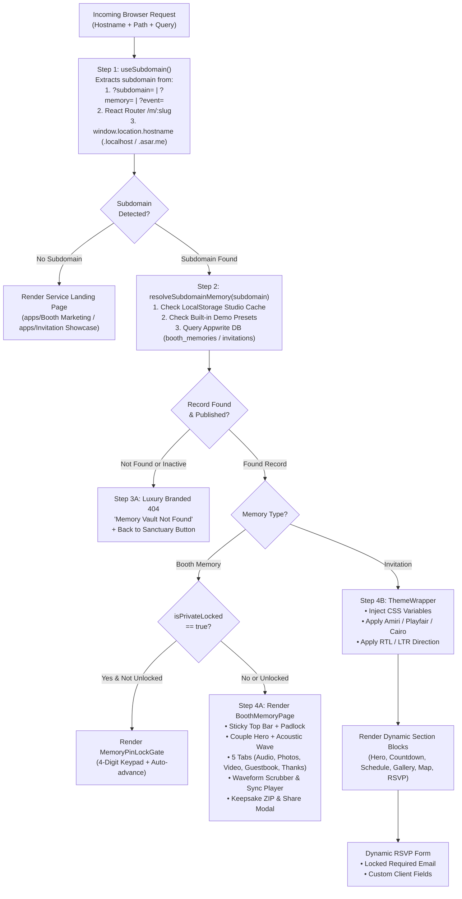

# Technical Analysis: Dynamic Subdomain-Based Memory Renderer Architecture

**Explorer:** Subdomain Memory Renderer Explorer (`teamwork_explorer_survey_2`)  
**Date:** 2026-11-03  
**Status:** Complete  
**Scope:** Architecture and implementation specification for dynamic subdomain-based rendering of Invitation and Booth memories operating as a web builder storefront platform.

---

## 1. Executive Summary & Problem Scope

ASAR (Athar / أثر) is an experiential digital memory and event hospitality platform that provides two flagship services:
1. **ASAR Booth:** Vintage rotary audio guestbook and digital memory vault (Image #1 reference: Couple Hero, 5 Tabs including Audio Messages with 48-bar waveform scrubbers, category filters, photos, video highlights, guestbook, thank you, keepsake ZIP download, and PIN gate).
2. **ASAR Invitation:** Bespoke interactive event websites with dynamic multi-occasion theming, live countdown, agenda, venue map, dress code swatches, dynamic RSVP form with locked mandatory email, and digital QR passes.

Currently, both applications (`apps/Booth` and `apps/Invitation`) use static/local route parsing (custom pathname splitting and search query checking via `window.location.pathname` and `URLSearchParams` inside `App.tsx`). Memories are viewed either via query parameters (e.g. `?memory=mina-and-maryam`, `?event=omar-and-layla`) or path routes (`/memory/:slug`, `/e/:slug`).

The objective is to elevate this system into a **dynamic subdomain-driven storefront platform** (analogous to Shopify or Webflow storefronts) where:
- In production, visiting `https://mina-and-maryam.asar.me` or `https://omar-and-layla.asar.me` automatically resolves the tenant, determines the memory type (Booth vs Invitation), and renders the personalized memory experience.
- In local development, developers and QA can effortlessly test subdomains using `http://mina-and-maryam.localhost:3000` OR `http://localhost:PORT?subdomain=mina-and-maryam` without touching system hosts files.
- The monorepo architecture integrates React Router monorepo-wide while preserving Admin studio workflows (`apps/Admin`).

---

## 2. Existing Memory Presentation Components Audit

### 2.1. Booth Memory Presentation (`apps/Booth/src/components/memory/*`)

The Booth Memory presentation is modeled after **Visual Reference #1** (*Mina & Maryam — A Private Memory*). The codebase already contains a comprehensive, pixel-perfect suite of components in `apps/Booth/src/components/memory/`:

| Component | File Path | Props & Responsibilities | Styling & DOM Hierarchy |
| :--- | :--- | :--- | :--- |
| **`MemoryHeader`** | `src/components/memory/MemoryHeader.tsx` | `coupleTitle`, `totalAudioCount`, `activeTab`, `onSelectTab`, `onBackToLanding`, `isPrivateLocked`, `onToggleLock` | Sticky frosted glass top bar (`position="sticky"`, `backdropFilter="blur(16px)"`, `bg="rgba(251, 247, 242, 0.92)"`), gold padlock icon, bilingual logo calligraphy, and hamburger slide-over sheet. |
| **`MemoryHero`** | `src/components/memory/MemoryHero.tsx` | `coupleTitle`, `eventHeaderTag`, `eventDateDisplay`, `eventLocationDisplay`, `highlightBadge`, `coupleQuote`, `quoteAuthor`, `taglineLine1`, `taglineLine2`, `heroImageUrl` | Editorial couple hero card with couple photograph, soft warm-alabaster bottom gradient fade, acoustic gold SVG waveform divider (`─── ∿∿∿ ───`), 3 metadata badges (`📅 Date`, `📍 Location`, `🤍 Badge`), and bilingual quote block. |
| **`MemoryTabs`** | `src/components/memory/MemoryTabs.tsx` | `activeTab: MemoryTabType`, `onSelectTab: (tab: MemoryTabType) => void` | 5 tactile rounded tab buttons (`audio`, `photos`, `video`, `guestbook`, `thankyou`). Active state: Royal Maroon `#6B1D28`, white text, gold border, soft elevation shadow; Inactive state: Warm Linen `#F4EFEA`. |
| **`VoiceCard`** | `src/components/memory/VoiceCard.tsx` | `record: VoiceRecord`, `isPlaying`, `currentTime`, `onPlayPause`, `onSeek`, `onToggleLike` | Individual voice card with guest avatar (or monogram fallback), Royal Maroon Play/Pause button, speaker name & role, bilingual italic quote, **interactive 48-bar waveform scrubber** with click-to-seek, duration display, heart like button, and download/share dropdown menu. |
| **`AudioPlayerBar`** | `src/components/memory/AudioPlayerBar.tsx` | `currentRecord`, `isPlaying`, `currentTime`, `duration`, `onPlayPause`, `onSeek`, `onClose` | Fixed bottom mini audio player bar synchronized with active voice playback. |
| **`PhotoGalleryGrid`** | `src/components/memory/PhotoGalleryGrid.tsx` | `photos: MediaPhoto[]` | Responsive multi-column photo grid with hover captions and lightbox. |
| **`VideoHighlightCard`**| `src/components/memory/VideoHighlightCard.tsx`| `mode: "banner" \| "full"`, `thumbnailUrl`, `videoTitle`, `videoSubtitle`, `coupleTitle`, `onClickBanner` | Banner mode (placed beneath audio list) or Full mode (30-second 4K video reel player). |
| **`GuestBookFeed`** | `src/components/memory/GuestBookFeed.tsx` | `notes: GuestBookNote[]`, `onOpenLeaveModal`, `onToggleLikeNote` | Guest blessing cards with likes, date, author role, and modal trigger. |
| **`LeaveLoveModal`** | `src/components/memory/LeaveLoveModal.tsx` | `isOpen`, `onClose`, `coupleTitle`, `onAddNote` | Modal dialog allowing visitors to sign the guestbook. |
| **`MemoryActionBar`** | `src/components/memory/MemoryActionBar.tsx`| `onOpenShareModal`, `totalAudioCount` | Fixed bottom bar: "Download All Messages" (ZIP download) and "Share Love" (QR code modal). |
| **`ShareSheetModal`** | `src/components/memory/ShareSheetModal.tsx` | `isOpen`, `onClose`, `coupleTitle`, `slug` | QR code display, WhatsApp direct share, and link copy. |
| **`MemoryPinLockGate`**| `src/components/memory/MemoryPinLockGate.tsx`| `coupleTitle`, `expectedPin`, `onUnlock`, `onBackToLanding` | 4-digit security PIN keypad for private memory vaults with auto-advance and error feedback. |

#### Hydration & State Engine in `BoothMemoryPage.tsx`:
1. **Cache / Preset Hydration:** On mount, it checks `localStorage.getItem("asar_booth_memories_cache")` (populated by Admin Studio). If absent, it hydrates from `DEMO_BOOTH_MEMORY` and `DEMO_BOOTH_VOICE_RECORDS`.
2. **Audio Playback Engine:** Synthesizes an analog telephone harmonic dual-frequency chime (`440Hz` + `480Hz`) via client-side Web Audio API (`AudioContext`) before playing any voice track, with an interval timer running at 200ms intervals to scrub waveforms accurately.
3. **Category Filtering:** Dynamically computes category counts (`All`, `Family`, `Friends`, `Colleagues`, `Special Guests`) from the active records array.

---

### 2.2. Invitation Custom Renderer (`apps/Invitation/src/components/renderer/*`)

The Invitation service features a multi-occasion, block-based event website builder and renderer:

| Component | File Path | Props & Responsibilities | Styling & Dynamic Features |
| :--- | :--- | :--- | :--- |
| **`ThemeWrapper`** | `src/components/renderer/ThemeWrapper.tsx` | `themeConfig: ThemeConfig`, `dir`, `children` | Dynamically injects CSS custom properties (`--event-primary`, `--event-secondary`, `--event-bg`, `--event-card-bg`), font family (`Amiri`, `Playfair Display`, `Cairo`), text direction (`rtl` / `ltr`), and ambient radial glow gradients. |
| **`EventHeroSection`** | `src/components/renderer/EventHeroSection.tsx` | `title`, `datePill`, `timePill`, `venuePill`, `tagline`, `heroImageUrl` | Fullscreen editorial hero section with customizable date, time, venue badges, and optional WebGL background shaders. |
| **`EventCountdownSection`**| `src/components/renderer/EventCountdownSection.tsx`| `targetDate`, `targetTime` | Real-time countdown timer calculating days, hours, minutes, and seconds until the celebration. |
| **`EventScheduleSection`** | `src/components/renderer/EventScheduleSection.tsx` | `items: ScheduleItem[]` | Chronological event schedule or milestones timeline with badges and descriptions. |
| **`EventLocationMap`** | `src/components/renderer/EventLocationMap.tsx` | `venueName`, `venueAddress`, `mapUrl`, `dressCodeConfig` | Interactive venue location map, valet parking notes, and dress code color swatches with hex circles. |
| **`EventMediaGallery`** | `src/components/renderer/EventMediaGallery.tsx` | `items: GalleryItem[]` | Photo gallery with responsive grid, captions, and lightbox. |
| **`DynamicRsvpForm`** | `src/components/renderer/DynamicRsvpForm.tsx` | `formSchema: DynamicFormField[]`, `onSubmitRsvp` | Renders Admin-configured dynamic form fields (text, email, tel, select, radio, textarea). **Strictly enforces `guestEmail` as required and locked.** |
| **`GuestAccessPass`** | `src/components/pass/GuestAccessPass.tsx` | `rsvpId`, `guestName`, `eventTitle`, `qrCodeUrl` | Mobile VIP QR entry pass (`/pass/:rsvpId`). |
| **`VenueQrScanner`** | `src/components/pass/VenueQrScanner.tsx` | `invitationId`, `onScanPass` | Venue gate host scanner for verifying guest passes. |

#### Hydration & Dynamic Configuration in `CustomEventPage.tsx`:
1. Resolves invitation by slug from `INVITATION_PRESETS` (`omar-and-layla`, `cairo-jazz-festival`) or `localStorage.getItem("asar_invitations_cache")`.
2. Parses JSON configurations safely: `themeConfigJson`, `sectionsConfigJson`, `formSchemaJson`, `scheduleJson`, `galleryJson`, `dressCodeJson`.
3. If not found, renders a luxury branded 404 screen.

---

## 3. Data Models & Querying Architecture in `packages/react-appwrite`

All ASAR data models are centralized in `packages/react-appwrite/src/AsarDomain/models.ts` and `collections.ts`:

### 3.1. Database Collections Overview

| Collection ID (`ASAR_COLLECTIONS.*`) | Collection Key | Primary Purpose | Key Fields |
| :--- | :--- | :--- | :--- |
| `booth_memories` | `BOOTH_MEMORIES` | Stores generated Booth memory sites | `$id`, `orderId`, `clientId`, `slug`, `coupleTitle`, `eventHeaderTag`, `tagline`, `eventDateDisplay`, `eventLocationDisplay`, `highlightBadge`, `coupleQuote`, `heroImageFileId`, `videoHighlightFileId`, `videoHighlightTitle`, `thankYouMessage`, `categoriesJson`, `isPrivateLocked`, `accessPinCode`, `qrCodeUrl`, `isPublished` |
| `booth_voice_records` | `BOOTH_VOICE_RECORDS` | Audio recordings linked to a Booth memory | `$id`, `memoryId`, `audioFileId`, `speakerName`, `speakerRole`, `category`, `quoteSnippet`, `avatarFileId`, `durationFormatted`, `durationSeconds`, `waveformPeaksJson` (48 floats), `likesCount`, `isFeatured`, `sortOrder` |
| `booth_media` | `BOOTH_MEDIA` | Photos and guestbook notes | `$id`, `memoryId`, `mediaType` (`photo` \| `guestbook_note`), `fileId`, `authorName`, `captionOrNote`, `sortOrder` |
| `invitations` | `INVITATIONS` | Stores custom event websites | `$id`, `orderId`, `clientId`, `slug`, `eventTitle`, `occasionType`, `eventDate`, `eventTime`, `venueName`, `venueAddress`, `venueMapUrl`, `maxCapacity`, `themeConfigJson`, `sectionsConfigJson`, `formSchemaJson`, `qrCodeUrl`, `isPublished` |
| `invitation_rsvps` | `INVITATION_RSVPS` | Guest RSVPs populated in Client Mailbox | `$id`, `invitationId`, `clientId`, `guestName`, `guestEmail` (strictly required), `guestPhone`, `companionsCount`, `dynamicResponsesJson`, `status` (`pending` \| `approved` \| `declined`), `passToken`, `qrCodeUrl`, `emailSent`, `isCheckedInAtVenue` |

### 3.2. Identification Strategy: `slug` vs `subdomain` vs `customDomain`

- **Current State:** Both `BoothMemory` and `AsarInvitation` models define a unique `slug: string` (e.g. `"mina-and-maryam"`, `"omar-and-layla"`). Neither model currently defines an explicit `subdomain` or `customDomain` field.
- **Storefront Best Practice:**
  1. In a multi-tenant platform, the `slug` acts as the canonical tenant identifier (URL-safe, lowercase, alphanumeric with hyphens, e.g. `mina-and-maryam`).
  2. The subdomain is inherently derived from `slug` (e.g. `mina-and-maryam.asar.me`).
  3. **Recommended Schema Enhancement:**
     - Add an optional `subdomain?: string` attribute to both `BoothMemory` and `AsarInvitation` models.
     - Add an optional `customDomain?: string` attribute (e.g. `mina-maryam.com`) for white-label VIP clients.
     - When querying, fallback logic: `const targetIdentifier = memory.subdomain || memory.slug`.
     - When resolving, query by:
       ```ts
       Query.or([
         Query.equal("slug", resolvedSubdomain),
         Query.equal("subdomain", resolvedSubdomain),
       ]);
       ```

---

## 4. Subdomain Resolution & Dynamic Storefront Architecture

### 4.1. How a Storefront Platform Resolves Subdomains

A modern storefront platform (like Shopify, Webflow, or Vercel Platforms Starter) operates with:
1. **Wildcard DNS (`*.asar.me`):** Directs all subdomain HTTP requests to the frontend application / edge reverse proxy.
2. **Client-Side Hostname Inspection:** The application inspects `window.location.hostname` to extract the subdomain.
3. **Reserved Subdomain Filtering:** System-critical subdomains (`www`, `app`, `admin`, `booth`, `invitation`, `main`, `api`, `auth`, `mail`, `cdn`) are strictly intercepted and bypass tenant memory lookup.
4. **Tenant Resolution Service:** Fetches the tenant configuration by subdomain, selects the layout, and renders the dynamic storefront.

### 4.2. Hostname Extraction in Production

```ts
const ROOT_DOMAINS = ["asar.me", "asar.audio", "localhost"];
const RESERVED_SUBDOMAINS = new Set([
  "www", "app", "admin", "api", "booth", "invitation",
  "main", "portal", "mail", "cdn", "auth", "static", "dev", "staging",
]);

export function extractSubdomainFromHostname(hostname: string): string | null {
  const host = hostname.toLowerCase().split(":")[0].trim();

  // 1. Handle .localhost (e.g. mina-and-maryam.localhost)
  if (host.endsWith(".localhost")) {
    const prefix = host.slice(0, -".localhost".length);
    const candidate = prefix.split(".").pop();
    if (candidate && !RESERVED_SUBDOMAINS.has(candidate)) {
      return candidate;
    }
    return null;
  }

  // 2. Handle production root domains (e.g. mina-and-maryam.asar.me)
  for (const root of ROOT_DOMAINS) {
    if (host === root || host === `www.${root}`) return null;
    if (host.endsWith(`.${root}`)) {
      const prefix = host.slice(0, -(root.length + 1));
      const parts = prefix.split(".");
      const candidate = parts[parts.length - 1];
      if (candidate && !RESERVED_SUBDOMAINS.has(candidate)) {
        return candidate;
      }
    }
  }

  // 3. Fallback for custom domains (e.g. wedding.mina-maryam.com)
  return null;
}
```

### 4.3. Local Development Testing Strategy (Zero-Config)

Developers must be able to develop and verify dynamic subdomain rendering without editing `C:\Windows\System32\drivers\etc\hosts` or DNS settings. Modern Chromium and Firefox browsers natively resolve `*.localhost` to `127.0.0.1`, but mobile devices, LAN testing, and automated test runners require flexible fallbacks.

We define a **4-Tier Subdomain Resolution Hierarchy**:

```
+-----------------------------------------------------------------------------------+
|                           SUBDOMAIN RESOLUTION HIERARCHY                          |
+-----------------------------------------------------------------------------------+
| Tier 1: Query Parameter Override (?subdomain=... | ?memory=... | ?event=...)      |
|   ↳ Unlocks instant local testing: http://localhost:3002?subdomain=mina-and-maryam |
+-----------------------------------------------------------------------------------+
| Tier 2: React Router Route Param (/m/:slug | /memory/:slug | /e/:slug)            |
|   ↳ Direct link sharing & Admin preview links without domain switching            |
+-----------------------------------------------------------------------------------+
| Tier 3: Hostname Extraction (subdomain.localhost:3002 | subdomain.asar.me)       |
|   ↳ Production-identical testing using native browser .localhost loopback         |
+-----------------------------------------------------------------------------------+
| Tier 4: Environment Variable Fallback (VITE_DEFAULT_SUBDOMAIN)                    |
|   ↳ Automated testing, storybooks, and isolated preview sandboxes                 |
+-----------------------------------------------------------------------------------+
```

---

## 5. Architectural Evaluation: Dedicated Renderer App vs Existing Apps

The original user request states:
> *"The team decides the best app structure (whether to introduce a new dedicated renderer app under `apps/` or adapt existing apps) and the subdomain resolution strategy for production and local environments."*

Below is the comprehensive evaluation of the three architectural options:

### 5.1. The Options Evaluated

```
+---------------------------------------------------------------------------------------------------------+
| OPTION A: Dedicated App under apps/ (apps/Storefront or apps/Memory)                                    |
| • Port: 3004                                                                                           |
| • Hosts: Solely the multi-tenant public memory renderer                                                |
| • Ingress: Wildcard DNS (*.asar.me) routes directly to this app                                        |
+---------------------------------------------------------------------------------------------------------+
| OPTION B: Unified Subdomain Storefront Engine in apps/Main (Port 3000)                                  |
| • Port: 3000                                                                                           |
| • Hosts: Root domain (asar.me) + Client Account + Dynamic Subdomains (*.asar.me)                        |
| • Ingress: asar.me and *.asar.me both hit apps/Main                                                    |
+---------------------------------------------------------------------------------------------------------+
| OPTION C: Autonomous Subdomain Handling in apps/Booth & apps/Invitation via Shared Resolver Package    |
| • Ports: 3002 (Booth), 3003 (Invitation)                                                                |
| • Hosts: apps/Booth handles booth subdomains; apps/Invitation handles invitation subdomains            |
| • Shared: @repo/react-appwrite/src/Storefront provides useSubdomain, resolver, and routing components   |
+---------------------------------------------------------------------------------------------------------+
```

### 5.2. Trade-Off Comparison Matrix

| Evaluation Dimension | Option A: Dedicated `apps/Storefront` | Option B: Storefront in `apps/Main` | Option C: Autonomous `Booth` & `Invitation` (Shared Package) |
| :--- | :--- | :--- | :--- |
| **Separation of Concerns** | **High.** Decouples public viewing from marketing landing pages. | **Medium.** Mixes client portal and public guest viewing in one app. | **High.** Booth memory lives with Booth; Invitation lives with Invitation. |
| **Code Refactoring Required** | **High.** Requires moving 20+ components from `Booth` and `Invitation` into a new package (`@repo/memory-components`). | **High.** Requires moving all memory and invitation components into `Main` or a shared package. | **Low.** Zero component relocation. Components remain in their native apps where styling and assets work. |
| **Monorepo Build Speed** | **Slower.** Adds a 5th Vite build target in Turborepo. | **Neutral.** Keeps 4 apps, but inflates `apps/Main` bundle. | **Fastest.** 4 existing apps; builds remain modular and cached. |
| **Production DNS & Ingress** | **Simple.** Single wildcard DNS `*.asar.me` -> `apps/Storefront`. | **Simple.** Wildcard DNS `*.asar.me` -> `apps/Main`. | **Moderate.** Subdomains either use `*.booth.asar.me` / `*.invitation.asar.me` OR edge proxy rewrites. |
| **Local Development DX** | **Moderate.** Devs must run 5 apps concurrently (`pnpm dev`). | **Simple.** Test everything on port 3000. | **Seamless.** Devs test Booth memories on port 3002 and Invitations on port 3003 with `?subdomain=` or `.localhost`. |
| **Risk of Breaking Existing Code** | **High.** Risk of breaking imports, CSS variables, and paths. | **High.** Risk of bundle collisions and styles bleeding. | **Zero.** Existing marketing pages, booking modals, and Admin preview flows remain 100% intact. |

### 5.3. Concrete Architectural Recommendation

**We strongly recommend Option C with a Shared Storefront Module in `@repo/react-appwrite/src/Storefront` (or Option A if the team insists on a single deployment URL for all subdomains).**

#### Why Option C is the Superior Engineering Choice for the Monorepo:
1. **Preserves Existing High-Quality Foundations:** `apps/Booth` already contains the full, pixel-perfect implementation of **Image #1** (`apps/Booth/src/components/memory/*`), and `apps/Invitation` already contains the complete custom event renderer (`apps/Invitation/src/components/renderer/*`). Moving them into a new package would introduce widespread import churn and risks without functional gain.
2. **Domain Specialization:** Booth memories require heavy audio mastering playback engines, waveform scrubbing, and phone chime synthesis. Invitations require dynamic form schemas, EmailJS dispatch, and WebGL shaders. Keeping them in their respective applications ensures clean bundle isolation and zero cross-service contamination.
3. **Unified Resolution Architecture:** By placing the `useSubdomain()` hook, `extractSubdomain()`, `resolveSubdomainMemory()`, and subdomain routing utilities inside `@repo/react-appwrite`, BOTH apps share identical resolution logic, query caching, 404 behavior, and PIN protection gates.
4. **Admin Studio Alignment:** `apps/Admin` can generate preview and live links seamlessly:
   - Booth Memory preview: `http://localhost:3002?subdomain=${slug}` (or `http://${slug}.localhost:3002`)
   - Invitation preview: `http://localhost:3003?subdomain=${slug}` (or `http://${slug}.localhost:3003`)
   - In production: `https://${slug}.booth.asar.me` or edge-routed `https://${slug}.asar.me`.

---

## 6. Detailed Dynamic Rendering Pipeline

The end-to-end rendering pipeline follows this unified flow:



### 6.1. Subdomain Resolution Hook: `useSubdomain`

**Contract Specification (`@repo/react-appwrite/src/Storefront/useSubdomain.ts`):**

```ts
export interface SubdomainResolution {
  subdomain: string | null;
  slug: string | null;
  resolutionSource: "query" | "route_param" | "hostname" | "fallback" | null;
  isLocalhost: boolean;
  isReserved: boolean;
  rawHostname: string;
}

export function useSubdomain(options?: {
  defaultSubdomain?: string;
  reservedSubdomains?: string[];
  rootDomains?: string[];
}): SubdomainResolution;
```

**Implementation Behavior:**
1. **Query Params:** Checks `searchParams.get("subdomain") || searchParams.get("memory") || searchParams.get("event") || searchParams.get("slug")`. If present, sets `resolutionSource: "query"`.
2. **React Router Params:** Checks `useParams<{ slug?: string; subdomain?: string }>()`. If present, sets `resolutionSource: "route_param"`.
3. **Hostname Parsing:** Splits `window.location.hostname`. If `.localhost`, extracts prefix. If `.asar.me` or `.asar.audio`, extracts tenant segment. Verifies that the candidate is not in `RESERVED_SUBDOMAINS`.
4. **Fallback:** If nothing is detected, returns `null` or `options.defaultSubdomain`.

### 6.2. Tenant Memory Resolver: `resolveSubdomainMemory`

**Resolution Logic:**
```ts
export async function resolveSubdomainMemory(
  subdomain: string,
  databases?: Databases
): Promise<MemoryResolutionResult> {
  // 1. Check Studio Preview Cache (Instant cross-tab updates from Admin Studio)
  const boothCache = localStorage.getItem("asar_booth_memories_cache");
  if (boothCache) {
    try {
      const parsed = JSON.parse(boothCache);
      if (parsed && (parsed.slug === subdomain || parsed.subdomain === subdomain)) {
        return { status: "success", type: "booth", memory: parsed };
      }
    } catch { /* ignore */ }
  }

  const invitationCache = localStorage.getItem("asar_invitations_cache");
  if (invitationCache) {
    try {
      const list = JSON.parse(invitationCache);
      const match = list.find((i: any) => i.slug === subdomain || i.subdomain === subdomain);
      if (match) {
        return { status: "success", type: "invitation", invitation: match };
      }
    } catch { /* ignore */ }
  }

  // 2. Check Static Demo Presets
  if (subdomain === "mina-and-maryam") {
    return { status: "success", type: "booth", memory: DEMO_BOOTH_MEMORY };
  }
  if (INVITATION_PRESETS[subdomain]) {
    return { status: "success", type: "invitation", invitation: INVITATION_PRESETS[subdomain] };
  }

  // 3. Query Appwrite Database (asar-db)
  if (databases) {
    // Check booth_memories
    try {
      const boothRes = await databases.listDocuments("asar-db", "booth_memories", [
        Query.equal("slug", subdomain),
        Query.equal("isPublished", true),
        Query.limit(1),
      ]);
      if (boothRes.documents.length > 0) {
        const doc = boothRes.documents[0];
        // Fetch voice records & media
        const voicesRes = await databases.listDocuments("asar-db", "booth_voice_records", [
          Query.equal("memoryId", doc.$id),
          Query.orderAsc("sortOrder"),
        ]);
        return {
          status: "success",
          type: "booth",
          memory: doc,
          voiceRecords: voicesRes.documents,
        };
      }
    } catch { /* proceed to invitation check */ }

    // Check invitations
    try {
      const invRes = await databases.listDocuments("asar-db", "invitations", [
        Query.equal("slug", subdomain),
        Query.equal("isPublished", true),
        Query.limit(1),
      ]);
      if (invRes.documents.length > 0) {
        return {
          status: "success",
          type: "invitation",
          invitation: invRes.documents[0],
        };
      }
    } catch { /* proceed to not found */ }
  }

  // 4. Return Not Found
  return { status: "not_found", subdomain, reason: "nonexistent" };
}
```

### 6.3. Security & PIN Protection Gate

Private Booth memories include an optional 4-digit PIN code (`isPrivateLocked: true`, `accessPinCode: string`):
1. **Session-Level Persistence:** When the guest successfully enters the PIN in `MemoryPinLockGate`, the app records `sessionStorage.setItem(`asar_unlocked_${memory.id}`, "true")`.
2. **Access Restoration:** Refreshing the page does NOT re-prompt the guest during the same browser session.
3. **Manual Re-locking:** Guests can re-lock the vault at any time via the padlock icon in `MemoryHeader`.

---

## 7. React Router & Admin Alignment

### 7.1. React Router Integration in `apps/Booth` and `apps/Invitation`

Currently, `apps/Booth` and `apps/Invitation` handle view switching via internal `useState`. Under the updated React Router model:

#### `apps/Booth` Route Topology:
- Route `/`: Renders `LandingPage` (marketing sections) if no subdomain is active.
- Route `/memory/:slug`: Renders `BoothMemoryPage` directly for path-based access.
- Subdomain Listener: If `useSubdomain()` detects an active subdomain on `/`, it immediately renders `BoothMemoryPage` with the resolved slug without redirecting, fulfilling the web builder storefront experience.

#### `apps/Invitation` Route Topology:
- Route `/`: Renders `InvitationLandingPage` if no subdomain is active.
- Route `/e/:slug`: Renders `CustomEventPage` for path-based access.
- Route `/pass/:rsvpId`: Renders `GuestPassPage` for VIP QR entry pass.
- Route `/scanner/:invitationId`: Renders `VenueQrScanner` for host check-in.
- Subdomain Listener: If `useSubdomain()` detects an active subdomain on `/`, it renders `CustomEventPage` with the resolved slug.

### 7.2. Admin Preview Alignment (`apps/Admin`)

In `apps/Admin`:
1. **Booth Memory Studio (`/admin/booth-studio/:orderId`):**
   - The "Live Preview" and "Visit Live Website" buttons will construct the dynamic storefront URL:
     ```ts
     const liveUrl = isProduction
       ? `https://${memory.slug}.booth.asar.me`
       : `http://localhost:3002?subdomain=${memory.slug}`;
     ```
2. **Invitation Studio (`/admin/invitation-studio/:orderId`):**
   - The live preview URL:
     ```ts
     const liveUrl = isProduction
       ? `https://${slug}.invitation.asar.me`
       : `http://localhost:3003?subdomain=${slug}`;
     ```
3. **Subdomain Validation:** Both studios must validate that the entered slug/subdomain conforms to RFC 1123 hostname standards (`/^[a-z0-9]([a-z0-9-]{0,61}[a-z0-9])?$/i`) and does not collide with reserved names.

---

## 8. Summary of Actionable Implementation Deliverables

1. **Shared Storefront Package / Module:** Create `@repo/react-appwrite/src/Storefront` (or `packages/storefront-core`) containing:
   - `extractSubdomain.ts`: Production & `.localhost` hostname parser.
   - `useSubdomain.ts`: 4-tier resolution React hook.
   - `resolveSubdomainMemory.ts`: Multi-source tenant fetcher (LocalStorage, Presets, Appwrite DB).
   - `types.ts`: `SubdomainResolution`, `MemoryResolutionResult`.
2. **`apps/Booth` React Router & Subdomain Switcher:**
   - Configure React Router `<BrowserRouter>` with `/`, `/memory/:slug`.
   - Wire `App.tsx` / `RootLayout` with `useSubdomain()` to automatically render `BoothMemoryPage` when a subdomain or `?subdomain=` is detected.
3. **`apps/Invitation` React Router & Subdomain Switcher:**
   - Configure React Router `<BrowserRouter>` with `/`, `/e/:slug`, `/pass/:rsvpId`, `/scanner/:invitationId`.
   - Wire `App.tsx` with `useSubdomain()` to render `CustomEventPage` when a subdomain or `?subdomain=` is detected.
4. **Admin Studio URL & Validation Alignment:**
   - Update preview link generators to use `?subdomain=${slug}` for local dev and `https://${slug}.[service].asar.me` for production.
   - Add RFC 1123 slug validation in `HeroAndTextsEditor.tsx` and `InvitationStudio.tsx`.
