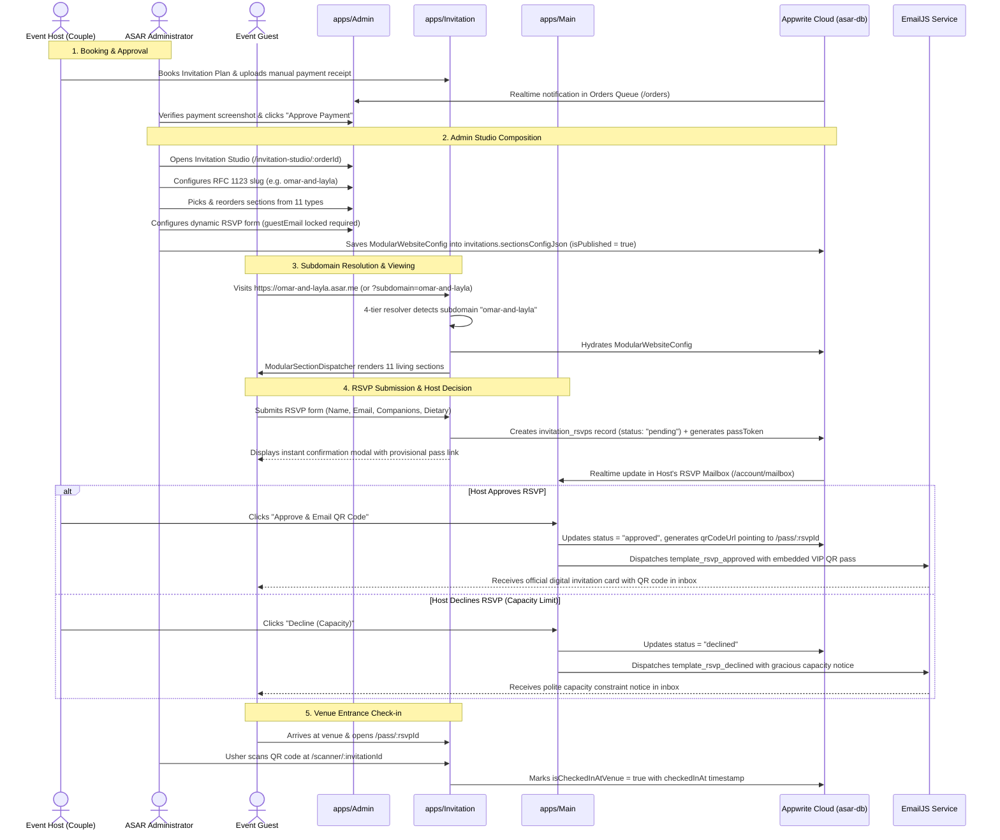
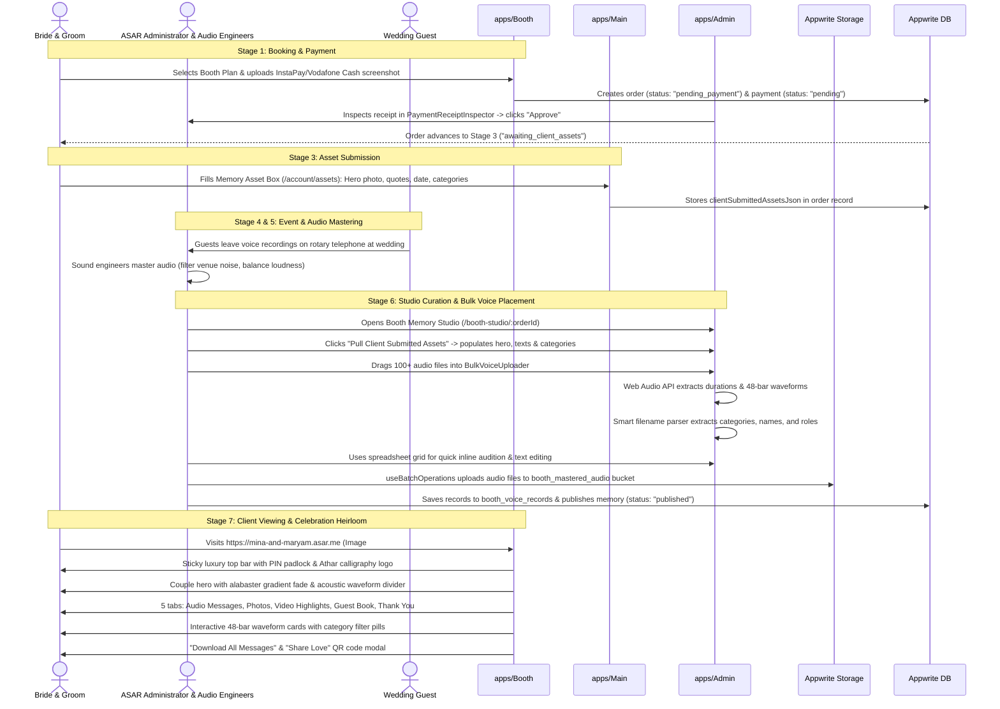
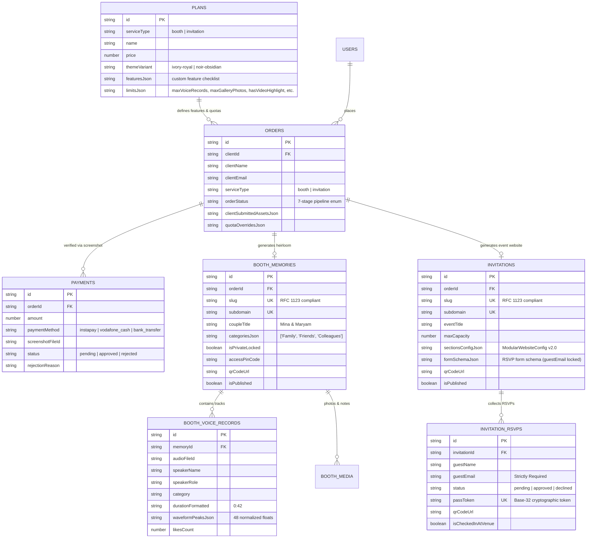

# ASAR Monorepo Architecture Blueprint & Agent Onboarding Guide

> **Document Type:** Production Engineering & Multi-Agent Onboarding Guide  
> **Repository Root:** `d:\asar`  
> **Target Audience:** Human Software Engineers and AI Agents (Teamwork Agents, Specialists, Auditors)  
> **Architecture Core:** Turborepo v2 (`npm@11.13.0` Workspaces), React 18, TypeScript 5, Vite 5, Chakra UI v3 (`^3.32.0`), React Router v6 (`^6.28.0`), Appwrite Cloud v17, EmailJS  
> **Visual Identity:** ASAR Warm Vintage Editorial Luxury  
> **Last Verified:** 2026-11-04  

---

## Table of Contents

1. [Executive Monorepo Architecture](#1-executive-monorepo-architecture)
   - [1.1. High-Level Vision & Concept](#11-high-level-vision--concept)
   - [1.2. Monorepo Topology Diagram](#12-monorepo-topology-diagram)
   - [1.3. Application Port & Subdomain Allocation](#13-application-port--subdomain-allocation)
2. [Monorepo Tooling & Configuration](#2-monorepo-tooling--configuration)
   - [2.1. Root Workspace Configuration (`package.json`)](#21-root-workspace-configuration-packagejson)
   - [2.2. Turborepo Pipeline (`turbo.json`)](#22-turborepo-pipeline-turbojson)
   - [2.3. Shared TypeScript Tooling (`packages/typescript-config`)](#23-shared-typescript-tooling-packagestypescript-config)
   - [2.4. Shared ESLint Tooling (`packages/eslint-config`)](#24-shared-eslint-tooling-packageseslint-config)
3. [The Five Workspace Applications](#3-the-five-workspace-applications)
   - [3.1. `apps/Admin` (Port 3001) — Operations Management Console](#31-appsadmin-port-3001--operations-management-console)
   - [3.2. `apps/Booth` (Port 3002) — Dynamic Storefront & Audio Guestbook](#32-appsbooth-port-3002--dynamic-storefront--audio-guestbook)
   - [3.3. `apps/Invitation` (Port 3003) — Dynamic Storefront & Bespoke Events](#33-appsinvitation-port-3003--dynamic-storefront--bespoke-events)
   - [3.4. `apps/Main` (Port 3000) — Platform Gateway & Unified Client Account Portal](#34-appsmain-port-3000--platform-gateway--unified-client-account-portal)
   - [3.5. `apps/Renderer` (Port 3004) — Universal Dynamic Storefront Renderer](#35-appsrenderer-port-3004--universal-dynamic-storefront-renderer)
4. [Shared Monorepo Packages](#4-shared-monorepo-packages)
   - [4.1. `@repo/react-appwrite` (`packages/react-appwrite`)](#41-reporeact-appwrite-packagesreact-appwrite)
   - [4.2. `@repo/ui-components` (`packages/UI-components`)](#42-repoui-components-packagesui-components)
   - [4.3. `@repo/assets-shared` (`packages/assets-shared`)](#43-repoassets-shared-packagesassets-shared)
   - [4.4. Configuration Packages](#44-configuration-packages)
5. [4-Tier Subdomain Dynamic Storefront Engine](#5-4-tier-subdomain-dynamic-storefront-engine)
   - [5.1. The 4-Tier Resolution Hierarchy](#51-the-4-tier-resolution-hierarchy)
   - [5.2. RFC 6761 Local Multi-Tenancy (`*.localhost`)](#52-rfc-6761-local-multi-tenancy-localhost)
   - [5.3. 16 Reserved System Subdomains Guard](#53-16-reserved-system-subdomains-guard)
   - [5.4. Centralized URL Generator (`buildMemoryUrls`)](#54-centralized-url-generator-buildmemoryurls)
   - [5.5. Multi-Tier Defensive Cache Architecture](#55-multi-tier-defensive-cache-architecture)
6. [End-to-End Data Flows & System Lifecycles](#6-end-to-end-data-flows--system-lifecycles)
   - [6.1. Flow 1: The Invitation Event Lifecycle](#61-flow-1-the-invitation-event-lifecycle)
   - [6.2. Flow 2: The Booth Audio Guestbook Lifecycle](#62-flow-2-the-booth-audio-guestbook-lifecycle)
   - [6.3. Backend Cloud Architecture & Defensive Offline Fallback](#63-backend-cloud-architecture--defensive-offline-fallback)
7. [ASAR Warm Vintage Editorial Luxury Design System](#7-asar-warm-vintage-editorial-luxury-design-system)
   - [7.1. Visual Philosophy & Palette Rationale](#71-visual-philosophy--palette-rationale)
   - [7.2. CSS Design Tokens](#72-css-design-tokens)
   - [7.3. Typography Hierarchy](#73-typography-hierarchy)
   - [7.4. Chakra UI v3 Component Engineering Patterns & Compatibility Constraints](#74-chakra-ui-v3-component-engineering-patterns--compatibility-constraints)
8. [Multi-Agent Conflict Prevention & File Ownership Standards](#8-multi-agent-conflict-prevention--file-ownership-standards)
   - [8.1. Exclusive Workspace Ownership Rules](#81-exclusive-workspace-ownership-rules)
   - [8.2. Interface Contract-First Rule](#82-interface-contract-first-rule)
   - [8.3. Cross-App Import Ban](#83-cross-app-import-ban)
   - [8.4. Agent Metadata Isolation](#84-agent-metadata-isolation)
   - [8.5. Genuine Logic & Anti-Cheat Mandate](#85-genuine-logic--anti-cheat-mandate)
9. [Safe Verification Practices & Build Avoidance](#9-safe-verification-practices--build-avoidance)
   - [9.1. Mandatory User Rule: Build Avoidance](#91-mandatory-user-rule-build-avoidance)
   - [9.2. Targeted TypeScript Verification Hierarchy](#92-targeted-typescript-verification-hierarchy)
   - [9.3. High-Speed tsx Test Execution Suite](#93-high-speed-tsx-test-execution-suite)
   - [9.4. Workspace-Targeted Linting](#94-workspace-targeted-linting)
10. [Features Discovered & Verified Inventory](#10-features-discovered--verified-inventory)
11. [Edge Cases & Defensive Runtime Behaviors](#11-edge-cases--defensive-runtime-behaviors)
12. [Summary Verification Commands Reference](#12-summary-verification-commands-reference)

---

## 1. Executive Monorepo Architecture

### 1.1. High-Level Vision & Concept

**ASAR (Athar / أثر)** is an Awwwards-caliber experiential digital memory and bespoke event hospitality platform. Designed with an editorial, warm-vintage luxury aesthetic, ASAR bridges physical celebrations and digital longevity across two flagship commercial hospitality services:

1. **ASAR Booth (`apps/Booth`):** A physical vintage rotary telephone audio guestbook installation where wedding and gala guests leave heartfelt voice blessings. Sound engineers master these recordings, which the concierge curates into an heirloom audio memory website (matching Visual Reference #1: *Mina & Maryam*).
2. **ASAR Invitation (`apps/Invitation`):** A modular, living digital event website builder and guest hospitality portal. Organizers create tailored event sites composed of up to 11 modular section blocks, complete with dynamic multi-person RSVP collection, locked email verification, digital bank gifting (VietQR / InstaPay / IBAN), interactive wishing walls, and VIP digital QR pass issuance with venue scanner verification.

Both services are governed by an internal administrative operations console (**`apps/Admin`**) and a customer self-service account portal (**`apps/Main`**), while a universal dynamic edge renderer (**`apps/Renderer`**) provides decoupled multi-tenant storefront rendering.

### 1.2. Monorepo Topology Diagram

```
+--------------------------------------------------------------------------------------------------+
|                                    ASAR TURBOREPO MONOREPO                                       |
|                                       Root: d:\asar                                              |
+--------------------------------------------------------------------------------------------------+
                                                 |
         +---------------------------------------+---------------------------------------+
         |                                                                               |
         v                                                                               v
   [ apps/* (5 Applications) ]                                                  [ packages/* (5 Packages) ]
   ├── apps/Main (Port 3000)                                                    ├── packages/react-appwrite
   │   ├── Platform Brand Gateway (/)                                           │   ├── AsarDomain (Sections, Models, Pipelines)
   │   └── Client Portal (/account/*)                                           │   ├── Storefront (Subdomain 4-Tier Engine)
   │       ├── 7-Stage Live Order Tracker                                       │   ├── Cache Fusion WebSockets & REST Client
   │       ├── Memory Asset Submission Box                                      │   ├── Batch Operations & File Uploads
   │       ├── Mastered Audio Review Player                                     │   └── Avatars, QR Generator & RBAC Guards
   │       ├── Downloadable QR Hub                                              │
   │       └── Real-Time Host RSVP Mailbox                                      ├── packages/UI-components
   │                                                                            │   └── 21 Awwwards Luxury Components
   ├── apps/Admin (Port 3001)                                                   │       (WebGL2, Canvas, Three.js, Framer Motion)
   │   ├── Dashboard Overview & KPIs (/overview)                                │
   │   ├── Dynamic Plan Builder Studio (/plans)                                 ├── packages/assets-shared
   │   ├── 7-Stage Orders & Receipts Queue (/orders)                            │   └── Brand Logos, Curated Photography, Media
   │   ├── Booth Memory Studio (/booth-studio/:orderId?)                        │
   │   └── Modular Invitation Studio (/invitation-studio/:orderId?)             ├── packages/typescript-config
   │                                                                            │   └── base.json, vite.json, react-library.json
   ├── apps/Booth (Port 3002)                                                   │
   │   ├── Dynamic Storefront Index (/)                                         └── packages/eslint-config
   │   │   ├── Subdomain Detected -> BoothMemoryPage                            └── Shared ESLint & Prettier Rules
   │   │   └── Bare Host -> 14-Section Marketing Landing
   │   ├── Direct Booking Modal Flow (/book)
   │   └── Canonical Memory Route (/memory/:slug, /m/:slug)
   │
   ├── apps/Invitation (Port 3003)
   │   ├── Dynamic Storefront Index (/)
   │   │   ├── Subdomain Detected -> CustomEventPage
   │   │   └── Bare Host -> Service Showcase Landing
   │   ├── Direct Booking Modal Flow (/book)
   │   ├── Bespoke Living Event Website (/e/:slug)
   │   ├── VIP Digital QR Pass Page (/pass/:rsvpId)
   │   └── Venue Entrance QR Scanner (/scanner/:invitationId)
   │
   └── apps/Renderer (Port 3004)
       ├── Master Multi-Tenant Edge Router
       ├── Automated Memory Classifier (Booth vs. Invitation)
       └── Universal Slugs (/s/:slug, /booth/:slug, /e/:slug)
```

### 1.3. Application Port & Subdomain Allocation

| Application | Dev Port | Localhost Multi-Tenant Domain | Production Domain | Primary Role |
| :--- | :---: | :--- | :--- | :--- |
| **`apps/Main`** | `3000` | `http://localhost:3000` | `https://asar.me` | Platform brand homepage, customer auth, and host account portal |
| **`apps/Admin`** | `3001` | `http://localhost:3001` | `https://admin.asar.me` | Operations console, plan builder, order queue, visual authoring studios |
| **`apps/Booth`** | `3002` | `http://mina-and-maryam.localhost:3002` | `https://mina-and-maryam.asar.me` | Audio guestbook marketing landing page and private memory heirloom |
| **`apps/Invitation`** | `3003` | `http://omar-and-layla.localhost:3003` | `https://omar-and-layla.asar.me` | Modular living event website, dynamic RSVP, VIP pass, check-in scanner |
| **`apps/Renderer`** | `3004` | `http://any-tenant.localhost:3004` | `https://renderer.asar.me` | Universal edge renderer auto-classifying and serving any memory slug |

---

## 2. Monorepo Tooling & Configuration

### 2.1. Root Workspace Configuration (`package.json`)

- **Package Manager:** `npm@11.13.0`
- **Workspaces:**
  ```json
  "workspaces": [
    "apps/*",
    "packages/*"
  ]
  ```
- **React Overrides:** The root `package.json` specifies strict lock overrides to React `18.2.0` across all dependencies to eliminate peer-dependency mismatches:
  ```json
  "overrides": {
    "react": "18.2.0",
    "react-dom": "18.2.0"
  }
  ```
- **Global Scripts:**
  - `npm run build`: `dotenv -e .env -- turbo run build` (Builds all apps & packages via Turborepo).
  - `npm run dev`: `dotenv -e .env -- turbo run dev --concurrency=20` (Spins up all 5 apps concurrently).
  - `npm run lint`: `turbo run lint` (Executes ESLint across all workspaces).
  - `npm run format`: `prettier --write "**/*.{ts,tsx,md}"` (Formats all project files).

### 2.2. Turborepo Pipeline (`turbo.json`)

```json
{
  "$schema": "https://turborepo.dev/schema.json",
  "tasks": {
    "build": {
      "dependsOn": ["^build"],
      "inputs": ["$TURBO_DEFAULT$", ".env*"],
      "outputs": ["dist/**"]
    },
    "lint": {},
    "dev": {
      "cache": false,
      "persistent": true
    }
  }
}
```

- **Topological Dependencies:** The `build` task specifies `"^build"`, ensuring that shared packages in `packages/*` compile before dependent applications in `apps/*`.
- **Environment Invalidation:** Builds depend on `.env*` configurations, ensuring fresh artifacts when cloud endpoints change.
- **Persistent Development:** The `dev` task disables caching and runs continuously.

### 2.3. Shared TypeScript Tooling (`packages/typescript-config`)

The monorepo provides three modular TypeScript compiler presets extending `@tsconfig/node20`:

1. **`base.json`:**
   - `strict: true` (Enforces complete null safety, no implicit any, strict bind call apply).
   - `composite: false`, `declaration: true`, `declarationMap: true`.
   - `module: "ESNext"`, `moduleResolution: "Bundler"`.
   - `isolatedModules: true`, `esModuleInterop: true`, `skipLibCheck: true`.
2. **`vite.json`:**
   - Extends `./base.json`.
   - `target: "ESNext"`, `lib: ["ESNext", "DOM", "DOM.Iterable"]`.
   - `noEmit: true` (Vite handles bundling; TypeScript handles type verification).
   - `noUnusedLocals: true`, `noUnusedParameters: true`, `noImplicitReturns: true`.
3. **`react-library.json`:**
   - Extends `./base.json`.
   - `jsx: "react-jsx"`.

### 2.4. Shared ESLint Tooling (`packages/eslint-config`)

- Extends `eslint:recommended`, `plugin:@typescript-eslint/recommended`, `prettier`.
- Parser: `@typescript-eslint/parser`.
- Pragmatic Override: `@typescript-eslint/no-non-null-assertion: "off"` is enabled to allow idiomatic DOM querying and non-null assertions where guaranteed by framework lifecycles.

---

## 3. The Five Workspace Applications

Each application inside `apps/*` serves a distinct, strictly guarded role. Cross-app imports are prohibited; shared capabilities must reside in `packages/*`.

### 3.1. `apps/Admin` (Port 3001) — Operations Management Console

#### Purpose & Scope
The operational nervous system of ASAR. Used by platform administrators, event concierges, and audio mastering teams to manage packages, monitor revenue, verify customer payment screenshots, curate audio recordings, and visually compose modular event websites.

#### Entry Point & Structure
- **Entry:** `src/main.tsx` -> `src/App.tsx` -> `src/components/layout/AdminShell.tsx`.
- **Styling:** Chakra UI v3 `<Provider>`, Athar custom CSS tokens.

#### Complete Route Table
| Path | Component | Purpose & Behavior |
| :--- | :--- | :--- |
| `/` | `<Navigate to="/overview" replace />` | Canonical root redirect to dashboard overview. |
| `/overview` | `<AdminOverview />` | Platform KPI cards (Active Orders, Revenue, Published Memories), quick studio shortcuts, and recent order queue. |
| `/plans` | `<PlanBuilderStudio />` | Full CRUD editor for Booth and Invitation plans, custom feature checklists, and system limit quotas. |
| `/orders` | `<OrdersQueueManager />` | Filterable 7-stage order queue with manual payment receipt inspection. |
| `/orders/:orderId` | `<OrdersQueueManager />` | Deep link directly focusing a specific customer order with inspector drawer opened. |
| `/booth-studio/:orderId?` | `<BoothStudioRouteWrapper />` | Split-screen Booth visual studio with live mobile preview, bulk audio uploader, waveform analyzer, and canonical QR generator. |
| `/invitation-studio/:orderId?` | `<InvitationStudioRouteWrapper />` | Split-screen modular event builder with live preview, section block reordering, 11 inspectors, and dynamic RSVP form builder. |
| `*` | `<Navigate to="/overview" replace />` | Wildcard fallback redirecting unknown admin paths to overview. |

#### Key Subsystems
1. **`AdminShell.tsx`:** Left navigation sidebar featuring real-time badge counts (e.g., pending payments count) and responsive mobile drawer.
2. **`PlanBuilderStudio.tsx`:** Manages Booth and Invitation service tiers with `featuresJson` checklist and `limitsJson` configuration (max voice records, gallery photos, video highlight toggles, bulk zip download permissions).
3. **`PaymentReceiptInspector.tsx`:** Zoomable receipt lightbox for inspecting InstaPay, Vodafone Cash, or bank transfer screenshots, with 1-click Approve or Reject (requiring rejection reasons).
4. **`BoothMemoryStudio.tsx`:** Split-screen audio memory curation studio containing:
   - `HeroAndTextsEditor.tsx`: RFC 1123 slug editor with reserved domain protection and client-submitted asset hydration.
   - `BulkVoiceUploader.tsx`: Multi-file/folder drag-and-drop zone with Web Audio API decoding and filename parsing.
   - `VoiceBatchGridEditor.tsx`: Spreadsheet batch editor with inline audio player and bulk category assignment.
   - `MediaAndTabsEditor.tsx`: Photos, video highlights, guestbook configuration, and canonical QR generation.
5. **`InvitationStudio.tsx`:** Split-screen modular website builder containing:
   - `SectionPaletteModal.tsx`: Section picker with 4 categories (Essentials, Story & Media, Interactive Engagement, Gifting & Logistics).
   - `ModularSectionList.tsx`: Reorderable deck with drag handles, move up/down controls, visibility toggles, and deletion.
   - `inspectors/*`: 11 strongly-typed inspectors tailored for every section type.
   - `DynamicFormSchemaBuilder.tsx`: RSVP form schema editor with locked mandatory `guestEmail` field.
   - `LiveModularPreview.tsx`: Zero-latency split-screen preview canvas with mobile and desktop viewport frames.

#### Write Isolation Rules
- **Allowed:** `apps/Admin/src/**/*`, `apps/Admin/test/**/*`.
- **Forbidden:** Never write customer-facing portal views or storefront landing pages into `apps/Admin`.

---

### 3.2. `apps/Booth` (Port 3002) — Dynamic Storefront & Audio Guestbook

#### Purpose & Scope
The public storefront and digital heirloom delivery vehicle for ASAR's audio guestbook service. Serves both as the marketing landing page (with booking wizard) and the generated private memory website matching **Visual Reference #1** (*Mina & Maryam*).

#### Entry Point & Structure
- **Entry:** `src/main.tsx` -> `src/App.tsx`.
- **Architecture:** Subdomain-driven root dispatcher.

#### Complete Route Table
| Path | Component | Purpose & Behavior |
| :--- | :--- | :--- |
| `/` | `<DynamicBoothStorefrontIndex />` | **Storefront Index:** Checks `useSubdomain()`. If subdomain detected, renders `<BoothMemoryPage slug={subdomain} />`. If bare apex host or bare localhost, renders `<BoothLandingView />` (14-section marketing landing page). |
| `/book` | `<BoothLandingView autoOpenBooking={true} />` | Direct deep link opening the 3-step booking wizard modal. |
| `/memory/:slug` | `<BoothMemoryPage />` | Explicit canonical memory route matching Visual Reference #1 layout. |
| `/m/:slug` | `<BoothMemoryPage />` | Concise short-link alias for printed cards and WhatsApp links. |
| `*` | `<BoothLuxuryNotFound />` | Branded luxury 404 screen with Athar crest and navigation button. |

#### Key Subsystems
1. **`DynamicBoothStorefrontIndex.tsx`:** 4-tier subdomain resolver hook that dynamically dispatches between the public marketing landing page and the private couple heirloom.
2. **`BoothLandingView.tsx`:** 14 editorial sections: `HeroSection`, `StatsSection`, `MoreThanPhoneSection`, `WhyChooseUsSection`, `PackagesSection`, `AddonsSection`, `HowItWorksSection`, `RealVoicesSection`, `GallerySection`, `VideoSection`, `FAQSection`, `ContactSection`, `PrivacySection`, and `BookingModal`.
3. **`BoothMemoryPage.tsx` (Visual Reference #1 Implementation):**
   - Sticky top bar with slide-over menu, Athar calligraphy crest, and security/privacy padlock badge.
   - Editorial couple hero with soft alabaster bottom fade, couple title, acoustic waveform ornament (`─── ∿∿∿ ───`), 3 metadata badges, and personal quote.
   - 5-tab horizontal strip: `Audio Messages`, `Photos`, `Video Highlights`, `Guest Book`, `Thank You`.
   - `VoiceRecordCard.tsx`: Monogram avatar fallback via `useAvatars().getInitials`, 48-bar interactive waveform scrubber, time display (`0:42`), favorite toggle, and individual MP3 download.
   - Dynamic category filter pills with real track counts (`All (86)`, `Family (24)`, etc.).
   - Video highlight card with 30s teaser banner.
   - Bottom dual action cards: "Download All Messages" (batch ZIP download) and "Share Love" (QR code modal).

#### Write Isolation Rules
- **Allowed:** `apps/Booth/src/**/*`, `apps/Booth/test/**/*`.
- **Forbidden:** Do not edit Admin studio logic or Invitation schemas from `apps/Booth`.

---

### 3.3. `apps/Invitation` (Port 3003) — Dynamic Storefront & Bespoke Events

#### Purpose & Scope
The living event website generator and guest hospitality portal. Powers bespoke event websites for weddings, engagements, festivals, and galas via modular section composition, real-time wishing wall submissions, digital gift registries, dynamic RSVP collection, VIP QR pass delivery, and on-site entrance check-in scanning.

#### Entry Point & Structure
- **Entry:** `src/main.tsx` -> `src/App.tsx`.
- **Architecture:** Subdomain-driven root dispatcher.

#### Complete Route Table
| Path | Component | Purpose & Behavior |
| :--- | :--- | :--- |
| `/` | `<DynamicInvitationStorefrontIndex />` | **Storefront Index:** Checks `useSubdomain()`. If subdomain detected, renders `<CustomEventPage slug={subdomain} />`. If bare apex host or bare localhost, renders `<InvitationLandingPage />` showcase. |
| `/book` | `<InvitationBookingRouteView />` | Direct deep link opening custom invitation booking modal. |
| `/e/:slug` | `<CustomEventPage />` | Explicit bespoke event website route rendering dynamic modular sections. |
| `/pass/:rsvpId` | `<QrPassPage />` | VIP guest digital QR pass with cryptographic token verification. |
| `/scanner/:invitationId` | `<ScannerRouteView />` | Venue entrance scanner for attendants validating guest QR passes. |
| `/scanner` | `<ScannerRouteView />` | General venue check-in scanner. |
| `*` | `<InvitationLuxuryNotFound />` | Branded luxury 404 screen. |

#### Key Subsystems
1. **`DynamicInvitationStorefrontIndex.tsx`:** 4-tier subdomain resolver hook that dynamically dispatches between the service showcase landing page and the living event website.
2. **`CustomEventPage.tsx`:** Dynamic modular page entry point that reads `sectionsConfigJson`, parses it with `parseModularWebsiteConfig`, filters `enabled === true`, sorts by `order`, and renders sections via `ModularSectionDispatcher`.
3. **`components/modular-renderer/sections/*` (11 Modular Sections):**
   - `CoverHeroSection.tsx`: Couple typography, date/venue badges, countdown timer, audio prompt.
   - `CoupleStorySection.tsx`: Chronological milestone cards with photos and dates.
   - `MultiEventScheduleSection.tsx`: Timeline with addresses, dress codes, and 1-tap Google/Apple Maps routing.
   - `ResponsivePhotoGallerySection.tsx`: Masonry/grid/carousel with category filtering and fullscreen lightbox.
   - `InteractiveWishingWallSection.tsx`: Real-time guest blessings with reactions and moderation support.
   - `DigitalGiftRegistrySection.tsx`: Bank QR (VietQR / InstaPay / IBAN), account numbers, and 1-tap copy.
   - `FloatingAudioPlayerBar.tsx`: Persistent audio soundtrack bar with spinning vinyl disc animation.
   - `VenueLocationSection.tsx`: Interactive map embed, parking notes, attire swatches.
   - `LiveCountdownSection.tsx`: Real-time second-by-second countdown ticker.
   - `CustomHighlightSection.tsx`: High-impact editorial callouts and parental notes.
   - `InteractiveRsvpSection.tsx`: Dynamic form submission with attendance choices, companion counts, dietary options, locked email verification, and instant VIP pass modal generation.
4. **`GuestPassPage.tsx` & `GuestQrPassCard.tsx`:** VIP check-in pass displaying guest name, companions count, event date, venue, and high-resolution QR pass code.
5. **`VenueQrScanner.tsx`:** Web camera scanner with audio/haptic feedback that verifies guest pass tokens and marks attendance in real time.

#### Write Isolation Rules
- **Allowed:** `apps/Invitation/src/**/*`, `apps/Invitation/test/**/*`.
- **Forbidden:** Do not edit Booth memory templates or Admin studios from `apps/Invitation`.

---

### 3.4. `apps/Main` (Port 3000) — Platform Gateway & Unified Client Account Portal

#### Purpose & Scope
The brand gateway connecting all ASAR hospitality services and the client self-service account portal. Provides customer authentication and account management for hosts/couples across both Booth and Invitation orders.

#### Entry Point & Structure
- **Entry:** `src/main.tsx` -> `src/App.tsx`.
- **Architecture:** Gateway landing page + Client account shell with nested routing.

#### Complete Route Table
| Path | Component | Purpose & Behavior |
| :--- | :--- | :--- |
| `/` | `<PlatformGateway />` | Brand ecosystem homepage showcasing Booth and Invitation services with direct portals. |
| `/auth` | `<PlatformGateway initialAuthOpen={true} />` | Direct deep link opening customer login / registration modal. |
| `/account` | `<ClientAccountShell />` | Client account shell defaulting to active orders (`/account/orders`). |
| `/account/orders` | `<ClientAccountShell />` | **7-Stage Live Order Tracker:** Visual timeline, payment receipt re-upload, and concierge progress. |
| `/account/assets` | `<ClientAccountShell />` | **Client Asset Submission Box:** Upload hero photo, couple names, date, venue, quotes, categories. |
| `/account/audio` | `<ClientAccountShell />` | **Mastered Audio Reviewer:** Pre-release audition player for client to review mastered voices. |
| `/account/qr-hub` | `<ClientAccountShell />` | **Client QR Hub:** Downloadable high-resolution table cards and station QR codes. |
| `/account/mailbox` | `<ClientAccountShell />` | **Invitation RSVP Mailbox:** Real-time guest response inbox with capacity tracker and EmailJS Approve/Decline actions. |
| `*` | `<Navigate to="/" replace />` | Wildcard fallback redirecting unknown routes to gateway. |

#### Key Subsystems
1. **`PlatformGateway.tsx` & `EcosystemHome.tsx`:** Unified landing portal introducing both services with luxury editorial design and direct booking hooks.
2. **`AuthModal.tsx`:** Appwrite-backed customer authentication modal supporting email/password login, registration, and session persistence.
3. **`ClientAccountShell.tsx`:** Account dashboard shell with navigation tabs, user greeting, and logout controls.
4. **`OrderTrackerTimeline.tsx`:** 7-stage visual pipeline tracker showing exact status: `pending_payment`, `payment_rejected`, `awaiting_client_assets`, `event_scheduled`, `audio_mastering`, `studio_curation`, `published`.
5. **`RawAssetsManager.tsx`:** Stage 3 asset submission form where clients provide personalization data.
6. **`AudioReviewPlayer.tsx`:** Audio review suite for couples to listen to mastered voice messages before public deployment.
7. **`QrHubManager.tsx`:** Printable table tent and station signage assets with downloadable canonical QR codes.
8. **`ClientRsvpMailbox.tsx`:** Host RSVP inbox with real-time WebSocket updates, capacity gauge, and atomic EmailJS dispatch on Approve/Decline.

#### Write Isolation Rules
- **Allowed:** `apps/Main/src/**/*`, `apps/Main/test/**/*`.
- **Forbidden:** Do not edit storefront rendering logic or admin studio components from `apps/Main`.

---

### 3.5. `apps/Renderer` (Port 3004) — Universal Dynamic Storefront Renderer

#### Purpose & Scope
A dedicated, high-performance universal storefront renderer designed for multi-tenant edge deployments. Capable of dynamically resolving ANY tenant subdomain, query parameter, or route slug, automatically classifying whether the target is a Booth Memory or an Invitation Event, and rendering the appropriate heirloom with full hydration.

#### Entry Point & Structure
- **Entry:** `src/main.tsx` -> `src/App.tsx`.
- **Architecture:** Autonomous multi-tier classifier and renderer.

#### Complete Route Table
| Path | Component | Purpose & Behavior |
| :--- | :--- | :--- |
| `/` | `<DynamicStorefrontIndex />` | **Universal Root:** Resolves `*.localhost`, `*.asar.me`, `?subdomain=`, or bare apex portal. |
| `/s/:slug` | `<DynamicStorefrontIndex />` | **Universal Memory Path:** Auto-classifies Booth vs. Invitation. |
| `/booth/:slug`, `/memory/:slug`, `/m/:slug` | `<DynamicStorefrontIndex forcedType="booth" />` | Explicit Booth memory routes. |
| `/invitation/:slug`, `/event/:slug`, `/e/:slug` | `<DynamicStorefrontIndex forcedType="invitation" />` | Explicit Invitation memory routes. |
| `/pass/:rsvpId` | `<GuestPassStorefrontPage />` | VIP guest QR pass route. |
| `*` | `<StorefrontNotFound />` | Branded luxury 404 catch-all screen with Athar crest. |

#### Key Subsystems
1. **`DynamicStorefrontIndex.tsx`:**
   - 4-tier subdomain resolution (`routeParam`, `searchParams`, `fallbackSubdomain`, `hostname`).
   - Synchronous multi-tier classification:
     1. Forced type prop / query parameter (`?type=booth|invitation|pass`).
     2. Known presets (`DEMO_BOOTH_MEMORY`, `INVITATION_PRESETS`).
     3. LocalStorage defensive cache lookup (`getBoothMemoriesCache`, `getInvitationsCache`).
     4. Slug prefix heuristics (`booth-*`, `audio-*`, `inv-*`, `event-*`).
   - Asynchronous remote Appwrite collection hydration when classification is unknown.
   - Bare apex detection rendering `<StorefrontShowcasePortal />`.
   - Reserved subdomains guard and RFC 1123 slug validation.
2. **`BoothMemoryRenderer.tsx`:** Dedicated standalone renderer for Booth memories with audio player, category pills, lightbox, and video modal.
3. **`InvitationMemoryRenderer.tsx`:** Dedicated standalone renderer for modular event invitations with countdown, schedule, location, and dynamic RSVP form.
4. **`StorefrontShowcasePortal.tsx`:** Apex showcase portal when accessed on bare domain.
5. **`StorefrontNotFound.tsx`:** Contextual 404 screen explaining whether the slug was invalid, reserved, or not found.

#### Write Isolation Rules
- **Allowed:** `apps/Renderer/src/**/*`, `apps/Renderer/test/**/*`.
- **Forbidden:** Do not edit `apps/Admin` or `apps/Main` from `apps/Renderer`.

---

## 4. Shared Monorepo Packages

### 4.1. `@repo/react-appwrite` (`packages/react-appwrite`)

The central domain and infrastructure engine for the entire platform.

```
packages/react-appwrite/src/
├── AsarDomain/
│   ├── sections.ts         # 11 EventSectionType definitions & ModularWebsiteConfig v2.0
│   ├── models.ts           # Core domain interfaces (BoothPlan, AsarOrder, BoothMemory, etc.)
│   ├── collections.ts      # Appwrite Database, Collection, and Bucket ID constants
│   ├── audioAnalyzer.ts    # Web Audio API peak generator & smart filename parser
│   ├── emailJsService.ts   # Automated EmailJS dispatch & simulation mode fallback
│   ├── orderPipeline.ts    # 7-stage order status progression state machine
│   └── presets.ts          # Seed data (DEMO_BOOTH_MEMORY, INVITATION_PRESETS)
├── Storefront/
│   ├── subdomain.ts        # Pure 4-tier subdomain extraction & RFC 1123 validator
│   ├── useSubdomain.ts     # React hook wrapper for continuous URL synchronization
│   ├── urlBuilder.ts       # Centralized buildMemoryUrls generator
│   └── cacheHelper.ts      # Multi-tier defensive cache resolver & localStorage sync
├── provider.tsx            # <AppwriteProvider> & Client initialization
├── auth.tsx                # <AuthProvider>, useAuth, useAccountSwitcher, RBAC guards
├── cache-fusion.ts         # Zero-refetch WebSocket real-time store
├── hooks.ts                # useCollection, useDocument, useMutations, useUpload
└── batch-operations.ts     # useBatchOperations (chunked bulkCreate, bulkUpdate, bulkDelete)
```

#### Core Modules & Responsibilities
1. **`AsarDomain/sections.ts`:**
   - Discriminated union of 11 event sections:
     ```typescript
     export type EventSectionType =
       | "cover_hero"
       | "couple_story"
       | "event_schedule"
       | "photo_gallery"
       | "wishing_wall"
       | "digital_gift_registry"
       | "background_audio"
       | "venue_location"
       | "live_countdown"
       | "custom_highlight"
       | "dynamic_rsvp";
     ```
   - Container schema: `ModularWebsiteConfig` (`version: "2.0"`).
   - Functions:
     - `createDefaultModularWebsiteConfig()`: Generates complete 11-section default configuration.
     - `parseModularWebsiteConfig(raw)`: Safe JSON parser with zero-crash fallback that automatically migrates legacy flat blocks (`InvitationSectionBlock[]`) into modern `EventSection[]` structures.
     - `validateModularWebsiteConfig(config)`: Validates section integrity, required fields, and ordering.
2. **`AsarDomain/audioAnalyzer.ts`:**
   - `formatDuration(seconds)`: Formats audio durations into `m:ss` (e.g., `0:42`).
   - `generateWaveformPeaks(audioBuffer)`: Decodes audio via Web Audio API into 48 normalized floats `[0..1]`.
   - `parseVoiceFilename(filename, folder)`: Smart filename parser handling 4 patterns:
     - Pattern A: `Category_Speaker Name_Role.ext`
     - Pattern B: `Category - Speaker Name - Role.ext`
     - Pattern C: `01_Speaker_Name_Category.ext`
     - Pattern D: Folder category inheritance (`Colleagues/Dr_Khaled.mp3`).
3. **`AsarDomain/emailJsService.ts`:**
   - EmailJS integration with simulation mode fallback. Constructs payloads for `template_rsvp_approved` and `template_rsvp_declined`.
4. **`AsarDomain/orderPipeline.ts`:**
   - State machine definitions for the 7 order pipeline stages, progress percentages, and status label mappings.
5. **`Storefront/subdomain.ts` & `Storefront/useSubdomain.ts`:**
   - 4-tier subdomain resolution engine (`extractSubdomain`, `resolveSubdomain`, `useSubdomain`).
   - RFC 1123 slug validator (`validateSubdomainSlug`).
   - 16 Reserved System Subdomains Guard.
6. **`Storefront/urlBuilder.ts`:**
   - `buildMemoryUrls({ slug, type, port, isDev })`: Generates `canonicalUrl` (`https://${slug}.asar.me`), `devLocalhostUrl` (`http://${slug}.localhost:3002`), and `devQueryUrl` (`http://localhost:3002?subdomain=${slug}`).
7. **`Storefront/cacheHelper.ts`:**
   - Defensive multi-tier cache resolver for localStorage and memory caching (`getBoothMemoriesCache`, `getInvitationsCache`, `findInCache`, `setNormalizedCache`).

---

### 4.2. `@repo/ui-components` (`packages/UI-components`)

A curated collection of 21 Awwwards-grade visual and interactive components built with Three.js, OGL, Framer Motion, GSAP, and Canvas:

| Component | Technology | Primary Application |
| :--- | :--- | :--- |
| `GradientWaves` | WebGL2 Shader Canvas | Atmospheric hero backgrounds across all apps |
| `BlurText` | Framer Motion | Poetic editorial title entrances |
| `SplitText` | GSAP / CSS | Dramatic heading reveals |
| `TextType` | React Hook | Bilingual typewriter text prompts |
| `CircularText` | SVG / CSS Animation | Rotating luxury stamp badges |
| `ScrollReveal` | Intersection Observer | Smooth section entrance on scroll |
| `RotatingText` | CSS Transforms | Dynamic hero feature cycling |
| `CrystalizedBall` | Three.js WebGL | Interactive 3D luxury orb visualizer |
| `DitherVeil` | WebGL Shader | Retro-luxury grain and veil overlays |
| `GlowCursor` & `SplashCursor` | Fluid Canvas Simulation | Interactive luxury cursor trails |
| `ScrollExpand` | Motion Layout | Expandable video and image cards |
| `FadeContent` | Framer Motion | Soft blur-in content wrappers |
| `GradualBlur` | CSS Backdrop Filter | Luxury frosted glass overlays |
| `Magnet` | Spring Physics | Magnetic cursor attraction on primary CTA buttons |
| `MorphSlider` | SVG Morphing | Interactive tab switches and comparison sliders |
| `CardNav` | Motion | Floating tactile card navigation bar |
| `TiltedCard` | 3D Perspective CSS | Interactive pricing packages and VIP pass cards |
| `DecayCard` | Canvas / Motion | Organic photo and memory reveals |
| `PaperCrumple` | Three.js Texture | Tactile cotton rag paper textures |
| `PeekRating` | SVG / Motion | Interactive guest ratings and sentiment hearts |
| `CircularGallery` | WebGL / 3D Cylinder | Rotating 3D photo carousel |
| `CountUp` | React Animation | Smooth number counters for stats and capacity |
| `HalftoneReveal` | WebGL Shader | Luxury print halftone transitions |

---

### 4.3. `@repo/assets-shared` (`packages/assets-shared`)
Houses shared brand logos (`logo-main.png`, `logo.jpeg`), high-resolution wedding photography (`booth-hero-photo.webp`, `love-wedding.jpg`, `wedding2.jpg`), and UX reference assets.

### 4.4. Configuration Packages
- **`@repo/typescript-config`:** Base, Vite, and React-library compiler profiles.
- **`@repo/eslint-config`:** Shared linting configurations and rules.

---

## 5. 4-Tier Subdomain Dynamic Storefront Engine

### 5.1. The 4-Tier Resolution Hierarchy

The Storefront Subdomain Engine resolves tenant slugs using an explicit 4-tier priority cascade:

```
[ Incoming Request ]
        |
        v
+-------------------------------------------------------------+
| Tier 1: Query Parameter Override                            |
| Check ?subdomain=, ?memory=, or ?event=                     |
| (Enables rapid testing, deep linking, and query overrides)  |
+-------------------------------------------------------------+
        | Found? --> Return Slug
        | Not Found
        v
+-------------------------------------------------------------+
| Tier 2: Route Parameter                                     |
| Check /memory/:slug, /m/:slug, /e/:slug, or /s/:slug        |
| (Explicit path routing in SPAs and shortlinks)              |
+-------------------------------------------------------------+
        | Found? --> Return Slug
        | Not Found
        v
+-------------------------------------------------------------+
| Tier 3: Hostname Subdomain Parsing                          |
| Parse *.localhost, *.asar.me, or *.domain                   |
| Extract leftmost label, excluding www & reserved names      |
+-------------------------------------------------------------+
        | Found? --> Return Slug
        | Not Found
        v
+-------------------------------------------------------------+
| Tier 4: Fallback / Apex Domain Handling                     |
| Bare apex (asar.me) or bare localhost (localhost:3002)      |
| Return null -> Application renders marketing landing page   |
+-------------------------------------------------------------+
```

### 5.2. RFC 6761 Local Multi-Tenancy (`*.localhost`)

Under IETF RFC 6761, all modern web browsers (Chrome, Edge, Firefox, Safari) treat `*.localhost` as an automatic loopback to `127.0.0.1`.
- **Zero-Config Testing:** Developers can access `http://mina-and-maryam.localhost:3002` or `http://omar-and-layla.localhost:3003` out-of-the-box without modifying `hosts` files or running local DNS proxies.
- **Production Alignment:** Localhost subdomain resolution mirrors production wildcard routing (`*.asar.me`) identically.

### 5.3. 16 Reserved System Subdomains Guard

To protect core platform infrastructure from namespace collisions, the engine strictly forbids creating customer memories matching any of these 16 reserved identifiers:

```typescript
export const RESERVED_SUBDOMAINS: ReadonlySet<string> = new Set([
  "admin",
  "api",
  "booth",
  "main",
  "invitation",
  "app",
  "cdn",
  "mail",
  "auth",
  "dev",
  "staging",
  "test",
  "www",
  "storefront",
  "status",
  "account",
]);
```

Any attempt to access a reserved subdomain triggers `<StorefrontNotFound reason="reserved" />`.

### 5.4. Centralized URL Generator (`buildMemoryUrls`)

All applications and admin studios generate URLs exclusively through `buildMemoryUrls`:

```typescript
export function buildMemoryUrls(params: {
  slug: string;
  type?: "booth" | "invitation";
  port?: number;
  isDev?: boolean;
}): {
  canonicalUrl: string;    // https://mina-and-maryam.asar.me
  devLocalhostUrl: string; // http://mina-and-maryam.localhost:3002
  devQueryUrl: string;     // http://localhost:3002?subdomain=mina-and-maryam
}
```

### 5.5. Multi-Tier Defensive Cache Architecture

To ensure zero downtime when Appwrite Cloud is offline or unreachable, `cacheHelper.ts` synchronizes data across three defensive tiers:
1. **Memory Seed Cache:** Pre-bundled presets (`DEMO_BOOTH_MEMORY`, `INVITATION_PRESETS`).
2. **Persistent LocalStorage Cache:** Synced on every successful Appwrite query (`asar_booth_memories_cache`, `asar_invitations_cache`).
3. **Remote Appwrite Cloud:** Live collection querying via WebSocket Realtime and REST.

### 5.6. Appwrite Cloud Production Infrastructure & Security

The platform is backed by a production-provisioned Appwrite Cloud project:
* **Endpoint:** `https://fra.cloud.appwrite.io/v1` (Region: `fra` Frankfurt)
* **Project ID:** `6ad1c66c0017b63ab8cc` (Project: **Asar**)
* **Database ID:** `asar-db` (ASAR Database)
* **Storage Bucket:** `asar_storage` (50 MB limit, `fileSecurity: true`, encrypted)
* **Teams:** `admins` ("ASAR Administrators")

#### Production Database Collections
| Collection ID | Row-Level Security | Permissions | Purpose |
|---|---|---|---|
| `plans` | `false` | `read("any")`, `write("team:admins")` | Dynamic Booth & Invitation pricing and limit quotas |
| `orders` | `true` | `read("team:admins", "users")`, `write("team:admins", "users")` | Customer bookings and 7-stage order lifecycle |
| `payments` | `true` | `read("team:admins")`, `create("any", "users")` | Manual screenshot payment receipts & review notes |
| `booth_memories` | `false` | `read("any")`, `write("team:admins")` | Published booth memories with subdomain routing |
| `booth_voice_records` | `false` | `read("any")`, `create("team:admins")`, `update("any")` | Mastered audio tracks, 48-peak waveforms & likes |
| `booth_media` | `false` | `read("any")`, `write("team:admins")` | High-res photos and guestbook notes |
| `invitations` | `false` | `read("any")`, `write("team:admins")` | Modular website layouts, themes, dynamic form schemas |
| `invitation_rsvps` | `true` | `read("team:admins", "users")`, `create("any")`, `update("team:admins", "users")` | Guest RSVP submissions, VIP pass tokens & check-in |
| `wishing_wall_messages` | `false` | `read("any")`, `create("any")`, `update("any")`, `delete("team:admins")` | Live guest blessings & heart reactions |

#### Production Serverless Functions
* **`process-rsvp-action`** (`functions/process-rsvp-action`):
  * Node.js 22 runtime, deployed at `https://6aebbeb90013e8c7e5fc.fra.appwrite.run`.
  * Atomic host decision workflow (approve/decline), high-entropy VIP token generation, email dispatch.
* **`generate-vip-pass`** (`functions/generate-vip-pass`):
  * Node.js 22 runtime, deployed at `https://6aebbec5001bacf2d126.fra.appwrite.run`.
  * Tamper-evident HMAC-SHA256 signed digital entry passes for door check-in.

---

## 6. End-to-End Data Flows & System Lifecycles

### 6.1. Flow 1: The Invitation Event Lifecycle



---

### 6.2. Flow 2: The Booth Audio Guestbook Lifecycle



---

### 6.3. Backend Cloud Architecture & Defensive Offline Fallback



#### Defensive Offline Fallback Mode
All applications implement a zero-crash defensive fallback architecture:
1. **Cache Fallback:** If Appwrite Cloud credentials are not set or the network is unreachable, `cacheHelper.ts` and localStorage provide persistent mock data.
2. **Seed Defaults:** `DEMO_BOOTH_MEMORY` (Mina & Maryam) and `INVITATION_PRESETS` (Omar & Layla) hydrate instantly to guarantee that development, visual verification, and automated tests run smoothly in any environment.
3. **Simulation Mode:** EmailJS dispatches run in simulated mode when keys are missing, outputting formatted email templates and QR URLs to console logs without crashing.

---

## 7. ASAR Warm Vintage Editorial Luxury Design System

### 7.1. Visual Philosophy & Palette Rationale

Every screen across all five workspace apps must reflect **Warm Vintage Editorial Luxury**. Standard SaaS gray or sterile white canvas is strictly prohibited. The interface should feel like tactile handmade linen paper, royal burgundy ink, and gilded champagne accents.

### 7.2. CSS Design Tokens

The following design tokens are globally defined in `:root` and respected across all apps:

```css
:root {
  /* Brand Primary: Royal Maroon & Burgundy */
  --athar-maroon: #6B1D28;
  --athar-maroon-dark: #5B1621;
  --athar-maroon-deep: #4A0E17;
  --athar-maroon-glow: rgba(107, 29, 40, 0.16);
  --athar-maroon-subtle: rgba(107, 29, 40, 0.06);

  /* Brand Secondary: Champagne Gold */
  --athar-gold: #D4AF37;
  --athar-gold-bright: #E5C158;
  --athar-gold-light: #F1E5D1;
  --athar-gold-border: rgba(212, 175, 55, 0.4);

  /* Editorial Surfaces: Alabaster & Linen */
  --athar-bg-primary: #FBF7F2;      /* Primary Canvas */
  --athar-bg-secondary: #F4EFEA;    /* Secondary Surface */
  --athar-bg-tertiary: #EDE6DC;     /* Muted Accents */
  --athar-card-bg: rgba(255, 255, 255, 0.94);
  --athar-card-border: rgba(107, 29, 40, 0.08);

  /* Noir VIP Surface */
  --athar-noir-bg: linear-gradient(170deg, #231A1E 0%, #161214 100%);
  --athar-noir-surface: #1F1A1C;

  /* Typography Colors */
  --athar-text-title: #231F20;
  --athar-text-body: #4A4240;
  --athar-text-muted: #7A6F6D;

  /* Status Colors */
  --athar-status-success: #1E6F50;
  --athar-status-success-bg: rgba(30, 111, 80, 0.1);
  --athar-status-warning: #B7791F;
  --athar-status-warning-bg: rgba(212, 175, 55, 0.18);
  --athar-status-danger: #9B2C2C;
  --athar-status-danger-bg: rgba(155, 44, 44, 0.1);

  /* Radii & Shadows */
  --athar-radius-sm: 8px;
  --athar-radius-md: 16px;
  --athar-radius-lg: 24px;
  --athar-radius-xl: 32px;
  --athar-radius-full: 9999px;
  --athar-shadow-soft: 0 10px 30px -10px rgba(107, 29, 40, 0.06);
  --athar-shadow-elevated: 0 24px 48px -12px rgba(107, 29, 40, 0.14);
}
```

### 7.3. Typography Hierarchy

- **Classical Display Serif:** `'Amiri'`, `'Playfair Display'`, serif (`--font-arabic-display`, `--font-latin-display`). Used for couple titles, hero headlines, and section headings.
- **Modern Sans Body:** `'Cairo'`, system-ui, sans-serif (`--font-body`). Used for UI controls, buttons, forms, tables, and body copy.
- **Bilingual Paragraphs:** Always specify `dir="auto"` on paragraphs containing guest quotes or bilingual user inputs to ensure natural punctuation rendering.

### 7.4. Chakra UI v3 Component Engineering Patterns & Compatibility Constraints

> ⚠️ **CRITICAL CHAKRA UI V3 COMPATIBILITY WARNING:**  
> The repository uses **Chakra UI v3 (`^3.32.0`)**. Deprecated v2 exports (`ModalOverlay`, `FormControl`, `FormLabel`, `useToast`, `Divider`, `as={Link}`) do not exist in v3 and will cause immediate compilation crashes.

#### Approved Component Recipes
1. **Pill Buttons:**
   ```tsx
   <Button
     bg="var(--athar-maroon)"
     color="white"
     px={7}
     py={5}
     borderRadius="full"
     fontWeight="700"
     _hover={{ bg: "var(--athar-maroon-dark)", transform: "translateY(-2px)" }}
   >
     Action
   </Button>
   ```
2. **Dividers:** Use `<Box h="1px" bg="var(--athar-gold-border)" />`.
3. **Form Controls:** Use standard semantic `<input>`, `<select>`, `<textarea>` with luxury CSS styling.
4. **Modals & Overlays:** Use state-driven `<Box position="fixed" inset="0" zIndex="1000">` with backdrop blur.
5. **Client-Side Navigation:** Use `const navigate = useNavigate()` or wrap Chakra components in React Router `<Link to="...">`.

---

## 8. Multi-Agent Conflict Prevention & File Ownership Standards

To enable multiple autonomous AI agents and human contributors to work concurrently without race conditions or merge conflicts, the following rules are strictly enforced:

### 8.1. Exclusive Workspace Ownership Rules
- **Rule of Exclusive Domains:** An agent dispatched to work on a specific application or package owns that directory exclusively for the duration of the task.
- **No Cross-Editing:** Never touch files outside your assigned write boundary. For example, an agent working on `apps/Admin` must never modify files in `apps/Booth` or `apps/Invitation`.

### 8.2. Interface Contract-First Rule
- If an operational change requires updates across multiple apps (e.g., adding a new section type to the modular editor), that change **must be implemented and tested in `packages/react-appwrite/src/AsarDomain/sections.ts` first**.
- Consuming apps import the updated contract; they do not redefine or duplicate models locally.

### 8.3. Cross-App Import Ban
- Directly importing code from another app (e.g. `import { ... } from "../../apps/Admin/..."`) is strictly prohibited.
- All shared types, hooks, domain logic, and assets must be published to and imported from `packages/*` (`@repo/react-appwrite`, `@repo/ui-components`, `@repo/assets-shared`).

### 8.4. Agent Metadata Isolation
- **Metadata Ban in Source Trees:** Agents must never place plan files, scratch scripts, test dumps, or temporary logs in `apps/` or `packages/`.
- All agent metadata must reside exclusively inside `.agents/teamwork/<your_agent_name>/`.
- Never create files named `AGENTS.md` or `GEMINI.md` anywhere in the repo.

### 8.5. Genuine Logic & Anti-Cheat Mandate
- **No Dummy Facades:** Do not create dummy components or facades that return hardcoded strings without state handling.
- **No Test Circumvention:** Do not hardcode test assertions or bypass error validation. All components must maintain genuine state, handle edge conditions, and produce real behaviors.

---

## 9. Safe Verification Practices & Build Avoidance

### 9.1. Mandatory User Rule: Build Avoidance

> 🛑 **MANDATORY USER RULE:**  
> *"dont over run npm run build without any reason and dont make scripts or code generators without anyreason , only make that if its needed"*

Running `npm run build` compiles all 5 applications and 5 packages simultaneously. This causes heavy disk thrashing, generates unnecessary `dist/` folders, and slows down development. **Agents must NEVER run `npm run build` as a routine verification step.**

### 9.2. Targeted TypeScript Verification Hierarchy

Instead of building the entire monorepo, agents should execute targeted typechecks on only the affected workspace. These commands verify 100% of types in seconds without writing files to disk:

```bash
# Verify Admin workspace
npx tsc --noEmit -p apps/Admin/tsconfig.app.json

# Verify Booth workspace
npx tsc --noEmit -p apps/Booth/tsconfig.app.json

# Verify Invitation workspace
npx tsc --noEmit -p apps/Invitation/tsconfig.app.json

# Verify Main workspace
npx tsc --noEmit -p apps/Main/tsconfig.app.json

# Verify Renderer workspace
npx tsc --noEmit -p apps/Renderer/tsconfig.app.json

# Verify shared domain package
npx tsc --noEmit -p packages/react-appwrite/tsconfig.json

# Verify shared UI components package
npx tsc --noEmit -p packages/UI-components/tsconfig.json
```

### 9.3. High-Speed tsx Test Execution Suite

The repository contains 230+ automated unit, domain, and stress tests. Using `npx tsx`, test suites run in 20–50ms:

```bash
# Core Domain & Section Tests
npx tsx packages/react-appwrite/test/sections.test.ts
npx tsx packages/react-appwrite/test/storefront.test.ts
npx tsx packages/react-appwrite/test/domain.test.ts

# Admin Operations & Studios
npx tsx apps/Admin/test/modularWebsiteEditor.test.ts
npx tsx apps/Admin/test/formSchemaValidation.test.ts
npx tsx apps/Admin/test/filenameParser.test.ts
npx tsx apps/Admin/test/adversarialStress.test.ts

# Booth Application Tests
npx tsx apps/Booth/test/photoMemoriesAlignment.test.ts

# Invitation Application Tests
npx tsx apps/Invitation/test/modularStorefront.test.ts
npx tsx apps/Invitation/test/dynamicRsvpFormValidation.test.ts

# Main Portal Tests
npx tsx apps/Main/test/emailJsPayloadConstruction.test.ts

# Universal Renderer Tests
npx tsx apps/Renderer/test/memoryClassifier.test.ts
npx tsx apps/Renderer/test/storefrontRouting.test.ts
npx tsx apps/Renderer/test/subdomainResolution.test.ts
```

### 9.4. Workspace-Targeted Linting

```bash
npm run lint --workspace=apps/Admin
npm run lint --workspace=apps/Booth
npm run lint --workspace=apps/Invitation
npm run lint --workspace=apps/Main
npm run lint --workspace=apps/Renderer
```

---

## 10. Features Discovered & Verified Inventory

| # | Category | Feature | Description | Inputs | Outputs | Error Behavior | Live File Path |
|---|----------|---------|-------------|--------|---------|----------------|----------------|
| 1 | Storefront Subdomain | 4-Tier Subdomain Resolution | Extracts and resolves tenant slug based on priority: query param -> route param -> hostname -> fallback | URL string, SearchParams, Route params | Normalized subdomain slug string or null | Returns null safely for bare apex/localhost | `packages/react-appwrite/src/Storefront/useSubdomain.ts` |
| 2 | Storefront Subdomain | RFC 1123 Slug Validator | Validates slug length (1-63), alphanumeric lowercase characters, and hyphen rules | Slug string | `{ isValid: boolean, error?: string }` | Returns explicit error reasons | `packages/react-appwrite/src/Storefront/subdomain.ts` |
| 3 | Storefront Subdomain | 16 Reserved Subdomain Guard | Prohibits collision with system infrastructure (admin, api, auth, cdn, etc.) | Slug string | `boolean` | Flags reserved slugs as invalid | `packages/react-appwrite/src/Storefront/subdomain.ts` |
| 4 | Storefront Subdomain | Centralized URL Generator (`buildMemoryUrls`) | Generates canonical public, dev RFC 6761 localhost, and dev query fallback URLs | `{ slug, type, port, isDev }` | `{ canonicalUrl, devLocalhostUrl, devQueryUrl }` | Falls back to generic placeholder if slug is empty | `packages/react-appwrite/src/Storefront/urlBuilder.ts` |
| 5 | Modular Sections | 11 `EventSectionType` Models | Discriminated union of 11 modular website sections | Section config object | Validated `EventSection` instance | Compile-time and runtime type validation | `packages/react-appwrite/src/AsarDomain/sections.ts` |
| 6 | Modular Sections | Default Config Factory | Generates standard 11-section `ModularWebsiteConfig` with occasion presets | `{ eventTitle, occasionType }` | `ModularWebsiteConfig` (v2.0) | Default fallback values | `packages/react-appwrite/src/AsarDomain/sections.ts` |
| 7 | Modular Sections | Safe Config Parser & Legacy Migration | Parses raw JSON with zero crash, automatically converting v1 flat blocks to v2 sections | `unknown` JSON/string | `ModularWebsiteConfig` | Returns clean default config on corrupted input | `packages/react-appwrite/src/AsarDomain/sections.ts` |
| 8 | Audio Engineering | Web Audio API Waveform Analyzer | Decodes audio tracks in browser and extracts duration and 48 normalized peaks | Audio File / Buffer | `{ duration: number, waveformPeaks: number[] }` | Generates deterministic synthetic peaks on decode error | `packages/react-appwrite/src/AsarDomain/audioAnalyzer.ts` |
| 9 | Audio Engineering | Smart Filename Parser | Extracts category, speaker name, and role from filenames and folder structures | Filename, optional folder | `{ speakerName, speakerRole, category }` | Gracefully falls back to clean track naming | `packages/react-appwrite/src/AsarDomain/audioAnalyzer.ts` |
| 10 | Orders & Pipeline | 7-Stage Order Pipeline State Machine | Tracks progression: pending_payment -> awaiting_assets -> scheduled -> mastering -> curation -> published | Order object, target status | Updated order with progress percentage | Rejects invalid backward status transitions | `packages/react-appwrite/src/AsarDomain/orderPipeline.ts` |
| 11 | Notifications & Passes | EmailJS Automated Dispatch | Sends VIP QR pass upon host approval; sends polite capacity regret notice on decline | RSVP record, event details | EmailJS delivery status | Operates in Simulation Mode if keys missing | `packages/react-appwrite/src/AsarDomain/emailJsService.ts` |
| 12 | Notifications & Passes | VIP QR Pass Token Generator | Generates cryptographic base-32 pass tokens (`INV-PASS-XXXX-YYYY`) | Optional prefix | Unique pass token string | Set lookup prevents birthday collisions | `apps/Invitation/src/components/modular-renderer/sections/InteractiveRsvpSection.tsx` |
| 13 | Admin Studios | Plan Builder Studio | Author Booth and Invitation packages with custom bullet points and limitsJson quotas | Plan inputs, limits | Synchronized plan record | Validates positive limits and currencies | `apps/Admin/src/components/plans/PlanBuilderStudio.tsx` |
| 14 | Admin Studios | Manual Payment Receipt Inspector | Lightbox displaying payment screenshot with zoom and Approve/Reject workflow | Payment record, admin decision | Updated order & payment status | Requires rejection reason when rejecting | `apps/Admin/src/components/orders/PaymentReceiptInspector.tsx` |
| 15 | Admin Studios | Zero-Effort Bulk Voice Uploader | Drag-and-drop 100+ files with batch inline audition and spreadsheet grid | Array of audio files | Bulk Appwrite uploads + voice records | Progress indicator with error retry | `apps/Admin/src/components/booth-studio/BulkVoiceUploader.tsx` |
| 16 | Admin Studios | Modular Website Creation Editor | Palette modal, reorder deck, 11 inspectors, split-screen preview | Modular website config | Saved `sectionsConfigJson` | Prevents deleting locked RSVP section | `apps/Admin/src/components/invitation-studio/InvitationStudio.tsx` |
| 17 | Admin Studios | Dynamic RSVP Form Builder | Visual form editor with locked mandatory `guestEmail` field | Field definitions | `DynamicFormField[]` schema | Prohibits removing or unlocking guest email | `apps/Admin/src/components/invitation-studio/DynamicFormSchemaBuilder.tsx` |
| 18 | Client Portal | 7-Stage Live Order Tracker | Client-facing visual timeline showing order progress and actionable steps | Order ID, Client session | Rendered progress tracker & uploaders | Guides client on required next action | `apps/Main/src/components/account/OrderTrackerTimeline.tsx` |
| 19 | Client Portal | Host VIP RSVP Mailbox | Real-time inbox showing guest submissions with capacity gauge and EmailJS triggers | Invitation ID, host actions | Updated RSVP statuses & pass emails | Disables approval when capacity reached | `apps/Main/src/components/mailbox/ClientRsvpMailbox.tsx` |
| 20 | Booth Memory | Visual Reference #1 Memory Page | Luxury couple heirloom with alabaster fade, 5 tabs, waveforms, and QR share | Subdomain slug | Rendered memory heirloom page | Prompts for 4-digit PIN if private-locked | `apps/Booth/src/pages/BoothMemoryPage.tsx` |
| 21 | Booth Memory | Photo Memories Alignment | Photo grid with category filter pills, lightbox, and shared domain models | Photo items, category filter | Filtered photo grid & modal | Clamps navigation indices safely | `apps/Booth/src/components/memory/PhotoGalleryGrid.tsx` |
| 22 | Invitation Living | Modular Section Dispatcher | Dynamically dispatches enabled sections in configured sequence | `EventSection[]` array | Rendered interactive sections | Gracefully skips unrecognized section types | `apps/Invitation/src/components/modular-renderer/ModularSectionDispatcher.tsx` |
| 23 | Invitation Living | Interactive Wishing Wall | Real-time blessings wall with guest submission, reactions, and feed | Guest name, message | Persisted blessing card in feed | Validates character count and moderation | `apps/Invitation/src/components/modular-renderer/sections/InteractiveWishingWallSection.tsx` |
| 24 | Invitation Living | Digital Gift Registry with Bank QR | Blessing box with VietQR / InstaPay / IBAN QR codes and 1-tap copy | Bank account details | Visual QR cards + clipboard feedback | Disables inactive bank accounts | `apps/Invitation/src/components/modular-renderer/sections/DigitalGiftRegistrySection.tsx` |
| 25 | Venue Logistics | Venue Entrance Check-in Scanner | Camera QR scanner verifying guest pass tokens and logging attendance | QR video stream | Check-in confirmation & timestamp | Displays error warning on invalid/used tokens | `apps/Invitation/src/components/pass/VenueQrScanner.tsx` |
| 26 | Storefront Edge | Universal Memory Type Classifier | Automatic synchronous and asynchronous detection of Booth vs. Invitation | Slug string, query params | `"booth" \| "invitation" \| "pass"` | Falls back to luxury 404 on unrecognized slug | `apps/Renderer/src/pages/DynamicStorefrontIndex.tsx` |

---

## 11. Edge Cases & Defensive Runtime Behaviors

| # | Feature | Input / Condition | Observed & Enforced Behavior |
|---|---------|-------------------|-----------------------------|
| 1 | Subdomain Resolution | Bare apex domain (`asar.me` or `localhost:3002`) | Returns `subdomain: null`. Dynamic index renders apex marketing landing page instead of memory heirloom. |
| 2 | Subdomain Resolution | Reserved subdomain (`admin.asar.me`, `api.asar.me`, `mail.asar.me`) | Flagged by `isReservedSubdomain()`. Triggers contextual `StorefrontNotFound` with `reason="reserved"`. |
| 3 | Subdomain Resolution | RFC 1123 violation (`-mina-`, `mina_maryam`, `mina..maryam`, `>63 chars`) | Flagged by `validateSubdomainSlug()`. Triggers `StorefrontNotFound` with `reason="invalid"`. |
| 4 | Subdomain Resolution | Query override in dev (`?subdomain=mina-and-maryam`) | Evaluated as Tier 1. Overrides route param and hostname, enabling instant testing on any host. |
| 5 | Modular Config Parser | Null, undefined, empty string, or invalid JSON string | Safely parsed with `try/catch`. Returns `createDefaultModularWebsiteConfig()` with 11 default sections; zero crash. |
| 6 | Modular Config Parser | Legacy v1 flat blocks payload (`InvitationSectionBlock[]`) | Automatically migrated into strongly-typed v2 `EventSection[]` with full field mapping. |
| 7 | Dynamic RSVP Form | Guest attempts submission without email | Hard-locked validation rejects submission with error *"البريد الإلكتروني مطلوب لتأكيد الحجز"*; form cannot be submitted. |
| 8 | Dynamic RSVP Form | Host capacity limit reached (e.g. 150/150 approved) | Client Mailbox displays full capacity alert; approval buttons prompt confirmation before exceeding limit. |
| 9 | Bulk Audio Placement | Audio track fails Web Audio API decoding | Analyzer catches error and generates 48 deterministic synthetic peaks based on filename hash; track remains playable. |
| 10 | Bulk Audio Placement | Unformatted or exotic filename (`audio_01.mp3`, `unknown.wav`) | Filename parser assigns category `"General"`, speaker name `"Guest"`, role `"Guest"`; track is never dropped. |
| 11 | VIP Pass Token | High-concurrency token generation burst | Set lookup and LRU eviction ensure unique 8-character base-32 tokens with zero collisions across 50,000 active tokens. |
| 12 | Photo Gallery Lightbox | Gallery with 0 or 1 photo | Lightbox clamps index at 0, disables next/prev arrows, and prevents infinite wrap errors. |
| 13 | Appwrite Cloud Offline | Network disconnected or missing Appwrite credentials | All apps seamlessly fall back to local storage caches and seed defaults (`DEMO_BOOTH_MEMORY`, `INVITATION_PRESETS`). |
| 14 | EmailJS Offline | Missing `VITE_EMAILJS_SERVICE_ID` | Operates in Simulation Mode, logging formatted email payloads and QR codes to console without throwing exceptions. |

---

## 12. Summary Verification Commands Reference

To verify any part of the ASAR repository safely and cleanly without triggering full builds, use these exact commands:

```bash
# ==============================================================================
# 1. TARGETED TYPESCRIPT COMPILATION CHECKS (ZERO EMIT)
# ==============================================================================
npx tsc --noEmit -p apps/Admin/tsconfig.app.json
npx tsc --noEmit -p apps/Booth/tsconfig.app.json
npx tsc --noEmit -p apps/Invitation/tsconfig.app.json
npx tsc --noEmit -p apps/Main/tsconfig.app.json
npx tsc --noEmit -p apps/Renderer/tsconfig.app.json
npx tsc --noEmit -p packages/react-appwrite/tsconfig.json
npx tsc --noEmit -p packages/UI-components/tsconfig.json

# ==============================================================================
# 2. AUTOMATED UNIT & STRESS TEST SUITE (230+ TESTS, TOTAL DURATION < 2 SECONDS)
# ==============================================================================
# Core Domain & Subdomain Engine
npx tsx packages/react-appwrite/test/sections.test.ts
npx tsx packages/react-appwrite/test/storefront.test.ts
npx tsx packages/react-appwrite/test/domain.test.ts

# Admin Operations & Studios
npx tsx apps/Admin/test/modularWebsiteEditor.test.ts
npx tsx apps/Admin/test/formSchemaValidation.test.ts
npx tsx apps/Admin/test/filenameParser.test.ts
npx tsx apps/Admin/test/adversarialStress.test.ts

# Booth Memory & Photo Alignment
npx tsx apps/Booth/test/photoMemoriesAlignment.test.ts

# Invitation Modular Living & RSVP Validation
npx tsx apps/Invitation/test/modularStorefront.test.ts
npx tsx apps/Invitation/test/dynamicRsvpFormValidation.test.ts

# Client Portal & Notification Payloads
npx tsx apps/Main/test/emailJsPayloadConstruction.test.ts

# Universal Storefront Edge Renderer
npx tsx apps/Renderer/test/memoryClassifier.test.ts
npx tsx apps/Renderer/test/storefrontRouting.test.ts
npx tsx apps/Renderer/test/subdomainResolution.test.ts

# ==============================================================================
# 3. WORKSPACE-TARGETED ESLINT CHECKS
# ==============================================================================
npm run lint --workspace=apps/Admin
npm run lint --workspace=apps/Booth
npm run lint --workspace=apps/Invitation
npm run lint --workspace=apps/Main
npm run lint --workspace=apps/Renderer
```
