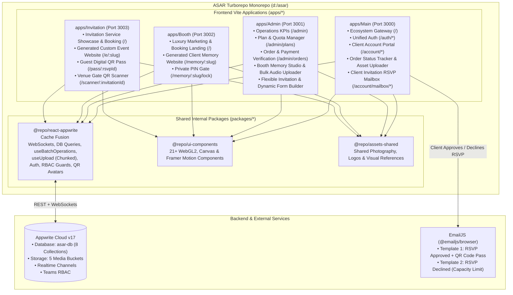
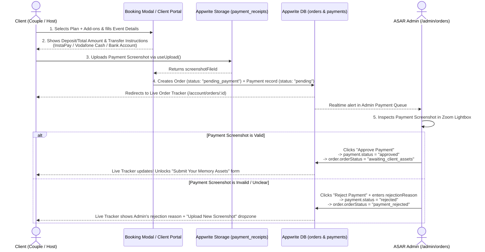
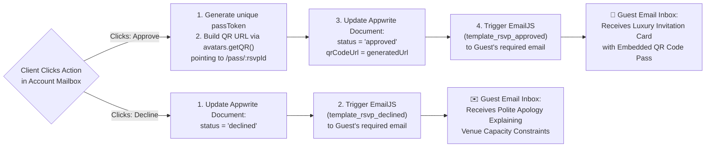
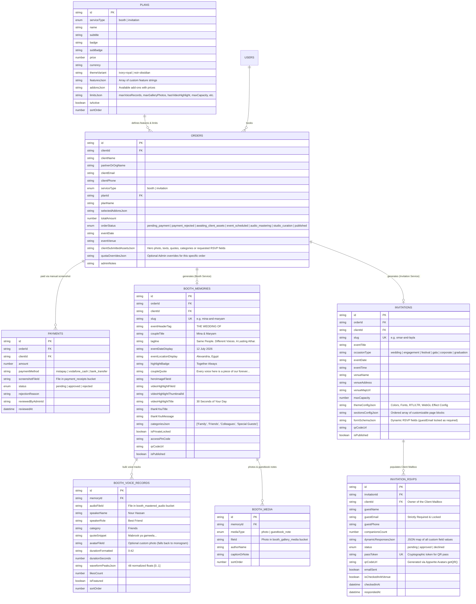

# ASAR (Athar / أثر) — Complete System Architecture & Services Specification

> **Monorepo Engine:** Turborepo v2 (`npm@11.13.0` Workspaces)  
> **Frontend Stack:** React 18, TypeScript 5, Vite 5, Chakra UI v3 (`@chakra-ui/react: ^3.32.0`)  
> **Shared Internal Packages:** `@repo/react-appwrite`, `@repo/ui-components`, `@repo/assets-shared`, `@repo/typescript-config`, `@repo/eslint-config`  
> **Backend & Cloud Infrastructure:** Appwrite v17 (Databases, Storage, Realtime Cache Fusion, Auth, Teams RBAC, Avatars/QR) + EmailJS (`@emailjs/browser`)  
> **Visual Reference:** `docs/ASAR_BOOTH_DESIGN_SPEC.md` & Uploaded Reference Image #1 (*Mina & Maryam — A Private Memory*)  
> **Document Scope:** End-to-End Platform Vision, Services Analysis, Turborepo Architecture, Database Schemas, Admin Studio Editors, Client Portal Workflows, EmailJS + QR Pipelines, and Implementation Roadmap.

---

## Table of Contents

1. [Executive Summary & Core Project Idea](#1-executive-summary--core-project-idea)
2. [Current Monorepo Audit (Already Finished vs. To Be Implemented)](#2-current-monorepo-audit-already-finished-vs-to-be-implemented)
3. [Turborepo Monorepo Architecture & Cross-App Topology](#3-turborepo-monorepo-architecture--cross-app-topology)
4. [Service 1: ASAR BOOTH — Complete Architecture & Workflows](#4-service-1-asar-booth--complete-architecture--workflows)
   * [4.1. Dynamic Plans, Custom Features & Quota Engine](#41-dynamic-plans-custom-features--quota-engine-admin-controlled)
   * [4.2. Manual Payment Screenshot & Admin Approval/Rejection Flow](#42-manual-payment-screenshot--admin-approvalrejection-flow)
   * [4.3. Non-Automated Concierge Fulfillment & 7-Stage Client Order Tracker](#43-non-automated-concierge-fulfillment--7-stage-client-order-tracker)
   * [4.4. The Generated Booth Memory Website (Image #1 Anatomy)](#44-the-generated-booth-memory-website-specification-visual-reference-1)
   * [4.5. Admin Booth Memory Studio & Zero-Effort Bulk Voice Record Uploader](#45-the-admin-booth-memory-studio--zero-effort-bulk-voice-uploader)
   * [4.6. Client Landing QR Code Generation & Printable Station Kit](#46-client-landing-qr-code-generation--printable-station-kit)
5. [Service 2: ASAR INVITATION — Complete Architecture & Workflows](#5-service-2-asar-invitation--complete-architecture--workflows)
   * [5.1. Flexible Custom Event/Memory Website Editor (Beyond Rigid Templates)](#51-flexible-custom-eventmemory-website-editor-beyond-rigid-templates)
   * [5.2. Admin Dynamic RSVP Form Builder (Locked Mandatory Email)](#52-admin-dynamic-rsvp-form-builder-with-locked-mandatory-email)
   * [5.3. Client Account RSVP Mailbox (Real-Time Inbox & Capacity Tracker)](#53-client-account-rsvp-mailbox-real-time-inbox--capacity-tracker)
   * [5.4. Automated EmailJS Pipeline: Approval QR Code vs. Capacity Decline](#54-automated-emailjs-pipeline-approval-qr-code-vs-capacity-decline)
6. [Appwrite Cloud Database Schema (ERD) & Storage Buckets](#6-appwrite-cloud-database-schema-erd--storage-buckets)
7. [Target Directory & File Structure Across All Turborepo Apps](#7-target-directory--file-structure-across-all-turborepo-apps)
8. [Phased Implementation Roadmap](#8-phased-implementation-roadmap)

---

## 1. Executive Summary & Core Project Idea

**ASAR (Athar / أثر)** is an Awwwards-caliber experiential digital memory and event hospitality platform. Rooted in **Warm Vintage Editorial Luxury**, ASAR provides two flagship commercial services orchestrated through a **Centralized Admin Console (`apps/Admin`)** and a **Unified Client Account Portal (`apps/Main` + shared account drawers)**:

### 1.1. Service 1: ASAR Booth (`apps/Booth`) — Audio Guestbook & Digital Memory Website
* **The Concept:** Clients book an on-site vintage rotary telephone installation (or audio memory package) for their wedding or celebration. Guests pick up the phone and leave heartfelt voice messages, blessings, and laughter.
* **Admin-Customizable Plans:** Admin can create and modify Booth Plans dynamically with custom specific features, add-ons, and strict or unlimited quotas (e.g., max voice records, max photos, video highlight inclusion, hosting duration, bulk ZIP download permission).
* **Manual Payment with Screenshot Verification:** Clients pay manually (e.g., InstaPay, Vodafone Cash, Bank Transfer) and upload a payment screenshot. From the Admin Dashboard, the Admin inspects the receipt and **Approves** or **Rejects** it.
* **Human-in-the-Loop Concierge Workflow & Live Order Status:** Booth memory generation is **not** automated immediately upon booking because the client must first send their raw assets (couple hero photo, personal texts/quotes, event details, and categories) to the Admin, and audio engineers must master the recorded voices. Throughout this entire journey, the client has a **Live Order Status Tracker** in their account so they know *exactly* where their order stands and what action is required next.
* **Easy-to-Use Admin Booth Editor & Effortless Bulk Voice Upload:** The Admin assembles the client's memory website using a split-screen visual studio with a live mobile preview. Most importantly, the editor includes a **Zero-Effort Bulk Voice Record Uploader** allowing the Admin to drag-and-drop 50–150+ audio recordings at once, auto-extracting durations and waveforms, auto-parsing filenames/folders into categories, and batch-editing speaker names/roles/quotes in an inline spreadsheet grid.
* **The Generated Booth Memory Website (Image #1) & Client QR Code:** Once published, the client receives a luxury private memory page (matching **Image #1**: Couple Hero, Metadata, Quote, 5 Tabs: `Audio Messages` with category filter pills & interactive waveforms, `Photos`, `Video Highlights`, `Guest Book`, `Thank You`, plus `"Download All Messages"` and `"Share Love"`) along with a **dedicated QR Code** pointing directly to their generated landing page.

### 1.2. Service 2: ASAR Invitation (`apps/Invitation`) — Flexible Custom Event Websites, Dynamic RSVP & Client Mailbox
* **The Concept:** Clients request a bespoke interactive digital invitation and memory website for any occasion (**Weddings, Engagements, Festivals, Galas, Corporate Summits, Graduations**) — similar to the ordering and manual payment workflow of Booth, but **without voice records**.
* **Flexible Visual Website Editor (Not Just a Template):** Because a music festival, a corporate summit, and a royal wedding require vastly different structures, the Admin uses a **Flexible Block & Theme Editor** to customize colors, typography, RTL/LTR direction, `@repo/ui-components` WebGL backgrounds, and reorderable page sections.
* **Admin Dynamic Form Builder (Mandatory Email):** When requesting an Invitation website, the client specifies what guest data they want to collect. The Admin dynamically adds these custom fields (text, dropdowns, companions count, dietary notes, etc.) to the Invitation's RSVP form. The **`email` field is strictly required and locked** on every form.
* **Client Account Mailbox & EmailJS Approval/Decline Automation:**
  * When an invitee submits the dynamic form on the Invitation website, the response lands immediately in a real-time **Mailbox** inside the **Client's Account Pages**.
  * The Client reviews each submission in their Mailbox and clicks **Approve** or **Decline**, which triggers an automated email to the guest via **EmailJS**:
    * **If Approved:** The guest receives a luxury confirmation email containing a unique **Invitation QR Code Pass** for venue entry.
    * **If Declined:** The guest receives a polite, dignified email explaining that **venue capacity constraints make accommodating the invitation difficult**.

---

## 2. Current Monorepo Audit (Already Finished vs. To Be Implemented)

This architecture is designed specifically around the **already finished** foundations in `d:\asar`:

### 2.1. Already Finished in `d:\asar` ✅

| Workspace | Path | Current Implementation Status |
| :--- | :--- | :--- |
| **`@repo/react-appwrite`** | `packages/react-appwrite` | **100% Complete.** Includes `<AppwriteProvider>`, `CacheFusionStore` (zero-refetch WebSocket sync), `<AuthProvider>`, `useAuth`, `useAccountSwitcher`, `useCollection`, `useCollectionWithPagination`, `useDocument`, `useMutations`, `useBatchOperations` (`bulkCreate`, `bulkUpdate`, `bulkDelete` with chunked concurrency & progress tracking), `useDocumentOperations`, `useCollectionCount`, `useSearchDocuments`, `useUpload` (chunked file upload with progress/pause/resume/abort), `useFiles`, `useFileDownload`, `<AppwriteImage>`, `<RequireAuth>`, `<HasRole>`, `<HasTeam>`, `useAvatars` (with native `getQR` & `getInitials`), and the `appwrite-react-gen` CLI. |
| **`@repo/ui-components`** | `packages/UI-components` | **100% Complete.** 21 Awwwards-grade interactive components: `GradientWaves`, `BlurText`, `SplitText`, `TextType`, `CircularText`, `ScrollReveal`, `RotatingText`, `CrystalizedBall`, `DitherVeil`, `GlowCursor`, `SplashCursor`, `ScrollExpand`, `FadeContent`, `GradualBlur`, `Magnet`, `MorphSlider`, `CardNav`, `TiltedCard`, `DecayCard`, `PaperCrumple`, `PeekRating`, `CircularGallery`, `CountUp`, `HalftoneReveal`. |
| **`@repo/assets-shared`** | `packages/assets-shared` | **100% Complete.** Contains shared brand logos (`logo-main.png`, `logo.jpeg`), photography (`booth-hero-photo.webp`, `love-wedding.jpg`, `wedding2.jpg`), and UX reference screens (`screens-booth.jpeg`, `landing-booth.jpeg`). |
| **`@repo/typescript-config`** & **`@repo/eslint-config`** | `packages/typescript-config`, `packages/eslint-config` | **100% Complete.** Shared TypeScript 5 and ESLint configurations across all workspaces. |
| **`apps/Booth` (Landing Page)** | `apps/Booth` (Port `3002`) | **Marketing Landing Page Complete.** 14-section Arabic RTL luxury landing page (`Header` with `CardNav`, `HeroSection` with `GradientWaves`, `StatsSection`, `MoreThanPhoneSection`, `WhyChooseUsSection`, `PackagesSection`, `AddonsSection`, `HowItWorksSection`, `RealVoicesSection`, `GallerySection`, `VideoSection`, `FAQSection`, `ContactSection`, `PrivacySection`, `Footer`, and 3-step `BookingModal` UI). |
| **`apps/Main`**, **`apps/Admin`**, **`apps/Invitation`** | `apps/*` (Ports `3000`, `3001`, `3003`) | **Scaffolded Shells.** Configured with Vite 5, Chakra UI v3 (`@chakra-ui/react: ^3.32.0`), and `<AppwriteProvider>`, ready for full feature build-out. |

### 2.2. Remaining Features to Implement 🚀

| Feature Module | Target Workspace(s) | Summary of Implementation Work |
| :--- | :--- | :--- |
| **1. Shared Domain Models & Utilities** | `packages/shared-types` (or inside `@repo/react-appwrite`) | TypeScript interfaces for the 8 Appwrite collections, Order Pipeline state machine, Web Audio API waveform peak extractor, smart filename parser, and EmailJS client wrapper. |
| **2. Dynamic Plans & Payment Flow** | `apps/Admin`, `apps/Booth`, `apps/Invitation` | Admin Plan CRUD with custom features & limits; connecting `PackagesSection` and `BookingModal` to Appwrite; adding Payment Screenshot upload & Admin Approve/Reject verification. |
| **3. Client Account Portal & Mailbox** | `apps/Main` (and shared account links) | Client Auth pages, **7-Stage Live Order Status Tracker**, **Booth Client Asset Submission Box**, **Client QR Code Hub**, and the **Invitation RSVP Mailbox** with EmailJS integration. |
| **4. Booth Memory Page & Bulk Studio** | `apps/Booth` (`/memory/:slug`), `apps/Admin` | Pixel-accurate implementation of **Image #1** in `apps/Booth` + the **Admin Booth Memory Studio** with split-screen live preview and the **Zero-Effort Bulk Voice Record Uploader**. |
| **5. Flexible Invitation Studio & Renderer**| `apps/Invitation` (`/e/:slug`), `apps/Admin` | Multi-occasion visual block/theme builder + **Admin Dynamic RSVP Form Builder** (with locked `email` field) + custom event renderer & digital QR pass page (`/pass/:rsvpId`). |

---

## 3. Turborepo Monorepo Architecture & Cross-App Topology

### 3.1. System Architecture Diagram



### 3.2. Cross-App Authentication & Unified Session Strategy in Turborepo
Because `Main` (`:3000`), `Admin` (`:3001`), `Booth` (`:3002`), and `Invitation` (`:3003`) run on separate ports in development (and either subdomains or path-based routes in production):
* **Production Deployment:** Hosting on a shared root domain (`asar.audio`, `booth.asar.audio`, `invitation.asar.audio`, `admin.asar.audio`) allows Appwrite first-party session cookies to authenticate the user seamlessly across all 4 apps without logging in twice.
* **Local Development (`localhost:3000..3003`):** Because `localStorage` is scoped by port in browsers, `apps/Main` serves as the central **Client Account Portal** (`http://localhost:3000/account`), while `apps/Booth` and `apps/Invitation` pass a `?session=` handoff or deep-link directly to `http://localhost:3000/account/orders/:orderId` after a client submits a booking!

---

## 4. Service 1: ASAR BOOTH — Complete Architecture & Workflows

### 4.1. Dynamic Plans, Custom Features & Quota Engine (Admin-Controlled)

The Admin has full control over Booth Plans (and Add-ons) from `/admin/plans`. No code changes are needed to launch seasonal offers, VIP tiers, or custom quotas.

#### How Admin Configures a Booth Plan:
1. **Core Identity & Pricing:**
   * `name` (e.g., `"لحظة أثر — Athar Moment"`), `subtitle` (`"الباقة الكلاسيكية"`), `badge` (`"الباقة الأكثر طلباً"`), `subBadge` (`"عرض الإطلاق"`).
   * `price` (`5500`), `currency` (`"EGP"`), `depositRequired` (`1500`).
   * `themeVariant`: `"ivory-royal"` (Light card) or `"noir-obsidian"` (Dark gold VIP card, matching `PackagesSection.tsx`).
2. **Custom Specific Features (Dynamic Checklist):**
   * Admin can add, edit, reorder, or delete any number of custom bullet points (`features: string[]`) displayed on the package card.
3. **Enforced System Limits (`limits` JSON Object):**
   * `coverageHours`: `3` or `6` hours.
   * `maxVoiceRecords`: e.g., `80`, `150`, or `-1` (Unlimited).
   * `maxGalleryPhotos`: e.g., `20`, `60`, or `-1` (Unlimited).
   * `maxCustomCategories`: e.g., `4` or `10`.
   * `hasVideoHighlight`: `boolean` — Controls whether the **Video Highlights** tab and 30s banner appear on the generated Memory Website.
   * `hasGuestBookTab`: `boolean` — Controls whether the written **Guest Book** tab is enabled.
   * `allowBulkZipDownload`: `boolean` — Controls whether the **"Download All Messages"** button on the Memory Website is unlocked.
   * `hostingDurationDays`: e.g., `365` (1 Year) or `730` (2 Years).
4. **Admin Per-Order Quota Override:**
   * Inside any specific order in `/admin/booth-studio/:orderId`, the Admin can override a limit for a specific client (e.g., gifting a client `hasVideoHighlight: true` or increasing `maxVoiceRecords` from `100` to `120`) without altering the global plan!

---

### 4.2. Manual Payment Screenshot & Admin Approval/Rejection Flow

All payments in ASAR are handled manually with full transparency between Client and Admin:



---

### 4.3. Non-Automated Concierge Fulfillment & 7-Stage Client Order Tracker

Because the Booth Memory Website requires **client-provided personalization assets** AND **studio-mastered voice recordings** from the physical event, the workflow is structured into **7 crystal-clear stages** displayed on the Client's Order Status Page (`/account/orders/:orderId`):

| Stage # | Status Key | Client-Facing Title | What Happens at This Stage | Who Acts |
| :-: | :--- | :--- | :--- | :--- |
| **1** | `pending_payment` | **Payment Verification** | Client has submitted booking and payment screenshot. Admin is verifying the receipt. | **Admin** (Approves or Rejects screenshot) |
| **2** | `payment_rejected` *(Conditional)* | **Action Required: Payment Receipt** | Displayed only if screenshot was unclear/invalid. Shows Admin's note and re-upload box. | **Client** (Re-uploads valid screenshot) |
| **3** | `awaiting_client_assets` | **Personalize Your Memory Page** | Payment is approved! The client now fills out the **Memory Asset Submission Form** (Hero Photo, Couple Names, Event Date, Venue, Custom Badge, Personal Quote, Thank You Note, & Desired Categories). | **Client** (Submits photos & texts to Admin) |
| **4** | `event_scheduled` | **Ready for Your Celebration** | Admin has reviewed the client's assets and confirmed the on-site Booth station & concierge host for the event date. (Pre-event table QR codes can already be downloaded here!). | **ASAR On-Site Team** |
| **5** | `audio_mastering` | **Studio Audio Mastering** | The celebration took place! ASAR sound engineers are filtering background venue music and mastering every guest's voice recording. | **ASAR Sound Engineers** |
| **6** | `studio_curation` | **Building Your Memory Website** | Admin is placing the mastered voice records in bulk, organizing categories, and curating photos/video in the **Booth Memory Studio**. | **Admin** |
| **7** | `published` | **Your Memory Vault is Live! 🎉** | The Booth Memory Website (`/memory/:slug`) is live! Client gets their direct link, privacy PIN control, and high-res **Landing QR Code**. | **Client** (Listens, downloads & shares!) |

#### What the Client Sends to the Admin in Stage 3 (`awaiting_client_assets`):
Inside `/account/orders/:orderId`, the client fills out a guided, user-friendly **Memory Assets Form**:
1. **Primary Cover Photo (`heroImageFileId`):** High-res photo of the couple (with live crop preview).
2. **Header Tag & Couple Display Title:** e.g., `"THE WEDDING OF"` and `"Mina & Maryam"`.
3. **Celebration Metadata Pills:** Date (`"12 July 2026"`), Location (`"Alexandria, Egypt"`), and Romantic Tag (`"Together Always"`).
4. **Personal Quote & Attribution:** e.g., `"Every voice here is a piece of our forever ..."` — `"Mina & Maryam"`.
5. **Preferred Voice Categories:** Default pills (`Family`, `Friends`, `Colleagues`, `Special Guests`) + ability for the client to suggest custom categories (e.g., `"Bride's Family"`, `"Groom's Friends"`).
6. **Thank You Tab Message:** A note from the couple to guests who visit the memory page.
7. **Additional Event Photos (Optional):** Up to their plan's `maxGalleryPhotos` limit.

---

### 4.4. The Generated Booth Memory Website Specification (Visual Reference #1)

Located at `apps/Booth` route `/memory/:slug`, this page is the final digital heirloom delivered to the client. Every visual and functional detail is modeled after **Uploaded Reference Image #1**:

#### Detailed Component Breakdown of `/memory/:slug`:

1. **Sticky Luxury Top Bar:**
   * **Left:** Hamburger Menu button (`≡`) opening a slide-over sheet (Quick navigation between tabs, Dark/Light contrast toggle, PIN Lock toggle, and `"Created by Athar Audio Memories"` link).
   * **Center:** High-res Athar Arabic/English calligraphy logo (`أثر ATHAR AUDIO MEMORIES`).
   * **Right:** Security & Ownership Badge: Gold padlock icon (`🔒`) + `"A Private Memory For Mina & Maryam"`. (If `isPrivateLocked` is enabled by the client/admin, visitors must enter the 4-digit PIN before accessing the page).

2. **Editorial Couple Hero Section:**
   * **Background:** Client's uploaded high-resolution couple photograph (`<AppwriteImage>`) with a soft warm-alabaster bottom fade (`linear-gradient(to bottom, rgba(251,247,242,0.1) 0%, rgba(251,247,242,0.95) 88%, #FBF7F2 100%)`).
   * **Typography Stack:**
     * Overline: `THE WEDDING OF` (tracked uppercase serif).
     * Couple Title: `Mina & Maryam` (`Playfair Display` / `Amiri` italic & bold, `#5B1621`).
     * Acoustic Divider: Gold SVG waveform emblem (`─── ∿∿∿ ───`).
     * Subtitle: `Same People. Different Voices. A Lasting Athar.`
   * **3 Metadata Badges Row:**
     * `📅 12 July 2026`  ·  `📍 Alexandria, Egypt`  ·  `🤍 Together Always`
   * **Personal Quote Block:**
     * `"Every voice here is a piece of our forever ..."`
     * `– Mina & Maryam`

3. **5-Tab Horizontal Navigation Strip:**
   * Styled as tactile rounded cards (`borderRadius="16px"`):
     1. **`Audio Messages`** (Waveform icon — Active state: Royal Maroon `#6B1D28` background, white text, soft elevation shadow).
     2. **`Photos`** (Gallery icon — Inactive state: Warm Linen `#F4EFEA` card).
     3. **`Video Highlights`** (Play icon — Hidden automatically if the client's plan has `hasVideoHighlight: false`).
     4. **`Guest Book`** (Open book icon — Written wishes & transcriptions).
     5. **`Thank You`** (Heart icon — Couple's thank-you note & keepsake card).

4. **Tab 1: `Audio Messages` (Default Active View in Image #1):**
   * **Section Header:** `AUDIO MESSAGES` + waveform divider + subtitle: *"Listen to the love, laughter and blessings from the people who matter most."*
   * **Dynamic Category Filter Pills with Real Counts:**
     * Computed automatically from the voice records array:
       `All (86)` · `Family (24)` · `Friends (38)` · `Colleagues (6)` · `Special Guests (8)`
   * **Voice Record Card List (`BoothVoiceCard`):**
     * Each card displays:
       * **Guest Avatar (`48px` circle):** Uses `avatarFileId` if uploaded, or automatically generates a warm luxury monogram/category avatar via `useAvatars().getInitials(speakerName)` so cards always look complete even when bulk-uploaded without individual guest photos!
       * **Play / Pause Button (`36px` Royal Maroon circle):** Plays/pauses the audio stream and synchronizes with the global audio controller (only one voice plays at a time; optional "Play All Continuous" mode).
       * **Speaker Metadata:**
         * **Name:** e.g., `Nour Hassan`, `Ahmed El Sayed`, `Mona Khaled`, `Tarek Mostafa`, `Grandma`.
         * **Relationship / Role:** e.g., `Best Friend`, `Brother`, `Cousin`, `Colleague`, `Family`.
         * **Quote Snippet:** Bilingual `dir="auto"` italic quote, e.g., `"Mabrook ya gameela, ربنا يسعدكم دايماً ..."`.
       * **Interactive 48-Bar Waveform Scrubber & Duration (`0:42`):**
         * Renders the pre-computed `waveformPeaksJson` array immediately on page load.
         * As the audio plays, bars to the left of `currentTime / duration` fill with Royal Maroon (`#6B1D28`), while upcoming bars remain Warm Truffle (`rgba(107, 29, 40, 0.25)`). Clicking anywhere on the waveform seeks directly to that timestamp!
       * **Heart (`♡` / `♥`) & More Menu (`⋮`):**
         * Heart button increments/toggles favorite status.
         * `⋮` menu allows **Download Single MP3** or **Share Direct Link to This Voice**.

5. **Video Highlight Banner Card:**
   * Positioned below the voice list: features a preview thumbnail, play button overlay, title `VIDEO HIGHLIGHT`, and subtitle `30 Seconds of Your Day >` (clicking switches to the `Video Highlights` tab or opens the fullscreen 4K reel).

6. **Bottom Dual Action Cards:**
   * **Left (`Download All Messages` — `Keep your memories forever`):** Downloads the complete mastered audio collection (as a pre-packaged `.zip` archive or sequential batch download via `useFileDownload`, gated by the plan's `allowBulkZipDownload` setting).
   * **Right (`Share Love` — `With Family & Friends`):** Opens a luxury Share & QR Code sheet where the couple can copy the link, share directly to WhatsApp, or save their **Memory QR Code**.

---

### 4.5. The Admin Booth Memory Studio & Zero-Effort Bulk Voice Uploader

To satisfy the requirement that **the Admin editor for the Booth generated memory must be super easy to use, have great UI/UX, and allow placing a bulk of voice records effortlessly**, `/admin/booth-studio/:orderId` is engineered as a **Split-Screen Visual Studio**:

```
+--------------------------------------------------------------------------------------------------+
|  ASAR ADMIN STUDIO  •  Order #ORD-902 (Mina & Maryam)  •  Plan: Athar Story VIP (86/Unlimited)   |
|  [ ← Back to Orders ]      [ Pull Client Submitted Assets ]      [ Generate QR ]  [ Publish ✓ ]  |
+--------------------------------------------------------------+-----------------------------------+
|  STUDIO WORKSPACE (62% Width)                                |  LIVE MOBILE PREVIEW (38% Width)  |
|                                                              |                                   |
|  TABS: [1. Hero & Texts] [2. Bulk Voice Studio (86)]         |     +-----------------------+     |
|        [3. Photos & Video] [4. Guest Book & Thank You]       |     |  ≡   أثر ATHAR    🔒  |     |
|  ----------------------------------------------------------  |     |-----------------------|     |
|  +--------------------------------------------------------+  |     |   THE WEDDING OF      |     |
|  | 🎙️ DRAG & DROP BULK VOICE RECORDS (.mp3, .wav, .m4a)   |  |     |   Mina & Maryam       |     |
|  | Drop 100+ files or category folders here.              |  |     |   12 July • Alex      |     |
|  | Auto-extracts duration, waveforms & parses filenames!  |  |     +-----------------------+     |
|  +--------------------------------------------------------+  |     | [Audio] [Photos] [Vid]|     |
|                                                              |     |                       |     |
|  BULK TOOLBAR: [☑ Select All] [Set Category ▾] [Auto-Number] |     | (All 86) (Family 24)  |     |
|                [Upload & Save All Changes (86 Tracks) ->]    |     |                       |     |
|                                                              |     | ▶ Nour Hassan  ılı 0:42|    |
|  FAST SPREADSHEET BATCH GRID (Tab/Enter between cells):      |     | ▶ Ahmed Sayed  ılı 1:12|    |
|  +---+----+----------------+------------+----------+------+  |     | ▶ Mona Khaled  ılı 0:38|    |
|  | ☑ | ▶  | Speaker Name   | Role       | Category |Quote |  |     | ▶ Grandma      ılı 1:08|    |
|  +---+----+----------------+------------+----------+------+  |     |                       |     |
|  | ☑ | ▶  | [Nour Hassan ] | [Best Fr.] | [Friends▾| [Mab.|  |     | [Download] [Share QR] |     |
|  | ☑ | ▶  | [Ahmed Sayed ] | [Brother ] | [Family ▾| [Sta.|  |     +-----------------------+     |
|  | ☐ | ▶  | [Mona Khaled ] | [Cousin  ] | [Family ▾| [بحب.|  |      (Updates in real time!)      |
|  +---+----+----------------+------------+----------+------+  |                                   |
+--------------------------------------------------------------+-----------------------------------+
```

#### 5 Ergonomic Features That Make Bulk Voice Placement Effortless:

1. **One-Click "Pull Client Submitted Assets":**
   * The Admin doesn't have to copy-paste the couple's photo, names, date, location, or quote. Clicking **"Pull Client Submitted Assets"** automatically populates the Hero image, titles, metadata, and categories from what the client uploaded in Stage 3.
2. **Multi-File & Folder Drag-and-Drop Zone:**
   * Admin can drag 100+ audio files at once—or even drag entire folders named `Family/`, `Friends/`, `Colleagues/`. If files are dropped inside a folder, the studio automatically assigns that folder's name as the `category` for every file inside it!
3. **Smart Filename Parser with Zero-Friction Fallbacks:**
   * Supports flexible naming patterns:
     * Pattern A (`Category_Name_Role.mp3`): `Friends_Nour Hassan_Best Friend.mp3` → Category: `Friends`, Name: `Nour Hassan`, Role: `Best Friend`.
     * Pattern B (`Name - Role.mp3`): `Ahmed El Sayed - Brother.mp3` → Name: `Ahmed El Sayed`, Role: `Brother`.
     * Pattern C (Raw files like `REC_001.mp3`): Automatically labels them cleanly (`Voice Memory #1`) so the page still looks great even if the Admin doesn't know every guest's name.
4. **Client-Side Web Audio API Auto-Analyzer (Zero Manual Timing):**
   * The moment files are dropped, a background Web Audio API worker decodes each file in milliseconds to:
     * Populate `durationFormatted` (`"0:42"`) and `durationSeconds` (`42`).
     * Generate a 48-point normalized `waveformPeaksJson` array (`[0.18, 0.45, 0.92, ...]`) so the visual waveform in Image #1 is 100% authentic to each guest's voice!
5. **Inline Audition + Keyboard Spreadsheet Grid + Batch Upload (`useBatchOperations`):**
   * Each row has an inline **`▶` Play button** so the Admin can listen to the recording while typing the speaker's name, role, and short quote snippet, then press `Tab` or `Enter` to jump directly to the next row.
   * Clicking **"Upload & Save All"** uses `@repo/react-appwrite`'s `useUpload` and `useBatchOperations().bulkCreate` (with chunked concurrency and a smooth progress bar) to upload and create all 80–150 records reliably without hitting rate limits.

---

### 4.6. Client Landing QR Code Generation & Printable Station Kit

Every Booth Memory Website automatically gets a dedicated **QR Code** pointing to `https://{booth-domain}/memory/{slug}`:
* **How It Is Generated:** Powered by `@repo/react-appwrite`'s `useAvatars().getQR(memoryUrl, 1000, 2)` and rendered inside a luxury SVG/Canvas frame styled in Athar Royal Maroon (`#6B1D28`) and Champagne Gold (`#D4AF37`).
* **Where It Is Available:**
  1. **In the Admin Booth Studio:** Admin can generate the slug and download the **Print-Ready Table QR Card (PDF/PNG)** *before* the wedding (to place on guest tables at the venue) and after publishing.
  2. **In the Client Account Portal (`/account/orders/:orderId`):** The client can view and download their high-resolution QR Code to share on WhatsApp, print in their wedding album, or frame at home.
  3. **On the Memory Website Itself (`Share Love` button):** Guests and family can pull up the QR code directly on their phones to share with others in the room.

---

## 5. Service 2: ASAR INVITATION — Complete Architecture & Workflows

### 5.1. Flexible Custom Event/Memory Website Editor (Beyond Rigid Templates)

Because Invitation clients request websites for diverse occasions (**Weddings, Engagements, Music/Art Festivals, VIP Galas, Corporate Conferences, Graduations, Anniversaries**), the Invitation service does **not** lock clients into a single static template.

Instead, `/admin/invitation-studio/:orderId` in `apps/Admin` provides a **3-Layer Flexible Visual Website Builder**:

```
+--------------------------------------------------------------------------------------------------+
|  ASAR INVITATION STUDIO  •  Order #ORD-915  •  Occasion: Wedding / Festival / Gala               |
+--------------------------------------------------------------+-----------------------------------+
|  BUILDER CONTROLS (60% Width)                                |  LIVE INTERACTIVE PREVIEW (40%)   |
|                                                              |                                   |
|  [1. Theme & Shaders] [2. Page Sections] [3. Dynamic Form]   |  +-----------------------------+  |
|  ----------------------------------------------------------  |  |  [Hero: SplitText + Waves]  |  |
|  SECTION BLOCK STACK (Drag ⠿ to Reorder, Toggle 👁️, Edit ✎): |  |   OMAR & LAYLA / GALA 2026  |  |
|                                                              |  +-----------------------------+  |
|  ⠿ [👁️] 1. HERO SHOWCASE BLOCK                         [✎]  |  |  [Countdown: 14d : 08h : 22m|  |
|         Layout: Fullscreen Center | Shader: GradientWaves    |  +-----------------------------+  |
|  ⠿ [👁️] 2. LIVE COUNTDOWN TIMER BLOCK                  [✎]  |  |  [Our Story / Event Agenda] |  |
|         Target: 2026-11-20 19:30 | Style: Glass Pills        |  +-----------------------------+  |
|  ⠿ [👁️] 3. STORY / AGENDA TIMELINE BLOCK               [✎]  |  |  [Interactive Photo Gallery]|  |
|         Items: 4 Milestones / Speakers                       |  +-----------------------------+  |
|  ⠿ [👁️] 4. PHOTO & MEMORY GALLERY BLOCK                [✎]  |  |  [Dynamic RSVP Form]        |  |
|         Mode: CircularGallery 3D / DecayCard Polaroids       |  |   * Full Name               |  |
|  ⠿ [👁️] 5. VENUE MAP & DRESS CODE BLOCK                [✎]  |  |   * Email (Required 🔒)     |  |
|         Venue: Four Seasons Alexandria + Color Swatches      |  |   * Companions (Dropdown)   |  |
|  ⠿ [🔒] 6. DYNAMIC RSVP FORM BLOCK (Always Included)   [✎]  |  |   [ Submit RSVP Request -> ]|  |
|                                                              |  +-----------------------------+  |
|  [ + Add Custom Content / Video / VIP Block ]                |                                   |
+--------------------------------------------------------------+-----------------------------------+
```

#### Layer 1: Theme Engine & `@repo/ui-components` Visual Effects
* **Occasion Presets (Fully Customizable):**
  * *Royal Wedding Editorial* (Warm Alabaster, Maroon `#6B1D28`, Gold `#D4AF37`, `Amiri` + `Playfair Display`).
  * *Noir Gala & Summit* (Obsidian `#121014`, Champagne Gold `#E5C158`, `Cairo` + `Plus Jakarta Sans`).
  * *Vibrant Festival / Celebration* (Custom brand hex colors, bold typography, interactive `SplashCursor` or `DitherVeil`).
* **Interactive Component Toggles:** Admin can enable `@repo/ui-components` effects (`GradientWaves`, `BlurText`, `SplitText`, `CircularGallery`, `DecayCard`, `TiltedCard`, `CountUp`, `Magnet`, `GlowCursor`) per section with simple dropdowns.

#### Layer 2: Composable Section Blocks
* Admin can add, duplicate, reorder, or hide modular sections (`HeroBlock`, `CountdownBlock`, `StoryTimelineBlock`, `GalleryBlock`, `VideoReelBlock`, `VenueMapBlock`, `DressCodeBlock`, `CustomRichTextBlock`, and `RsvpFormBlock`) stored as a structured JSON array (`sectionsConfigJson`) in Appwrite.

---

### 5.2. Admin Dynamic RSVP Form Builder (with Locked Mandatory Email)

When a client orders an Invitation website, they specify what guest details they want to collect (e.g., *Full Name*, *Email*, *Phone*, *Number of Companions*, *Side of Family / VIP Code*, *Dietary Restrictions*, *Song Request*).

In **Tab 3 (`Dynamic Form Builder`)** of the Invitation Studio, the Admin configures the form schema for that invitation:

```
+--------------------------------------------------------------------------------------------------+
|  DYNAMIC RSVP FORM BUILDER (Fields requested by Client: "Name, Email, Phone, Companions, Note")  |
+--------------------------------------------------------------------------------------------------+
|  🔒 1. [Text Input]   Label: "Full Name / الاسم بالكامل"          Required: [YES 🔒] (System)    |
|  🔒 2. [Email Input]  Label: "Email Address / البريد الإلكتروني"   Required: [YES 🔒] (System)    |
|        ↳ Note: Locked as required so EmailJS can deliver QR Code or Capacity Notice to guest.    |
|  ⠿  3. [Tel Input]    Label: "WhatsApp Phone Number"              Required: [☑ Yes]  [🗑️ Delete] |
|  ⠿  4. [Select Menu]  Label: "Number of Companions"               Required: [☑ Yes]  [🗑️ Delete] |
|        ↳ Options: ["Just Me (1)", "+1 Guest (2)", "+2 Guests (3)"]                               |
|  ⠿  5. [Textarea]     Label: "Leave a Memory or Blessing"         Required: [☐ No ]  [🗑️ Delete] |
|                                                                                                  |
|  [ + Add Dynamic Field (Text / Number / Select Dropdown / Radio / Checkbox / Textarea) ]         |
+--------------------------------------------------------------------------------------------------+
```

* **Strict Architectural Rule:** The `guestEmail` field (`type: "email"`, `required: true`) is **hard-locked at both the Admin Builder UI level and the Guest Form validation level**. A guest cannot submit the RSVP form without providing a valid email address.

---

### 5.3. Client Account RSVP Mailbox (Real-Time Inbox & Capacity Tracker)

When guests visit `/e/:slug` in `apps/Invitation` and submit the dynamic RSVP form, their submission is saved to the `invitation_rsvps` collection in Appwrite with `status: "pending"`.

Inside the **Client Account Portal** (`/account/mailbox/:invitationId` in `apps/Main`), the client (the event host/couple) has a dedicated **VIP RSVP Mailbox**:

```
+--------------------------------------------------------------------------------------------------+
|  ✉️ INVITATION RSVP MAILBOX  •  "The Wedding of Omar & Layla"                                    |
|  Capacity Meter: [████████████████░░░░] 120 / 150 Seats Approved   •   14 Pending   •   8 Declined|
+------------------------------------+-------------------------------------------------------------+
|  INBOX LIST (Realtime WebSockets)  |  SELECTED GUEST SUBMISSION DETAILS                          |
|  Filter: [All] [Pending (14)]      |                                                             |
|          [Approved] [Declined]     |  Guest Name:   Karim El-Masry                               |
|  --------------------------------  |  Email:        karim.masry@example.com  (Verified ✓)        |
|  ● Karim El-Masry       [Pending]  |  Submitted:    Today at 2:14 PM                             |
|    karim@example.com • +1 Guest    |  Status:       ⏳ Pending Host Decision                      |
|                                    |  ---------------------------------------------------------  |
|  ● Sara Mahmoud         [Pending]  |  DYNAMIC FORM RESPONSES:                                    |
|    sara@example.com • Just Me      |  • WhatsApp Phone:        01012345678                       |
|                                    |  • Number of Companions:  +1 Guest (2 Seats Total)          |
|  ✓ H.E. Yousef Ghamdi  [Approved]  |  • Dietary Preference:    Standard                          |
|    QR Sent via EmailJS ✓           |  • Memory / Blessing:     "So happy for you both! Mabrook!" |
|                                    |  ---------------------------------------------------------  |
|  ✕ Nadia Mansour       [Declined]  |  HOST DECISION (Automatically sends Email via EmailJS):     |
|    Capacity Notice Sent ✓          |                                                             |
|                                    |  [ ✓ Approve & Email QR Code ]   [ ✕ Decline (Capacity) ]   |
+------------------------------------+-------------------------------------------------------------+
```

---

### 5.4. Automated EmailJS Pipeline: Approval QR Code vs. Capacity Decline

When the Client clicks **Approve** or **Decline** inside their Mailbox, the system executes an atomic workflow combining **Appwrite Database updates**, **Appwrite QR Code generation (`useAvatars`)**, and **EmailJS (`@emailjs/browser`)**:



#### Exact Behavior of the Two EmailJS Outcomes:
1. **Outcome A — Client Approves (`status: "approved"`):**
   * The system generates a unique verification token (`passToken`) and constructs the guest's digital pass URL: `https://{invitation-domain}/pass/{rsvp.$id}?token={passToken}`.
   * Using `@repo/react-appwrite`'s `useAvatars().getQR()`, it generates the direct image URL for the QR Code.
   * EmailJS dispatches `template_rsvp_approved` to `rsvp.guestEmail` containing:
     * Event Title, Date, Time, and Venue Map link.
     * The embedded **Invitation QR Code image** (``).
     * A button to open their interactive mobile pass (`/pass/:rsvpId`).
2. **Outcome B — Client Declines (`status: "declined"`):**
   * The document status is updated to `"declined"`.
   * EmailJS dispatches `template_rsvp_declined` to `rsvp.guestEmail` with a gracious, dignified message explaining that **venue capacity constraints make accommodating the invitation difficult**:
     > *"Dear {{to_name}}, thank you deeply for your warm wishes and for responding to our invitation for {{event_title}}. Due to strict venue capacity limits, we are unfortunately unable to confirm additional seats at this time. We truly cherish your love and support."*

---

## 6. Appwrite Cloud Database Schema (ERD) & Storage Buckets

All four apps connect to the single Appwrite database (`asar-db`) via `@repo/react-appwrite`.

### 6.1. Complete Entity-Relationship Diagram



### 6.2. Storage Buckets Overview

| Bucket ID | Purpose | Used By |
| :--- | :--- | :--- |
| `payment_receipts` | Manual payment screenshots uploaded by clients during booking or from their Order Tracker | `apps/Booth`, `apps/Invitation`, `apps/Main`, `apps/Admin` |
| `client_raw_assets` | Client-submitted cover photos, secondary photos, and reference assets for Booth or Invitation | `apps/Main`, `apps/Admin` |
| `booth_mastered_audio` | Bulk-uploaded mastered guest voice recordings (`.mp3`, `.wav`, `.m4a`) and optional pre-packed `.zip` bundles | `apps/Admin`, `apps/Booth` |
| `booth_gallery_media` | Hero cover photos, speaker avatars, gallery photos, and 30s video highlight reels | `apps/Admin`, `apps/Booth` |
| `invitation_assets` | Custom event hero media, gallery images, and brand assets for generated Invitations | `apps/Admin`, `apps/Invitation` |

---

## 7. Target Directory & File Structure Across All Turborepo Apps

Below is the complete modular folder structure for the 4 applications in `d:\asar\apps/*`, integrating what is already completed with the new modules:

```
d:\asar\
├── apps/
│   ├── Booth/                                      # (Port 3002) Audio Guestbook Landing & Memory Page
│   │   └── src/
│   │       ├── components/
│   │       │   ├── layout/                         # [COMPLETED] Header.tsx, Footer.tsx
│   │       │   ├── sections/                       # [COMPLETED] 14 Marketing Sections + BookingModal.tsx
│   │       │   │                                   # (Update PackagesSection & BookingModal to sync with Appwrite)
│   │       │   └── memory/                         # [TO IMPLEMENT] Generated Booth Memory Page (Image #1)
│   │       │       ├── MemoryTopBar.tsx            # Logo + "🔒 A Private Memory For..."
│   │       │       ├── MemoryHero.tsx              # Couple cover photo, names, date/city/tag, personal quote
│   │       │       ├── MemoryTabsBar.tsx           # 5 Tabs: Audio Messages, Photos, Video, Guest Book, Thank You
│   │       │       ├── AudioMessagesTab.tsx        # Category filter pills + Voice Record cards list
│   │       │       ├── VoiceRecordCard.tsx         # Avatar, Play/Pause, 48-bar Waveform Scrubber, Duration, Heart, Menu
│   │       │       ├── PhotosTab.tsx               # Event photo gallery with DecayCard / Lightbox
│   │       │       ├── VideoHighlightTab.tsx       # 30s video highlight player & banner card
│   │       │       ├── GuestBookTab.tsx            # Written guest blessings
│   │       │       ├── ThankYouTab.tsx             # Couple's thank-you card
│   │       │       ├── MemoryBottomActions.tsx     # "Download All Messages" & "Share Love" (QR Modal)
│   │       │       └── MemoryPinLockGate.tsx       # Optional PIN entry screen
│   │       ├── pages/
│   │       │   ├── LandingPage.tsx                 # Wraps the 14 completed marketing sections
│   │       │   └── BoothMemoryPage.tsx             # Dynamic route `/memory/:slug`
│   │       └── App.tsx                             # Router switching between `/` and `/memory/:slug`
│   │
│   ├── Invitation/                                 # (Port 3003) Bespoke Event Websites & Digital QR Passes
│   │   └── src/
│   │       ├── components/
│   │       │   ├── landing/                        # Invitation service showcase, dynamic plans & booking modal
│   │       │   ├── renderer/                       # [TO IMPLEMENT] Flexible Custom Event Website Renderer
│   │       │   │   ├── ThemeWrapper.tsx            # Injects custom CSS tokens, fonts, RTL/LTR & WebGL shaders
│   │       │   │   ├── blocks/
│   │       │   │   │   ├── HeroBlock.tsx           # Customizable event hero (Wedding, Festival, Gala, etc.)
│   │       │   │   │   ├── CountdownBlock.tsx      # Live countdown timer
│   │       │   │   │   ├── StoryTimelineBlock.tsx  # Couple story or festival/conference schedule
│   │       │   │   │   ├── GalleryBlock.tsx        # CircularGallery or masonry photos
│   │       │   │   │   ├── VenueMapBlock.tsx       # Location map & dress code swatches
│   │       │   │   │   └── DynamicRsvpFormBlock.tsx# Renders Admin's dynamic form schema (email required 🔒)
│   │       │   └── pass/
│   │       │       ├── GuestQrPassCard.tsx         # Digital QR Pass view (`/pass/:rsvpId`)
│   │       │       └── VenueQrScanner.tsx          # Host check-in scanner (`/scanner/:invitationId`)
│   │       ├── pages/
│   │       │   ├── InvitationLandingPage.tsx       # `/`
│   │       │   ├── CustomEventPage.tsx             # `/e/:slug`
│   │       │   └── GuestPassPage.tsx               # `/pass/:rsvpId`
│   │       └── App.tsx
│   │
│   ├── Main/                                       # (Port 3000) Brand Hub & Unified Client Account Portal
│   │   └── src/
│   │       ├── components/
│   │       │   ├── auth/
│   │       │   │   └── AuthModalOrPage.tsx         # Login / Register via @repo/react-appwrite useAuth()
│   │       │   ├── account/
│   │       │   │   ├── ClientSidebarLayout.tsx     # Account navigation (My Orders, Asset Box, QR Hub, Mailbox)
│   │       │   │   ├── OrderPipelineTracker.tsx    # 7-Stage visual progress tracker
│   │       │   │   ├── PaymentReceiptUploader.tsx  # Manual payment screenshot upload & status view
│   │       │   │   ├── BoothClientAssetsForm.tsx   # Client uploads Hero photo, texts, quotes & categories
│   │       │   │   └── ClientQrCodeCard.tsx        # High-res downloadable QR Code for Booth or Invitation
│   │       │   └── mailbox/                        # [TO IMPLEMENT] Client Invitation RSVP Mailbox
│   │       │       ├── RsvpMailboxView.tsx         # Real-time inbox (`useCollection` with `realtime: true`)
│   │       │       ├── CapacityMeterBar.tsx        # Approved vs. Max Capacity progress bar
│   │       │       ├── RsvpSubmissionInspector.tsx # Displays all dynamic form answers from guest
│   │       │       └── EmailJsDispatcher.ts        # Sends Approval QR Email or Capacity Decline Email via EmailJS
│   │       └── App.tsx
│   │
│   └── Admin/                                      # (Port 3001) Centralized Operations & Visual Studios
│       └── src/
│           ├── components/
│           │   ├── layout/
│           │   │   └── AdminShell.tsx              # Sidebar navigation & RBAC guard
│           │   ├── plans/
│           │   │   └── PlanBuilderStudio.tsx       # Create/Modify Booth & Invitation plans, features & limits
│           │   ├── orders/
│           │   │   ├── OrdersQueueTable.tsx        # Filterable orders list + status pipeline switcher
│           │   │   └── PaymentReceiptInspector.tsx # Zoomable screenshot viewer + Approve / Reject controls
│           │   ├── booth-studio/                   # [TO IMPLEMENT] Easy-to-Use Booth Memory Editor
│           │   │   ├── BoothMemoryStudio.tsx       # Split-screen editor + Live iPhone Preview
│           │   │   ├── HeroAndTextsEditor.tsx      # One-click pull from Client Assets + manual refinement
│           │   │   ├── BulkVoiceUploader.tsx       # Drag & drop 100+ audio files + Web Audio peak/duration extractor
│           │   │   ├── VoiceBatchGridEditor.tsx    # Spreadsheet inline editor + bulk category assignment
│           │   │   └── MediaAndTabsEditor.tsx      # Photos, 30s Video, Guest Book, Thank You & QR generator
│           │   └── invitation-studio/              # [TO IMPLEMENT] Flexible Invitation & Form Editor
│           │       ├── InvitationStudio.tsx        # Split-screen visual builder + Live Preview
│           │       ├── ThemeAndEffectsPanel.tsx    # Colors, fonts, RTL/LTR & @repo/ui-components shaders
│           │       ├── SectionBlocksManager.tsx    # Add, reorder & configure custom event sections
│           │       └── DynamicFormSchemaBuilder.tsx# Add custom RSVP fields (with locked required Email field)
│           └── App.tsx
│
└── packages/
    ├── react-appwrite/                             # [COMPLETED] Full Appwrite v17 SDK wrapper
    ├── UI-components/                              # [COMPLETED] 21+ Interactive WebGL2 / Motion components
    ├── assets-shared/                              # [COMPLETED] Shared brand assets & reference photography
    ├── typescript-config/                          # [COMPLETED] Shared TS configs
    └── eslint-config/                              # [COMPLETED] Shared ESLint rules
```

---

## 8. Phased Implementation Roadmap

1. **Phase 1 — Database Provisioning & Shared Contracts:**
   * Create the 8 Appwrite collections (`plans`, `orders`, `payments`, `booth_memories`, `booth_voice_records`, `booth_media`, `invitations`, `invitation_rsvps`) and 5 Storage Buckets.
   * Add shared TypeScript interfaces, the client-side Web Audio API waveform/duration analyzer utility, smart filename parser, and EmailJS service helper.
2. **Phase 2 — Dynamic Plans, Booking Engine & Manual Payment Verification:**
   * Build `/admin/plans` in `apps/Admin` so Admin can create and modify Booth and Invitation plans with custom features and limits.
   * Connect `apps/Booth` (`PackagesSection.tsx` and `BookingModal.tsx`) to fetch live plans from Appwrite, upload manual payment screenshots, and create orders.
   * Build `/admin/orders` in `apps/Admin` to inspect payment screenshots, Approve or Reject them, and advance order stages.
3. **Phase 3 — Client Account Portal (`apps/Main`):**
   * Build the Client Account Dashboard with the **7-Stage Live Order Status Tracker**, payment re-upload flow, **Booth Client Asset Submission Form** (hero photo, couple names, date, location, quote), and **Client QR Code Hub**.
4. **Phase 4 — Booth Memory Website (`apps/Booth`) & Admin Bulk Voice Studio (`apps/Admin`):**
   * Build `/memory/:slug` in `apps/Booth` matching **Image #1** (Hero, 5 Tabs, Category Pills, synced Waveform Audio Player, Video Highlight banner, Bulk ZIP Download, and Share/QR sheet).
   * Build `/admin/booth-studio/:orderId` in `apps/Admin` with the live mobile preview and the **Zero-Effort Bulk Voice Record Uploader** (`OfflineAudioContext` peak/duration extraction + smart filename/folder parser + inline spreadsheet batch grid + `useBatchOperations`).
5. **Phase 5 — Flexible Invitation Studio (`apps/Admin`), Custom Event Renderer (`apps/Invitation`) & Client Mailbox (`apps/Main`):**
   * Build `/admin/invitation-studio/:orderId` with the multi-occasion Section Block Builder and the **Dynamic RSVP Form Builder** (locking `guestEmail` as required).
   * Build `/e/:slug` and `/pass/:rsvpId` in `apps/Invitation`.
   * Build the real-time **Client RSVP Mailbox** (`/account/mailbox/:invitationId` in `apps/Main`) wired to **EmailJS** so approving sends the guest their **Invitation QR Code Pass** and declining sends the **Venue Capacity Apology** email.
