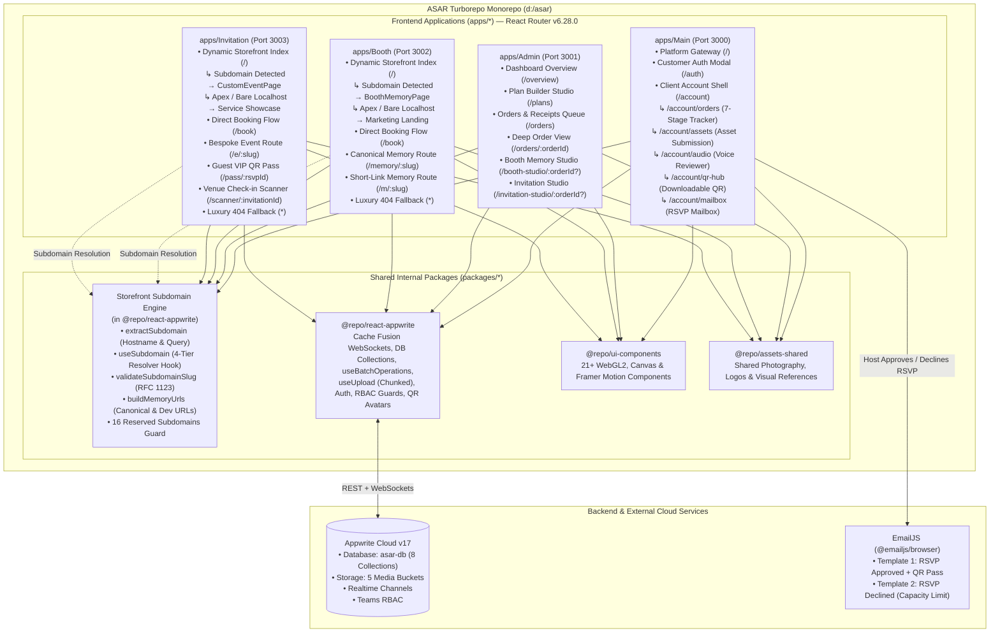
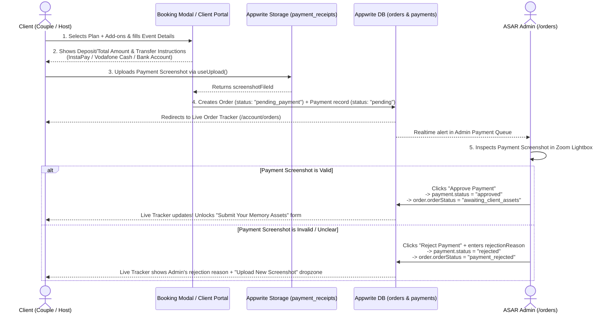
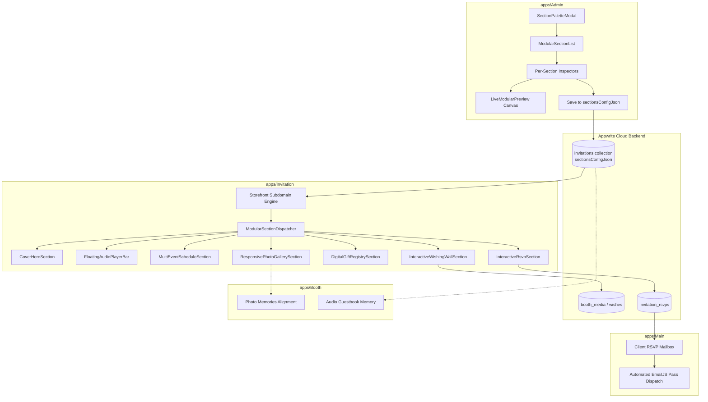
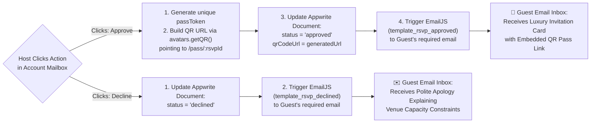
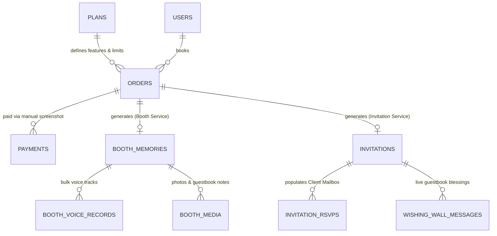

# ASAR (Athar / أثر) — Complete System Architecture & Services Specification

> **Monorepo Engine:** Turborepo v2 (`npm@11.13.0` Workspaces)  
> **Frontend Stack:** React 18, TypeScript 5, Vite 5, Chakra UI v3 (`@chakra-ui/react: ^3.32.0`), React Router v6 (`react-router-dom: ^6.28.0`)  
> **Shared Internal Packages:** `@repo/react-appwrite` (with Storefront Subdomain Engine), `@repo/ui-components`, `@repo/assets-shared`, `@repo/typescript-config`, `@repo/eslint-config`  
> **Backend & Cloud Infrastructure:** Appwrite v17 (Databases, Storage, Realtime Cache Fusion, Auth, Teams RBAC, Avatars/QR) + EmailJS (`@emailjs/browser`)  
> **Visual Reference:** `docs/ASAR_BOOTH_DESIGN_SPEC.md` & Uploaded Reference Image #1 (*Mina & Maryam — A Private Memory*)  
> **Document Scope:** End-to-End Platform Vision, Services Analysis, Turborepo Architecture, React Router Routing Topology, Subdomain Storefront Engine, Database Schemas, Admin Studio Editors, Client Portal Workflows, EmailJS + QR Pipelines, and Implementation Roadmap.

---

## Table of Contents

1. [Executive Summary & Core Project Idea](#1-executive-summary--core-project-idea)
   * [1.1. Service 1: ASAR Booth — Audio Guestbook & Digital Memory Website](#11-service-1-asar-booth-appsbooth--audio-guestbook--digital-memory-website)
   * [1.2. Service 2: ASAR Invitation — Flexible Custom Event Websites, Dynamic RSVP & Client Mailbox](#12-service-2-asar-invitation-appsinvitation--flexible-custom-event-websites-dynamic-rsvp--client-mailbox)
   * [1.3. Architecture Paradigm: Subdomain-Driven Storefront Renderer & Client-Side Routing](#13-architecture-paradigm-subdomain-driven-storefront-renderer--client-side-routing)
2. [Current Monorepo Audit (Completed Milestones vs. Roadmap)](#2-current-monorepo-audit-completed-milestones-vs-roadmap)
   * [2.1. Already Finished in Monorepo](#21-already-finished-in-monorepo-)
   * [2.2. Architectural Transition & Enhancements](#22-architectural-transition--enhancements)
3. [Turborepo Monorepo Architecture & Cross-App Topology](#3-turborepo-monorepo-architecture--cross-app-topology)
   * [3.1. System Architecture Diagram](#31-system-architecture-diagram)
   * [3.2. Cross-App Authentication & Unified Session Strategy](#32-cross-app-authentication--unified-session-strategy-in-turborepo)
   * [3.3. Monorepo-Wide Client-Side Routing Architecture (`react-router-dom@^6.28.0`)](#33-monorepo-wide-client-side-routing-architecture-react-router-dom6280)
   * [3.4. Declarative Routing Tables & Deep-Link Maps Across All 4 Applications](#34-declarative-routing-tables--deep-link-maps-across-all-4-applications)
   * [3.5. Chakra UI v3 Link Component Compatibility Pattern](#35-chakra-ui-v3-link-component-compatibility-pattern)
4. [Service 1: ASAR BOOTH — Complete Architecture & Workflows](#4-service-1-asar-booth--complete-architecture--workflows)
   * [4.0. Subdomain-Driven Dynamic Memory Storefront Model & 4-Tier Resolution Hierarchy](#40-subdomain-driven-dynamic-memory-storefront-model--4-tier-resolution-hierarchy)
   * [4.1. Dynamic Plans, Custom Features & Quota Engine (Admin-Controlled)](#41-dynamic-plans-custom-features--quota-engine-admin-controlled)
   * [4.2. Manual Payment Screenshot & Admin Approval/Rejection Flow](#42-manual-payment-screenshot--admin-approvalrejection-flow)
   * [4.3. Non-Automated Concierge Fulfillment & 7-Stage Client Order Tracker](#43-non-automated-concierge-fulfillment--7-stage-client-order-tracker)
   * [4.4. The Generated Booth Memory Website Specification (Visual Reference #1)](#44-the-generated-booth-memory-website-specification-visual-reference-1)
   * [4.5. Admin Booth Memory Studio & Zero-Effort Bulk Voice Record Uploader](#45-the-admin-booth-memory-studio--zero-effort-bulk-voice-uploader)
   * [4.6. Admin Alignment: Canonical URL Generation, RFC 1123 DNS Validation & QR Cards](#46-admin-alignment-canonical-url-generation-rfc-1123-dns-validation--qr-cards)
5. [Service 2: ASAR INVITATION — Complete Architecture & Workflows](#5-service-2-asar-invitation--complete-architecture--workflows)
   * [5.0. Subdomain-Driven Custom Event Storefront Model & Dynamic Root Index](#50-subdomain-driven-custom-event-storefront-model--dynamic-root-index)
   * [5.1. Flexible Custom Event/Memory Website Editor (Beyond Rigid Templates)](#51-flexible-custom-eventmemory-website-editor-beyond-rigid-templates)
   * [5.2. Admin Dynamic RSVP Form Builder (Locked Mandatory Email)](#52-admin-dynamic-rsvp-form-builder-with-locked-mandatory-email)
   * [5.3. Client Account RSVP Mailbox (Real-Time Inbox & Capacity Tracker)](#53-client-account-rsvp-mailbox-real-time-inbox--capacity-tracker)
   * [5.4. Automated EmailJS Pipeline: Approval QR Code vs. Capacity Decline](#54-automated-emailjs-pipeline-approval-qr-code-vs-capacity-decline)
   * [5.5. Admin Alignment: Canonical URLs, RFC 1123 Validation & VIP Pass Generation](#55-admin-alignment-canonical-urls-rfc-1123-validation--vip-pass-generation)
6. [Appwrite Cloud Database Schema (ERD) & Storage Buckets](#6-appwrite-cloud-database-schema-erd--storage-buckets)
   * [6.1. Complete Entity-Relationship Diagram](#61-complete-entity-relationship-diagram)
   * [6.2. Storage Buckets Overview](#62-storage-buckets-overview)
7. [Target Directory & File Structure Across All Turborepo Workspaces](#7-target-directory--file-structure-across-all-turborepo-workspaces)
8. [Phased Implementation Roadmap & Verification Milestones](#8-phased-implementation-roadmap--verification-milestones)

---

## 1. Executive Summary & Core Project Idea

**ASAR (Athar / أثر)** is an Awwwards-caliber experiential digital memory and event hospitality platform. Rooted in **Warm Vintage Editorial Luxury**, ASAR provides two flagship commercial services orchestrated through a **Centralized Admin Console (`apps/Admin`)** and a **Unified Client Account Portal (`apps/Main` + shared account drawers)**:

### 1.1. Service 1: ASAR Booth (`apps/Booth`) — Audio Guestbook & Digital Memory Website
* **The Concept:** Clients book an on-site vintage rotary telephone installation (or audio memory package) for their wedding or celebration. Guests pick up the phone and leave heartfelt voice messages, blessings, and laughter.
* **Admin-Customizable Plans:** Admin can create and modify Booth Plans dynamically with custom specific features, add-ons, and strict or unlimited quotas (e.g., max voice records, max photos, video highlight inclusion, hosting duration, bulk ZIP download permission).
* **Manual Payment with Screenshot Verification:** Clients pay manually (e.g., InstaPay, Vodafone Cash, Bank Transfer) and upload a payment screenshot. From the Admin Dashboard, the Admin inspects the receipt and **Approves** or **Rejects** it.
* **Human-in-the-Loop Concierge Workflow & Live Order Status:** Booth memory generation is **not** automated immediately upon booking because the client must first send their raw assets (couple hero photo, personal texts/quotes, event details, and categories) to the Admin, and audio engineers must master the recorded voices. Throughout this entire journey, the client has a **Live Order Status Tracker** in their account so they know *exactly* where their order stands and what action is required next.
* **Easy-to-Use Admin Booth Editor & Effortless Bulk Voice Upload:** The Admin assembles the client's memory website using a split-screen visual studio with a live mobile preview. Most importantly, the editor includes a **Zero-Effort Bulk Voice Record Uploader** allowing the Admin to drag-and-drop 50–150+ audio recordings at once, auto-extracting durations and waveforms, auto-parsing filenames/folders into categories, and batch-editing speaker names/roles/quotes in an inline spreadsheet grid.
* **The Generated Booth Memory Website (Image #1) & Client QR Code:** Once published, the client receives a luxury private memory page (matching **Image #1**: Couple Hero, Metadata, Quote, 5 Tabs: `Audio Messages` with category filter pills & interactive waveforms, `Photos`, `Video Highlights`, `Guest Book`, `Thank You`, plus `"Download All Messages"` and `"Share Love"`) along with a **dedicated QR Code** pointing directly to their canonical public subdomain URL.

### 1.2. Service 2: ASAR Invitation (`apps/Invitation`) — Modular Section-Based Event Websites, Dynamic RSVP & Interactive Hospitality
* **The Concept:** Clients request a bespoke interactive digital invitation and living event website for any occasion (**Weddings, Engagements, Festivals, Galas, Corporate Summits, Graduations**) — orchestrated through a modern modular section architecture.
* **Admin Modular Section-Based Website Creation Editor:** The Admin utilizes a visual modular section editor in `apps/Admin` to compose and customize living websites by adding, reordering, toggling, and configuring 11 modular section types:
  1. `cover_hero`: Interactive 3D wax seal envelope animation, couple typography, date/venue badges, live countdown timer, and audio prompt.
  2. `couple_story`: Chronological milestones track with photos, dates, and narrative storytelling.
  3. `event_schedule`: Multi-event itinerary (Ceremony, Reception, Afterparty) with specific addresses, dress codes, and 1-tap Google/Apple Maps routing.
  4. `photo_gallery`: Responsive masonry, grid, or circular 3D carousel with category filtering and fullscreen touch lightbox.
  5. `wishing_wall`: Real-time interactive guest blessing wall with message submission, reactions, and host moderation.
  6. `digital_gift_registry`: Blessing box with auto-generated Bank QR (VietQR / InstaPay / IBAN), account numbers, and 1-tap copy to clipboard.
  7. `background_audio`: Floating vinyl audio player widget with spinning disc animation, playlist title, and tap-to-play compliance.
  8. `venue_location`: Embedded interactive map, directions, parking notes, and attire color swatches.
  9. `live_countdown`: Precision second-by-second countdown ticker with celebration completion banner.
  10. `custom_highlight`: High-impact editorial callouts, parental thank-you notes, or featured quotes.
  11. `dynamic_rsvp`: Dynamic multi-person attendance RSVP form with locked email verification, plus-one limits, dietary preferences, and shuttle bus requests.
* **Modern Interactive Guest Features in Invitation & Booth:** Guests access the event website via a single personalized link (`https://slug.asar.me?guest=Name`), enjoying a frictionless mobile-first hospitality experience with real-time interactive wishing wall submissions, persistent audio playback, instant Bank QR gifting, dynamic RSVP confirmation with immediate VIP QR pass delivery, and shared photo memories with Booth.
* **Client Account Mailbox & EmailJS Automation:** When guests submit RSVPs, records land in the host's real-time Mailbox (`/account/mailbox`) with capacity tracking. Host approval triggers automated EmailJS dispatch of the digital VIP QR pass; capacity decline sends a dignified regret notice.

### 1.3. Architecture Paradigm: Subdomain-Driven Storefront Renderer & Client-Side Routing
To deliver a true web-builder hospitality experience (analogous to Shopify storefronts or Webflow sites), ASAR employs a **Subdomain-Driven Storefront Architecture** paired with monorepo-wide client-side routing via `react-router-dom@^6.28.0`:
* **Multi-Tenant Storefront Isolation:** Every published memory or event functions as an independent, beautifully rendered digital storefront hosted under its own custom subdomain (e.g., `https://mina-and-maryam.asar.me` or `https://omar-and-layla.asar.me`).
* **Dynamic Root Index Resolution:** Accessing root `/` on any host triggers the Storefront Subdomain Engine. If a custom slug is detected (via hostname or query parameters), the application dynamically mounts the respective memory or event website with full slug hydration. If accessed on a bare apex domain (`asar.me`) or bare localhost, it mounts the marketing landing page and booking flow.
* **Zero-Config Local Development via RFC 6761:** Utilizing the native browser loopback specification for `*.localhost`, developers and testers can instantly preview subdomains (e.g., `http://mina-and-maryam.localhost:3002`) in any standard browser without editing `/etc/hosts` or setting up local DNS servers.
* **Declarative Client-Side Routing Across All Apps:** All 4 applications (`apps/Admin`, `apps/Booth`, `apps/Invitation`, `apps/Main`) feature declarative React Router v6 route trees supporting deep linking, clean browser history, and parameter synchronization.

---

## 2. Current Monorepo Audit (Completed Milestones vs. Roadmap)

This architecture reflects the active codebase state in `d:\asar`, integrating completed packages with the client-side routing and storefront subdomain engine.

### 2.1. Already Finished in Monorepo ✅

| Workspace / Module | Path | Implementation Status & Key Capabilities |
| :--- | :--- | :--- |
| **Storefront Subdomain Engine** | `packages/react-appwrite/src/Storefront` | **100% Complete.** Pure 4-tier resolution engine (`useSubdomain`, `resolveSubdomain`, `extractSubdomain`), RFC 1123 slug validator (`validateSubdomainSlug`), 16 reserved system subdomains guard (`RESERVED_SUBDOMAINS`), centralized URL generator (`buildMemoryUrls`), and automated unit test suite (`test/storefront.test.ts`). |
| **`@repo/react-appwrite`** | `packages/react-appwrite` | **100% Complete.** `<AppwriteProvider>`, `CacheFusionStore` (zero-refetch WebSocket sync), `<AuthProvider>`, `useAuth`, `useAccountSwitcher`, `useCollection`, `useCollectionWithPagination`, `useDocument`, `useMutations`, `useBatchOperations` (`bulkCreate`, `bulkUpdate`, `bulkDelete` with chunked concurrency & progress tracking), `useDocumentOperations`, `useCollectionCount`, `useSearchDocuments`, `useUpload` (chunked file upload with progress/pause/resume/abort), `useFiles`, `useFileDownload`, `<AppwriteImage>`, `<RequireAuth>`, `<HasRole>`, `<HasTeam>`, `useAvatars` (with native `getQR` & `getInitials`), and the `appwrite-react-gen` CLI. |
| **`@repo/ui-components`** | `packages/UI-components` | **100% Complete.** 21 Awwwards-grade interactive components: `GradientWaves`, `BlurText`, `SplitText`, `TextType`, `CircularText`, `ScrollReveal`, `RotatingText`, `CrystalizedBall`, `DitherVeil`, `GlowCursor`, `SplashCursor`, `ScrollExpand`, `FadeContent`, `GradualBlur`, `Magnet`, `MorphSlider`, `CardNav`, `TiltedCard`, `DecayCard`, `PaperCrumple`, `PeekRating`, `CircularGallery`, `CountUp`, `HalftoneReveal`. |
| **`@repo/assets-shared`** | `packages/assets-shared` | **100% Complete.** Contains shared brand logos (`logo-main.png`, `logo.jpeg`), photography (`booth-hero-photo.webp`, `love-wedding.jpg`, `wedding2.jpg`), and UX reference screens (`screens-booth.jpeg`, `landing-booth.jpeg`). |
| **`@repo/typescript-config`** & **`@repo/eslint-config`** | `packages/typescript-config`, `packages/eslint-config` | **100% Complete.** Shared TypeScript 5 and ESLint configurations across all workspaces. |
| **`apps/Admin` (Port 3001)** | `apps/Admin` | **React Router v6 Active.** Declarative `<Routes>` tree (`/overview`, `/plans`, `/orders`, `/orders/:orderId`, `/booth-studio/:orderId?`, `/invitation-studio/:orderId?`). Synchronized orders and payments state, `PlanBuilderStudio` with custom quotas, `OrdersQueueManager` with manual receipt inspection, split-screen Booth Memory Studio with iPhone preview, and split-screen Invitation Studio. |
| **`apps/Booth` (Port 3002)** | `apps/Booth` | **React Router v6 & Storefront Active.** Dynamic storefront index at root `/` via `DynamicBoothStorefrontIndex` (renders `BoothMemoryPage` with slug hydration if subdomain detected; renders 14-section Arabic RTL marketing landing page if bare apex/localhost). Explicit routes `/book`, `/memory/:slug`, `/m/:slug`, and luxury 404 fallback screen (`BoothLuxuryNotFound`). |
| **`apps/Invitation` (Port 3003)** | `apps/Invitation` | **React Router v6 & Storefront Active.** Dynamic storefront index at root `/` via `DynamicInvitationStorefrontIndex` (renders `CustomEventPage` with theme & RSVP hydration if subdomain detected; renders showcase landing page if bare apex/localhost). Explicit routes `/book`, `/e/:slug`, `/pass/:rsvpId` (`QrPassPage`), `/scanner/:invitationId` (`ScannerRouteView`), and luxury 404 fallback screen (`InvitationLuxuryNotFound`). |
| **`apps/Main` (Port 3000)** | `apps/Main` | **React Router v6 Active.** Declarative `<Routes>` tree (`/`, `/auth`, `/account`, `/account/*`). Platform Gateway, customer authentication modal, and unified Client Account Portal with nested deep links (`/account/orders`, `/account/assets`, `/account/audio`, `/account/qr-hub`, `/account/mailbox`). |

### 2.2. Architectural Transition & Enhancements
The migration from isolated single-page view switchers (`useState`) to a unified **React Router v6 + Subdomain Storefront Engine** resolves three critical architectural needs:
1. **Direct Deep-Linking & Browser Navigation:** Users can bookmark, refresh, share, and navigate back/forward across Admin views, Client account tabs, and memory pages without losing state.
2. **True Subdomain Multi-Tenancy:** Each couple or event organizer receives an authentic subdomain URL (`mina-and-maryam.asar.me`) resolving to their private heirloom, while preserving local development agility via RFC 6761 `*.localhost`.
3. **Enterprise Slug & Infrastructure Protection:** The 16 reserved system subdomains and RFC 1123 validation guarantee that customer slugs cannot collide with administrative portals, API gateways, or edge CDN paths.

---

## 3. Turborepo Monorepo Architecture & Cross-App Topology

### 3.1. System Architecture Diagram



### 3.2. Cross-App Authentication & Unified Session Strategy in Turborepo
Because `Main` (`:3000`), `Admin` (`:3001`), `Booth` (`:3002`), and `Invitation` (`:3003`) run on separate ports in development (and distinct subdomains in production):
* **Production Deployment:** Hosting under a shared root domain (`asar.me` or `asar.audio`, with `admin.asar.me`, `booth.asar.me`, `invitation.asar.me`, and customer subdomains `*.asar.me`) allows Appwrite first-party session cookies (`SameSite=Lax`, domain `.asar.me`) to authenticate the user seamlessly across all monorepo applications without re-login prompts.
* **Local Development (`localhost:3000..3003`):** Because `localStorage` is isolated per port in web browsers, `apps/Main` serves as the central customer identity provider (`http://localhost:3000/auth`). Booking flows in `apps/Booth` and `apps/Invitation` seamlessly hand off client sessions or deep-link to `http://localhost:3000/account/orders` upon order creation.

### 3.3. Monorepo-Wide Client-Side Routing Architecture (`react-router-dom@^6.28.0`)
All 4 applications in `apps/*` standardize on `react-router-dom@^6.28.0`. Each application entry point (`src/main.tsx`) wraps the component tree in `<BrowserRouter>`:

```tsx
// Standardized entry point pattern across all apps/
import React from "react";
import ReactDOM from "react-dom/client";
import { BrowserRouter } from "react-router-dom";
import { Provider } from "./components/ui/provider";
import App from "./App";

ReactDOM.createRoot(document.getElementById("root")!).render(
  <React.StrictMode>
    <Provider>
      <BrowserRouter>
        <App />
      </BrowserRouter>
    </Provider>
  </React.StrictMode>
);
```

#### Vite Single-Page Application (SPA) History Fallback
To ensure deep links (e.g. `/orders/ORD-8821`, `/memory/mina-and-maryam`, `/account/mailbox`) reload cleanly without 404 errors during development and production previews, each application's Vite configuration (`vite.config.ts`) supports HTML5 history fallback, routing all non-file asset requests to `index.html`.

### 3.4. Declarative Routing Tables & Deep-Link Maps Across All 4 Applications

#### 1. `apps/Admin` (Port 3001) — Operations Management Console
Admin operates a declarative router inside `<AdminShell>`, binding URL routes directly to operational studios:

| Path | Component / Handler | Purpose & Behavior |
| :--- | :--- | :--- |
| `/` | `<Navigate to="/overview" replace />` | Canonical root redirect to dashboard overview. |
| `/overview` | `<AdminOverview />` | Platform KPI cards (active orders, revenue, published memories), quick studio shortcuts, and recent activity. |
| `/plans` | `<PlanBuilderStudio />` | Full CRUD editor for Booth and Invitation plans, custom feature checklists, and system limit quotas. |
| `/orders` | `<OrdersQueueManager />` | Filterable order queue across all 7 pipeline stages with manual payment receipt inspection. |
| `/orders/:orderId` | `<OrdersQueueManager />` | Deep link directly focusing a specific customer order with inspector drawer opened. |
| `/booth-studio/:orderId?` | `<BoothStudioRouteWrapper />` | Split-screen Booth visual studio with live mobile preview, bulk audio uploader, waveform analyzer, and QR generator. |
| `/invitation-studio/:orderId?` | `<InvitationStudioRouteWrapper />` | Split-screen Invitation visual builder with live preview, section block reordering, and dynamic RSVP form builder. |
| `*` | `<Navigate to="/overview" replace />` | Wildcard fallback redirecting unknown admin paths to overview. |

#### 2. `apps/Booth` (Port 3002) — Dynamic Storefront & Audio Guestbook Experience
Booth features dynamic root resolution alongside canonical memory routes:

| Path | Component / Handler | Purpose & Behavior |
| :--- | :--- | :--- |
| `/` | `<DynamicBoothStorefrontIndex />` | **Storefront Index:** Checks 4-tier subdomain resolver (`useSubdomain`). If a subdomain slug is detected (e.g. `mina-and-maryam.localhost` or `?subdomain=mina-and-maryam`), renders `<BoothMemoryPage slug={subdomain} />`. If bare apex host or bare localhost, renders `<BoothLandingView />` (14-section marketing landing page). |
| `/book` | `<BoothLandingView autoOpenBooking={true} />` | Direct deep link opening the 3-step booking wizard modal on top of the landing page. |
| `/memory/:slug` | `<BoothMemoryPage />` | Explicit canonical memory route matching Visual Reference #1 (*Mina & Maryam*) with couple hero, 5 tabs, audio waveform player, gallery, and QR share modal. |
| `/m/:slug` | `<BoothMemoryPage />` | Concise short-link alias for printed cards and SMS/WhatsApp distribution. |
| `*` | `<BoothLuxuryNotFound />` | Luxury branded 404 screen with Athar crest, Arabic explanation, and "Return to Asar" button. |

#### 3. `apps/Invitation` (Port 3003) — Dynamic Storefront & Bespoke Event Experience
Invitation delivers custom event websites, RSVP guest passes, and venue check-in:

| Path | Component / Handler | Purpose & Behavior |
| :--- | :--- | :--- |
| `/` | `<DynamicInvitationStorefrontIndex />` | **Storefront Index:** Checks 4-tier subdomain resolver (`useSubdomain`). If a subdomain slug is detected (e.g. `omar-and-layla.localhost` or `?subdomain=omar-and-layla`), renders `<CustomEventPage slug={subdomain} />`. If bare apex host or bare localhost, renders `<InvitationLandingPage />` showcase. |
| `/book` | `<InvitationBookingRouteView />` | Direct deep link opening the custom invitation booking modal. |
| `/e/:slug` | `<CustomEventPage />` | Explicit bespoke event website route rendering custom themes, reordered blocks, countdown timer, agenda, and dynamic RSVP form. |
| `/pass/:rsvpId` | `<QrPassPage />` | Guest VIP QR pass screen with cryptographic verification token, check-in status, and downloadable pass card. |
| `/scanner/:invitationId` | `<ScannerRouteView />` | Venue entrance scanner for hosts/attendants to validate guest QR codes. |
| `/scanner` | `<ScannerRouteView />` | General venue entrance scanner without pre-selected invitation ID. |
| `*` | `<InvitationLuxuryNotFound />` | Luxury branded 404 screen with Athar crest, Arabic explanation, and "Return to Asar" button. |

#### 4. `apps/Main` (Port 3000) — Client Gateway & Unified Account Portal
Main connects the ecosystem and hosts the client's self-service account portal:

| Path | Component / Handler | Purpose & Behavior |
| :--- | :--- | :--- |
| `/` | `<PlatformGateway />` | Ecosystem home showcasing both Booth and Invitation services with direct portals. |
| `/auth` | `<PlatformGateway initialAuthOpen={true} />` | Direct link triggering the customer login / registration modal. |
| `/account` | `<ClientAccountShell />` | Client account shell defaulting to active orders tab (`/account/orders`). |
| `/account/orders` | `<ClientAccountShell />` | **7-Stage Live Order Tracker:** Visual timeline, payment receipt re-upload, and concierge progress. |
| `/account/assets` | `<ClientAccountShell />` | **Client Asset Submission Box:** Client uploads hero photo, couple names, date, venue, quotes, and categories. |
| `/account/audio` | `<ClientAccountShell />` | **Mastered Audio Reviewer:** Client previews mastered guest voices before public release. |
| `/account/qr-hub` | `<ClientAccountShell />` | **Client QR Hub:** Downloadable high-resolution print-ready table QR codes and wedding station assets. |
| `/account/mailbox` | `<ClientAccountShell />` | **Invitation RSVP Mailbox:** Real-time guest response inbox with capacity meter and EmailJS Approve/Decline actions. |
| `*` | `<Navigate to="/" replace />` | Wildcard fallback redirecting unknown customer routes to platform gateway. |

### 3.5. Chakra UI v3 Link Component Compatibility Pattern
Chakra UI v3 (`@chakra-ui/react: ^3.32.0`) does not use the deprecated v2 `as={Link}` polymorphic pattern. To maintain zero type errors, clean accessibility, and fast client-side navigation without full-page reloads, all monorepo applications utilize either of two approved patterns:
1. **Programmatic Navigation (`useNavigate`):**
   ```tsx
   const navigate = useNavigate();
   <Button onClick={() => navigate("/orders/ORD-8821")} className="btn-athar-primary">
     عرض تفاصيل الطلب
   </Button>
   ```
2. **React Router `Link` Wrapping Chakra UI Components:**
   ```tsx
   import { Link as RouterLink } from "react-router-dom";
   import { Box } from "@chakra-ui/react";

   <RouterLink to="/account/orders" style={{ textDecoration: "none" }}>
     <Box className="athar-nav-link">طلباتي</Box>
   </RouterLink>
   ```

---

## 4. Service 1: ASAR BOOTH — Complete Architecture & Workflows

### 4.0. Subdomain-Driven Dynamic Memory Storefront Model & 4-Tier Resolution Hierarchy

In the ASAR architecture, every generated Booth Memory functions as an independent, luxury digital heirloom hosted on its own subdomain. This operates on a **web builder storefront pattern** (identical to Shopify or Webflow), where a single frontend deployment serves millions of client memories dynamically based on hostname and route detection.

```
+--------------------------------------------------------------------------------------------------+
+                                 4-TIER SUBDOMAIN RESOLUTION HIERARCHY                           +
+--------------------------------------------------------------------------------------------------+
|                                                                                                  |
|   1. QUERY PARAMETER OVERRIDE (Highest Priority)                                                 |
|      ?subdomain=mina-and-maryam  OR  ?memory=mina-and-maryam  OR  ?event=mina-and-maryam             |
|      ↳ Evaluated first. Enables instant preview in any browser, iframe preview in Admin Studio,  |
|        and automated testing environments without DNS configuration.                             |
|                                                                                                  |
|   2. ROUTE PARAMETER                                                                             |
|      /memory/:slug  OR  /m/:slug                                                                 |
|      ↳ Resolves explicit path-based links for backwards compatibility and direct sharing.        |
|                                                                                                  |
|   3. HOSTNAME SUBDOMAIN                                                                          |
|      mina-and-maryam.localhost:3002  (Local Dev)  OR  mina-and-maryam.asar.me  (Production)         |
|      ↳ Extracted from window.location.hostname. Strips ports, protocol, and apex root domains.   |
|                                                                                                  |
|   4. DEFAULT FALLBACK                                                                            |
|      null (Render Apex Marketing Landing Page & Booking Wizard)                                  |
|                                                                                                  |
+--------------------------------------------------------------------------------------------------+
```

#### Local Development vs. Production Environments:

##### 1. RFC 6761 `*.localhost:[port]` Native Browser Loopback
Under **RFC 6761 Section 6.3**, the `.localhost` top-level domain is formally reserved for loopback testing. Modern web browsers (Google Chrome, Microsoft Edge, Mozilla Firefox, Apple Safari) natively resolve any subdomain of `localhost` (such as `http://mina-and-maryam.localhost:3002` or `http://wedding-2026.localhost:3002`) directly to IPv4 `127.0.0.1` and IPv6 `::1` **without requiring any edits to the operating system's `/etc/hosts` file or custom local DNS proxies**.
* This enables developers and QA to test authentic multi-tenant subdomains locally with complete cookie, storage, and origin isolation out of the box.

##### 2. Query Override Fallback (`?subdomain=[slug]`)
For restricted environments—such as internal corporate proxies, older mobile webviews, or headless automated testing containers that do not support wildcard localhost loopback—the Storefront engine provides an instant query fallback:
`http://localhost:3002?subdomain=mina-and-maryam` or `http://localhost:3002?memory=mina-and-maryam`.

##### 3. Production Wildcard DNS (`*.asar.me` & `*.asar.audio`)
In production environments, wildcard DNS A and CNAME records (`*.asar.me`, `*.asar.audio`) route all incoming subdomains to the edge reverse proxy / CDN origin. The proxy forwards the original `Host` header to the Vite SPA, where `extractSubdomain` automatically strips the apex domain (`asar.me`) to retrieve the tenant slug (`mina-and-maryam`).

#### Root Dynamic Index Behavior (`DynamicBoothStorefrontIndex`):
When a user visits the root path `/` of `apps/Booth`:
1. The hook `useSubdomain()` inspects the current request through the 4-tier resolution hierarchy.
2. **If a valid subdomain slug is resolved** (e.g. `mina-and-maryam.localhost:3002` or `mina-and-maryam.asar.me` or `?subdomain=mina-and-maryam`), the application dynamically renders `<BoothMemoryPage slug={subdomain} />`, automatically hydrating the couple's cover photo, metadata badges, voice records, and audio waveforms.
3. **If NO subdomain is resolved** (e.g. bare apex domain `https://asar.me` or bare localhost `http://localhost:3002`), the application renders `<BoothLandingView />`—the full 14-section Arabic RTL marketing landing page and 3-step booking wizard.

---

### 4.1. Dynamic Plans, Custom Features & Quota Engine (Admin-Controlled)

The Admin has full control over Booth Plans (and Add-ons) from `/admin/plans`. No code changes are needed to launch seasonal offers, VIP tiers, or custom quotas.

#### How Admin Configures a Booth Plan:
1. **Core Identity & Pricing:**
   * `name` (e.g., `"لحظة أثر — Athar Moment"`), `subtitle` (`"الباقة الكلاسيكية"`), `badge` (`"الباقة الأكثر طلباً"`), `subBadge` (`"عرض الإطلاق"`).
   * `price` (`5500`), `currency` (`"EGP"`), `depositRequired` (`1500`).
   * `themeVariant`: `"ivory-royal"` (Light card) or `"noir-obsidian"` (Dark gold VIP card, matching `PackagesSection.tsx`).
2. **Custom Specific Features (Dynamic Checklist):**
   * Admin can add, edit, reorder, or delete any number of custom bullet points (`features: string[]`) displayed on the package card.
3. **Enforced System Limits (`limits` JSON Object):**
   * `coverageHours`: `3` or `6` hours.
   * `maxVoiceRecords`: e.g., `80`, `150`, or `-1` (Unlimited).
   * `maxGalleryPhotos`: e.g., `20`, `60`, or `-1` (Unlimited).
   * `maxCustomCategories`: e.g., `4` or `10`.
   * `hasVideoHighlight`: `boolean` — Controls whether the **Video Highlights** tab and 30s banner appear on the generated Memory Website.
   * `hasGuestBookTab`: `boolean` — Controls whether the written **Guest Book** tab is enabled.
   * `allowBulkZipDownload`: `boolean` — Controls whether the **"Download All Messages"** button on the Memory Website is unlocked.
   * `hostingDurationDays`: e.g., `365` (1 Year) or `730` (2 Years).
4. **Admin Per-Order Quota Override:**
   * Inside any specific order in `/admin/booth-studio/:orderId`, the Admin can override a limit for a specific client (e.g., gifting a client `hasVideoHighlight: true` or increasing `maxVoiceRecords` from `100` to `120`) without altering the global plan.

---

### 4.2. Manual Payment Screenshot & Admin Approval/Rejection Flow

All payments in ASAR are handled manually with full transparency between Client and Admin:



---

### 4.3. Non-Automated Concierge Fulfillment & 7-Stage Client Order Tracker

Because the Booth Memory Website requires **client-provided personalization assets** AND **studio-mastered voice recordings** from the physical event, the workflow is structured into **7 crystal-clear stages** displayed on the Client's Order Status Page (`/account/orders`):

| Stage # | Status Key | Client-Facing Title | What Happens at This Stage | Who Acts |
| :-: | :--- | :--- | :--- | :--- |
| **1** | `pending_payment` | **Payment Verification** | Client has submitted booking and payment screenshot. Admin is verifying the receipt. | **Admin** (Approves or Rejects screenshot) |
| **2** | `payment_rejected` *(Conditional)* | **Action Required: Payment Receipt** | Displayed only if screenshot was unclear/invalid. Shows Admin's note and re-upload box. | **Client** (Re-uploads valid screenshot) |
| **3** | `awaiting_client_assets` | **Personalize Your Memory Page** | Payment is approved! The client now fills out the **Memory Asset Submission Form** (Hero Photo, Couple Names, Event Date, Venue, Custom Badge, Personal Quote, Thank You Note, & Desired Categories). | **Client** (Submits photos & texts to Admin) |
| **4** | `event_scheduled` | **Ready for Your Celebration** | Admin has reviewed the client's assets and confirmed the on-site Booth station & concierge host for the event date. (Pre-event table QR codes can already be downloaded here!). | **ASAR On-Site Team** |
| **5** | `audio_mastering` | **Studio Audio Mastering** | The celebration took place! ASAR sound engineers are filtering background venue music and mastering every guest's voice recording. | **ASAR Sound Engineers** |
| **6** | `studio_curation` | **Building Your Memory Website** | Admin is placing the mastered voice records in bulk, organizing categories, and curating photos/video in the **Booth Memory Studio**. | **Admin** |
| **7** | `published` | **Your Memory Vault is Live! 🎉** | The Booth Memory Website is live under its canonical public subdomain (`https://${slug}.asar.me`)! Client gets their direct link, privacy PIN control, and high-res **Landing QR Code**. | **Client** (Listens, downloads & shares!) |

---

### 4.4. The Generated Booth Memory Website Specification (Visual Reference #1)

Located at `apps/Booth` route `/memory/:slug` (and dynamically rendered at root `/` when a subdomain is active), this page is the final digital heirloom delivered to the client. Every visual and functional detail is modeled after **Uploaded Reference Image #1**:

#### Detailed Component Breakdown of `/memory/:slug`:

1. **Sticky Luxury Top Bar:**
   * **Left:** Hamburger Menu button (`≡`) opening a slide-over sheet (Quick navigation between tabs, Dark/Light contrast toggle, PIN Lock toggle, and `"Created by Athar Audio Memories"` link).
   * **Center:** High-res Athar Arabic/English calligraphy logo (`أثر ATHAR AUDIO MEMORIES`).
   * **Right:** Security & Ownership Badge: Gold padlock icon (`🔒`) + `"A Private Memory For Mina & Maryam"`. (If `isPrivateLocked` is enabled, visitors must enter the 4-digit PIN before accessing the page).

2. **Editorial Couple Hero Section:**
   * **Background:** Client's uploaded high-resolution couple photograph (`<AppwriteImage>`) with a soft warm-alabaster bottom fade (`linear-gradient(to bottom, rgba(251,247,242,0.1) 0%, rgba(251,247,242,0.95) 88%, #FBF7F2 100%)`).
   * **Typography Stack:**
     * Overline: `THE WEDDING OF` (tracked uppercase serif).
     * Couple Title: `Mina & Maryam` (`Playfair Display` / `Amiri` italic & bold, `#5B1621`).
     * Acoustic Divider: Gold SVG waveform emblem (`─── ∿∿∿ ───`).
     * Subtitle: `Same People. Different Voices. A Lasting Athar.`
   * **3 Metadata Badges Row:**
     * `📅 12 July 2026`  ·  `📍 Alexandria, Egypt`  ·  `🤍 Together Always`
   * **Personal Quote Block:**
     * `"Every voice here is a piece of our forever ..."`
     * `– Mina & Maryam`

3. **5-Tab Horizontal Navigation Strip:**
   * Styled as tactile rounded cards (`borderRadius="16px"`):
     1. **`Audio Messages`** (Waveform icon — Active state: Royal Maroon `#6B1D28` background, white text, soft elevation shadow).
     2. **`Photos`** (Gallery icon — Inactive state: Warm Linen `#F4EFEA` card).
     3. **`Video Highlights`** (Play icon — Hidden automatically if the client's plan has `hasVideoHighlight: false`).
     4. **`Guest Book`** (Open book icon — Written wishes & transcriptions).
     5. **`Thank You`** (Heart icon — Couple's thank-you note & keepsake card).

4. **Tab 1: `Audio Messages` (Default Active View in Image #1):**
   * **Section Header:** `AUDIO MESSAGES` + waveform divider + subtitle: *"Listen to the love, laughter and blessings from the people who matter most."*
   * **Dynamic Category Filter Pills with Real Counts:**
     * Computed automatically from the voice records array:
       `All (86)` · `Family (24)` · `Friends (38)` · `Colleagues (6)` · `Special Guests (8)`
   * **Voice Record Card List (`BoothVoiceCard`):**
     * Each card displays:
       * **Guest Avatar (`48px` circle):** Uses `avatarFileId` if uploaded, or automatically generates a warm luxury monogram/category avatar via `useAvatars().getInitials(speakerName)` so cards always look complete even when bulk-uploaded without individual guest photos!
       * **Play / Pause Button (`36px` Royal Maroon circle):** Plays/pauses the audio stream and synchronizes with the global audio controller (only one voice plays at a time; optional "Play All Continuous" mode).
       * **Speaker Metadata:**
         * **Name:** e.g., `Nour Hassan`, `Ahmed El Sayed`, `Mona Khaled`, `Tarek Mostafa`, `Grandma`.
         * **Relationship / Role:** e.g., `Best Friend`, `Brother`, `Cousin`, `Colleague`, `Family`.
         * **Quote Snippet:** Bilingual `dir="auto"` italic quote, e.g., `"Mabrook ya gameela, ربنا يسعدكم دايماً ..."`.
       * **Interactive 48-Bar Waveform Scrubber & Duration (`0:42`):**
         * Renders the pre-computed `waveformPeaksJson` array immediately on page load.
         * As the audio plays, bars to the left of `currentTime / duration` fill with Royal Maroon (`#6B1D28`), while upcoming bars remain Warm Truffle (`rgba(107, 29, 40, 0.25)`). Clicking anywhere on the waveform seeks directly to that timestamp!
       * **Heart (`♡` / `♥`) & More Menu (`⋮`):**
         * Heart button increments/toggles favorite status.
         * `⋮` menu allows **Download Single MP3** or **Share Direct Link to This Voice**.

5. **Video Highlight Banner Card:**
   * Positioned below the voice list: features a preview thumbnail, play button overlay, title `VIDEO HIGHLIGHT`, and subtitle `30 Seconds of Your Day >` (clicking switches to the `Video Highlights` tab or opens the fullscreen 4K reel).

6. **Bottom Dual Action Cards:**
   * **Left (`Download All Messages` — `Keep your memories forever`):** Downloads the complete mastered audio collection (as a pre-packaged `.zip` archive or sequential batch download via `useFileDownload`, gated by the plan's `allowBulkZipDownload` setting).
   * **Right (`Share Love` — `With Family & Friends`):** Opens a luxury Share & QR Code sheet where the couple can copy the canonical public subdomain link, share directly to WhatsApp, or save their **Memory QR Code**.

---

### 4.5. The Admin Booth Memory Studio & Zero-Effort Bulk Voice Uploader

Located at `/booth-studio/:orderId?` in `apps/Admin`, this split-screen visual studio gives administrators effortless control over memory website composition with a real-time mobile preview:

```
+--------------------------------------------------------------------------------------------------+
|  ASAR ADMIN STUDIO  •  Order #ORD-8821 (Mina & Maryam)  •  Plan: Royal Heritage (86/Unlimited)   |
|  [ ← Back to Orders ]      [ Pull Client Submitted Assets ]      [ Generate QR ]  [ Publish ✓ ]  |
+--------------------------------------------------------------+-----------------------------------+
|  STUDIO WORKSPACE (62% Width)                                |  LIVE MOBILE PREVIEW (38% Width)  |
|                                                              |                                   |
|  TABS: [1. Hero & Texts] [2. Bulk Voice Studio (86)]         |     +-----------------------+     |
|        [3. Photos & Video] [4. Guest Book & Thank You]       |     |  ≡   أثر ATHAR    🔒  |     |
|  ----------------------------------------------------------  |     |-----------------------|     |
|  +--------------------------------------------------------+  |     |   THE WEDDING OF      |     |
|  | 🎙️ DRAG & DROP BULK VOICE RECORDS (.mp3, .wav, .m4a)   |  |     |   Mina & Maryam       |     |
|  | Drop 100+ files or category folders here.              |  |     |   12 July • Alex      |     |
|  | Auto-extracts duration, waveforms & parses filenames!  |  |     +-----------------------+     |
|  +--------------------------------------------------------+  |     | [Audio] [Photos] [Vid]|     |
|                                                              |     |                       |     |
|  BULK TOOLBAR: [☑ Select All] [Set Category ▾] [Auto-Number] |     | (All 86) (Family 24)  |     |
|                [Upload & Save All Changes (86 Tracks) ->]    |     |                       |     |
|                                                              |     | ▶ Nour Hassan  ılı 0:42|    |
|  FAST SPREADSHEET BATCH GRID (Tab/Enter between cells):      |     | ▶ Ahmed Sayed  ılı 1:12|    |
|  +---+----+----------------+------------+----------+------+  |     | ▶ Mona Khaled  ılı 0:38|    |
|  | ☑ | ▶  | Speaker Name   | Role       | Category |Quote |  |     | ▶ Grandma      ılı 1:08|    |
|  +---+----+----------------+------------+----------+------+  |     |                       |     |
|  | ☑ | ▶  | [Nour Hassan ] | [Best Fr.] | [Friends▾| [Mab.|  |     | [Download] [Share QR] |     |
|  | ☑ | ▶  | [Ahmed Sayed ] | [Brother ] | [Family ▾| [Sta.|  |     +-----------------------+     |
|  | ☐ | ▶  | [Mona Khaled ] | [Cousin  ] | [Family ▾| [بحب.|  |      (Updates in real time!)      |
|  +---+----+----------------+------------+----------+------+  |                                   |
+--------------------------------------------------------------+-----------------------------------+
```

#### Ergonomic Features That Make Bulk Voice Placement Effortless:
1. **One-Click "Pull Client Submitted Assets":** Populates Hero image, titles, metadata, and categories from what the client submitted in Stage 3.
2. **Multi-File & Folder Drag-and-Drop Zone:** Drag 100+ files or folders named `Family/`, `Friends/`, `Colleagues/`. Folder names auto-assign as categories.
3. **Smart Filename Parser:** Automatically extracts Category, Speaker Name, and Role from patterns like `Friends_Nour Hassan_Best Friend.mp3` or `Ahmed El Sayed - Brother.mp3`.
4. **Client-Side Web Audio API Waveform Analyzer:** Background decoding decodes audio files in milliseconds, formatting durations (`0:42`) and generating 48-point normalized waveform peak arrays for Visual Reference #1.
5. **Inline Audition + Keyboard Spreadsheet Grid + Batch Upload (`useBatchOperations`):** Play recordings inline while typing metadata, then save all tracks with chunked progress reporting.

---

### 4.6. Admin Alignment: Canonical URL Generation, RFC 1123 DNS Validation & QR Cards

To support the Subdomain Dynamic Renderer model, the Admin Booth Memory Studio aligns strictly with the Storefront Subdomain Engine:

#### 1. Centralized URL Generation via `buildMemoryUrls`
The Admin Studio imports `buildMemoryUrls` from `@repo/react-appwrite` to generate all URLs:
```ts
const urls = buildMemoryUrls({
  slug: memory.slug || "mina-and-maryam",
  type: "booth",
  port: 3002,
  isDev: process.env.NODE_ENV !== "production",
});
// urls.canonicalUrl    -> "https://mina-and-maryam.asar.me"
// urls.devLocalhostUrl -> "http://mina-and-maryam.localhost:3002"
// urls.devQueryUrl     -> "http://localhost:3002?subdomain=mina-and-maryam"
```
The studio displays the **Canonical Public Subdomain URL** prominently to the Admin, while offering dev test buttons that open the local preview via RFC 6761 `.localhost` or query fallback.

#### 2. RFC 1123 DNS Slug Validation Rules
Subdomain slugs entered or edited by the Admin are validated via `validateSubdomainSlug`:
* **Length:** 1 to 63 characters (RFC 1123 maximum label limit).
* **Character Set:** Lowercase alphanumeric characters (`a-z`, `0-9`) and hyphens (`-`) only.
* **Hyphen Rules:** Cannot begin or end with a hyphen (`-`).
* **Casing:** Automatically converted to lowercase.

#### 3. Protection Against the 16 Reserved System Subdomains
To prevent routing collisions with platform infrastructure, the validator strictly prohibits the 16 reserved system subdomains:
`admin`, `api`, `booth`, `main`, `invitation`, `app`, `cdn`, `mail`, `auth`, `dev`, `staging`, `test`, `www`, `storefront`, `status`, `account`.

#### 4. Canonical QR Code Generation & Printable Station Kit
QR codes generated in the Admin Studio (`MediaAndTabsEditor`) and in the Client QR Hub point directly to the **canonical public subdomain URL** (`https://${slug}.asar.me`). This guarantees that physical cards printed for guest tables at the celebration venue will always resolve to the published memory website in production.

#### 5. Preservation of Plan Quotas & 7-Stage Pipeline
All Admin enhancements preserve zero-regression integrity:
* Quota limits (`maxVoiceRecords`, `maxGalleryPhotos`, `hasVideoHighlight`, `allowBulkZipDownload`) remain strictly enforced.
* The 7-stage order status state machine and payment receipt inspector remain completely operational.
* The in-app split-screen mobile mockup updates instantly when metadata or audio records change.

---

## 5. Service 2: ASAR INVITATION — Complete Architecture & Workflows

### 5.0. Subdomain-Driven Custom Event Storefront Model & Dynamic Root Index

Just like Booth Memories, each custom event created through ASAR Invitation operates as a dynamic, branded storefront:
* **Production Subdomain:** `https://[slug].asar.me` (e.g. `https://omar-and-layla.asar.me` or `https://alex-art-summit.asar.me`).
* **Local Development:** RFC 6761 `http://[slug].localhost:3003` and query fallback `http://localhost:3003?subdomain=[slug]`.
* **Root `/` Dynamic Dispatch:**
  * When accessed with a detected subdomain, `DynamicInvitationStorefrontIndex` automatically mounts `<CustomEventPage slug={subdomain} />`, hydrating the event's custom theme, reordered block stack, countdown timer, and dynamic RSVP form.
  * When accessed without a subdomain on a bare host (`localhost:3003` or `asar.me`), it mounts `<InvitationLandingPage />` showcasing available themes and the booking wizard.
* **Luxury 404 Fallback:** Any unrecognized route triggers `<InvitationLuxuryNotFound />`.

---

### 5.1. Modular Section-Based Website Creation Editor in `apps/Admin`

Modern event hospitality platforms require living, modular websites that can be assembled, reordered, personalized, and branded with distinct interactive experiences. In `apps/Admin/src/components/invitation-studio/`, ASAR provides a visual **Modular Website Creation Studio**:

```
+-------------------------------------------------------------------------------------------------------------------------+
|  ASAR MODULAR WEBSITE EDITOR  •  Order: ORD-8819 (Omar & Layla)  •  Occasion: Royal Wedding  •  Status: Published ✓    |
|  [ ← Back to Orders ]   [ Slug: omar-and-layla (RFC 1123 ✓) ]   [ 🌐 omar-and-layla.asar.me ↗ ]   [ Save & Publish ]   |
+-----------------------------------------------------------------------------+-------------------------------------------+
|  LEFT COLUMN: CONTROL DECK (58% Width)                                      |  RIGHT COLUMN: LIVE PREVIEW (42% Width)   |
|                                                                             |                                           |
|  STUDIO TABS: [ 🧱 Modular Sections (11) ]  [ 🎨 Theme & FX ]  [ 📝 Form ]  |  DEVICE: [ 📱 Mobile ] [ 💻 Desktop ]    |
|  -------------------------------------------------------------------------  |  +-------------------------------------+  |
|  [ + Add New Section (Palette) ]   [ 👁️ Expand All ]   [ ⟳ Reset Defaults ]  |  | 🏛️ OMAR & LAYLA                    |  |
|                                                                             |  |-------------------------------------|  |
|  SECTION REORDER STACK:                                                     |  | 🎵 Background Music: Playing "A     |  |
|  +-----------------------------------------------------------------------+  |  |    Thousand Years" (Vinyl Disc 💽)  |  |
|  | ⠿ [👁️] 1. COVER / HERO SHOWCASE                       [⚙ Edit] [🗑️]  |  |-------------------------------------|  |
|  |    Headline: "Omar & Layla" • Style: Royal Editorial • Wax Seal: Yes   |  |           THE WEDDING OF            |  |
|  +-----------------------------------------------------------------------+  |  |            Omar & Layla             |  |
|  | ⠿ [👁️] 2. BACKGROUND SOUNDTRACK                        [⚙ Edit] [🗑️]  |  |          20 November 2026           |  |
|  |    Song: "Clair de Lune" • Autoplay: On • Floating Widget: Bottom Right|  |-------------------------------------|  |
|  +-----------------------------------------------------------------------+  |  | ⏳ COUNTDOWN: 14d : 08h : 22m : 15s |  |
|  | ⠿ [👁️] 3. EVENT TIMELINE & SCHEDULE                    [⚙ Edit] [🗑️]  |  |-------------------------------------|  |
|  |    3 Events (Reception, Vows, Royal Banquet) • Multi-Venue & Maps     |  |  📅 EVENT SCHEDULE                   |  |
|  +-----------------------------------------------------------------------+  |  |  • 05:00 PM: Welcome Elixirs        |  |
|  | ⠿ [👁️] 4. PHOTO & MEMORY GALLERY                     [⚙ Edit] [🗑️]  |  |  • 07:00 PM: Vows Under the Stars   |  |
|  |    12 Photos • Mode: Masonry Grid / Fullscreen Lightbox                |  |-------------------------------------|  |
|  +-----------------------------------------------------------------------+  |  | 💌 WISHING WALL (Live Blessings)    |  |
|  | ⠿ [👁️] 5. WISHING WALL & GUESTBOOK                    [⚙ Edit] [🗑️]  |  |  "Alf Mabrook! - Uncle Tarek" ❤️    |  |
|  |    Allow Reactions: Yes • Moderation: Auto-Approved • Realtime Feed    |  |  [ + Leave a Blessing Message ]     |  |
|  +-----------------------------------------------------------------------+  |  |-------------------------------------|  |
|  | ⠿ [👁️] 6. DIGITAL GIFT REGISTRY & BANK QR             [⚙ Edit] [🗑️]  |  | 🎁 BLESSING BOX & GIFT REGISTRY     |  |
|  |    Bank QR: InstaPay & CIB Egypt • 1-Tap Copy Number Active           |  |  [ InstaPay QR ] [ Bank CIB: 1000..]|  |
|  +-----------------------------------------------------------------------+  |  |-------------------------------------|  |
|  | ⠿ [🔒] 7. DYNAMIC RSVP FORM BLOCK                      [⚙ Edit] [🔒]  |  | ✉️ CONFIRM ATTENDANCE (RSVP)       |  |
|  |    Fields: Name, Email (Locked), Phone, Companions, Meal Choice       |  |  [ Name Input... ]                  |  |
|  +-----------------------------------------------------------------------+  |  |  [ Email Input (Required 🔒)... ]   |  |
|                                                                             |  |  [ Confirm Attendance Button -> ]   |  |
|  ACTIVE SECTION CONFIG INSPECTOR (Wishing Wall):                            |  +-------------------------------------+  |
|  +-----------------------------------------------------------------------+  |  (Real-time split-screen sync)            |
|  | Section Title: [ Guestbook & Wishing Wall                             ]  |                                           |
|  | Greeting Note: [ Leave your heartfelt blessings for the couple        ]  |                                           |
|  | Options:       [☑ Allow Reactions]       [☐ Require Moderation]       |                                           |
|  | Max Length:    [ 300 Characters ]                                         |                                           |
|  +-----------------------------------------------------------------------+  |                                           |
+-----------------------------------------------------------------------------+-------------------------------------------+
```

#### Editor UI/UX Subsystems
1. **Section Palette Modal (`SectionPaletteModal.tsx`)**: Modal dialog organized into 4 semantic categories (**Essentials**, **Story & Media**, **Interactive Engagement**, **Gifting & Logistics**), allowing administrators to drop in any of the 11 section types with rich initial presets.
2. **Reorderable Section Deck (`ModularSectionList.tsx`)**: Tactile list supporting drag-and-drop handles (`⠿`), Up/Down position buttons, enable/disable visibility toggles (`👁️`), duplication (`⎘`), and deletion (`🗑️`), with lock guards on essential blocks (`dynamic_rsvp`).
3. **Per-Section Config Inspectors (`inspectors/*`)**: Polymorphic configuration forms tailored for each section type (Cover/Hero, Couple Story, Schedule, Gallery, Wishing Wall, Bank QR Registry, Audio, Venue/Map, Live Countdown, Custom Highlight, Dynamic RSVP).
4. **Live Split-Screen Modular Preview (`LiveModularPreview.tsx`)**: Real-time viewport frame toggling between Mobile (375px/390px) and Desktop viewports, updating with zero-latency as the administrator edits fields.

---

### 5.1.B. Discriminated Union Schema & Domain Engine (`@repo/react-appwrite`)

To guarantee strict compile-time type safety and runtime resilience, all modular website configurations follow a discriminated union pattern implemented in `packages/react-appwrite/src/AsarDomain/sections.ts`:

#### 1. The 11 `EventSectionType` Literals
```typescript
export type EventSectionType =
  | "cover_hero"
  | "couple_story"
  | "event_schedule"
  | "photo_gallery"
  | "wishing_wall"
  | "digital_gift_registry"
  | "background_audio"
  | "venue_location"
  | "live_countdown"
  | "custom_highlight"
  | "dynamic_rsvp";
```

#### 2. Section Base Interface
```typescript
export interface SectionBase {
  id: string;
  type: EventSectionType;
  title: string;
  titleAr?: string;
  enabled: boolean;
  order: number;
}
```

#### 3. Strongly-Typed Section Models
- **`CoverHeroSection`**: `coupleTitle`, `dateDisplay`, `venueDisplay`, `headline`, `coverImageUrl`, `countdownEnabled`, `audioPromptBadge`.
- **`CoupleStorySection`**: `title`, `subtitle`, `milestones: Array<{ id, yearOrDate, title, description, imageUrl }>`
- **`EventScheduleSection`**: `title`, `subtitle`, `scheduleItems: Array<{ id, time, eventName, locationName, address, mapUrl, dressCode, calendarSummary, calendarDescription }>`
- **`PhotoGallerySection`**: `title`, `subtitle`, `layoutMode: "masonry" | "grid" | "carousel"`, `images: Array<{ id, url, caption, category }>`, `categories: string[]`.
- **`WishingWallSection`**: `title`, `subtitle`, `moderationRequired: boolean`, `greetingPrompt: string`, `placeholder: string`, `allowReactions: boolean`, `maxMessageLength: number`.
- **`DigitalGiftRegistrySection`**: `title`, `subtitle`, `greetingNote: string`, `accounts: Array<{ id, bankName, accountNumber, accountHolder, branchName, qrImageUrl, transferMemo, currency }>`, `cashGiftingEnabled: boolean`, `cashGiftingInstructions?: string`.
- **`BackgroundAudioSection`**: `title`, `songTitle`, `artistName`, `audioUrl`, `autoPlayNotice: string`, `loopEnabled: boolean`, `initialMuted: boolean`.
- **`VenueLocationSection`**: `venueName`, `address`, `mapCoordinates?: { lat, lng }`, `mapEmbedUrl?: string`, `parkingNote?: string`, `dressCodeTitle?: string`, `dressCodeSwatches?: Array<{ hex, label }>`.
- **`LiveCountdownSection`**: `targetDateIso: string`, `heading: string`, `completedMessage: string`.
- **`CustomHighlightSection`**: `badge?: string`, `title: string`, `quoteText: string`, `author?: string`, `backgroundStyle?: "alabaster" | "obsidian" | "burgundy" | "glass"`, `imageUrl?: string`.
- **`DynamicRsvpSection`**: `title: string`, `subtitle?: string`, `deadlineDate?: string`, `capacityLimit?: number`, `formSchema: DynamicFormField[]` (with locked email field), `allowPlusOnes: boolean`, `maxCompanions: number`, `askDietary: boolean`, `askTransportation: boolean`.

#### 4. Root Container: `ModularWebsiteConfig`
```typescript
export interface ModularWebsiteConfig {
  version: "2.0";
  sections: EventSection[];
  themeConfig?: Record<string, unknown>;
  metadata?: {
    lastEditedAt: string;
    publishedAt?: string;
  };
}
```

#### 5. Domain Engine Functions
- `createDefaultModularWebsiteConfig(options)`: Factory producing an 11-section default stack with occasion-specific initial values.
- `parseModularWebsiteConfig(raw: unknown)`: Robust parser that safely deserializes strings/objects, automatically migrating legacy flat `InvitationSectionBlock[]` v1 blocks into v2 `EventSection[]` with zero runtime crash.
- `validateModularWebsiteConfig(config: unknown)`: Validates section structure, type integrity, required fields, and order sequence.

---

### 5.1.C. Component Responsibilities Across Monorepo Apps & Data Flow



#### Application Boundaries
1. **`packages/react-appwrite`**: Single source of truth for the `EventSection` discriminated union, `ModularWebsiteConfig` schema, `parseModularWebsiteConfig` migration normalizer, and validation engine.
2. **`apps/Admin`**: Visual authoring environment managing the section stack, handling section additions, deletions, reordering, config editing, and serializing `ModularWebsiteConfig` into `invitation.sectionsConfigJson`.
3. **`apps/Invitation`**: Customer-facing living website that parses `sectionsConfigJson`, filters `enabled === true`, sorts by `order`, and dispatches to high-fidelity interactive visual components.
4. **`apps/Booth`**: Aligns photo memories and media galleries with the shared schema, enabling seamless cross-event storytelling.
5. **`apps/Main`**: Manages guest RSVP submissions received through the dynamic form, enabling host approvals, capacity management, and QR pass delivery.

---

### 5.2. Admin Dynamic RSVP Form Builder (with Locked Mandatory Email)

When a client orders an Invitation website, they specify what guest details they want to collect. In **Tab 3 (`Dynamic Form Builder`)** of the Invitation Studio, the Admin configures the dynamic form schema:

```
+--------------------------------------------------------------------------------------------------+
|  DYNAMIC RSVP FORM BUILDER (Configured Fields: Name, Email, Phone, Companions, Note)             |
+--------------------------------------------------------------------------------------------------+
|  🔒 1. [Text Input]   Label: "Full Name / الاسم بالكامل"          Required: [YES 🔒] (System)    |
|  🔒 2. [Email Input]  Label: "Email Address / البريد الإلكتروني"   Required: [YES 🔒] (System)    |
|        ↳ Note: Locked as required so EmailJS can deliver QR Code or Capacity Notice to guest.    |
|  ⠿  3. [Tel Input]    Label: "WhatsApp Phone Number"              Required: [☑ Yes]  [🗑️ Delete] |
|  ⠿  4. [Select Menu]  Label: "Number of Companions"               Required: [☑ Yes]  [🗑️ Delete] |
|        ↳ Options: ["Just Me (1)", "+1 Guest (2)", "+2 Guests (3)"]                               |
|  ⠿  5. [Textarea]     Label: "Leave a Memory or Blessing"         Required: [☐ No ]  [🗑️ Delete] |
|                                                                                                  |
|  [ + Add Dynamic Field (Text / Number / Select Dropdown / Radio / Checkbox / Textarea) ]         |
+--------------------------------------------------------------------------------------------------+
```

* **Strict Architectural Rule:** The `guestEmail` field (`type: "email"`, `required: true`) is **hard-locked at both the Admin Builder UI level and the Guest Form validation level**. A guest cannot submit the RSVP form without providing a valid email address.

---

### 5.3. Client Account RSVP Mailbox (Real-Time Inbox & Capacity Tracker)

When guests submit the dynamic RSVP form at `/` (or `/e/:slug`), their submission lands in Appwrite with `status: "pending"`. Inside the **Client Account Portal** (`/account/mailbox` in `apps/Main`), the client (the event host/couple) has a dedicated real-time **VIP RSVP Mailbox**:

```
+--------------------------------------------------------------------------------------------------+
|  ✉️ INVITATION RSVP MAILBOX  •  "The Wedding of Omar & Layla"                                    |
|  Capacity Meter: [████████████████░░░░] 120 / 150 Seats Approved   •   14 Pending   •   8 Declined|
+------------------------------------+-------------------------------------------------------------+
|  INBOX LIST (Realtime WebSockets)  |  SELECTED GUEST SUBMISSION DETAILS                          |
|  Filter: [All] [Pending (14)]      |                                                             |
|          [Approved] [Declined]     |  Guest Name:   Karim El-Masry                               |
|  --------------------------------  |  Email:        karim.masry@example.com  (Verified ✓)        |
|  ● Karim El-Masry       [Pending]  |  Submitted:    Today at 2:14 PM                             |
|    karim@example.com • +1 Guest    |  Status:       ⏳ Pending Host Decision                      |
|                                    |  ---------------------------------------------------------  |
|  ● Sara Mahmoud         [Pending]  |  DYNAMIC FORM RESPONSES:                                    |
|    sara@example.com • Just Me      |  • WhatsApp Phone:        01012345678                       |
|                                    |  • Number of Companions:  +1 Guest (2 Seats Total)          |
|  ✓ H.E. Yousef Ghamdi  [Approved]  |  • Dietary Preference:    Standard                          |
|    QR Sent via EmailJS ✓           |  • Memory / Blessing:     "So happy for you both! Mabrook!" |
|                                    |  ---------------------------------------------------------  |
|  ✕ Nadia Mansour       [Declined]  |  HOST DECISION (Automatically sends Email via EmailJS):     |
|    Capacity Notice Sent ✓          |                                                             |
|                                    |  [ ✓ Approve & Email QR Code ]   [ ✕ Decline (Capacity) ]   |
+------------------------------------+-------------------------------------------------------------+
```

---

### 5.4. Automated EmailJS Pipeline: Approval QR Code vs. Capacity Decline

When the Client clicks **Approve** or **Decline** inside their Mailbox, the system executes an atomic workflow combining Appwrite updates, QR Code generation, and EmailJS:



#### Exact Behavior of the Two EmailJS Outcomes:
1. **Outcome A — Client Approves (`status: "approved"`):**
   * Generates a unique `passToken` and constructs the digital pass URL: `https://${slug}.asar.me/pass/${rsvp.$id}?token=${passToken}`.
   * EmailJS dispatches `template_rsvp_approved` to `rsvp.guestEmail` with event title, date, time, venue map, embedded QR image, and a button to view their mobile pass.
2. **Outcome B — Client Declines (`status: "declined"`):**
   * EmailJS dispatches `template_rsvp_declined` to `rsvp.guestEmail` with a gracious message explaining that **venue capacity constraints make accommodating the invitation difficult**:
     > *"Dear {{to_name}}, thank you deeply for your warm wishes and for responding to our invitation for {{event_title}}. Due to strict venue capacity limits, we are unfortunately unable to confirm additional seats at this time. We truly cherish your love and support."*

---

### 5.5. Admin Alignment: Canonical URLs, RFC 1123 Validation & VIP Pass Generation
Similar to Booth Studio, the Invitation Studio incorporates:
* `buildMemoryUrls({ slug, type: "invitation", port: 3003 })` for canonical public subdomain URLs (`https://${slug}.asar.me`) and dev test URLs (`http://${slug}.localhost:3003`).
* RFC 1123 DNS slug validation and the 16 reserved system subdomains guard.
* Canonical QR code targets pointing to public subdomain URLs for guest passes (`/pass/:rsvpId`) and venue scanner (`/scanner/:invitationId`).

---

## 6. Appwrite Cloud Database Schema (ERD), Storage & Serverless Automation

All applications in the ASAR monorepo connect to the centralized Appwrite Cloud project:
* **Region / Endpoint:** Frankfurt, Germany (`https://fra.cloud.appwrite.io/v1`)
* **Project ID:** `6ad1c66c0017b63ab8cc` (Project: **Asar**)
* **Database ID:** `asar-db` (ASAR Database)
* **Storage Bucket:** `asar_storage` (50 MB capacity, file-level security, encrypted, antivirus & transformations enabled)
* **RBAC Teams:** `admins` ("ASAR Administrators")

### 6.1. Complete Entity-Relationship Diagram



### 6.2. Collections & Permission Security Model

| Collection / Table | Primary Responsibilities | Row-Level Security | Permissions Matrix |
| :--- | :--- | :--- | :--- |
| `plans` | Service tiers, quotas, add-ons, pricing | `false` | `read("any")`, `write("team:admins")` |
| `orders` | Client bookings, lifecycle pipeline, assets | `true` | `read("team:admins", "users")`, `create("any", "users")`, `update("team:admins", "users")` |
| `payments` | Screenshot receipts, transaction auditing | `true` | `read("team:admins")`, `create("any", "users")`, `update("team:admins")` |
| `booth_memories` | Published Booth heirlooms, slugs, domains | `false` | `read("any")`, `write("team:admins")` |
| `booth_voice_records` | Mastered audio tracks, 48-bar waveforms, likes | `false` | `read("any")`, `create("team:admins")`, `update("team:admins", "any")` |
| `booth_media` | High-res photos, guestbook notes | `false` | `read("any")`, `write("team:admins")` |
| `invitations` | Modular website layouts, themes, form schemas | `false` | `read("any")`, `write("team:admins")` |
| `invitation_rsvps` | Guest RSVP responses, pass tokens, check-in | `true` | `read("team:admins", "users")`, `create("any")`, `update("team:admins", "users")` |
| `wishing_wall_messages` | Live guest blessings, roles, heart likes | `false` | `read("any")`, `create("any")`, `update("any")`, `delete("team:admins")` |

### 6.3. Storage Buckets Overview

The ASAR architecture utilizes `asar_storage` as the unified high-performance media bucket with per-file security:
* **Bucket ID:** `asar_storage` (with canonical aliases `payment_receipts`, `client_raw_assets`, `booth_mastered_audio`, `booth_gallery_media`, `invitation_assets`).
* **File Security:** Enabled (`fileSecurity: true`). Private assets (such as payment transfer screenshots) are restricted to `read("team:admins")` and the uploading user. Public assets (mastered MP3 audio, gallery photos, and invitation media) carry `read("any")` for high-speed CDN delivery.
* **Allowed Extensions:** `jpg`, `jpeg`, `png`, `webp`, `pdf`, `mp3`, `wav`, `m4a`, `ogg`, `svg`, `mp4`, `mov`.
* **Max File Size:** 50,000,000 bytes (50 MB).

### 6.4. Serverless Functions

ASAR deploys two dedicated serverless functions executing on OpenRuntimes Node.js 22:
1. **`process-rsvp-action`** (`functions/process-rsvp-action`):
   * **Live Deployment:** `https://6aebbeb90013e8c7e5fc.fra.appwrite.run`
   * **Execution Roles:** `team:admins`, `users`
   * **Triggers:** Client RSVP Mailbox action button click or update event.
   * **Logic:** Atomically transitions guest RSVP between `approved` and `declined`, generates unique cryptographic VIP pass tokens (`VIP-XXXX-XXXX`), formats check-in QR codes, and dispatches email notifications.
2. **`generate-vip-pass`** (`functions/generate-vip-pass`):
   * **Live Deployment:** `https://6aebbec5001bacf2d126.fra.appwrite.run`
   * **Execution Roles:** `team:admins`, `users`, `any`
   * **Logic:** Generates tamper-evident HMAC-SHA256 signed digital entry passes with party size verification and one-click scanner check-in validation.

### 6.5. Architectural Benchmark & Product Parity (Chung Đôi, The Knot, Bliss & Bone)

ASAR synthesizes the best architectural strengths of the world's leading wedding and event platforms:

| Architectural Pillar | Chung Đôi (`chungdoi.com`) | The Knot (`theknot.com`) | Bliss & Bone (`blissandbone.com`) | **ASAR Implementation** |
| :--- | :--- | :--- | :--- | :--- |
| **Visual Philosophy** | Romantic Vietnamese digital invite with wax-seal envelope | Traditional commercial wedding registry & portal | Bespoke luxury editorial typography & dark/ivory palettes | **Warm Vintage Editorial Luxury:** Alabaster/cream surfaces, champagne gold accents, royal maroon, dual Cairo/Playfair typography, wax-seal envelope animation. |
| **Audio & Voice Heritage** | Floating MP3 player bar | None | None | **Dual Audio Experience:** Floating ambient vinyl soundtrack player + **Booth Audio Heirloom** with vintage rotary telephone recordings, Web Audio analyzer, and 48-peak waveform cards. |
| **Modular Section Builder** | Fixed-layout template | Standard page sections | High-end section customization | **Discriminated Union Section Engine:** 11 section types with palette modal, drag/move reordering, and 11 dedicated property inspectors in `apps/Admin`. |
| **Interactive Guestbook** | Sổ lưu bút with heart likes | Basic guestbook | Bespoke message wall | **Live Wishing Wall:** Real-time optimistic wish stream, role tags (Family, Friend, Colleague), heart reaction counters, persisted in Appwrite `wishing_wall_messages`. |
| **RSVP & Companion Management** | Standard RSVP form | Household party search + meal options | Custom form with conditional logic | **Dynamic RSVP & VIP Pass:** Custom form schema builder, locked mandatory email, companion counters, dietary choices, and instant VIP QR pass modal with signed check-in tokens. |
| **Gift Registry & Cash Funds** | VietQR bank transfer box | Retail store registry + Cash Funds | Registry links & wishing well | **Digital Blessing Box:** Bank accounts, InstaPay, IBAN, 1-tap clipboard copying, and dynamic payment QR generation. |
| **Multi-Event Scheduling** | Basic timeline | Multi-event schedule with calendar export | Multi-event itinerary with dress codes | **Multi-Event Timeline:** Event schedule with time, location address, Google Maps directions link, and RFC 5545 `.ics` calendar sync. |
| **Multi-Tenant Routing** | Path-based slugs | Subdomain & path slugs | Custom domains & subdomains | **4-Tier Storefront Subdomain Engine:** Subdomain isolation (`*.asar.me`), apex custom domains, path routing, and query overrides with zero-flash loading screens. |

    PLANS {
        string id PK
        enum serviceType "booth | invitation"
        string name
        string subtitle
        string badge
        string subBadge
        number price
        string currency
        string themeVariant "ivory-royal | noir-obsidian"
        string featuresJson "Array of custom feature strings"
        string addonsJson "Available add-ons with prices"
        string limitsJson "maxVoiceRecords, maxGalleryPhotos, hasVideoHighlight, maxCapacity, etc."
        boolean isActive
        number sortOrder
    }

    ORDERS {
        string id PK
        string clientId FK
        string clientName
        string partnerOrOrgName
        string clientEmail
        string clientPhone
        enum serviceType "booth | invitation"
        string planId FK
        string planName
        string selectedAddonsJson
        number totalAmount
        enum orderStatus "pending_payment | payment_rejected | awaiting_client_assets | event_scheduled | audio_mastering | studio_curation | published"
        string eventDate
        string eventVenue
        string clientSubmittedAssetsJson "Hero photo, texts, quotes, categories or requested RSVP fields"
        string quotaOverridesJson "Optional Admin overrides for this specific order"
        string adminNotes
    }

    PAYMENTS {
        string id PK
        string orderId FK
        string clientId FK
        number amount
        string paymentMethod "instapay | vodafone_cash | bank_transfer"
        string screenshotFileId "File in payment_receipts bucket"
        enum status "pending | approved | rejected"
        string rejectionReason
        string reviewedByAdminId
        datetime reviewedAt
    }

    BOOTH_MEMORIES {
        string id PK
        string orderId FK
        string clientId FK
        string slug UK "RFC 1123 DNS slug (e.g. mina-and-maryam)"
        string subdomain UK "Normalized subdomain slug"
        string customDomain "Optional custom vanity domain"
        string eventHeaderTag "THE WEDDING OF"
        string coupleTitle "Mina & Maryam"
        string tagline "Same People. Different Voices. A Lasting Athar."
        string eventDateDisplay "12 July 2026"
        string eventLocationDisplay "Alexandria, Egypt"
        string highlightBadge "Together Always"
        string coupleQuote "Every voice here is a piece of our forever..."
        string heroImageFileId
        string videoHighlightFileId
        string videoHighlightThumbnailId
        string videoHighlightTitle "30 Seconds of Your Day"
        string thankYouTitle
        string thankYouMessage
        string categoriesJson "['Family', 'Friends', 'Colleagues', 'Special Guests']"
        boolean isPrivateLocked
        string accessPinCode
        string qrCodeUrl "Points to canonical public subdomain URL"
        boolean isPublished
    }

    BOOTH_VOICE_RECORDS {
        string id PK
        string memoryId FK
        string audioFileId "File in booth_mastered_audio bucket"
        string speakerName "Nour Hassan"
        string speakerRole "Best Friend"
        string category "Friends"
        string quoteSnippet "Mabrook ya gameela..."
        string avatarFileId "Optional custom photo (falls back to monogram)"
        string durationFormatted "0:42"
        number durationSeconds
        string waveformPeaksJson "48 normalized floats [0..1]"
        number likesCount
        boolean isFeatured
        number sortOrder
    }

    BOOTH_MEDIA {
        string id PK
        string memoryId FK
        enum mediaType "photo | guestbook_note"
        string fileId "Photo in booth_gallery_media bucket"
        string authorName
        string captionOrNote
        number sortOrder
    }

    INVITATIONS {
        string id PK
        string orderId FK
        string clientId FK
        string slug UK "RFC 1123 DNS slug (e.g. omar-and-layla)"
        string subdomain UK "Normalized subdomain slug"
        string customDomain "Optional custom vanity domain"
        string eventTitle
        string occasionType "wedding | engagement | festival | gala | corporate | graduation"
        string eventDate
        string eventTime
        string venueName
        string venueAddress
        string venueMapUrl
        number maxCapacity
        string themeConfigJson "Colors, Fonts, RTL/LTR, WebGL Effect Config"
        string sectionsConfigJson "Ordered array of customizable page blocks"
        string formSchemaJson "Dynamic RSVP fields (guestEmail locked as required)"
        string qrCodeUrl "Points to canonical public subdomain URL"
        boolean isPublished
    }

    INVITATION_RSVPS {
        string id PK
        string invitationId FK
        string clientId FK "Owner of the Client Mailbox"
        string guestName
        string guestEmail "Strictly Required & Locked"
        string guestPhone
        number companionsCount
        string dynamicResponsesJson "JSON map of all custom field values"
        enum status "pending | approved | declined"
        string passToken UK "Cryptographic token for QR pass"
        string qrCodeUrl "Generated via Appwrite Avatars getQR()"
        boolean emailSent
        boolean isCheckedInAtVenue
        datetime checkedInAt
        datetime respondedAt
    }
```

### 6.2. Storage Buckets Overview

| Bucket ID | Purpose | Used By |
| :--- | :--- | :--- |
| `payment_receipts` | Manual payment screenshots uploaded by clients during booking or from their Order Tracker | `apps/Booth`, `apps/Invitation`, `apps/Main`, `apps/Admin` |
| `client_raw_assets` | Client-submitted cover photos, secondary photos, and reference assets for Booth or Invitation | `apps/Main`, `apps/Admin` |
| `booth_mastered_audio` | Bulk-uploaded mastered guest voice recordings (`.mp3`, `.wav`, `.m4a`) and optional pre-packed `.zip` bundles | `apps/Admin`, `apps/Booth` |
| `booth_gallery_media` | Hero cover photos, speaker avatars, gallery photos, and 30s video highlight reels | `apps/Admin`, `apps/Booth` |
| `invitation_assets` | Custom event hero media, gallery images, and brand assets for generated Invitations | `apps/Admin`, `apps/Invitation` |

---

## 7. Target Directory & File Structure Across All Turborepo Workspaces

Below is the complete directory and file layout for the monorepo, showing the integration of the React Router v6 routing topology and the Storefront Subdomain Engine:

```
d:\asar\
├── apps/
│   ├── Admin/                                      # (Port 3001) Centralized Operations & Visual Studios
│   │   └── src/
│   │       ├── main.tsx                            # Wraps app in BrowserRouter & Chakra Provider
│   │       ├── App.tsx                             # React Router declarative <Routes> tree:
│   │       │                                       #   /overview, /plans, /orders, /orders/:orderId,
│   │       │                                       #   /booth-studio/:orderId?, /invitation-studio/:orderId?
│   │       └── components/
│   │           ├── layout/
│   │           │   └── AdminShell.tsx              # Sidebar navigation, deep-link triggers & status badges
│   │           ├── dashboard/
│   │           │   └── AdminOverview.tsx           # Operations KPIs, revenue metrics & recent orders
│   │           ├── plans/
│   │           │   └── PlanBuilderStudio.tsx       # Dynamic plan editor & system quota limits manager
│   │           ├── orders/
│   │           │   ├── OrdersQueueManager.tsx      # Filterable order table & status state machine switcher
│   │           │   └── PaymentReceiptInspector.tsx # Zoomable receipt lightbox with Approve / Reject actions
│   │           ├── booth-studio/
│   │           │   ├── BoothMemoryStudio.tsx       # Split-screen editor + live mobile preview
│   │           │   ├── HeroAndTextsEditor.tsx      # RFC 1123 slug editor with reserved domain protection
│   │           │   ├── BulkVoiceUploader.tsx       # Drag & drop 100+ audio files + Web Audio analyzer
│   │           │   ├── VoiceBatchGridEditor.tsx    # Spreadsheet batch editor + inline audition
│   │           │   └── MediaAndTabsEditor.tsx      # buildMemoryUrls integration, canonical QR generator
│   │           └── invitation-studio/
│   │               ├── InvitationStudio.tsx        # Split-screen builder with buildMemoryUrls & live preview
│   │               ├── ThemeAndEffectsPanel.tsx    # Occasion presets, fonts, RTL & WebGL shader toggles
│   │               ├── SectionBlocksManager.tsx    # Add, reorder & configure custom page blocks
│   │               └── DynamicFormSchemaBuilder.tsx# Dynamic RSVP form builder with locked required email
│   │
│   ├── Booth/                                      # (Port 3002) Dynamic Subdomain Storefront & Audio Guestbook
│   │   └── src/
│   │       ├── main.tsx                            # Wraps app in BrowserRouter
│   │       ├── App.tsx                             # React Router declarative <Routes> tree:
│   │       │                                       #   / (DynamicBoothStorefrontIndex)
│   │       │                                       #   /book (Booking wizard modal)
│   │       │                                       #   /memory/:slug, /m/:slug (BoothMemoryPage)
│   │       │                                       #   * (BoothLuxuryNotFound)
│   │       ├── pages/
│   │       │   └── BoothMemoryPage.tsx             # Canonical Visual Reference #1 layout
│   │       └── components/
│   │           ├── layout/                         # Header.tsx with CardNav, Footer.tsx
│   │           ├── sections/                       # 14 luxury marketing landing sections + BookingModal.tsx
│   │           └── memory/                         # Image #1 components: MemoryHero, 5-Tab strip,
│   │                                               #   VoiceRecordCard (48-bar waveform), QR share modal
│   │
│   ├── Invitation/                                 # (Port 3003) Dynamic Subdomain Storefront & Bespoke Events
│   │   └── src/
│   │       ├── main.tsx                            # Wraps app in BrowserRouter
│   │       ├── App.tsx                             # React Router declarative <Routes> tree:
│   │       │                                       #   / (DynamicInvitationStorefrontIndex)
│   │       │                                       #   /book (Invitation booking modal)
│   │       │                                       #   /e/:slug (CustomEventPage)
│   │       │                                       #   /pass/:rsvpId (Guest VIP QR pass)
│   │       │                                       #   /scanner/:invitationId (Venue scanner)
│   │       │                                       #   * (InvitationLuxuryNotFound)
│   │       ├── pages/
│   │       │   ├── InvitationLandingPage.tsx       # Service showcase landing
│   │       │   ├── CustomEventPage.tsx             # Bespoke occasion website with theme & blocks
│   │       │   └── GuestPassPage.tsx               # VIP digital check-in pass
│   │       └── components/
│   │           ├── landing/                        # InvitationBookingModal.tsx
│   │           ├── renderer/                       # ThemeWrapper, HeroBlock, CountdownBlock, StoryTimelineBlock,
│   │           │                                   #   GalleryBlock, VenueMapBlock, DynamicRsvpFormBlock
│   │           └── pass/                           # GuestQrPassCard.tsx, VenueQrScanner.tsx
│   │
│   └── Main/                                       # (Port 3000) Platform Gateway & Unified Client Account Portal
│       └── src/
│           ├── main.tsx                            # Wraps app in BrowserRouter
│           ├── App.tsx                             # React Router declarative <Routes> tree:
│           │                                       #   / (PlatformGateway & EcosystemHome)
│           │                                       #   /auth (Customer login/register modal)
│           │                                       #   /account, /account/* (ClientAccountShell)
│           └── components/
│               ├── home/
│               │   └── EcosystemHome.tsx           # Brand gateway connecting Booth & Invitation services
│               ├── auth/
│               │   └── AuthModal.tsx               # Authentication modal powered by @repo/react-appwrite
│               ├── account/
│               │   ├── ClientAccountShell.tsx      # Account shell with tab navigation
│               │   ├── OrderTrackerTimeline.tsx    # 7-stage live visual order status tracker
│               │   ├── RawAssetsManager.tsx        # Booth client asset submission form
│               │   ├── AudioReviewPlayer.tsx       # Pre-release mastered audio preview player
│               │   └── QrHubManager.tsx            # High-res downloadable table cards & event QR codes
│               └── mailbox/
│                   └── ClientRsvpMailbox.tsx       # Real-time RSVP inbox with capacity tracker & EmailJS
│
└── packages/
    ├── react-appwrite/                             # Shared Appwrite SDK, Storefront & Modular Domain Engine
    │   ├── src/
    │   │   ├── AsarDomain/                         # Shared Modular Section Engine & Domain Models:
    │   │   │   ├── sections.ts                     # Discriminated union EventSection, ModularWebsiteConfig, parsers
    │   │   │   ├── models.ts                       # Domain types & interfaces
    │   │   │   ├── collections.ts                  # Appwrite collection IDs
    │   │   │   └── index.ts                        # Domain exports
    │   │   ├── Storefront/                         # Storefront Subdomain Engine:
    │   │   │   ├── subdomain.ts                    # extractSubdomain, validateSubdomainSlug, RESERVED_SUBDOMAINS
    │   │   │   ├── urlBuilder.ts                   # buildMemoryUrls (canonical & dev URLs)
    │   │   │   ├── useSubdomain.ts                 # 4-tier resolution hook & pure resolveSubdomain function
    │   │   │   └── index.ts                        # Public exports
    │   │   ├── context/                            # <AppwriteProvider>, <AuthProvider>, CacheFusionStore
    │   │   ├── hooks/                              # useCollection, useBatchOperations, useUpload, useAvatars
    │   │   └── index.ts                            # Root package exports
    │   └── test/
    │       ├── sections.test.ts                    # Automated unit tests for modular section engine
    │       └── storefront.test.ts                  # Automated unit test suite (extraction, RFC 1123, reserved)
    ├── UI-components/                              # 21+ luxury WebGL2, Canvas & Motion components
    ├── assets-shared/                              # Shared photography, logos & visual references
    ├── typescript-config/                          # Shared tsconfig bases
    └── eslint-config/                              # Shared ESLint rules
```

---

## 8. Phased Implementation Roadmap & Verification Milestones

The ASAR Modular Website Platform update is governed by five structured milestones:

| Milestone | Scope & Deliverables | Verification Strategy | Status |
| :--- | :--- | :--- | :--- |
| **M1: Architecture & Shared Modular Domain Engine** | • Publish `docs/COMPETITIVE_ANALYSIS.md` benchmark.<br/>• Sync root `PROJECT.md` and update `docs/ASAR_PROJECT_ARCHITECTURE.md`.<br/>• Implement `packages/react-appwrite/src/AsarDomain/sections.ts` with 11 `EventSectionType` models, `EventSection` discriminated union, and `ModularWebsiteConfig`.<br/>• Implement `parseModularWebsiteConfig` with legacy migration and `validateModularWebsiteConfig`.<br/>• Automated unit tests in `test/sections.test.ts`. | `tsc --noEmit` and `node --test sections.test.ts` verifying default creation, valid parsing, legacy migration, validation, and serialization roundtrips. | **Complete ✅** |
| **M2: Admin Modular Website Creation Editor** | • Section Palette Modal with 4 categories.<br/>• Reorderable Modular Section Deck with up/down, visibility, duplicate, delete.<br/>• Dedicated Config Inspectors for all section types.<br/>• Live split-screen Mobile & Desktop preview.<br/>• Save/Publish persistence to `sectionsConfigJson`. | Admin Studio UX testing, slug validation, inspector reactivity, and localStorage/Appwrite save verification. | **Planned 📋** |
| **M3: Invitation Dynamic Storefront & Interactive Features** | • Dynamic Modular Section Dispatcher in `apps/Invitation`.<br/>• Interactive Wishing Wall with live message feed and reactions.<br/>• Multi-Event Schedule Timeline with navigation maps and calendar export.<br/>• Persistent Floating Audio Player Bar with vinyl animation.<br/>• Digital Gift Registry Box with Bank QR (VietQR/InstaPay) and 1-tap copy.<br/>• Dynamic Guest RSVP with VIP pass token generation.<br/>• Responsive Photo Memories Gallery with touch lightbox. | Storefront rendering verification across desktop & mobile viewports, form submissions, and audio playback. | **Planned 📋** |
| **M4: Booth Photo Memories Alignment** | • Align Booth photo gallery components with shared event section schema.<br/>• Category filtering and media synchronization between Invitation and Booth. | Inspection of photo memory alignment and cross-app media pipelines. | **Planned 📋** |
| **M5: Verification, Adversarial Testing & Forensic Audit** | • Monorepo-wide typecheck (`tsc --noEmit`) across all tsconfigs.<br/>• Automated test suites execution.<br/>• Challenger adversarial stress testing of schemas, order sequences, and edge cases.<br/>• Independent Forensic Integrity Audit verifying authentic implementation. | Full clean build check, test suite execution, zero lint errors, and attestation sign-off. | **Planned 📋** |

---

*Authored by the ASAR Core Architecture Team · Monorepo Specification v2.5 · Athar Experience Platform*

